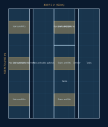
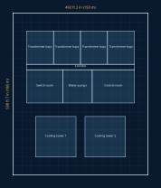
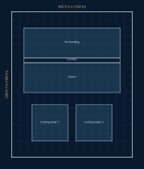

# P1-08 Bow Docks Utility Plant: plan

Footprint 492 ft 2 in (150 m) × 590 ft 7 in (180 m) · structural grid 65 ft 7 in (20 m)

## Levels

| Level | Floor above deck | Height | Floor area |
|---|---|---|---|
| Level B1 · Plant level | −19 ft 8 in (6,000 mm) | 19 ft 8 in (6,000 mm) | 267,376 sq ft (24,840 m²) |
| Level 1 · Ground floor | 0 ft (0 mm) | 26 ft 3 in (8,000 mm) | 222,813 sq ft (20,700 m²) |
| Level 2 · Upper floor | 26 ft 3 in (8,000 mm) | 26 ft 3 in (8,000 mm) | 267,376 sq ft (24,840 m²) |

## Elements

| ID | Designation | Type | Name | Level(s) | Size / length | Area | Status |
|---|---|---|---|---|---|---|---|
| L1-001 | D5F3P1B4A5L1R1 | zone | Corridor | L1 | 19 ft 8 in (6,000 mm) × 590 ft 7 in (180 m) | 11,625 sq ft (1,080 m²) | proposed |
| L1-002 | D5F3P1B4A5L1R2 | zone | Corridor | L1 | 19 ft 8 in (6,000 mm) × 590 ft 7 in (180 m) | 11,625 sq ft (1,080 m²) | proposed |
| L1-003 | D5F3P1B4A5L1R3 | room | Substation | L1 | 113 ft 2 in (34 m) × 65 ft 7 in (20 m) | 7,427 sq ft (690 m²) | proposed |
| L1-004 | D5F3P1B4A5L1R4 | room | Substation | L1 | 113 ft 2 in (34 m) × 131 ft 3 in (40 m) | 14,854 sq ft (1,380 m²) | proposed |
| L1-005 | D5F3P1B4A5L1R5 | room | Substation | L1 | 113 ft 2 in (34 m) × 131 ft 3 in (40 m) | 14,854 sq ft (1,380 m²) | proposed |
| L1-006 | D5F3P1B4A5L1R6 | room | Substation | L1 | 113 ft 2 in (34 m) × 65 ft 7 in (20 m) | 7,427 sq ft (690 m²) | proposed |
| L1-007 | D5F3P1B4A5L1R7 | room | Substation | L1 | 113 ft 2 in (34 m) × 131 ft 3 in (40 m) | 14,854 sq ft (1,380 m²) | proposed |
| L1-008 | D5F3P1B4A5L1R8 | room | Air handling | L1 | 113 ft 2 in (34 m) × 459 ft 4 in (140 m) | 51,990 sq ft (4,830 m²) | proposed |
| L1-009 | D5F3P1B4A5L1R9 | room | Water pumps and tanks | L1 | 113 ft 2 in (34 m) × 65 ft 7 in (20 m) | 7,427 sq ft (690 m²) | proposed |
| L1-010 | D5F3P1B4A5L1R10 | room | Water pumps and tanks | L1 | 113 ft 2 in (34 m) × 131 ft 3 in (40 m) | 14,854 sq ft (1,380 m²) | proposed |
| L1-011 | D5F3P1B4A5L1R11 | room | Water pumps and tanks | L1 | 113 ft 2 in (34 m) × 131 ft 3 in (40 m) | 14,854 sq ft (1,380 m²) | proposed |
| L1-012 | D5F3P1B4A5L1R12 | room | Water pumps and tanks | L1 | 113 ft 2 in (34 m) × 65 ft 7 in (20 m) | 7,427 sq ft (690 m²) | proposed |
| L1-013 | D5F3P1B4A5L1R13 | room | Water pumps and tanks | L1 | 113 ft 2 in (34 m) × 131 ft 3 in (40 m) | 14,854 sq ft (1,380 m²) | proposed |
| L1-014 | D5F3P1B4A5L1R14 | room | Control room | L1 | 113 ft 2 in (34 m) × 65 ft 7 in (20 m) | 7,427 sq ft (690 m²) | proposed |
| L1-015 | D5F3P1B4A5L1R15 | room | Workshop and stores | L1 | 113 ft 2 in (34 m) × 393 ft 8 in (120 m) | 44,563 sq ft (4,140 m²) | proposed |
| L1-016 | D5F3P1B4A5LB1R1, D5F3P1B4A5L1R16, D5F3P1B4A5L2R1 | core | Stairs and lifts | LB1, L1, L2 | 113 ft 2 in (34 m) × 65 ft 7 in (20 m) | 7,427 sq ft (690 m²) | proposed |
| L1-017 | D5F3P1B4A5LB1R2, D5F3P1B4A5L1R17, D5F3P1B4A5L2R2 | core | Stairs and lifts | LB1, L1, L2 | 113 ft 2 in (34 m) × 65 ft 7 in (20 m) | 7,427 sq ft (690 m²) | proposed |
| L1-018 | D5F3P1B4A5LB1R3, D5F3P1B4A5L1R18, D5F3P1B4A5L2R3 | core | Stairs and lifts | LB1, L1, L2 | 113 ft 2 in (34 m) × 65 ft 7 in (20 m) | 7,427 sq ft (690 m²) | proposed |
| L1-019 | D5F3P1B4A5LB1R4, D5F3P1B4A5L1R19, D5F3P1B4A5L2R4 | core | Stairs and lifts | LB1, L1, L2 | 113 ft 2 in (34 m) × 65 ft 7 in (20 m) | 7,427 sq ft (690 m²) | proposed |
| L1-020 | D5F3P1B4A5LB1R5, D5F3P1B4A5L1R20, D5F3P1B4A5L2R5 | core | Stairs and lifts | LB1, L1, L2 | 113 ft 2 in (34 m) × 65 ft 7 in (20 m) | 7,427 sq ft (690 m²) | proposed |
| L1-021 | D5F3P1B4A5LB1R6, D5F3P1B4A5L1R21, D5F3P1B4A5L2R6 | core | Stairs and lifts | LB1, L1, L2 | 113 ft 2 in (34 m) × 65 ft 7 in (20 m) | 7,427 sq ft (690 m²) | proposed |
| LT-001 | D5F3P1B4A5L2R7 | zone | Corridor | L2 | 19 ft 8 in (6,000 mm) × 590 ft 7 in (180 m) | 11,625 sq ft (1,080 m²) | proposed |
| LT-002 | D5F3P1B4A5L2R8 | zone | Corridor | L2 | 19 ft 8 in (6,000 mm) × 590 ft 7 in (180 m) | 11,625 sq ft (1,080 m²) | proposed |
| LT-003 | D5F3P1B4A5L2R9 | room | Air handling (around the core) | L2 | 113 ft 2 in (34 m) × 590 ft 7 in (180 m) | 66,844 sq ft (6,210 m²) | proposed |
| LT-004 | D5F3P1B4A5L2R10 | room | Air handling | L2 | 113 ft 2 in (34 m) × 590 ft 7 in (180 m) | 66,844 sq ft (6,210 m²) | proposed |
| LT-005 | D5F3P1B4A5L2R11 | room | Switch rooms (around the core) | L2 | 113 ft 2 in (34 m) × 590 ft 7 in (180 m) | 66,844 sq ft (6,210 m²) | proposed |
| LT-006 | D5F3P1B4A5L2R12 | room | Switch rooms | L2 | 113 ft 2 in (34 m) × 131 ft 3 in (40 m) | 14,854 sq ft (1,380 m²) | proposed |
| LT-007 | D5F3P1B4A5L2R13 | room | Offices | L2 | 113 ft 2 in (34 m) × 459 ft 4 in (140 m) | 51,990 sq ft (4,830 m²) | proposed |
| BB1-001 | D5F3P1B4A5LB1R7 | zone | Corridor | LB1 | 19 ft 8 in (6,000 mm) × 590 ft 7 in (180 m) | 11,625 sq ft (1,080 m²) | proposed |
| BB1-002 | D5F3P1B4A5LB1R8 | zone | Corridor | LB1 | 19 ft 8 in (6,000 mm) × 590 ft 7 in (180 m) | 11,625 sq ft (1,080 m²) | proposed |
| BB1-003 | D5F3P1B4A5LB1R9 | room | Pipe and cable galleries | LB1 | 113 ft 2 in (34 m) × 590 ft 7 in (180 m) | 66,844 sq ft (6,210 m²) | proposed |
| BB1-004 | D5F3P1B4A5LB1R10 | room | Pipe and cable galleries | LB1 | 113 ft 2 in (34 m) × 590 ft 7 in (180 m) | 66,844 sq ft (6,210 m²) | proposed |
| BB1-005 | D5F3P1B4A5LB1R11 | room | Pipe and cable galleries | LB1 | 113 ft 2 in (34 m) × 196 ft 10 in (60 m) | 22,281 sq ft (2,070 m²) | proposed |
| BB1-006 | D5F3P1B4A5LB1R12 | room | Tanks | LB1 | 113 ft 2 in (34 m) × 393 ft 8 in (120 m) | 44,563 sq ft (4,140 m²) | proposed |
| BB1-007 | D5F3P1B4A5LB1R13 | room | Tanks | LB1 | 113 ft 2 in (34 m) × 590 ft 7 in (180 m) | 66,844 sq ft (6,210 m²) | proposed |
| D-36 |  | door | Main entrance | L1 | 49 ft 3 in (15 m), 49 ft 3 in (15 m) wide | — | proposed |
| D-37 |  | door | Second entrance | L1 | 49 ft 3 in (15 m), 49 ft 3 in (15 m) wide | — | proposed |
| D-38 |  | door | Side door | L1 | 19 ft 8 in (6,000 mm), 19 ft 8 in (6,000 mm) wide | — | proposed |
| D-39 |  | door | Side door | L1 | 19 ft 8 in (6,000 mm), 19 ft 8 in (6,000 mm) wide | — | proposed |

## Drawings

### Level B1 · Plant level

### Level 1 · Ground floor

### Level 2 · Upper floor

