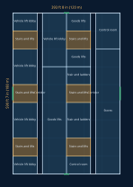

# P1-09 Bow Docks Service Shaft: plan

Footprint 393 ft 8 in (120 m) × 590 ft 7 in (180 m) · structural grid 32 ft 10 in (10 m)

## Levels

| Level | Floor above deck | Height | Floor area |
|---|---|---|---|
| Level B1 · Shaft head | −32 ft 10 in (10 m) | 32 ft 10 in (10 m) | 106,563 sq ft (9,900 m²) |
| Level 1 · Ground floor | 0 ft (0 mm) | 23 ft (7,000 mm) | 130,782 sq ft (12,150 m²) |
| Level 2 · Lift machine level | 23 ft (7,000 mm) | 19 ft 8 in (6,000 mm) | 106,563 sq ft (9,900 m²) |

## Elements

| ID | Designation | Type | Name | Level(s) | Size / length | Area | Status |
|---|---|---|---|---|---|---|---|
| E001 | D5F3P1B4A6L1R1 | zone | Corridor | L1 | 295 ft 3 in (90 m) × 9 ft 10 in (3,000 mm) | 2,906 sq ft (270 m²) | proposed |
| E002 | D5F3P1B4A6L1R2 | room | Shaft control room | L1 | 295 ft 3 in (90 m) × 41 ft (12 m) | 12,109 sq ft (1,125 m²) | proposed |
| E003 | D5F3P1B4A6L1R3 | room | Crew room | L1 | 295 ft 3 in (90 m) × 41 ft (12 m) | 12,109 sq ft (1,125 m²) | proposed |
| E004 | D5F3P1B4A6LB1R1, D5F3P1B4A6L1R4, D5F3P1B4A6L2R1 | room | Vehicle lift | LB1, L1, L2 | 295 ft 3 in (90 m) × 180 ft 5 in (55 m) | 53,281 sq ft (4,950 m²) | proposed |
| E005 | D5F3P1B4A6LB1R2, D5F3P1B4A6L1R5, D5F3P1B4A6L2R2 | room | Goods lift hall | LB1, L1, L2 | 295 ft 3 in (90 m) × 180 ft 5 in (55 m) | 53,281 sq ft (4,950 m²) | proposed |
| E006 | D5F3P1B4A6L1R6 | zone | Vehicle queue | L1 | 295 ft 3 in (90 m) × 85 ft 4 in (26 m) | 25,188 sq ft (2,340 m²) | proposed |

## Drawings

### Level B1 · Shaft head

### Level 1 · Ground floor

### Level 2 · Lift machine level

