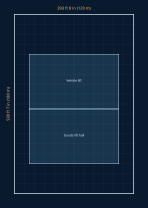
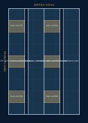

# P1-09 Bow Docks Service Shaft: plan

Footprint 393 ft 8 in (120 m) × 590 ft 7 in (180 m) · structural grid 65 ft 7 in (20 m)

## Levels

| Level | Floor above deck | Height | Floor area |
|---|---|---|---|
| Level B1 · Shaft head (down to the service layer) | −26 ft 3 in (8,000 mm) | 26 ft 3 in (8,000 mm) | 209,250 sq ft (19,440 m²) |
| Level 1 · Ground floor | 0 ft (0 mm) | 19 ft 8 in (6,000 mm) | 174,375 sq ft (16,200 m²) |
| Level 2 · Upper floor | 19 ft 8 in (6,000 mm) | 19 ft 8 in (6,000 mm) | 209,250 sq ft (19,440 m²) |

## Elements

| ID | Designation | Type | Name | Level(s) | Size / length | Area | Status |
|---|---|---|---|---|---|---|---|
| L1-001 | D5F3P1B4A6L1R1 | zone | Corridor | L1 | 19 ft 8 in (6,000 mm) × 590 ft 7 in (180 m) | 11,625 sq ft (1,080 m²) | proposed |
| L1-002 | D5F3P1B4A6L1R2 | zone | Corridor | L1 | 19 ft 8 in (6,000 mm) × 590 ft 7 in (180 m) | 11,625 sq ft (1,080 m²) | proposed |
| L1-003 | D5F3P1B4A6L1R3 | room | Vehicle lift lobby | L1 | 88 ft 7 in (27 m) × 65 ft 7 in (20 m) | 5,813 sq ft (540 m²) | proposed |
| L1-004 | D5F3P1B4A6L1R4 | room | Vehicle lift lobby | L1 | 88 ft 7 in (27 m) × 131 ft 3 in (40 m) | 11,625 sq ft (1,080 m²) | proposed |
| L1-005 | D5F3P1B4A6L1R5 | room | Vehicle lift lobby | L1 | 88 ft 7 in (27 m) × 131 ft 3 in (40 m) | 11,625 sq ft (1,080 m²) | proposed |
| L1-006 | D5F3P1B4A6L1R6 | room | Vehicle lift lobby | L1 | 88 ft 7 in (27 m) × 65 ft 7 in (20 m) | 5,813 sq ft (540 m²) | proposed |
| L1-007 | D5F3P1B4A6L1R7 | room | Vehicle lift lobby | L1 | 88 ft 7 in (27 m) × 196 ft 10 in (60 m) | 17,438 sq ft (1,620 m²) | proposed |
| L1-008 | D5F3P1B4A6L1R8 | room | Goods lifts | L1 | 88 ft 7 in (27 m) × 393 ft 8 in (120 m) | 34,875 sq ft (3,240 m²) | proposed |
| L1-009 | D5F3P1B4A6L1R9 | room | Goods lifts | L1 | 88 ft 7 in (27 m) × 65 ft 7 in (20 m) | 5,813 sq ft (540 m²) | proposed |
| L1-010 | D5F3P1B4A6L1R10 | room | Goods lifts | L1 | 88 ft 7 in (27 m) × 65 ft 7 in (20 m) | 5,813 sq ft (540 m²) | proposed |
| L1-011 | D5F3P1B4A6L1R11 | room | Stair and ladders | L1 | 88 ft 7 in (27 m) × 65 ft 7 in (20 m) | 5,813 sq ft (540 m²) | proposed |
| L1-012 | D5F3P1B4A6L1R12 | room | Stair and ladders | L1 | 88 ft 7 in (27 m) × 131 ft 3 in (40 m) | 11,625 sq ft (1,080 m²) | proposed |
| L1-013 | D5F3P1B4A6L1R13 | room | Control room | L1 | 88 ft 7 in (27 m) × 65 ft 7 in (20 m) | 5,813 sq ft (540 m²) | proposed |
| L1-014 | D5F3P1B4A6L1R14 | room | Control room | L1 | 88 ft 7 in (27 m) × 131 ft 3 in (40 m) | 11,625 sq ft (1,080 m²) | proposed |
| L1-015 | D5F3P1B4A6L1R15 | room | Stores | L1 | 88 ft 7 in (27 m) × 459 ft 4 in (140 m) | 40,688 sq ft (3,780 m²) | proposed |
| L1-016 | D5F3P1B4A6LB1R1, D5F3P1B4A6L1R16, D5F3P1B4A6L2R1 | core | Stairs and lifts | LB1, L1, L2 | 88 ft 7 in (27 m) × 65 ft 7 in (20 m) | 5,813 sq ft (540 m²) | proposed |
| L1-017 | D5F3P1B4A6LB1R2, D5F3P1B4A6L1R17, D5F3P1B4A6L2R2 | core | Stairs and lifts | LB1, L1, L2 | 88 ft 7 in (27 m) × 65 ft 7 in (20 m) | 5,813 sq ft (540 m²) | proposed |
| L1-018 | D5F3P1B4A6LB1R3, D5F3P1B4A6L1R18, D5F3P1B4A6L2R3 | core | Stairs and lifts | LB1, L1, L2 | 88 ft 7 in (27 m) × 65 ft 7 in (20 m) | 5,813 sq ft (540 m²) | proposed |
| L1-019 | D5F3P1B4A6LB1R4, D5F3P1B4A6L1R19, D5F3P1B4A6L2R4 | core | Stairs and lifts | LB1, L1, L2 | 88 ft 7 in (27 m) × 65 ft 7 in (20 m) | 5,813 sq ft (540 m²) | proposed |
| L1-020 | D5F3P1B4A6LB1R5, D5F3P1B4A6L1R20, D5F3P1B4A6L2R5 | core | Stairs and lifts | LB1, L1, L2 | 88 ft 7 in (27 m) × 65 ft 7 in (20 m) | 5,813 sq ft (540 m²) | proposed |
| L1-021 | D5F3P1B4A6LB1R6, D5F3P1B4A6L1R21, D5F3P1B4A6L2R6 | core | Stairs and lifts | LB1, L1, L2 | 88 ft 7 in (27 m) × 65 ft 7 in (20 m) | 5,813 sq ft (540 m²) | proposed |
| LT-001 | D5F3P1B4A6L2R7 | zone | Corridor | L2 | 19 ft 8 in (6,000 mm) × 590 ft 7 in (180 m) | 11,625 sq ft (1,080 m²) | proposed |
| LT-002 | D5F3P1B4A6L2R8 | zone | Corridor | L2 | 19 ft 8 in (6,000 mm) × 590 ft 7 in (180 m) | 11,625 sq ft (1,080 m²) | proposed |
| LT-003 | D5F3P1B4A6L2R9 | room | Lift machine rooms (around the core) | L2 | 88 ft 7 in (27 m) × 590 ft 7 in (180 m) | 52,313 sq ft (4,860 m²) | proposed |
| LT-004 | D5F3P1B4A6L2R10 | room | Lift machine rooms | L2 | 88 ft 7 in (27 m) × 590 ft 7 in (180 m) | 52,313 sq ft (4,860 m²) | proposed |
| LT-005 | D5F3P1B4A6L2R11 | room | Ventilation plant (around the core) | L2 | 88 ft 7 in (27 m) × 590 ft 7 in (180 m) | 52,313 sq ft (4,860 m²) | proposed |
| LT-006 | D5F3P1B4A6L2R12 | room | Ventilation plant | L2 | 88 ft 7 in (27 m) × 590 ft 7 in (180 m) | 52,313 sq ft (4,860 m²) | proposed |
| BB1-001 | D5F3P1B4A6LB1R7 | zone | Corridor | LB1 | 19 ft 8 in (6,000 mm) × 590 ft 7 in (180 m) | 11,625 sq ft (1,080 m²) | proposed |
| BB1-002 | D5F3P1B4A6LB1R8 | zone | Corridor | LB1 | 19 ft 8 in (6,000 mm) × 590 ft 7 in (180 m) | 11,625 sq ft (1,080 m²) | proposed |
| BB1-003 | D5F3P1B4A6LB1R9 | room | Shaft opening | LB1 | 88 ft 7 in (27 m) × 590 ft 7 in (180 m) | 52,313 sq ft (4,860 m²) | proposed |
| BB1-004 | D5F3P1B4A6LB1R10 | room | Shaft opening | LB1 | 88 ft 7 in (27 m) × 590 ft 7 in (180 m) | 52,313 sq ft (4,860 m²) | proposed |
| BB1-005 | D5F3P1B4A6LB1R11 | room | Shaft opening | LB1 | 88 ft 7 in (27 m) × 196 ft 10 in (60 m) | 17,438 sq ft (1,620 m²) | proposed |
| BB1-006 | D5F3P1B4A6LB1R12 | room | Lift pits | LB1 | 88 ft 7 in (27 m) × 393 ft 8 in (120 m) | 34,875 sq ft (3,240 m²) | proposed |
| BB1-007 | D5F3P1B4A6LB1R13 | room | Lift pits | LB1 | 88 ft 7 in (27 m) × 590 ft 7 in (180 m) | 52,313 sq ft (4,860 m²) | proposed |
| D-35 |  | door | Main entrance | L1 | 49 ft 3 in (15 m), 49 ft 3 in (15 m) wide | — | proposed |
| D-36 |  | door | Second entrance | L1 | 49 ft 3 in (15 m), 49 ft 3 in (15 m) wide | — | proposed |
| D-37 |  | door | Side door | L1 | 19 ft 8 in (6,000 mm), 19 ft 8 in (6,000 mm) wide | — | proposed |
| D-38 |  | door | Side door | L1 | 19 ft 8 in (6,000 mm), 19 ft 8 in (6,000 mm) wide | — | proposed |

## Drawings

### Level B1 · Shaft head (down to the service layer)

### Level 1 · Ground floor

### Level 2 · Upper floor

