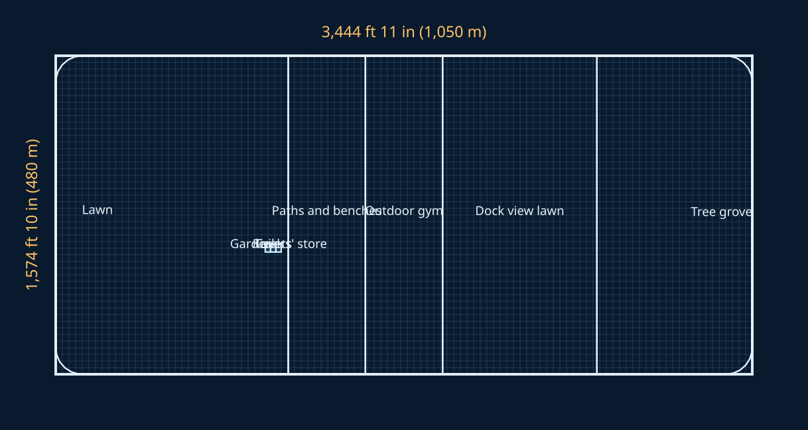

# P1-10 Marina Park: plan

Footprint 3,444 ft 11 in (1,050 m) × 1,574 ft 10 in (480 m) · structural grid 32 ft 10 in (10 m)

## Levels

| Level | Floor above deck | Height | Floor area |
|---|---|---|---|
| Level 1 · Ground | 0 ft (0 mm) | 13 ft 1 in (4,000 mm) | 3,100 sq ft (288 m²) |

## Elements

| ID | Designation | Type | Name | Level(s) | Size / length | Area | Status |
|---|---|---|---|---|---|---|---|
| E001 | D5F3P1B2A1R1 | zone | Lawn | L1 | 1,149 ft 11 in (350 m) × 1,573 ft 10 in (480 m) | 1,800,992 sq ft (167,318 m²) | proposed |
| E002 | D5F3P1B2A1R2 | room | Kiosk | L1 | 26 ft 3 in (8,000 mm) × 39 ft 4 in (12 m) | 1,033 sq ft (96 m²) | proposed |
| E003 | D5F3P1B2A1R3 | room | Toilets | L1 | 26 ft 3 in (8,000 mm) × 39 ft 4 in (12 m) | 1,033 sq ft (96 m²) | proposed |
| E004 | D5F3P1B2A1R4 | room | Gardeners' store | L1 | 26 ft 3 in (8,000 mm) × 39 ft 4 in (12 m) | 1,033 sq ft (96 m²) | proposed |
| E005 | D5F3P1B2A1R5 | zone | Paths and benches | L1 | 381 ft 7 in (116 m) × 1,573 ft 10 in (480 m) | 600,384 sq ft (55,777 m²) | proposed |
| E006 | D5F3P1B2A1R6 | zone | Outdoor gym | L1 | 381 ft 11 in (116 m) × 1,573 ft 6 in (480 m) | 600,900 sq ft (55,825 m²) | proposed |
| E007 | D5F3P1B2A1R7 | zone | Dock view lawn | L1 | 763 ft 1 in (233 m) × 1,573 ft 10 in (480 m) | 1,200,768 sq ft (111,555 m²) | proposed |
| E008 | D5F3P1B2A1R8 | zone | Tree grove | L1 | 768 ft 4 in (234 m) × 1,573 ft 10 in (480 m) | 1,200,608 sq ft (111,540 m²) | proposed |

## Drawings

### Level 1 · Ground

