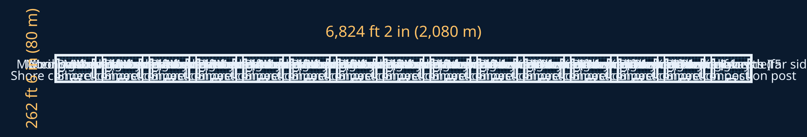

# P1-11 Medium Berths: plan

Footprint 6,824 ft 2 in (2,080 m) × 262 ft 6 in (80 m) · structural grid 32 ft 10 in (10 m)

## Levels

| Level | Floor above deck | Height | Floor area |
|---|---|---|---|
| Level 1 · Berth floor | 0 ft (0 mm) | 13 ft 1 in (4,000 mm) | — |

## Elements

| ID | Designation | Type | Name | Level(s) | Size / length | Area | Status |
|---|---|---|---|---|---|---|---|
| E001 | D5F3P1B1A1R1 | zone | Medium berth 1 | L1 | 393 ft 8 in (120 m) × 262 ft 6 in (80 m) | 103,334 sq ft (9,600 m²) | proposed |
| E002 |  | fixture | Mooring arms | L1 | 23 ft 7 in (7,200 mm) × 183 ft 9 in (56 m) | 4,340 sq ft (403 m²) | proposed |
| E003 |  | fixture | Mooring arms (far side) | L1 | 23 ft 7 in (7,200 mm) × 183 ft 9 in (56 m) | 4,340 sq ft (403 m²) | proposed |
| E004 |  | fixture | Shore connection post | L1 | 78 ft 9 in (24 m) × 26 ft 3 in (8,000 mm) | 2,067 sq ft (192 m²) | proposed |
| E005 | D5F3P1B1A1R2 | zone | Berth walkway | L1 | 65 ft 7 in (20 m) × 262 ft 6 in (80 m) | 17,222 sq ft (1,600 m²) | proposed |
| E006 | D5F3P1B1A1R3 | zone | Medium berth 2 | L1 | 393 ft 8 in (120 m) × 262 ft 6 in (80 m) | 103,334 sq ft (9,600 m²) | proposed |
| E007 |  | fixture | Mooring arms | L1 | 23 ft 7 in (7,200 mm) × 183 ft 9 in (56 m) | 4,340 sq ft (403 m²) | proposed |
| E008 |  | fixture | Mooring arms (far side) | L1 | 23 ft 7 in (7,200 mm) × 183 ft 9 in (56 m) | 4,340 sq ft (403 m²) | proposed |
| E009 |  | fixture | Shore connection post | L1 | 78 ft 9 in (24 m) × 26 ft 3 in (8,000 mm) | 2,067 sq ft (192 m²) | proposed |
| E010 | D5F3P1B1A1R4 | zone | Berth walkway | L1 | 65 ft 7 in (20 m) × 262 ft 6 in (80 m) | 17,222 sq ft (1,600 m²) | proposed |
| E011 | D5F3P1B1A1R5 | zone | Medium berth 3 | L1 | 393 ft 8 in (120 m) × 262 ft 6 in (80 m) | 103,334 sq ft (9,600 m²) | proposed |
| E012 |  | fixture | Mooring arms | L1 | 23 ft 7 in (7,200 mm) × 183 ft 9 in (56 m) | 4,340 sq ft (403 m²) | proposed |
| E013 |  | fixture | Mooring arms (far side) | L1 | 23 ft 7 in (7,200 mm) × 183 ft 9 in (56 m) | 4,340 sq ft (403 m²) | proposed |
| E014 |  | fixture | Shore connection post | L1 | 78 ft 9 in (24 m) × 26 ft 3 in (8,000 mm) | 2,067 sq ft (192 m²) | proposed |
| E015 | D5F3P1B1A1R6 | zone | Berth walkway | L1 | 65 ft 7 in (20 m) × 262 ft 6 in (80 m) | 17,222 sq ft (1,600 m²) | proposed |
| E016 | D5F3P1B1A1R7 | zone | Medium berth 4 | L1 | 393 ft 8 in (120 m) × 262 ft 6 in (80 m) | 103,334 sq ft (9,600 m²) | proposed |
| E017 |  | fixture | Mooring arms | L1 | 23 ft 7 in (7,200 mm) × 183 ft 9 in (56 m) | 4,340 sq ft (403 m²) | proposed |
| E018 |  | fixture | Mooring arms (far side) | L1 | 23 ft 7 in (7,200 mm) × 183 ft 9 in (56 m) | 4,340 sq ft (403 m²) | proposed |
| E019 |  | fixture | Shore connection post | L1 | 78 ft 9 in (24 m) × 26 ft 3 in (8,000 mm) | 2,067 sq ft (192 m²) | proposed |
| E020 | D5F3P1B1A1R8 | zone | Berth walkway | L1 | 65 ft 7 in (20 m) × 262 ft 6 in (80 m) | 17,222 sq ft (1,600 m²) | proposed |
| E021 | D5F3P1B1A1R9 | zone | Medium berth 5 | L1 | 393 ft 8 in (120 m) × 262 ft 6 in (80 m) | 103,334 sq ft (9,600 m²) | proposed |
| E022 |  | fixture | Mooring arms | L1 | 23 ft 7 in (7,200 mm) × 183 ft 9 in (56 m) | 4,340 sq ft (403 m²) | proposed |
| E023 |  | fixture | Mooring arms (far side) | L1 | 23 ft 7 in (7,200 mm) × 183 ft 9 in (56 m) | 4,340 sq ft (403 m²) | proposed |
| E024 |  | fixture | Shore connection post | L1 | 78 ft 9 in (24 m) × 26 ft 3 in (8,000 mm) | 2,067 sq ft (192 m²) | proposed |
| E025 | D5F3P1B1A1R10 | zone | Berth walkway | L1 | 65 ft 7 in (20 m) × 262 ft 6 in (80 m) | 17,222 sq ft (1,600 m²) | proposed |
| E026 | D5F3P1B1A1R11 | zone | Medium berth 6 | L1 | 393 ft 8 in (120 m) × 262 ft 6 in (80 m) | 103,334 sq ft (9,600 m²) | proposed |
| E027 |  | fixture | Mooring arms | L1 | 23 ft 7 in (7,200 mm) × 183 ft 9 in (56 m) | 4,340 sq ft (403 m²) | proposed |
| E028 |  | fixture | Mooring arms (far side) | L1 | 23 ft 7 in (7,200 mm) × 183 ft 9 in (56 m) | 4,340 sq ft (403 m²) | proposed |
| E029 |  | fixture | Shore connection post | L1 | 78 ft 9 in (24 m) × 26 ft 3 in (8,000 mm) | 2,067 sq ft (192 m²) | proposed |
| E030 | D5F3P1B1A1R12 | zone | Berth walkway | L1 | 65 ft 7 in (20 m) × 262 ft 6 in (80 m) | 17,222 sq ft (1,600 m²) | proposed |
| E031 | D5F3P1B1A1R13 | zone | Medium berth 7 | L1 | 393 ft 8 in (120 m) × 262 ft 6 in (80 m) | 103,334 sq ft (9,600 m²) | proposed |
| E032 |  | fixture | Mooring arms | L1 | 23 ft 7 in (7,200 mm) × 183 ft 9 in (56 m) | 4,340 sq ft (403 m²) | proposed |
| E033 |  | fixture | Mooring arms (far side) | L1 | 23 ft 7 in (7,200 mm) × 183 ft 9 in (56 m) | 4,340 sq ft (403 m²) | proposed |
| E034 |  | fixture | Shore connection post | L1 | 78 ft 9 in (24 m) × 26 ft 3 in (8,000 mm) | 2,067 sq ft (192 m²) | proposed |
| E035 | D5F3P1B1A1R14 | zone | Berth walkway | L1 | 65 ft 7 in (20 m) × 262 ft 6 in (80 m) | 17,222 sq ft (1,600 m²) | proposed |
| E036 | D5F3P1B1A1R15 | zone | Medium berth 8 | L1 | 393 ft 8 in (120 m) × 262 ft 6 in (80 m) | 103,334 sq ft (9,600 m²) | proposed |
| E037 |  | fixture | Mooring arms | L1 | 23 ft 7 in (7,200 mm) × 183 ft 9 in (56 m) | 4,340 sq ft (403 m²) | proposed |
| E038 |  | fixture | Mooring arms (far side) | L1 | 23 ft 7 in (7,200 mm) × 183 ft 9 in (56 m) | 4,340 sq ft (403 m²) | proposed |
| E039 |  | fixture | Shore connection post | L1 | 78 ft 9 in (24 m) × 26 ft 3 in (8,000 mm) | 2,067 sq ft (192 m²) | proposed |
| E040 | D5F3P1B1A1R16 | zone | Berth walkway | L1 | 65 ft 7 in (20 m) × 262 ft 6 in (80 m) | 17,222 sq ft (1,600 m²) | proposed |
| E041 | D5F3P1B1A1R17 | zone | Medium berth 9 | L1 | 393 ft 8 in (120 m) × 262 ft 6 in (80 m) | 103,334 sq ft (9,600 m²) | proposed |
| E042 |  | fixture | Mooring arms | L1 | 23 ft 7 in (7,200 mm) × 183 ft 9 in (56 m) | 4,340 sq ft (403 m²) | proposed |
| E043 |  | fixture | Mooring arms (far side) | L1 | 23 ft 7 in (7,200 mm) × 183 ft 9 in (56 m) | 4,340 sq ft (403 m²) | proposed |
| E044 |  | fixture | Shore connection post | L1 | 78 ft 9 in (24 m) × 26 ft 3 in (8,000 mm) | 2,067 sq ft (192 m²) | proposed |
| E045 | D5F3P1B1A1R18 | zone | Berth walkway | L1 | 65 ft 7 in (20 m) × 262 ft 6 in (80 m) | 17,222 sq ft (1,600 m²) | proposed |
| E046 | D5F3P1B1A1R19 | zone | Medium berth 10 | L1 | 393 ft 8 in (120 m) × 262 ft 6 in (80 m) | 103,334 sq ft (9,600 m²) | proposed |
| E047 |  | fixture | Mooring arms | L1 | 23 ft 7 in (7,200 mm) × 183 ft 9 in (56 m) | 4,340 sq ft (403 m²) | proposed |
| E048 |  | fixture | Mooring arms (far side) | L1 | 23 ft 7 in (7,200 mm) × 183 ft 9 in (56 m) | 4,340 sq ft (403 m²) | proposed |
| E049 |  | fixture | Shore connection post | L1 | 78 ft 9 in (24 m) × 26 ft 3 in (8,000 mm) | 2,067 sq ft (192 m²) | proposed |
| E050 | D5F3P1B1A1R20 | zone | Berth walkway | L1 | 65 ft 7 in (20 m) × 262 ft 6 in (80 m) | 17,222 sq ft (1,600 m²) | proposed |
| E051 | D5F3P1B1A1R21 | zone | Medium berth 11 | L1 | 393 ft 8 in (120 m) × 262 ft 6 in (80 m) | 103,334 sq ft (9,600 m²) | proposed |
| E052 |  | fixture | Mooring arms | L1 | 23 ft 7 in (7,200 mm) × 183 ft 9 in (56 m) | 4,340 sq ft (403 m²) | proposed |
| E053 |  | fixture | Mooring arms (far side) | L1 | 23 ft 7 in (7,200 mm) × 183 ft 9 in (56 m) | 4,340 sq ft (403 m²) | proposed |
| E054 |  | fixture | Shore connection post | L1 | 78 ft 9 in (24 m) × 26 ft 3 in (8,000 mm) | 2,067 sq ft (192 m²) | proposed |
| E055 | D5F3P1B1A1R22 | zone | Berth walkway | L1 | 65 ft 7 in (20 m) × 262 ft 6 in (80 m) | 17,222 sq ft (1,600 m²) | proposed |
| E056 | D5F3P1B1A1R23 | zone | Medium berth 12 | L1 | 393 ft 8 in (120 m) × 262 ft 6 in (80 m) | 103,334 sq ft (9,600 m²) | proposed |
| E057 |  | fixture | Mooring arms | L1 | 23 ft 7 in (7,200 mm) × 183 ft 9 in (56 m) | 4,340 sq ft (403 m²) | proposed |
| E058 |  | fixture | Mooring arms (far side) | L1 | 23 ft 7 in (7,200 mm) × 183 ft 9 in (56 m) | 4,340 sq ft (403 m²) | proposed |
| E059 |  | fixture | Shore connection post | L1 | 78 ft 9 in (24 m) × 26 ft 3 in (8,000 mm) | 2,067 sq ft (192 m²) | proposed |
| E060 | D5F3P1B1A1R24 | zone | Berth walkway | L1 | 65 ft 7 in (20 m) × 262 ft 6 in (80 m) | 17,222 sq ft (1,600 m²) | proposed |
| E061 | D5F3P1B1A1R25 | zone | Medium berth 13 | L1 | 393 ft 8 in (120 m) × 262 ft 6 in (80 m) | 103,334 sq ft (9,600 m²) | proposed |
| E062 |  | fixture | Mooring arms | L1 | 23 ft 7 in (7,200 mm) × 183 ft 9 in (56 m) | 4,340 sq ft (403 m²) | proposed |
| E063 |  | fixture | Mooring arms (far side) | L1 | 23 ft 7 in (7,200 mm) × 183 ft 9 in (56 m) | 4,340 sq ft (403 m²) | proposed |
| E064 |  | fixture | Shore connection post | L1 | 78 ft 9 in (24 m) × 26 ft 3 in (8,000 mm) | 2,067 sq ft (192 m²) | proposed |
| E065 | D5F3P1B1A1R26 | zone | Berth walkway | L1 | 65 ft 7 in (20 m) × 262 ft 6 in (80 m) | 17,222 sq ft (1,600 m²) | proposed |
| E066 | D5F3P1B1A1R27 | zone | Medium berth 14 | L1 | 393 ft 8 in (120 m) × 262 ft 6 in (80 m) | 103,334 sq ft (9,600 m²) | proposed |
| E067 |  | fixture | Mooring arms | L1 | 23 ft 7 in (7,200 mm) × 183 ft 9 in (56 m) | 4,340 sq ft (403 m²) | proposed |
| E068 |  | fixture | Mooring arms (far side) | L1 | 23 ft 7 in (7,200 mm) × 183 ft 9 in (56 m) | 4,340 sq ft (403 m²) | proposed |
| E069 |  | fixture | Shore connection post | L1 | 78 ft 9 in (24 m) × 26 ft 3 in (8,000 mm) | 2,067 sq ft (192 m²) | proposed |
| E070 | D5F3P1B1A1R28 | zone | Berth walkway | L1 | 65 ft 7 in (20 m) × 262 ft 6 in (80 m) | 17,222 sq ft (1,600 m²) | proposed |
| E071 | D5F3P1B1A1R29 | zone | Medium berth 15 | L1 | 393 ft 8 in (120 m) × 262 ft 6 in (80 m) | 103,334 sq ft (9,600 m²) | proposed |
| E072 |  | fixture | Mooring arms | L1 | 23 ft 7 in (7,200 mm) × 183 ft 9 in (56 m) | 4,340 sq ft (403 m²) | proposed |
| E073 |  | fixture | Mooring arms (far side) | L1 | 23 ft 7 in (7,200 mm) × 183 ft 9 in (56 m) | 4,340 sq ft (403 m²) | proposed |
| E074 |  | fixture | Shore connection post | L1 | 78 ft 9 in (24 m) × 26 ft 3 in (8,000 mm) | 2,067 sq ft (192 m²) | proposed |

## Drawings

### Level 1 · Berth floor

