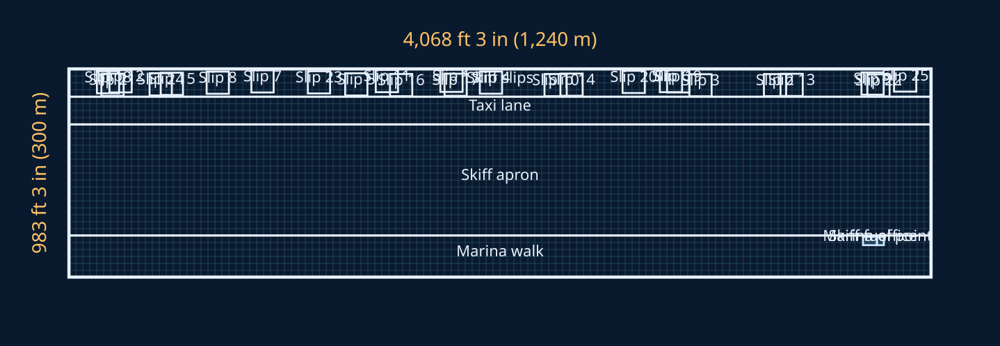

# P1-12 Skiff Marina: plan

Footprint 4,068 ft 3 in (1,240 m) × 983 ft 3 in (300 m) · structural grid 32 ft 10 in (10 m)

## Levels

| Level | Floor above deck | Height | Floor area |
|---|---|---|---|
| Level 1 · Marina floor | 0 ft (0 mm) | 13 ft 1 in (4,000 mm) | 3,875 sq ft (360 m²) |

## Elements

| ID | Designation | Type | Name | Level(s) | Size / length | Area | Status |
|---|---|---|---|---|---|---|---|
| E001 | D5F3P1B1A2R1 | zone | Skiff slips | L1 | 4,068 ft 3 in (1,240 m) × 131 ft 3 in (40 m) | 533,890 sq ft (49,600 m²) | proposed |
| E002 |  | fixture | Slip 1 | L1 | 105 ft (32 m) × 105 ft (32 m) | 11,022 sq ft (1,024 m²) | proposed |
| E003 |  | fixture | Slip 2 | L1 | 105 ft (32 m) × 104 ft 8 in (32 m) | 10,988 sq ft (1,021 m²) | proposed |
| E004 |  | fixture | Slip 3 | L1 | 105 ft (32 m) × 104 ft 8 in (32 m) | 10,988 sq ft (1,021 m²) | proposed |
| E005 |  | fixture | Slip 4 | L1 | 105 ft (32 m) × 105 ft (32 m) | 11,022 sq ft (1,024 m²) | proposed |
| E006 |  | fixture | Slip 5 | L1 | 105 ft (32 m) × 105 ft (32 m) | 11,022 sq ft (1,024 m²) | proposed |
| E007 |  | fixture | Slip 6 | L1 | 105 ft (32 m) × 105 ft (32 m) | 11,022 sq ft (1,024 m²) | proposed |
| E008 |  | fixture | Slip 7 | L1 | 105 ft (32 m) × 104 ft 8 in (32 m) | 10,988 sq ft (1,021 m²) | proposed |
| E009 |  | fixture | Slip 8 | L1 | 105 ft (32 m) × 104 ft 8 in (32 m) | 10,988 sq ft (1,021 m²) | proposed |
| E010 |  | fixture | Slip 9 | L1 | 105 ft (32 m) × 105 ft (32 m) | 11,022 sq ft (1,024 m²) | proposed |
| E011 |  | fixture | Slip 10 | L1 | 105 ft (32 m) × 105 ft (32 m) | 11,022 sq ft (1,024 m²) | proposed |
| E012 |  | fixture | Slip 11 | L1 | 105 ft (32 m) × 105 ft (32 m) | 11,022 sq ft (1,024 m²) | proposed |
| E013 |  | fixture | Slip 12 | L1 | 105 ft (32 m) × 105 ft (32 m) | 11,022 sq ft (1,024 m²) | proposed |
| E014 |  | fixture | Slip 13 | L1 | 105 ft (32 m) × 105 ft (32 m) | 11,022 sq ft (1,024 m²) | proposed |
| E015 |  | fixture | Slip 14 | L1 | 105 ft (32 m) × 105 ft (32 m) | 11,022 sq ft (1,024 m²) | proposed |
| E016 |  | fixture | Slip 15 | L1 | 105 ft (32 m) × 105 ft (32 m) | 11,022 sq ft (1,024 m²) | proposed |
| E017 |  | fixture | Slip 16 | L1 | 105 ft (32 m) × 105 ft (32 m) | 11,022 sq ft (1,024 m²) | proposed |
| E018 |  | fixture | Slip 17 | L1 | 105 ft (32 m) × 104 ft 8 in (32 m) | 10,988 sq ft (1,021 m²) | proposed |
| E019 |  | fixture | Slip 18 | L1 | 105 ft (32 m) × 104 ft 8 in (32 m) | 10,988 sq ft (1,021 m²) | proposed |
| E020 |  | fixture | Slip 19 | L1 | 105 ft (32 m) × 104 ft 8 in (32 m) | 10,988 sq ft (1,021 m²) | proposed |
| E021 |  | fixture | Slip 20 | L1 | 105 ft (32 m) × 105 ft (32 m) | 11,022 sq ft (1,024 m²) | proposed |
| E022 |  | fixture | Slip 21 | L1 | 105 ft (32 m) × 105 ft (32 m) | 11,022 sq ft (1,024 m²) | proposed |
| E023 |  | fixture | Slip 22 | L1 | 105 ft (32 m) × 104 ft 8 in (32 m) | 10,988 sq ft (1,021 m²) | proposed |
| E024 |  | fixture | Slip 23 | L1 | 105 ft (32 m) × 105 ft (32 m) | 11,022 sq ft (1,024 m²) | proposed |
| E025 |  | fixture | Slip 24 | L1 | 105 ft (32 m) × 105 ft (32 m) | 11,022 sq ft (1,024 m²) | proposed |
| E026 |  | fixture | Slip 25 | L1 | 105 ft (32 m) × 104 ft 8 in (32 m) | 10,988 sq ft (1,021 m²) | proposed |
| E027 | D5F3P1B1A2R2 | zone | Taxi lane | L1 | 4,068 ft 3 in (1,240 m) × 130 ft 11 in (40 m) | 532,555 sq ft (49,476 m²) | proposed |
| E028 | D5F3P1B1A2R3 | zone | Skiff apron | L1 | 4,068 ft 3 in (1,240 m) × 524 ft 7 in (160 m) | 2,134,225 sq ft (198,276 m²) | proposed |
| E029 | D5F3P1B1A2R4 | zone | Marina walk | L1 | 4,068 ft 3 in (1,240 m) × 196 ft 6 in (60 m) | 799,500 sq ft (74,276 m²) | proposed |
| E030 | D5F3P1B1A2R5 | room | Marina office | L1 | 65 ft 7 in (20 m) × 39 ft 4 in (12 m) | 2,583 sq ft (240 m²) | proposed |
| E031 | D5F3P1B1A2R6 | room | Skiff fuel point | L1 | 32 ft 10 in (10 m) × 39 ft 4 in (12 m) | 1,292 sq ft (120 m²) | proposed |

## Drawings

### Level 1 · Marina floor

