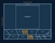
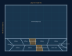

# P2-02 Arrival hangar: plan

Footprint 262 ft 6 in (80 m) × 196 ft 10 in (60 m) · structural grid 32 ft 10 in (10 m)

## Levels

| Level | Floor above deck | Height | Floor area |
|---|---|---|---|
| Level 1 · Hangar floor | 0 ft (0 mm) | 16 ft 5 in (5,000 mm) | 49,800 sq ft (4,627 m²) |
| Level 2 · Upper floor 1 | 16 ft 5 in (5,000 mm) | 16 ft 5 in (5,000 mm) | 49,800 sq ft (4,627 m²) |
| Level 3 · Upper floor 2 | 32 ft 10 in (10 m) | 16 ft 5 in (5,000 mm) | 49,800 sq ft (4,627 m²) |

## Elements

| ID | Designation | Type | Name | Level(s) | Size / length | Area | Status |
|---|---|---|---|---|---|---|---|
| E001 | D5F3P2B1A2L1R1, D5F3P2B1A2L2R1, D5F3P2B1A2L3R1 | room | Arrival hangar bay | L1, L2, L3 | 262 ft 6 in (80 m) × 144 ft 4 in (44 m) | 37,889 sq ft (3,520 m²) | proposed |
| E002 |  | fixture | Shuttle pad | L1 | 131 ft 3 in (40 m) × 129 ft 11 in (40 m) | 17,050 sq ft (1,584 m²) | proposed |
| E003 |  | fixture | Dock door | L1 | 131 ft 3 in (40 m) × 7 ft 3 in (2,200 mm) | 947 sq ft (88 m²) | proposed |
| E004 | D5F3P2B1A2L1R2, D5F3P2B1A2L2R2, D5F3P2B1A2L3R2 | core | Stairs and lifts | L1, L2, L3 | 29 ft 2 in (8,900 mm) × 24 ft 11 in (7,600 mm) | 654 sq ft (61 m²) | proposed |
| E005 | D5F3P2B1A2L1R3, D5F3P2B1A2L2R3, D5F3P2B1A2L3R3 | core | Stairs and lifts | L1, L2, L3 | 29 ft 2 in (8,900 mm) × 24 ft 11 in (7,600 mm) | 654 sq ft (61 m²) | proposed |
| E006 | D5F3P2B1A2L1R4 | room | Unloading office | L1 | 24 ft 11 in (7,600 mm) × 32 ft 10 in (10 m) | 429 sq ft (40 m²) | proposed |
| E007 | D5F3P2B1A2L1R5 | room | Baggage transfer room | L1 | 46 ft 7 in (14 m) × 25 ft 11 in (7,900 mm) | 863 sq ft (80 m²) | proposed |
| E008 | D5F3P2B1A2L1R6 | room | Ground crew room | L1 | 43 ft (13 m) × 24 ft 11 in (7,600 mm) | 646 sq ft (60 m²) | proposed |
| E009 | D5F3P2B1A2L1R7 | room | Tool room | L1 | 29 ft 10 in (9,100 mm) × 24 ft 11 in (7,600 mm) | 429 sq ft (40 m²) | proposed |
| E010 | D5F3P2B1A2L1R8 | room | Staff toilets and showers | L1 | 32 ft 10 in (10 m) × 24 ft 11 in (7,600 mm) | 609 sq ft (57 m²) | proposed |
| E011 | D5F3P2B1A2L1R9 | room | Offices | L1 | 57 ft 1 in (17 m) × 24 ft 11 in (7,600 mm) | 1,293 sq ft (120 m²) | proposed |
| E012 | D5F3P2B1A2L1R10 | room | Offices | L1 | 67 ft 11 in (21 m) × 24 ft 11 in (7,600 mm) | 1,293 sq ft (120 m²) | proposed |
| E013 | D5F3P2B1A2L1R11 | room | Offices | L1 | 39 ft 1 in (12 m) × 52 ft 6 in (16 m) | 1,293 sq ft (120 m²) | proposed |
| E014 | D5F3P2B1A2L1R12 | room | Offices | L1 | 69 ft 7 in (21 m) × 24 ft 11 in (7,600 mm) | 1,293 sq ft (120 m²) | proposed |
| E015 | D5F3P2B1A2L1R13 | room | Offices | L1 | 40 ft 8 in (12 m) × 24 ft 11 in (7,600 mm) | 785 sq ft (73 m²) | proposed |
| E016 | D5F3P2B1A2L1R14 | room | Offices | L1 | 57 ft 1 in (17 m) × 24 ft 11 in (7,600 mm) | 1,293 sq ft (120 m²) | proposed |
| E017 | D5F3P2B1A2L1R15 | room | Offices | L1 | 85 ft 4 in (26 m) × 24 ft 11 in (7,600 mm) | 1,685 sq ft (157 m²) | proposed |
| E018 | D5F3P2B1A2L2R4, D5F3P2B1A2L3R4 | room | Hangar control room | L2, L3 | 24 ft 11 in (7,600 mm) × 41 ft (12 m) | 536 sq ft (50 m²) | proposed |
| E019 | D5F3P2B1A2L2R5, D5F3P2B1A2L3R5 | room | Crew rest room | L2, L3 | 39 ft 1 in (12 m) × 25 ft 7 in (7,800 mm) | 544 sq ft (51 m²) | proposed |
| E020 | D5F3P2B1A2L2R6, D5F3P2B1A2L3R6 | room | Plant room | L2, L3 | 67 ft 11 in (21 m) × 24 ft 11 in (7,600 mm) | 1,288 sq ft (120 m²) | proposed |
| E021 | D5F3P2B1A2L2R7, D5F3P2B1A2L3R7 | room | Tea point | L2, L3 | 32 ft 10 in (10 m) × 24 ft 11 in (7,600 mm) | 609 sq ft (57 m²) | proposed |
| E022 | D5F3P2B1A2L2R8, D5F3P2B1A2L3R8 | room | Offices | L2, L3 | 57 ft 1 in (17 m) × 24 ft 11 in (7,600 mm) | 1,293 sq ft (120 m²) | proposed |
| E023 | D5F3P2B1A2L2R9, D5F3P2B1A2L3R9 | room | Offices | L2, L3 | 67 ft 11 in (21 m) × 24 ft 11 in (7,600 mm) | 1,293 sq ft (120 m²) | proposed |
| E024 | D5F3P2B1A2L2R10, D5F3P2B1A2L3R10 | room | Offices | L2, L3 | 39 ft 1 in (12 m) × 52 ft 6 in (16 m) | 1,293 sq ft (120 m²) | proposed |
| E025 | D5F3P2B1A2L2R11, D5F3P2B1A2L3R11 | room | Offices | L2, L3 | 69 ft 7 in (21 m) × 24 ft 11 in (7,600 mm) | 1,293 sq ft (120 m²) | proposed |
| E026 | D5F3P2B1A2L2R12, D5F3P2B1A2L3R12 | room | Offices | L2, L3 | 40 ft 8 in (12 m) × 24 ft 11 in (7,600 mm) | 785 sq ft (73 m²) | proposed |
| E027 | D5F3P2B1A2L2R13, D5F3P2B1A2L3R13 | room | Offices | L2, L3 | 57 ft 1 in (17 m) × 24 ft 11 in (7,600 mm) | 1,293 sq ft (120 m²) | proposed |
| E028 | D5F3P2B1A2L2R14, D5F3P2B1A2L3R14 | room | Offices | L2, L3 | 85 ft 4 in (26 m) × 24 ft 11 in (7,600 mm) | 1,685 sq ft (157 m²) | proposed |

## Drawings

### Level 1 · Hangar floor

### Level 2 · Upper floor 1

### Level 3 · Upper floor 2

