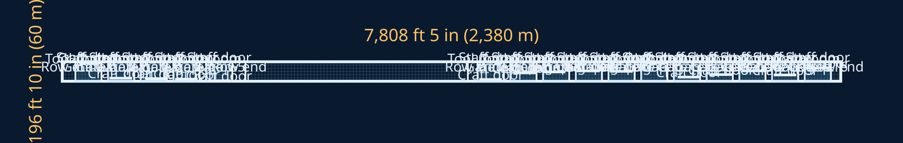

# P2-03 Shuttle gates G1–G16: plan

Footprint 7,808 ft 5 in (2,380 m) × 196 ft 10 in (60 m) · structural grid 32 ft 10 in (10 m)

## Levels

| Level | Floor above deck | Height | Floor area |
|---|---|---|---|
| Level 1 · Bay floor | 0 ft (0 mm) | 49 ft 3 in (15 m) | 826,668 sq ft (76,800 m²) |

## Elements

| ID | Designation | Type | Name | Level(s) | Size / length | Area | Status |
|---|---|---|---|---|---|---|---|
| E001 | D5F3P2B1A3R1 | zone | Row end | L1 | 131 ft 3 in (40 m) × 196 ft 10 in (60 m) | 25,833 sq ft (2,400 m²) | proposed |
| E002 | D5F3P2B1A3R2 | room | Gate G1 | L1 | 262 ft 6 in (80 m) × 196 ft 10 in (60 m) | 51,667 sq ft (4,800 m²) | proposed |
| E003 |  | fixture | Craft door | L1 | 210 ft (64 m) × 9 ft 6 in (2,900 mm) | 1,998 sq ft (186 m²) | proposed |
| E004 |  | fixture | Tool room | L1 | 52 ft 6 in (16 m) × 35 ft 5 in (11 m) | 1,860 sq ft (173 m²) | proposed |
| E005 |  | fixture | Staff door | L1 | 26 ft 3 in (8,000 mm) × 9 ft 10 in (3,000 mm) | 258 sq ft (24 m²) | proposed |
| E006 | D5F3P2B1A3R3 | zone | Gate gap | L1 | 65 ft 7 in (20 m) × 196 ft 10 in (60 m) | 12,917 sq ft (1,200 m²) | proposed |
| E007 | D5F3P2B1A3R4 | room | Gate G2 | L1 | 262 ft 6 in (80 m) × 196 ft 10 in (60 m) | 51,667 sq ft (4,800 m²) | proposed |
| E008 |  | fixture | Craft door | L1 | 210 ft (64 m) × 9 ft 6 in (2,900 mm) | 1,998 sq ft (186 m²) | proposed |
| E009 |  | fixture | Tool room | L1 | 52 ft 6 in (16 m) × 35 ft 5 in (11 m) | 1,860 sq ft (173 m²) | proposed |
| E010 |  | fixture | Staff door | L1 | 26 ft 3 in (8,000 mm) × 9 ft 10 in (3,000 mm) | 258 sq ft (24 m²) | proposed |
| E011 | D5F3P2B1A3R5 | zone | Gate gap | L1 | 65 ft 7 in (20 m) × 196 ft 10 in (60 m) | 12,917 sq ft (1,200 m²) | proposed |
| E012 | D5F3P2B1A3R6 | room | Gate G3 | L1 | 262 ft 6 in (80 m) × 196 ft 10 in (60 m) | 51,667 sq ft (4,800 m²) | proposed |
| E013 |  | fixture | Craft door | L1 | 210 ft (64 m) × 9 ft 2 in (2,800 mm) | 1,929 sq ft (179 m²) | proposed |
| E014 |  | fixture | Tool room | L1 | 52 ft 6 in (16 m) × 35 ft 5 in (11 m) | 1,860 sq ft (173 m²) | proposed |
| E015 |  | fixture | Staff door | L1 | 26 ft 3 in (8,000 mm) × 9 ft 10 in (3,000 mm) | 258 sq ft (24 m²) | proposed |
| E016 | D5F3P2B1A3R7 | zone | Gate gap | L1 | 65 ft 7 in (20 m) × 196 ft 10 in (60 m) | 12,917 sq ft (1,200 m²) | proposed |
| E017 | D5F3P2B1A3R8 | room | Gate G4 | L1 | 262 ft 6 in (80 m) × 196 ft 10 in (60 m) | 51,667 sq ft (4,800 m²) | proposed |
| E018 |  | fixture | Craft door | L1 | 210 ft (64 m) × 9 ft 6 in (2,900 mm) | 1,998 sq ft (186 m²) | proposed |
| E019 |  | fixture | Tool room | L1 | 52 ft 6 in (16 m) × 35 ft 5 in (11 m) | 1,860 sq ft (173 m²) | proposed |
| E020 |  | fixture | Staff door | L1 | 26 ft 3 in (8,000 mm) × 9 ft 10 in (3,000 mm) | 258 sq ft (24 m²) | proposed |
| E021 | D5F3P2B1A3R9 | zone | Gate gap | L1 | 65 ft 7 in (20 m) × 196 ft 10 in (60 m) | 12,917 sq ft (1,200 m²) | proposed |
| E022 | D5F3P2B1A3R10 | room | Gate G5 | L1 | 262 ft 6 in (80 m) × 196 ft 10 in (60 m) | 51,667 sq ft (4,800 m²) | proposed |
| E023 |  | fixture | Craft door | L1 | 210 ft (64 m) × 9 ft 2 in (2,800 mm) | 1,929 sq ft (179 m²) | proposed |
| E024 |  | fixture | Tool room | L1 | 52 ft 6 in (16 m) × 35 ft 5 in (11 m) | 1,860 sq ft (173 m²) | proposed |
| E025 |  | fixture | Staff door | L1 | 26 ft 3 in (8,000 mm) × 9 ft 10 in (3,000 mm) | 258 sq ft (24 m²) | proposed |
| E026 | D5F3P2B1A3R11 | zone | Row end | L1 | 131 ft 3 in (40 m) × 196 ft 10 in (60 m) | 25,833 sq ft (2,400 m²) | proposed |
| E027 | D5F3P2B1A3R12 | zone | Row end | L1 | 98 ft 5 in (30 m) × 196 ft 10 in (60 m) | 19,375 sq ft (1,800 m²) | proposed |
| E028 | D5F3P2B1A3R13 | room | Gate G6 | L1 | 262 ft 6 in (80 m) × 196 ft 10 in (60 m) | 51,667 sq ft (4,800 m²) | proposed |
| E029 |  | fixture | Craft door | L1 | 210 ft (64 m) × 9 ft 2 in (2,800 mm) | 1,929 sq ft (179 m²) | proposed |
| E030 |  | fixture | Tool room | L1 | 52 ft 6 in (16 m) × 35 ft 5 in (11 m) | 1,860 sq ft (173 m²) | proposed |
| E031 |  | fixture | Staff door | L1 | 26 ft 3 in (8,000 mm) × 9 ft 10 in (3,000 mm) | 258 sq ft (24 m²) | proposed |
| E032 | D5F3P2B1A3R14 | zone | Gate gap | L1 | 65 ft 7 in (20 m) × 196 ft 10 in (60 m) | 12,917 sq ft (1,200 m²) | proposed |
| E033 | D5F3P2B1A3R15 | room | Gate G7 | L1 | 262 ft 6 in (80 m) × 196 ft 10 in (60 m) | 51,667 sq ft (4,800 m²) | proposed |
| E034 |  | fixture | Craft door | L1 | 210 ft (64 m) × 9 ft 6 in (2,900 mm) | 1,998 sq ft (186 m²) | proposed |
| E035 |  | fixture | Tool room | L1 | 52 ft 6 in (16 m) × 35 ft 5 in (11 m) | 1,860 sq ft (173 m²) | proposed |
| E036 |  | fixture | Staff door | L1 | 26 ft 3 in (8,000 mm) × 9 ft 10 in (3,000 mm) | 258 sq ft (24 m²) | proposed |
| E037 | D5F3P2B1A3R16 | zone | Gate gap | L1 | 65 ft 7 in (20 m) × 196 ft 10 in (60 m) | 12,917 sq ft (1,200 m²) | proposed |
| E038 | D5F3P2B1A3R17 | room | Gate G8 | L1 | 262 ft 6 in (80 m) × 196 ft 10 in (60 m) | 51,667 sq ft (4,800 m²) | proposed |
| E039 |  | fixture | Craft door | L1 | 210 ft (64 m) × 9 ft 6 in (2,900 mm) | 1,998 sq ft (186 m²) | proposed |
| E040 |  | fixture | Tool room | L1 | 52 ft 6 in (16 m) × 35 ft 5 in (11 m) | 1,860 sq ft (173 m²) | proposed |
| E041 |  | fixture | Staff door | L1 | 26 ft 3 in (8,000 mm) × 9 ft 10 in (3,000 mm) | 258 sq ft (24 m²) | proposed |
| E042 | D5F3P2B1A3R18 | zone | Gate gap | L1 | 65 ft 7 in (20 m) × 196 ft 10 in (60 m) | 12,917 sq ft (1,200 m²) | proposed |
| E043 | D5F3P2B1A3R19 | room | Gate G9 | L1 | 262 ft 6 in (80 m) × 196 ft 10 in (60 m) | 51,667 sq ft (4,800 m²) | proposed |
| E044 |  | fixture | Craft door | L1 | 210 ft (64 m) × 9 ft 6 in (2,900 mm) | 1,998 sq ft (186 m²) | proposed |
| E045 |  | fixture | Tool room | L1 | 52 ft 6 in (16 m) × 35 ft 5 in (11 m) | 1,860 sq ft (173 m²) | proposed |
| E046 |  | fixture | Staff door | L1 | 26 ft 3 in (8,000 mm) × 9 ft 10 in (3,000 mm) | 258 sq ft (24 m²) | proposed |
| E047 | D5F3P2B1A3R20 | zone | Gate gap | L1 | 65 ft 7 in (20 m) × 196 ft 10 in (60 m) | 12,917 sq ft (1,200 m²) | proposed |
| E048 | D5F3P2B1A3R21 | room | Gate G10 | L1 | 262 ft 6 in (80 m) × 196 ft 10 in (60 m) | 51,667 sq ft (4,800 m²) | proposed |
| E049 |  | fixture | Craft door | L1 | 210 ft (64 m) × 9 ft 6 in (2,900 mm) | 1,998 sq ft (186 m²) | proposed |
| E050 |  | fixture | Tool room | L1 | 52 ft 6 in (16 m) × 35 ft 5 in (11 m) | 1,860 sq ft (173 m²) | proposed |
| E051 |  | fixture | Staff door | L1 | 26 ft 3 in (8,000 mm) × 9 ft 10 in (3,000 mm) | 258 sq ft (24 m²) | proposed |
| E052 | D5F3P2B1A3R22 | zone | Gate gap | L1 | 65 ft 7 in (20 m) × 196 ft 10 in (60 m) | 12,917 sq ft (1,200 m²) | proposed |
| E053 | D5F3P2B1A3R23 | room | Gate G11 | L1 | 262 ft 6 in (80 m) × 196 ft 10 in (60 m) | 51,667 sq ft (4,800 m²) | proposed |
| E054 |  | fixture | Craft door | L1 | 210 ft (64 m) × 9 ft 6 in (2,900 mm) | 1,998 sq ft (186 m²) | proposed |
| E055 |  | fixture | Tool room | L1 | 52 ft 6 in (16 m) × 35 ft 5 in (11 m) | 1,860 sq ft (173 m²) | proposed |
| E056 |  | fixture | Staff door | L1 | 26 ft 3 in (8,000 mm) × 9 ft 10 in (3,000 mm) | 258 sq ft (24 m²) | proposed |
| E057 | D5F3P2B1A3R24 | zone | Gate gap | L1 | 65 ft 7 in (20 m) × 196 ft 10 in (60 m) | 12,917 sq ft (1,200 m²) | proposed |
| E058 | D5F3P2B1A3R25 | room | Gate G12 | L1 | 262 ft 6 in (80 m) × 196 ft 10 in (60 m) | 51,667 sq ft (4,800 m²) | proposed |
| E059 |  | fixture | Craft door | L1 | 210 ft (64 m) × 9 ft 6 in (2,900 mm) | 1,998 sq ft (186 m²) | proposed |
| E060 |  | fixture | Tool room | L1 | 52 ft 6 in (16 m) × 35 ft 5 in (11 m) | 1,860 sq ft (173 m²) | proposed |
| E061 |  | fixture | Staff door | L1 | 26 ft 3 in (8,000 mm) × 9 ft 10 in (3,000 mm) | 258 sq ft (24 m²) | proposed |
| E062 | D5F3P2B1A3R26 | zone | Gate gap | L1 | 65 ft 7 in (20 m) × 196 ft 10 in (60 m) | 12,917 sq ft (1,200 m²) | proposed |
| E063 | D5F3P2B1A3R27 | room | Gate G13 | L1 | 262 ft 6 in (80 m) × 196 ft 10 in (60 m) | 51,667 sq ft (4,800 m²) | proposed |
| E064 |  | fixture | Craft door | L1 | 210 ft (64 m) × 9 ft 2 in (2,800 mm) | 1,929 sq ft (179 m²) | proposed |
| E065 |  | fixture | Tool room | L1 | 52 ft 6 in (16 m) × 35 ft 5 in (11 m) | 1,860 sq ft (173 m²) | proposed |
| E066 |  | fixture | Staff door | L1 | 26 ft 3 in (8,000 mm) × 9 ft 10 in (3,000 mm) | 258 sq ft (24 m²) | proposed |
| E067 | D5F3P2B1A3R28 | zone | Gate gap | L1 | 65 ft 7 in (20 m) × 196 ft 10 in (60 m) | 12,917 sq ft (1,200 m²) | proposed |
| E068 | D5F3P2B1A3R29 | room | Gate G14 | L1 | 262 ft 6 in (80 m) × 196 ft 10 in (60 m) | 51,667 sq ft (4,800 m²) | proposed |
| E069 |  | fixture | Craft door | L1 | 210 ft (64 m) × 9 ft 6 in (2,900 mm) | 1,998 sq ft (186 m²) | proposed |
| E070 |  | fixture | Tool room | L1 | 52 ft 6 in (16 m) × 35 ft 5 in (11 m) | 1,860 sq ft (173 m²) | proposed |
| E071 |  | fixture | Staff door | L1 | 26 ft 3 in (8,000 mm) × 9 ft 10 in (3,000 mm) | 258 sq ft (24 m²) | proposed |
| E072 | D5F3P2B1A3R30 | zone | Gate gap | L1 | 65 ft 7 in (20 m) × 196 ft 10 in (60 m) | 12,917 sq ft (1,200 m²) | proposed |
| E073 | D5F3P2B1A3R31 | room | Gate G15 | L1 | 262 ft 6 in (80 m) × 196 ft 10 in (60 m) | 51,667 sq ft (4,800 m²) | proposed |
| E074 |  | fixture | Craft door | L1 | 210 ft (64 m) × 9 ft 6 in (2,900 mm) | 1,998 sq ft (186 m²) | proposed |
| E075 |  | fixture | Tool room | L1 | 52 ft 6 in (16 m) × 35 ft 5 in (11 m) | 1,860 sq ft (173 m²) | proposed |
| E076 |  | fixture | Staff door | L1 | 26 ft 3 in (8,000 mm) × 9 ft 10 in (3,000 mm) | 258 sq ft (24 m²) | proposed |
| E077 | D5F3P2B1A3R32 | zone | Gate gap | L1 | 65 ft 7 in (20 m) × 196 ft 10 in (60 m) | 12,917 sq ft (1,200 m²) | proposed |
| E078 | D5F3P2B1A3R33 | room | Gate G16 | L1 | 262 ft 6 in (80 m) × 196 ft 10 in (60 m) | 51,667 sq ft (4,800 m²) | proposed |
| E079 |  | fixture | Craft door | L1 | 210 ft (64 m) × 9 ft 2 in (2,800 mm) | 1,929 sq ft (179 m²) | proposed |
| E080 |  | fixture | Tool room | L1 | 52 ft 6 in (16 m) × 35 ft 5 in (11 m) | 1,860 sq ft (173 m²) | proposed |
| E081 |  | fixture | Staff door | L1 | 26 ft 3 in (8,000 mm) × 9 ft 10 in (3,000 mm) | 258 sq ft (24 m²) | proposed |
| E082 | D5F3P2B1A3R34 | zone | Row end | L1 | 98 ft 5 in (30 m) × 196 ft 10 in (60 m) | 19,375 sq ft (1,800 m²) | proposed |

## Drawings

### Level 1 · Bay floor

