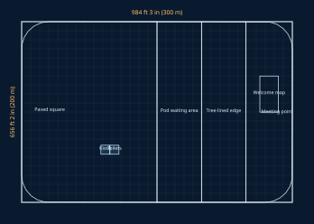

# P2-07 Arrivals Forecourt: plan

Footprint 984 ft 3 in (300 m) × 656 ft 2 in (200 m) · structural grid 32 ft 10 in (10 m)

## Levels

| Level | Floor above deck | Height | Floor area |
|---|---|---|---|
| Level 1 · Ground | 0 ft (0 mm) | 13 ft 1 in (4,000 mm) | 2,153 sq ft (200 m²) |

## Elements

| ID | Designation | Type | Name | Level(s) | Size / length | Area | Status |
|---|---|---|---|---|---|---|---|
| E001 | D5F3P2B3A1R1 | zone | Paved square | L1 | 492 ft 2 in (150 m) × 655 ft 10 in (200 m) | 318,018 sq ft (29,545 m²) | proposed |
| E002 | D5F3P2B3A1R2 | room | Kiosk | L1 | 32 ft 10 in (10 m) × 32 ft 10 in (10 m) | 1,076 sq ft (100 m²) | proposed |
| E003 | D5F3P2B3A1R3 | room | Toilets | L1 | 32 ft 10 in (10 m) × 32 ft 10 in (10 m) | 1,076 sq ft (100 m²) | proposed |
| E004 | D5F3P2B3A1R4 | zone | Pod waiting area | L1 | 161 ft 9 in (49 m) × 655 ft 6 in (200 m) | 105,999 sq ft (9,848 m²) | proposed |
| E005 | D5F3P2B3A1R5 | zone | Tree-lined edge | L1 | 161 ft 9 in (49 m) × 655 ft 6 in (200 m) | 105,973 sq ft (9,845 m²) | proposed |
| E006 | D5F3P2B3A1R6 | zone | Meeting point | L1 | 168 ft 8 in (51 m) × 655 ft 2 in (200 m) | 106,003 sq ft (9,848 m²) | proposed |
| E007 |  | fixture | Welcome map | L1 | 67 ft 7 in (21 m) × 130 ft 11 in (40 m) | 8,847 sq ft (822 m²) | proposed |

## Drawings

### Level 1 · Ground

