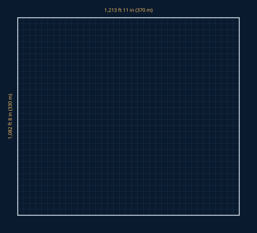
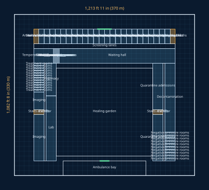
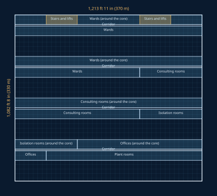

# P2-12 Port Health: plan

Footprint 1,213 ft 11 in (370 m) × 1,082 ft 8 in (330 m) · structural grid 32 ft 10 in (10 m)

## Levels

| Level | Floor above deck | Height | Floor area |
|---|---|---|---|
| Level B1 · Service level | −16 ft 5 in (5,000 mm) | 16 ft 5 in (5,000 mm) | — |
| Level 1 · Ground floor | 0 ft (0 mm) | 16 ft 5 in (5,000 mm) | 357,147 sq ft (33,180 m²) |
| Level 2 · Level 2 | 16 ft 5 in (5,000 mm) | 14 ft 9 in (4,500 mm) | 176,313 sq ft (16,380 m²) |
| Level 3 · Level 3 | 31 ft 2 in (9,500 mm) | 14 ft 9 in (4,500 mm) | 176,313 sq ft (16,380 m²) |

## Elements

| ID | Designation | Type | Name | Level(s) | Size / length | Area | Status |
|---|---|---|---|---|---|---|---|
| E001 | D5F3P2B2A1L1R1 | core | Stairs and lifts | L1 | 32 ft 10 in (10 m) × 98 ft 5 in (30 m) | 3,229 sq ft (300 m²) | proposed |
| E002 | D5F3P2B2A1L1R2 | core | Stairs and lifts | L1 | 32 ft 10 in (10 m) × 98 ft 5 in (30 m) | 3,229 sq ft (300 m²) | proposed |
| E003 | D5F3P2B2A1L1R3 | zone | Screening lanes | L1 | 951 ft 5 in (290 m) × 32 ft 10 in (10 m) | 31,215 sq ft (2,900 m²) | proposed |
| E004 | D5F3P2B2A1L1R4 | room | Arrivals screening booths | L1 | 36 ft 9 in (11 m) × 98 ft 5 in (30 m) | 3,617 sq ft (336 m²) | proposed |
| E005 | D5F3P2B2A1L1R5 | room | Arrivals screening booths | L1 | 37 ft 1 in (11 m) × 98 ft 5 in (30 m) | 3,649 sq ft (339 m²) | proposed |
| E006 | D5F3P2B2A1L1R6 | room | Arrivals screening booths | L1 | 37 ft 1 in (11 m) × 98 ft 5 in (30 m) | 3,649 sq ft (339 m²) | proposed |
| E007 | D5F3P2B2A1L1R7 | room | Arrivals screening booths | L1 | 36 ft 9 in (11 m) × 98 ft 5 in (30 m) | 3,617 sq ft (336 m²) | proposed |
| E008 | D5F3P2B2A1L1R8 | room | Arrivals screening booths | L1 | 36 ft 9 in (11 m) × 98 ft 5 in (30 m) | 3,617 sq ft (336 m²) | proposed |
| E009 | D5F3P2B2A1L1R9 | room | Arrivals screening booths | L1 | 37 ft 1 in (11 m) × 98 ft 5 in (30 m) | 3,649 sq ft (339 m²) | proposed |
| E010 | D5F3P2B2A1L1R10 | room | Arrivals screening booths | L1 | 37 ft 1 in (11 m) × 98 ft 5 in (30 m) | 3,649 sq ft (339 m²) | proposed |
| E011 | D5F3P2B2A1L1R11 | room | Arrivals screening booths | L1 | 36 ft 9 in (11 m) × 98 ft 5 in (30 m) | 3,617 sq ft (336 m²) | proposed |
| E012 | D5F3P2B2A1L1R12 | room | Arrivals screening booths | L1 | 36 ft 9 in (11 m) × 98 ft 5 in (30 m) | 3,617 sq ft (336 m²) | proposed |
| E013 | D5F3P2B2A1L1R13 | room | Arrivals screening booths | L1 | 37 ft 1 in (11 m) × 98 ft 5 in (30 m) | 3,649 sq ft (339 m²) | proposed |
| E014 | D5F3P2B2A1L1R14 | room | Arrivals screening booths | L1 | 37 ft 1 in (11 m) × 98 ft 5 in (30 m) | 3,649 sq ft (339 m²) | proposed |
| E015 | D5F3P2B2A1L1R15 | room | Arrivals screening booths | L1 | 36 ft 9 in (11 m) × 98 ft 5 in (30 m) | 3,617 sq ft (336 m²) | proposed |
| E016 | D5F3P2B2A1L1R16 | room | Arrivals screening booths | L1 | 36 ft 9 in (11 m) × 98 ft 5 in (30 m) | 3,617 sq ft (336 m²) | proposed |
| E017 | D5F3P2B2A1L1R17 | room | Arrivals screening booths | L1 | 37 ft 1 in (11 m) × 98 ft 5 in (30 m) | 3,649 sq ft (339 m²) | proposed |
| E018 | D5F3P2B2A1L1R18 | room | Arrivals screening booths | L1 | 37 ft 1 in (11 m) × 98 ft 5 in (30 m) | 3,649 sq ft (339 m²) | proposed |
| E019 | D5F3P2B2A1L1R19 | room | Arrivals screening booths | L1 | 36 ft 9 in (11 m) × 98 ft 5 in (30 m) | 3,617 sq ft (336 m²) | proposed |
| E020 | D5F3P2B2A1L1R20 | room | Arrivals screening booths | L1 | 36 ft 9 in (11 m) × 98 ft 5 in (30 m) | 3,617 sq ft (336 m²) | proposed |
| E021 | D5F3P2B2A1L1R21 | room | Arrivals screening booths | L1 | 37 ft 1 in (11 m) × 98 ft 5 in (30 m) | 3,649 sq ft (339 m²) | proposed |
| E022 | D5F3P2B2A1L1R22 | room | Arrivals screening booths | L1 | 37 ft 1 in (11 m) × 98 ft 5 in (30 m) | 3,649 sq ft (339 m²) | proposed |
| E023 | D5F3P2B2A1L1R23 | room | Arrivals screening booths | L1 | 36 ft 9 in (11 m) × 98 ft 5 in (30 m) | 3,617 sq ft (336 m²) | proposed |
| E024 | D5F3P2B2A1L1R24 | room | Arrivals screening booths | L1 | 36 ft 9 in (11 m) × 98 ft 5 in (30 m) | 3,617 sq ft (336 m²) | proposed |
| E025 | D5F3P2B2A1L1R25 | room | Arrivals screening booths | L1 | 37 ft 1 in (11 m) × 98 ft 5 in (30 m) | 3,649 sq ft (339 m²) | proposed |
| E026 | D5F3P2B2A1L1R26 | room | Arrivals screening booths | L1 | 37 ft 1 in (11 m) × 98 ft 5 in (30 m) | 3,649 sq ft (339 m²) | proposed |
| E027 | D5F3P2B2A1L1R27 | room | Arrivals screening booths | L1 | 36 ft 9 in (11 m) × 98 ft 5 in (30 m) | 3,617 sq ft (336 m²) | proposed |
| E028 | D5F3P2B2A1L1R28 | room | Temperature and scan gates | L1 | 131 ft 3 in (40 m) × 98 ft 5 in (30 m) | 12,917 sq ft (1,200 m²) | proposed |
| E029 | D5F3P2B2A1L1R29 | room | Family screening rooms | L1 | 6 ft 7 in (2,000 mm) × 98 ft 5 in (30 m) | 646 sq ft (60 m²) | proposed |
| E030 | D5F3P2B2A1L1R30 | room | Family screening rooms | L1 | 6 ft 7 in (2,000 mm) × 98 ft 5 in (30 m) | 646 sq ft (60 m²) | proposed |
| E031 | D5F3P2B2A1L1R31 | room | Family screening rooms | L1 | 6 ft 7 in (2,000 mm) × 98 ft 5 in (30 m) | 646 sq ft (60 m²) | proposed |
| E032 | D5F3P2B2A1L1R32 | room | Family screening rooms | L1 | 6 ft 7 in (2,000 mm) × 98 ft 5 in (30 m) | 646 sq ft (60 m²) | proposed |
| E033 | D5F3P2B2A1L1R33 | room | Family screening rooms | L1 | 6 ft 7 in (2,000 mm) × 98 ft 5 in (30 m) | 646 sq ft (60 m²) | proposed |
| E034 | D5F3P2B2A1L1R34 | room | Family screening rooms | L1 | 6 ft 7 in (2,000 mm) × 98 ft 5 in (30 m) | 646 sq ft (60 m²) | proposed |
| E035 | D5F3P2B2A1L1R35 | room | Waiting hall | L1 | 780 ft 10 in (238 m) × 98 ft 5 in (30 m) | 76,854 sq ft (7,140 m²) | proposed |
| E036 | D5F3P2B2A1L1R36, D5F3P2B2A1L2R1, D5F3P2B2A1L3R1 | core | Stairs and lifts | L1, L2, L3 | 68 ft 11 in (21 m) × 32 ft 10 in (10 m) | 2,260 sq ft (210 m²) | proposed |
| E037 | D5F3P2B2A1L1R37 | zone | Corridor | L1 | 13 ft 1 in (4,000 mm) × 656 ft 2 in (200 m) | 8,611 sq ft (800 m²) | proposed |
| E038 | D5F3P2B2A1L1R38 | room | Treatment rooms | L1 | 68 ft 11 in (21 m) × 16 ft 1 in (4,900 mm) | 1,108 sq ft (103 m²) | proposed |
| E039 | D5F3P2B2A1L1R39 | room | Treatment rooms | L1 | 68 ft 11 in (21 m) × 16 ft 1 in (4,900 mm) | 1,108 sq ft (103 m²) | proposed |
| E040 | D5F3P2B2A1L1R40 | room | Treatment rooms | L1 | 68 ft 11 in (21 m) × 16 ft 1 in (4,900 mm) | 1,108 sq ft (103 m²) | proposed |
| E041 | D5F3P2B2A1L1R41 | room | Treatment rooms | L1 | 68 ft 11 in (21 m) × 16 ft 5 in (5,000 mm) | 1,130 sq ft (105 m²) | proposed |
| E042 | D5F3P2B2A1L1R42 | room | Treatment rooms | L1 | 68 ft 11 in (21 m) × 16 ft 1 in (4,900 mm) | 1,108 sq ft (103 m²) | proposed |
| E043 | D5F3P2B2A1L1R43 | room | Treatment rooms | L1 | 68 ft 11 in (21 m) × 16 ft 1 in (4,900 mm) | 1,108 sq ft (103 m²) | proposed |
| E044 | D5F3P2B2A1L1R44 | room | Treatment rooms | L1 | 68 ft 11 in (21 m) × 16 ft 1 in (4,900 mm) | 1,108 sq ft (103 m²) | proposed |
| E045 | D5F3P2B2A1L1R45 | room | Treatment rooms | L1 | 68 ft 11 in (21 m) × 16 ft 1 in (4,900 mm) | 1,108 sq ft (103 m²) | proposed |
| E046 | D5F3P2B2A1L1R46 | room | Treatment rooms | L1 | 68 ft 11 in (21 m) × 16 ft 1 in (4,900 mm) | 1,108 sq ft (103 m²) | proposed |
| E047 | D5F3P2B2A1L1R47 | room | Treatment rooms | L1 | 68 ft 11 in (21 m) × 16 ft 1 in (4,900 mm) | 1,108 sq ft (103 m²) | proposed |
| E048 | D5F3P2B2A1L1R48 | room | Treatment rooms | L1 | 68 ft 11 in (21 m) × 16 ft 5 in (5,000 mm) | 1,130 sq ft (105 m²) | proposed |
| E049 | D5F3P2B2A1L1R49 | room | Treatment rooms | L1 | 68 ft 11 in (21 m) × 16 ft 1 in (4,900 mm) | 1,108 sq ft (103 m²) | proposed |
| E050 | D5F3P2B2A1L1R50 | room | Imaging | L1 | 68 ft 11 in (21 m) × 118 ft 1 in (36 m) | 8,138 sq ft (756 m²) | proposed |
| E051 | D5F3P2B2A1L1R51 | room | Imaging | L1 | 68 ft 11 in (21 m) × 311 ft 8 in (95 m) | 21,474 sq ft (1,995 m²) | proposed |
| E052 | D5F3P2B2A1L1R52 | room | Pharmacy | L1 | 68 ft 11 in (21 m) × 218 ft 10 in (67 m) | 15,077 sq ft (1,401 m²) | proposed |
| E053 | D5F3P2B2A1L1R53 | room | Lab | L1 | 68 ft 11 in (21 m) × 437 ft 4 in (133 m) | 30,131 sq ft (2,799 m²) | proposed |
| E054 | D5F3P2B2A1L2R2, D5F3P2B2A1L3R2 | zone | Corridor | L2, L3 | 13 ft 1 in (4,000 mm) × 656 ft 2 in (200 m) | 8,611 sq ft (800 m²) | proposed |
| E055 | D5F3P2B2A1L2R3, D5F3P2B2A1L3R3 | room | Wards | L2, L3 | 68 ft 11 in (21 m) × 311 ft 8 in (95 m) | 21,474 sq ft (1,995 m²) | proposed |
| E056 | D5F3P2B2A1L2R4, D5F3P2B2A1L3R4 | room | Wards | L2, L3 | 68 ft 11 in (21 m) × 311 ft 8 in (95 m) | 21,474 sq ft (1,995 m²) | proposed |
| E057 | D5F3P2B2A1L2R5, D5F3P2B2A1L3R5 | room | Wards | L2, L3 | 68 ft 11 in (21 m) × 187 ft 4 in (57 m) | 12,907 sq ft (1,199 m²) | proposed |
| E058 | D5F3P2B2A1L2R6, D5F3P2B2A1L3R6 | room | Consulting rooms | L2, L3 | 68 ft 11 in (21 m) × 3 ft 11 in (1,200 mm) | 271 sq ft (25 m²) | proposed |
| E059 | D5F3P2B2A1L2R7, D5F3P2B2A1L3R7 | room | Consulting rooms | L2, L3 | 68 ft 11 in (21 m) × 3 ft 11 in (1,200 mm) | 271 sq ft (25 m²) | proposed |
| E060 | D5F3P2B2A1L2R8, D5F3P2B2A1L3R8 | room | Consulting rooms | L2, L3 | 68 ft 11 in (21 m) × 3 ft 11 in (1,200 mm) | 271 sq ft (25 m²) | proposed |
| E061 | D5F3P2B2A1L2R9, D5F3P2B2A1L3R9 | room | Consulting rooms | L2, L3 | 68 ft 11 in (21 m) × 3 ft 11 in (1,200 mm) | 271 sq ft (25 m²) | proposed |
| E062 | D5F3P2B2A1L2R10, D5F3P2B2A1L3R10 | room | Consulting rooms | L2, L3 | 68 ft 11 in (21 m) × 3 ft 11 in (1,200 mm) | 271 sq ft (25 m²) | proposed |
| E063 | D5F3P2B2A1L2R11, D5F3P2B2A1L3R11 | room | Consulting rooms | L2, L3 | 68 ft 11 in (21 m) × 3 ft 11 in (1,200 mm) | 271 sq ft (25 m²) | proposed |
| E064 | D5F3P2B2A1L2R12, D5F3P2B2A1L3R12 | room | Consulting rooms | L2, L3 | 68 ft 11 in (21 m) × 3 ft 11 in (1,200 mm) | 271 sq ft (25 m²) | proposed |
| E065 | D5F3P2B2A1L2R13, D5F3P2B2A1L3R13 | room | Consulting rooms | L2, L3 | 68 ft 11 in (21 m) × 3 ft 11 in (1,200 mm) | 271 sq ft (25 m²) | proposed |
| E066 | D5F3P2B2A1L2R14, D5F3P2B2A1L3R14 | room | Consulting rooms | L2, L3 | 68 ft 11 in (21 m) × 3 ft 11 in (1,200 mm) | 271 sq ft (25 m²) | proposed |
| E067 | D5F3P2B2A1L2R15, D5F3P2B2A1L3R15 | room | Consulting rooms | L2, L3 | 68 ft 11 in (21 m) × 3 ft 7 in (1,100 mm) | 249 sq ft (23 m²) | proposed |
| E068 | D5F3P2B2A1L2R16, D5F3P2B2A1L3R16 | room | Staff rooms | L2, L3 | 68 ft 11 in (21 m) × 429 ft 9 in (131 m) | 29,612 sq ft (2,751 m²) | proposed |
| E069 | D5F3P2B2A1L1R54, D5F3P2B2A1L2R17, D5F3P2B2A1L3R17 | core | Stairs and lifts | L1, L2, L3 | 68 ft 11 in (21 m) × 32 ft 10 in (10 m) | 2,260 sq ft (210 m²) | proposed |
| E070 | D5F3P2B2A1L1R55 | zone | Corridor | L1 | 13 ft 1 in (4,000 mm) × 656 ft 2 in (200 m) | 8,611 sq ft (800 m²) | proposed |
| E071 | D5F3P2B2A1L1R56 | room | Quarantine admissions | L1 | 68 ft 11 in (21 m) × 311 ft 8 in (95 m) | 21,474 sq ft (1,995 m²) | proposed |
| E072 | D5F3P2B2A1L1R57 | room | Quarantine admissions | L1 | 68 ft 11 in (21 m) × 311 ft 8 in (95 m) | 21,474 sq ft (1,995 m²) | proposed |
| E073 | D5F3P2B2A1L1R58 | room | Decontamination | L1 | 68 ft 11 in (21 m) × 463 ft 3 in (141 m) | 31,917 sq ft (2,965 m²) | proposed |
| E074 | D5F3P2B2A1L1R59 | room | Negative-pressure rooms | L1 | 68 ft 11 in (21 m) × 19 ft 4 in (5,900 mm) | 1,334 sq ft (124 m²) | proposed |
| E075 | D5F3P2B2A1L1R60 | room | Negative-pressure rooms | L1 | 68 ft 11 in (21 m) × 19 ft (5,800 mm) | 1,311 sq ft (122 m²) | proposed |
| E076 | D5F3P2B2A1L1R61 | room | Negative-pressure rooms | L1 | 68 ft 11 in (21 m) × 19 ft 4 in (5,900 mm) | 1,334 sq ft (124 m²) | proposed |
| E077 | D5F3P2B2A1L1R62 | room | Negative-pressure rooms | L1 | 68 ft 11 in (21 m) × 19 ft 4 in (5,900 mm) | 1,334 sq ft (124 m²) | proposed |
| E078 | D5F3P2B2A1L1R63 | room | Negative-pressure rooms | L1 | 68 ft 11 in (21 m) × 19 ft 4 in (5,900 mm) | 1,334 sq ft (124 m²) | proposed |
| E079 | D5F3P2B2A1L1R64 | room | Negative-pressure rooms | L1 | 68 ft 11 in (21 m) × 19 ft 4 in (5,900 mm) | 1,334 sq ft (124 m²) | proposed |
| E080 | D5F3P2B2A1L1R65 | room | Negative-pressure rooms | L1 | 68 ft 11 in (21 m) × 19 ft 4 in (5,900 mm) | 1,334 sq ft (124 m²) | proposed |
| E081 | D5F3P2B2A1L1R66 | room | Negative-pressure rooms | L1 | 68 ft 11 in (21 m) × 19 ft (5,800 mm) | 1,311 sq ft (122 m²) | proposed |
| E082 | D5F3P2B2A1L1R67 | room | Negative-pressure rooms | L1 | 68 ft 11 in (21 m) × 19 ft 4 in (5,900 mm) | 1,334 sq ft (124 m²) | proposed |
| E083 | D5F3P2B2A1L1R68 | room | Negative-pressure rooms | L1 | 68 ft 11 in (21 m) × 19 ft 4 in (5,900 mm) | 1,334 sq ft (124 m²) | proposed |
| E084 | D5F3P2B2A1L2R18, D5F3P2B2A1L3R18 | zone | Corridor | L2, L3 | 13 ft 1 in (4,000 mm) × 656 ft 2 in (200 m) | 8,611 sq ft (800 m²) | proposed |
| E085 | D5F3P2B2A1L2R19, D5F3P2B2A1L3R19 | room | Quarantine suites | L2, L3 | 68 ft 11 in (21 m) × 51 ft 10 in (16 m) | 3,571 sq ft (332 m²) | proposed |
| E086 | D5F3P2B2A1L2R20, D5F3P2B2A1L3R20 | room | Quarantine suites | L2, L3 | 68 ft 11 in (21 m) × 52 ft 2 in (16 m) | 3,594 sq ft (334 m²) | proposed |
| E087 | D5F3P2B2A1L2R21, D5F3P2B2A1L3R21 | room | Quarantine suites | L2, L3 | 68 ft 11 in (21 m) × 51 ft 10 in (16 m) | 3,571 sq ft (332 m²) | proposed |
| E088 | D5F3P2B2A1L2R22, D5F3P2B2A1L3R22 | room | Quarantine suites | L2, L3 | 68 ft 11 in (21 m) × 51 ft 10 in (16 m) | 3,571 sq ft (332 m²) | proposed |
| E089 | D5F3P2B2A1L2R23, D5F3P2B2A1L3R23 | room | Quarantine suites | L2, L3 | 68 ft 11 in (21 m) × 52 ft 2 in (16 m) | 3,594 sq ft (334 m²) | proposed |
| E090 | D5F3P2B2A1L2R24, D5F3P2B2A1L3R24 | room | Quarantine suites | L2, L3 | 68 ft 11 in (21 m) × 51 ft 10 in (16 m) | 3,571 sq ft (332 m²) | proposed |
| E091 | D5F3P2B2A1L2R25, D5F3P2B2A1L3R25 | room | Quarantine suites | L2, L3 | 68 ft 11 in (21 m) × 51 ft 10 in (16 m) | 3,571 sq ft (332 m²) | proposed |
| E092 | D5F3P2B2A1L2R26, D5F3P2B2A1L3R26 | room | Quarantine suites | L2, L3 | 68 ft 11 in (21 m) × 52 ft 2 in (16 m) | 3,594 sq ft (334 m²) | proposed |
| E093 | D5F3P2B2A1L2R27, D5F3P2B2A1L3R27 | room | Quarantine suites | L2, L3 | 68 ft 11 in (21 m) × 51 ft 10 in (16 m) | 3,571 sq ft (332 m²) | proposed |
| E094 | D5F3P2B2A1L2R28, D5F3P2B2A1L3R28 | room | Quarantine suites | L2, L3 | 68 ft 11 in (21 m) × 51 ft 10 in (16 m) | 3,571 sq ft (332 m²) | proposed |
| E095 | D5F3P2B2A1L2R29, D5F3P2B2A1L3R29 | room | Quarantine suites | L2, L3 | 68 ft 11 in (21 m) × 52 ft 2 in (16 m) | 3,594 sq ft (334 m²) | proposed |
| E096 | D5F3P2B2A1L2R30, D5F3P2B2A1L3R30 | room | Quarantine suites | L2, L3 | 68 ft 11 in (21 m) × 51 ft 10 in (16 m) | 3,571 sq ft (332 m²) | proposed |
| E097 | D5F3P2B2A1L2R31, D5F3P2B2A1L3R31 | room | Quarantine suites | L2, L3 | 68 ft 11 in (21 m) × 54 ft 9 in (17 m) | 3,775 sq ft (351 m²) | proposed |
| E098 | D5F3P2B2A1L2R32, D5F3P2B2A1L3R32 | room | Quarantine suites | L2, L3 | 68 ft 11 in (21 m) × 54 ft 6 in (17 m) | 3,752 sq ft (349 m²) | proposed |
| E099 | D5F3P2B2A1L2R33, D5F3P2B2A1L3R33 | room | Quarantine suites | L2, L3 | 68 ft 11 in (21 m) × 54 ft 9 in (17 m) | 3,775 sq ft (351 m²) | proposed |
| E100 | D5F3P2B2A1L2R34, D5F3P2B2A1L3R34 | room | Quarantine suites | L2, L3 | 68 ft 11 in (21 m) × 54 ft 9 in (17 m) | 3,775 sq ft (351 m²) | proposed |
| E101 | D5F3P2B2A1L2R35, D5F3P2B2A1L3R35 | room | Quarantine suites | L2, L3 | 68 ft 11 in (21 m) × 54 ft 6 in (17 m) | 3,752 sq ft (349 m²) | proposed |
| E102 | D5F3P2B2A1L2R36, D5F3P2B2A1L3R36 | room | Quarantine suites | L2, L3 | 68 ft 11 in (21 m) × 54 ft 9 in (17 m) | 3,775 sq ft (351 m²) | proposed |
| E103 | D5F3P2B2A1L2R37, D5F3P2B2A1L3R37 | room | Family rooms | L2, L3 | 68 ft 11 in (21 m) × 82 ft (25 m) | 5,651 sq ft (525 m²) | proposed |
| E104 | D5F3P2B2A1L2R38, D5F3P2B2A1L3R38 | room | Family rooms | L2, L3 | 68 ft 11 in (21 m) × 82 ft (25 m) | 5,651 sq ft (525 m²) | proposed |
| E105 | D5F3P2B2A1L2R39, D5F3P2B2A1L3R39 | room | Family rooms | L2, L3 | 68 ft 11 in (21 m) × 82 ft (25 m) | 5,651 sq ft (525 m²) | proposed |
| E106 | D5F3P2B2A1L2R40, D5F3P2B2A1L3R40 | room | Family rooms | L2, L3 | 68 ft 11 in (21 m) × 82 ft (25 m) | 5,651 sq ft (525 m²) | proposed |
| E107 | D5F3P2B2A1L1R69 | zone | Healing garden | L1 | 649 ft 7 in (198 m) × 590 ft 7 in (180 m) | 383,626 sq ft (35,640 m²) | proposed |
| E108 | D5F3P2B2A1L1R70 | zone | Ambulance bay | L1 | 557 ft 9 in (170 m) × 98 ft 5 in (30 m) | 54,896 sq ft (5,100 m²) | proposed |
| E109 |  | door | Arrivals screening entry | L1 | 98 ft 5 in (30 m), 98 ft 5 in (30 m) wide | — | proposed |
| E110 |  | door | Ambulance entrance | L1 | 65 ft 7 in (20 m), 65 ft 7 in (20 m) wide | — | proposed |

## Drawings

### Level B1 · Service level

### Level 1 · Ground floor

### Level 2 · Level 2

### Level 3 · Level 3

