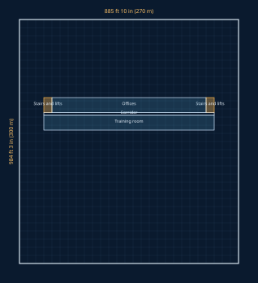

# P2-13 Arrivals Fire Station: plan

Footprint 885 ft 10 in (270 m) × 984 ft 3 in (300 m) · structural grid 32 ft 10 in (10 m)

## Levels

| Level | Floor above deck | Height | Floor area |
|---|---|---|---|
| Level 1 · Ground floor | 0 ft (0 mm) | 14 ft 9 in (4,500 mm) | 228,841 sq ft (21,260 m²) |
| Level 2 · Level 2 | 14 ft 9 in (4,500 mm) | 14 ft 9 in (4,500 mm) | 228,841 sq ft (21,260 m²) |
| Level 3 · Level 3 | 29 ft 6 in (9,000 mm) | 13 ft 1 in (4,000 mm) | 79,653 sq ft (7,400 m²) |

## Elements

| ID | Designation | Type | Name | Level(s) | Size / length | Area | Status |
|---|---|---|---|---|---|---|---|
| E001 | D5F3P2B2A2L1R1, D5F3P2B2A2L2R1 | room | Crash tender | L1, L2 | 114 ft 10 in (35 m) × 216 ft 6 in (66 m) | 24,865 sq ft (2,310 m²) | proposed |
| E002 | D5F3P2B2A2L1R2, D5F3P2B2A2L2R2 | room | Crash tender | L1, L2 | 114 ft 10 in (35 m) × 216 ft 6 in (66 m) | 24,865 sq ft (2,310 m²) | proposed |
| E003 | D5F3P2B2A2L1R3, D5F3P2B2A2L2R3 | room | Foam tender | L1, L2 | 114 ft 10 in (35 m) × 216 ft 6 in (66 m) | 24,865 sq ft (2,310 m²) | proposed |
| E004 | D5F3P2B2A2L1R4, D5F3P2B2A2L2R4 | room | Rescue unit | L1, L2 | 114 ft 10 in (35 m) × 216 ft 6 in (66 m) | 24,865 sq ft (2,310 m²) | proposed |
| E005 | D5F3P2B2A2L1R5, D5F3P2B2A2L2R5 | room | Medical response car | L1, L2 | 114 ft 10 in (35 m) × 216 ft 6 in (66 m) | 24,865 sq ft (2,310 m²) | proposed |
| E006 | D5F3P2B2A2L1R6, D5F3P2B2A2L2R6 | room | Command car | L1, L2 | 114 ft 10 in (35 m) × 216 ft 6 in (66 m) | 24,865 sq ft (2,310 m²) | proposed |
| E007 | D5F3P2B2A2L1R7, D5F3P2B2A2L2R7, D5F3P2B2A2L3R1 | core | Stairs and lifts | L1, L2, L3 | 32 ft 10 in (10 m) × 60 ft 8 in (18 m) | 1,991 sq ft (185 m²) | proposed |
| E008 | D5F3P2B2A2L1R8, D5F3P2B2A2L2R8, D5F3P2B2A2L3R2 | core | Stairs and lifts | L1, L2, L3 | 32 ft 10 in (10 m) × 60 ft 8 in (18 m) | 1,991 sq ft (185 m²) | proposed |
| E009 | D5F3P2B2A2L1R9 | zone | Corridor | L1 | 689 ft (210 m) × 9 ft 10 in (3,000 mm) | 6,781 sq ft (630 m²) | proposed |
| E010 | D5F3P2B2A2L1R10 | room | Watch room | L1 | 249 ft 4 in (76 m) × 60 ft 8 in (18 m) | 15,134 sq ft (1,406 m²) | proposed |
| E011 | D5F3P2B2A2L1R11 | room | Breathing apparatus | L1 | 374 ft (114 m) × 60 ft 8 in (18 m) | 22,701 sq ft (2,109 m²) | proposed |
| E012 | D5F3P2B2A2L1R12 | room | Medical store | L1 | 53 ft 2 in (16 m) × 60 ft 8 in (18 m) | 3,226 sq ft (300 m²) | proposed |
| E013 | D5F3P2B2A2L1R13 | room | Workshop | L1 | 635 ft 10 in (194 m) × 60 ft 8 in (18 m) | 38,592 sq ft (3,585 m²) | proposed |
| E014 | D5F3P2B2A2L2R9 | zone | Corridor | L2 | 689 ft (210 m) × 9 ft 10 in (3,000 mm) | 6,781 sq ft (630 m²) | proposed |
| E015 | D5F3P2B2A2L2R10 | room | Bunk rooms | L2 | 34 ft 9 in (11 m) × 60 ft 8 in (18 m) | 2,111 sq ft (196 m²) | proposed |
| E016 | D5F3P2B2A2L2R11 | room | Bunk rooms | L2 | 34 ft 5 in (10 m) × 60 ft 8 in (18 m) | 2,091 sq ft (194 m²) | proposed |
| E017 | D5F3P2B2A2L2R12 | room | Bunk rooms | L2 | 34 ft 9 in (11 m) × 60 ft 8 in (18 m) | 2,111 sq ft (196 m²) | proposed |
| E018 | D5F3P2B2A2L2R13 | room | Bunk rooms | L2 | 34 ft 5 in (10 m) × 60 ft 8 in (18 m) | 2,091 sq ft (194 m²) | proposed |
| E019 | D5F3P2B2A2L2R14 | room | Bunk rooms | L2 | 34 ft 9 in (11 m) × 60 ft 8 in (18 m) | 2,111 sq ft (196 m²) | proposed |
| E020 | D5F3P2B2A2L2R15 | room | Bunk rooms | L2 | 34 ft 5 in (10 m) × 60 ft 8 in (18 m) | 2,091 sq ft (194 m²) | proposed |
| E021 | D5F3P2B2A2L2R16 | room | Bunk rooms | L2 | 34 ft 9 in (11 m) × 60 ft 8 in (18 m) | 2,111 sq ft (196 m²) | proposed |
| E022 | D5F3P2B2A2L2R17 | room | Bunk rooms | L2 | 34 ft 5 in (10 m) × 60 ft 8 in (18 m) | 2,091 sq ft (194 m²) | proposed |
| E023 | D5F3P2B2A2L2R18 | room | Bunk rooms | L2 | 34 ft 9 in (11 m) × 60 ft 8 in (18 m) | 2,111 sq ft (196 m²) | proposed |
| E024 | D5F3P2B2A2L2R19 | room | Bunk rooms | L2 | 34 ft 9 in (11 m) × 60 ft 8 in (18 m) | 2,111 sq ft (196 m²) | proposed |
| E025 | D5F3P2B2A2L2R20 | room | Bunk rooms | L2 | 34 ft 5 in (10 m) × 60 ft 8 in (18 m) | 2,091 sq ft (194 m²) | proposed |
| E026 | D5F3P2B2A2L2R21 | room | Bunk rooms | L2 | 34 ft 9 in (11 m) × 60 ft 8 in (18 m) | 2,111 sq ft (196 m²) | proposed |
| E027 | D5F3P2B2A2L2R22 | room | Bunk rooms | L2 | 34 ft 5 in (10 m) × 60 ft 8 in (18 m) | 2,091 sq ft (194 m²) | proposed |
| E028 | D5F3P2B2A2L2R23 | room | Bunk rooms | L2 | 34 ft 9 in (11 m) × 60 ft 8 in (18 m) | 2,111 sq ft (196 m²) | proposed |
| E029 | D5F3P2B2A2L2R24 | room | Bunk rooms | L2 | 34 ft 5 in (10 m) × 60 ft 8 in (18 m) | 2,091 sq ft (194 m²) | proposed |
| E030 | D5F3P2B2A2L2R25 | room | Bunk rooms | L2 | 34 ft 9 in (11 m) × 60 ft 8 in (18 m) | 2,111 sq ft (196 m²) | proposed |
| E031 | D5F3P2B2A2L2R26 | room | Bunk rooms | L2 | 34 ft 5 in (10 m) × 60 ft 8 in (18 m) | 2,091 sq ft (194 m²) | proposed |
| E032 | D5F3P2B2A2L2R27 | room | Bunk rooms | L2 | 34 ft 9 in (11 m) × 60 ft 8 in (18 m) | 2,111 sq ft (196 m²) | proposed |
| E033 | D5F3P2B2A2L2R28 | room | Kitchen and mess | L2 | 689 ft (210 m) × 60 ft 8 in (18 m) | 41,818 sq ft (3,885 m²) | proposed |
| E034 | D5F3P2B2A2L3R3 | zone | Corridor | L3 | 689 ft (210 m) × 9 ft 10 in (3,000 mm) | 6,781 sq ft (630 m²) | proposed |
| E035 | D5F3P2B2A2L3R4 | room | Offices | L3 | 623 ft 4 in (190 m) × 60 ft 8 in (18 m) | 37,835 sq ft (3,515 m²) | proposed |
| E036 | D5F3P2B2A2L3R5 | room | Training room | L3 | 689 ft (210 m) × 60 ft 8 in (18 m) | 41,818 sq ft (3,885 m²) | proposed |
| E037 | D5F3P2B2A2L1R14 | zone | Drill yard | L1 | 689 ft (210 m) × 426 ft 6 in (130 m) | 293,855 sq ft (27,300 m²) | proposed |
| E038 | D5F3P2B2A2L1R15 | zone | Apron | L1 | 885 ft 10 in (270 m) × 98 ft 5 in (30 m) | 87,188 sq ft (8,100 m²) | proposed |
| E039 |  | door | Appliance doors | L1 | 689 ft (210 m), 689 ft (210 m) wide | — | proposed |

## Drawings

### Level 1 · Ground floor

### Level 2 · Level 2

### Level 3 · Level 3

