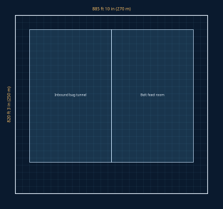
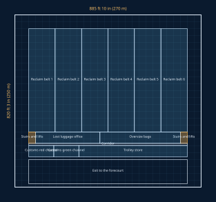
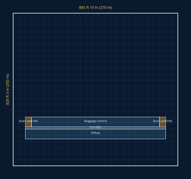

# P2-14 Baggage Hall: plan

Footprint 885 ft 10 in (270 m) × 820 ft 3 in (250 m) · structural grid 32 ft 10 in (10 m)

## Levels

| Level | Floor above deck | Height | Floor area |
|---|---|---|---|
| Level B1 · Baggage tunnel | −19 ft 8 in (6,000 mm) | 19 ft 8 in (6,000 mm) | 460,480 sq ft (42,780 m²) |
| Level 1 · Reclaim hall | 0 ft (0 mm) | 29 ft 6 in (9,000 mm) | 449,501 sq ft (41,760 m²) |
| Level 2 · Upper | 29 ft 6 in (9,000 mm) | 14 ft 9 in (4,500 mm) | 78,146 sq ft (7,260 m²) |

## Elements

| ID | Designation | Type | Name | Level(s) | Size / length | Area | Status |
|---|---|---|---|---|---|---|---|
| E001 | D5F3P2B3A4L1R1 | room | Reclaim belt 1 | L1 | 125 ft 8 in (38 m) × 492 ft 2 in (150 m) | 61,839 sq ft (5,745 m²) | proposed |
| E002 | D5F3P2B3A4L1R2 | room | Reclaim belt 2 | L1 | 126 ft (38 m) × 492 ft 2 in (150 m) | 62,000 sq ft (5,760 m²) | proposed |
| E003 | D5F3P2B3A4L1R3 | room | Reclaim belt 3 | L1 | 125 ft 8 in (38 m) × 492 ft 2 in (150 m) | 61,839 sq ft (5,745 m²) | proposed |
| E004 | D5F3P2B3A4L1R4 | room | Reclaim belt 4 | L1 | 125 ft 8 in (38 m) × 492 ft 2 in (150 m) | 61,839 sq ft (5,745 m²) | proposed |
| E005 | D5F3P2B3A4L1R5 | room | Reclaim belt 5 | L1 | 126 ft (38 m) × 492 ft 2 in (150 m) | 62,000 sq ft (5,760 m²) | proposed |
| E006 | D5F3P2B3A4L1R6 | room | Reclaim belt 6 | L1 | 125 ft 8 in (38 m) × 492 ft 2 in (150 m) | 61,839 sq ft (5,745 m²) | proposed |
| E007 | D5F3P2B3A4L1R7, D5F3P2B3A4L2R1 | core | Stairs and lifts | L1, L2 | 32 ft 10 in (10 m) × 54 ft 2 in (16 m) | 1,776 sq ft (165 m²) | proposed |
| E008 | D5F3P2B3A4L1R8, D5F3P2B3A4L2R2 | core | Stairs and lifts | L1, L2 | 32 ft 10 in (10 m) × 54 ft 2 in (16 m) | 1,776 sq ft (165 m²) | proposed |
| E009 | D5F3P2B3A4L1R9 | zone | Corridor | L1 | 754 ft 7 in (230 m) × 9 ft 10 in (3,000 mm) | 7,427 sq ft (690 m²) | proposed |
| E010 | D5F3P2B3A4L1R10 | room | Lost luggage office | L1 | 306 ft 1 in (93 m) × 54 ft 2 in (16 m) | 16,571 sq ft (1,539 m²) | proposed |
| E011 | D5F3P2B3A4L1R11 | room | Oversize bags | L1 | 382 ft 10 in (117 m) × 54 ft 2 in (16 m) | 20,726 sq ft (1,926 m²) | proposed |
| E012 | D5F3P2B3A4L1R12 | room | Customs red channel | L1 | 119 ft 5 in (36 m) × 54 ft 2 in (16 m) | 6,465 sq ft (601 m²) | proposed |
| E013 | D5F3P2B3A4L1R13 | room | Customs green channel | L1 | 119 ft 1 in (36 m) × 54 ft 2 in (16 m) | 6,447 sq ft (599 m²) | proposed |
| E014 | D5F3P2B3A4L1R14 | room | Trolley store | L1 | 516 ft 1 in (157 m) × 54 ft 2 in (16 m) | 27,937 sq ft (2,595 m²) | proposed |
| E015 | D5F3P2B3A4L2R3 | zone | Corridor | L2 | 754 ft 7 in (230 m) × 9 ft 10 in (3,000 mm) | 7,427 sq ft (690 m²) | proposed |
| E016 | D5F3P2B3A4L2R4 | room | Baggage control | L2 | 689 ft (210 m) × 54 ft 2 in (16 m) | 37,297 sq ft (3,465 m²) | proposed |
| E017 | D5F3P2B3A4L2R5 | room | Offices | L2 | 754 ft 7 in (230 m) × 54 ft 2 in (16 m) | 40,849 sq ft (3,795 m²) | proposed |
| E018 | D5F3P2B3A4LB1R1 | room | Inbound bag tunnel | LB1 | 377 ft 4 in (115 m) × 610 ft 3 in (186 m) | 230,240 sq ft (21,390 m²) | proposed |
| E019 | D5F3P2B3A4LB1R2 | room | Belt feed room | LB1 | 377 ft 4 in (115 m) × 610 ft 3 in (186 m) | 230,240 sq ft (21,390 m²) | proposed |
| E020 | D5F3P2B3A4L1R15 | zone | Exit to the forecourt | L1 | 754 ft 7 in (230 m) × 114 ft 10 in (35 m) | 86,649 sq ft (8,050 m²) | proposed |

## Drawings

### Level B1 · Baggage tunnel

### Level 1 · Reclaim hall

### Level 2 · Upper

