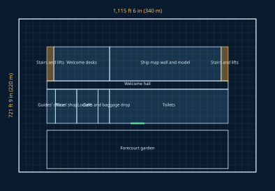

# P2-15 Visitor Centre: plan

Footprint 1,115 ft 6 in (340 m) × 721 ft 9 in (220 m) · structural grid 32 ft 10 in (10 m)

## Levels

| Level | Floor above deck | Height | Floor area |
|---|---|---|---|
| Level 1 · Ground floor | 0 ft (0 mm) | 19 ft 8 in (6,000 mm) | 263,716 sq ft (24,500 m²) |
| Level 2 · Gallery | 19 ft 8 in (6,000 mm) | 16 ft 5 in (5,000 mm) | 263,716 sq ft (24,500 m²) |
| Level 3 · Viewing deck | 36 ft 1 in (11 m) | 13 ft 1 in (4,000 mm) | 75,347 sq ft (7,000 m²) |

## Elements

| ID | Designation | Type | Name | Level(s) | Size / length | Area | Status |
|---|---|---|---|---|---|---|---|
| E001 | D5F3P2B3A5L1R1, D5F3P2B3A5L2R1 | core | Stairs and lifts | L1, L2 | 32 ft 10 in (10 m) × 160 ft 9 in (49 m) | 5,274 sq ft (490 m²) | proposed |
| E002 | D5F3P2B3A5L1R2, D5F3P2B3A5L2R2 | core | Stairs and lifts | L1, L2 | 32 ft 10 in (10 m) × 160 ft 9 in (49 m) | 5,274 sq ft (490 m²) | proposed |
| E003 | D5F3P2B3A5L1R3 | zone | Welcome hall | L1 | 853 ft (260 m) × 39 ft 4 in (12 m) | 33,583 sq ft (3,120 m²) | proposed |
| E004 | D5F3P2B3A5L1R4 | room | Welcome desks | L1 | 262 ft 6 in (80 m) × 160 ft 9 in (49 m) | 42,195 sq ft (3,920 m²) | proposed |
| E005 | D5F3P2B3A5L1R5 | room | Ship map wall and model | L1 | 524 ft 11 in (160 m) × 160 ft 9 in (49 m) | 84,389 sq ft (7,840 m²) | proposed |
| E006 | D5F3P2B3A5L1R6 | room | Guides' office | L1 | 40 ft (12 m) × 160 ft 9 in (49 m) | 6,435 sq ft (598 m²) | proposed |
| E007 | D5F3P2B3A5L1R7 | room | Travel shop | L1 | 100 ft 9 in (31 m) × 160 ft 9 in (49 m) | 16,192 sq ft (1,504 m²) | proposed |
| E008 | D5F3P2B3A5L1R8 | room | Café | L1 | 100 ft 5 in (31 m) × 160 ft 9 in (49 m) | 16,139 sq ft (1,499 m²) | proposed |
| E009 | D5F3P2B3A5L1R9 | room | Lockers and baggage drop | L1 | 53 ft 6 in (16 m) × 160 ft 9 in (49 m) | 8,597 sq ft (799 m²) | proposed |
| E010 | D5F3P2B3A5L1R10 | room | Toilets | L1 | 558 ft 5 in (170 m) × 160 ft 9 in (49 m) | 89,769 sq ft (8,340 m²) | proposed |
| E011 | D5F3P2B3A5L2R3 | zone | Welcome hall | L2 | 853 ft (260 m) × 39 ft 4 in (12 m) | 33,583 sq ft (3,120 m²) | proposed |
| E012 | D5F3P2B3A5L2R4 | room | Invicta exhibition | L2 | 787 ft 5 in (240 m) × 160 ft 9 in (49 m) | 126,584 sq ft (11,760 m²) | proposed |
| E013 | D5F3P2B3A5L2R5 | room | Cinema | L2 | 100 ft 5 in (31 m) × 160 ft 9 in (49 m) | 16,139 sq ft (1,499 m²) | proposed |
| E014 | D5F3P2B3A5L2R6 | room | Group rooms | L2 | 8 ft 2 in (2,500 mm) × 160 ft 9 in (49 m) | 1,319 sq ft (122 m²) | proposed |
| E015 | D5F3P2B3A5L2R7 | room | Group rooms | L2 | 7 ft 10 in (2,400 mm) × 160 ft 9 in (49 m) | 1,266 sq ft (118 m²) | proposed |
| E016 | D5F3P2B3A5L2R8 | room | Group rooms | L2 | 8 ft 2 in (2,500 mm) × 160 ft 9 in (49 m) | 1,319 sq ft (122 m²) | proposed |
| E017 | D5F3P2B3A5L2R9 | room | Group rooms | L2 | 7 ft 10 in (2,400 mm) × 160 ft 9 in (49 m) | 1,266 sq ft (118 m²) | proposed |
| E018 | D5F3P2B3A5L2R10 | room | Offices | L2 | 720 ft 6 in (220 m) × 160 ft 9 in (49 m) | 115,824 sq ft (10,760 m²) | proposed |
| E019 | D5F3P2B3A5L3R1 | room | Roof viewing deck | L3 | 328 ft 1 in (100 m) × 229 ft 8 in (70 m) | 75,347 sq ft (7,000 m²) | proposed |
| E020 | D5F3P2B3A5L1R11 | zone | Forecourt garden | L1 | 853 ft (260 m) × 180 ft 5 in (55 m) | 153,924 sq ft (14,300 m²) | proposed |
| E021 |  | door | Main entrance | L1 | 65 ft 7 in (20 m), 65 ft 7 in (20 m) wide | — | proposed |

## Drawings

### Level 1 · Ground floor

### Level 2 · Gallery

### Level 3 · Viewing deck

