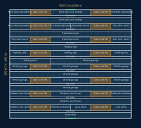
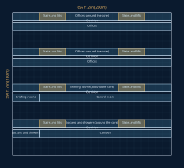

# P2-16 Arrivals Police Post: plan

Footprint 656 ft 2 in (200 m) × 590 ft 7 in (180 m) · structural grid 32 ft 10 in (10 m)

## Levels

| Level | Floor above deck | Height | Floor area |
|---|---|---|---|
| Level 1 · Ground floor | 0 ft (0 mm) | 13 ft 9 in (4,200 mm) | 85,627 sq ft (7,955 m²) |
| Level 2 · Upper floor | 13 ft 9 in (4,200 mm) | 13 ft 9 in (4,200 mm) | 53,766 sq ft (4,995 m²) |

## Elements

| ID | Designation | Type | Name | Level(s) | Size / length | Area | Status |
|---|---|---|---|---|---|---|---|
| E001 | D5F3P2B4A1L1R1, D5F3P2B4A1L2R1 | core | Stairs and lifts | L1, L2 | 32 ft 10 in (10 m) × 60 ft 8 in (18 m) | 1,991 sq ft (185 m²) | proposed |
| E002 | D5F3P2B4A1L1R2 | zone | Corridor | L1 | 459 ft 4 in (140 m) × 9 ft 10 in (3,000 mm) | 4,521 sq ft (420 m²) | proposed |
| E003 | D5F3P2B4A1L1R3 | room | Front desk | L1 | 213 ft 3 in (65 m) × 60 ft 8 in (18 m) | 12,944 sq ft (1,202 m²) | proposed |
| E004 | D5F3P2B4A1L1R4 | room | Front desk | L1 | 213 ft 3 in (65 m) × 60 ft 8 in (18 m) | 12,944 sq ft (1,202 m²) | proposed |
| E005 | D5F3P2B4A1L1R5 | room | Interview rooms | L1 | 5 ft 3 in (1,600 mm) × 60 ft 8 in (18 m) | 319 sq ft (30 m²) | proposed |
| E006 | D5F3P2B4A1L1R6 | room | Interview rooms | L1 | 5 ft 3 in (1,600 mm) × 60 ft 8 in (18 m) | 319 sq ft (30 m²) | proposed |
| E007 | D5F3P2B4A1L1R7 | room | Interview rooms | L1 | 5 ft 7 in (1,700 mm) × 60 ft 8 in (18 m) | 339 sq ft (31 m²) | proposed |
| E008 | D5F3P2B4A1L1R8 | room | Holding rooms | L1 | 2 ft (600 mm) × 60 ft 8 in (18 m) | 119 sq ft (11 m²) | proposed |
| E009 | D5F3P2B4A1L1R9 | room | Holding rooms | L1 | 2 ft 4 in (700 mm) × 60 ft 8 in (18 m) | 139 sq ft (13 m²) | proposed |
| E010 | D5F3P2B4A1L1R10 | room | Holding rooms | L1 | 2 ft (600 mm) × 60 ft 8 in (18 m) | 119 sq ft (11 m²) | proposed |
| E011 | D5F3P2B4A1L1R11 | room | Holding rooms | L1 | 2 ft 4 in (700 mm) × 60 ft 8 in (18 m) | 139 sq ft (13 m²) | proposed |
| E012 | D5F3P2B4A1L1R12 | room | Holding rooms | L1 | 2 ft (600 mm) × 60 ft 8 in (18 m) | 119 sq ft (11 m²) | proposed |
| E013 | D5F3P2B4A1L1R13 | room | Holding rooms | L1 | 2 ft 4 in (700 mm) × 60 ft 8 in (18 m) | 139 sq ft (13 m²) | proposed |
| E014 | D5F3P2B4A1L1R14 | room | Duty office | L1 | 430 ft 5 in (131 m) × 60 ft 8 in (18 m) | 26,126 sq ft (2,427 m²) | proposed |
| E015 | D5F3P2B4A1L2R2 | zone | Corridor | L2 | 459 ft 4 in (140 m) × 9 ft 10 in (3,000 mm) | 4,521 sq ft (420 m²) | proposed |
| E016 | D5F3P2B4A1L2R3 | room | Open office | L2 | 213 ft 3 in (65 m) × 60 ft 8 in (18 m) | 12,944 sq ft (1,202 m²) | proposed |
| E017 | D5F3P2B4A1L2R4 | room | Open office | L2 | 213 ft 3 in (65 m) × 60 ft 8 in (18 m) | 12,944 sq ft (1,202 m²) | proposed |
| E018 | D5F3P2B4A1L2R5 | room | Briefing room | L2 | 44 ft 3 in (14 m) × 60 ft 8 in (18 m) | 2,688 sq ft (250 m²) | proposed |
| E019 | D5F3P2B4A1L2R6 | room | Lockers | L2 | 415 ft (126 m) × 60 ft 8 in (18 m) | 25,190 sq ft (2,340 m²) | proposed |
| E020 | D5F3P2B4A1L1R15 | zone | Corridor | L1 | 9 ft 10 in (3,000 mm) × 262 ft 6 in (80 m) | 2,583 sq ft (240 m²) | proposed |
| E021 | D5F3P2B4A1L1R16 | room | Vehicle garage | L1 | 60 ft 8 in (18 m) × 262 ft 6 in (80 m) | 15,931 sq ft (1,480 m²) | proposed |
| E022 | D5F3P2B4A1L1R17 | room | Evidence store | L1 | 60 ft 8 in (18 m) × 262 ft 6 in (80 m) | 15,931 sq ft (1,480 m²) | proposed |
| E023 | D5F3P2B4A1L1R18 | zone | Secure yard | L1 | 328 ft 1 in (100 m) × 262 ft 6 in (80 m) | 86,111 sq ft (8,000 m²) | proposed |

## Drawings

### Level 1 · Ground floor

### Level 2 · Upper floor

