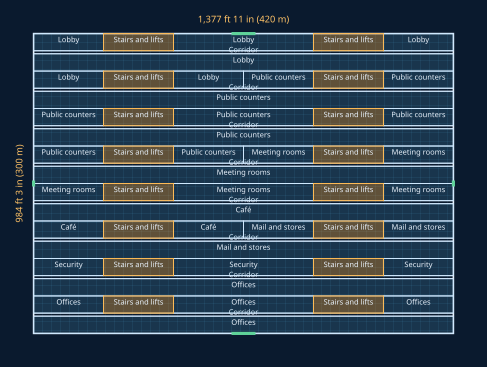
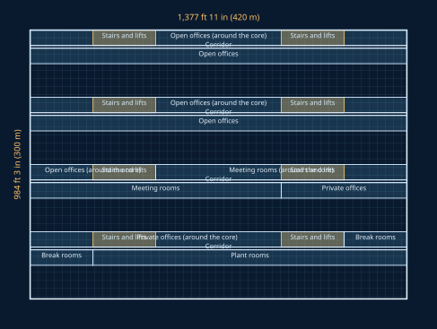
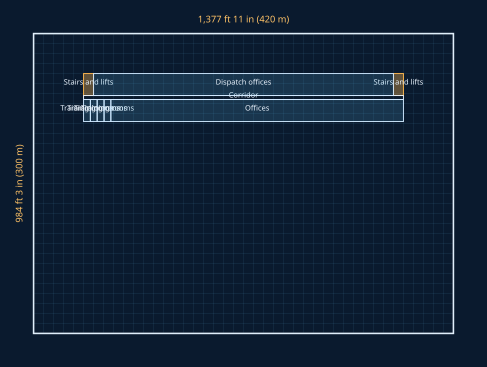
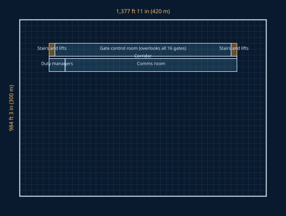

# P2-17 Gate Operations: plan

Footprint 1,377 ft 11 in (420 m) × 984 ft 3 in (300 m) · structural grid 32 ft 10 in (10 m)

## Levels

| Level | Floor above deck | Height | Floor area |
|---|---|---|---|
| Level 1 · Ground floor | 0 ft (0 mm) | 16 ft 5 in (5,000 mm) | 560,154 sq ft (52,040 m²) |
| Level 2 · Level 2 | 16 ft 5 in (5,000 mm) | 14 ft 9 in (4,500 mm) | 560,154 sq ft (52,040 m²) |
| Level 3 · Level 3 | 31 ft 2 in (9,500 mm) | 14 ft 9 in (4,500 mm) | 146,820 sq ft (13,640 m²) |
| Level 4 · Gate control floor | 45 ft 11 in (14 m) | 19 ft 8 in (6,000 mm) | 146,820 sq ft (13,640 m²) |

## Elements

| ID | Designation | Type | Name | Level(s) | Size / length | Area | Status |
|---|---|---|---|---|---|---|---|
| E001 | D5F3P2B4A2L1R1, D5F3P2B4A2L2R1, D5F3P2B4A2L3R1, D5F3P2B4A2L4R1 | core | Stairs and lifts | L1, L2, L3, L4 | 32 ft 10 in (10 m) × 72 ft 2 in (22 m) | 2,368 sq ft (220 m²) | proposed |
| E002 | D5F3P2B4A2L1R2, D5F3P2B4A2L2R2, D5F3P2B4A2L3R2, D5F3P2B4A2L4R2 | core | Stairs and lifts | L1, L2, L3, L4 | 32 ft 10 in (10 m) × 72 ft 2 in (22 m) | 2,368 sq ft (220 m²) | proposed |
| E003 | D5F3P2B4A2L1R3 | zone | Corridor | L1 | 1,049 ft 10 in (320 m) × 13 ft 1 in (4,000 mm) | 13,778 sq ft (1,280 m²) | proposed |
| E004 | D5F3P2B4A2L1R4 | room | Entrance hall | L1 | 281 ft 2 in (86 m) × 72 ft 2 in (22 m) | 20,294 sq ft (1,885 m²) | proposed |
| E005 | D5F3P2B4A2L1R5 | room | Gate crew room | L1 | 703 ft 1 in (214 m) × 72 ft 2 in (22 m) | 50,748 sq ft (4,715 m²) | proposed |
| E006 | D5F3P2B4A2L1R6 | room | Ramp equipment store | L1 | 298 ft 3 in (91 m) × 72 ft 2 in (22 m) | 21,526 sq ft (2,000 m²) | proposed |
| E007 | D5F3P2B4A2L1R7 | room | Lockers | L1 | 179 ft 2 in (55 m) × 72 ft 2 in (22 m) | 12,930 sq ft (1,201 m²) | proposed |
| E008 | D5F3P2B4A2L1R8 | room | Canteen | L1 | 572 ft 6 in (174 m) × 72 ft 2 in (22 m) | 41,323 sq ft (3,839 m²) | proposed |
| E009 | D5F3P2B4A2L2R3, D5F3P2B4A2L3R3 | zone | Corridor | L2, L3 | 1,049 ft 10 in (320 m) × 13 ft 1 in (4,000 mm) | 13,778 sq ft (1,280 m²) | proposed |
| E010 | D5F3P2B4A2L2R4, D5F3P2B4A2L3R4 | room | Dispatch offices | L2, L3 | 984 ft 3 in (300 m) × 72 ft 2 in (22 m) | 71,042 sq ft (6,600 m²) | proposed |
| E011 | D5F3P2B4A2L2R5, D5F3P2B4A2L3R5 | room | Training rooms | L2, L3 | 22 ft 4 in (6,800 mm) × 72 ft 2 in (22 m) | 1,610 sq ft (150 m²) | proposed |
| E012 | D5F3P2B4A2L2R6, D5F3P2B4A2L3R6 | room | Training rooms | L2, L3 | 22 ft 4 in (6,800 mm) × 72 ft 2 in (22 m) | 1,610 sq ft (150 m²) | proposed |
| E013 | D5F3P2B4A2L2R7, D5F3P2B4A2L3R7 | room | Training rooms | L2, L3 | 22 ft 8 in (6,900 mm) × 72 ft 2 in (22 m) | 1,634 sq ft (152 m²) | proposed |
| E014 | D5F3P2B4A2L2R8, D5F3P2B4A2L3R8 | room | Training rooms | L2, L3 | 22 ft 4 in (6,800 mm) × 72 ft 2 in (22 m) | 1,610 sq ft (150 m²) | proposed |
| E015 | D5F3P2B4A2L2R9, D5F3P2B4A2L3R9 | room | Offices | L2, L3 | 960 ft 4 in (293 m) × 72 ft 2 in (22 m) | 69,313 sq ft (6,439 m²) | proposed |
| E016 | D5F3P2B4A2L4R3 | zone | Corridor | L4 | 1,049 ft 10 in (320 m) × 13 ft 1 in (4,000 mm) | 13,778 sq ft (1,280 m²) | proposed |
| E017 | D5F3P2B4A2L4R4 | room | Gate control room (overlooks all 16 gates) | L4 | 984 ft 3 in (300 m) × 72 ft 2 in (22 m) | 71,042 sq ft (6,600 m²) | proposed |
| E018 | D5F3P2B4A2L4R5 | room | Duty managers | L4 | 89 ft 7 in (27 m) × 72 ft 2 in (22 m) | 6,465 sq ft (601 m²) | proposed |
| E019 | D5F3P2B4A2L4R6 | room | Comms room | L4 | 960 ft 4 in (293 m) × 72 ft 2 in (22 m) | 69,313 sq ft (6,439 m²) | proposed |
| E020 | D5F3P2B4A2L1R9, D5F3P2B4A2L2R10 | room | Boarding bridge spares | L1, L2 | 262 ft 6 in (80 m) × 393 ft 8 in (120 m) | 103,334 sq ft (9,600 m²) | proposed |
| E021 | D5F3P2B4A2L1R10, D5F3P2B4A2L2R11 | room | Tug and tow bay | L1, L2 | 262 ft 6 in (80 m) × 393 ft 8 in (120 m) | 103,334 sq ft (9,600 m²) | proposed |
| E022 | D5F3P2B4A2L1R11, D5F3P2B4A2L2R12 | room | Ground power units | L1, L2 | 262 ft 6 in (80 m) × 393 ft 8 in (120 m) | 103,334 sq ft (9,600 m²) | proposed |
| E023 | D5F3P2B4A2L1R12, D5F3P2B4A2L2R13 | room | Stairs and loaders | L1, L2 | 262 ft 6 in (80 m) × 393 ft 8 in (120 m) | 103,334 sq ft (9,600 m²) | proposed |
| E024 | D5F3P2B4A2L1R13 | zone | Equipment yard | L1 | 1,049 ft 10 in (320 m) × 164 ft 1 in (50 m) | 172,223 sq ft (16,000 m²) | proposed |
| E025 |  | door | Main entrance | L1 | 65 ft 7 in (20 m), 65 ft 7 in (20 m) wide | — | proposed |

## Drawings

### Level 1 · Ground floor

### Level 2 · Level 2

### Level 3 · Level 3

### Level 4 · Gate control floor

