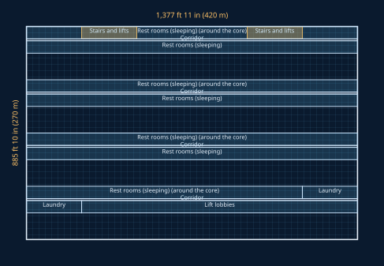

# P2-18 Staff Centre: plan

Footprint 1,377 ft 11 in (420 m) × 885 ft 10 in (270 m) · structural grid 32 ft 10 in (10 m)

## Levels

| Level | Floor above deck | Height | Floor area |
|---|---|---|---|
| Level 1 · Ground floor | 0 ft (0 mm) | 16 ft 5 in (5,000 mm) | 266,837 sq ft (24,790 m²) |
| Level 2 · Level 2 | 16 ft 5 in (5,000 mm) | 13 ft 1 in (4,000 mm) | 266,837 sq ft (24,790 m²) |
| Level 3 · Level 3 | 29 ft 6 in (9,000 mm) | 13 ft 1 in (4,000 mm) | 131,427 sq ft (12,210 m²) |

## Elements

| ID | Designation | Type | Name | Level(s) | Size / length | Area | Status |
|---|---|---|---|---|---|---|---|
| E001 | D5F3P2B4A3L1R1, D5F3P2B4A3L2R1, D5F3P2B4A3L3R1 | core | Stairs and lifts | L1, L2, L3 | 32 ft 10 in (10 m) × 60 ft 8 in (18 m) | 1,991 sq ft (185 m²) | proposed |
| E002 | D5F3P2B4A3L1R2, D5F3P2B4A3L2R2, D5F3P2B4A3L3R2 | core | Stairs and lifts | L1, L2, L3 | 32 ft 10 in (10 m) × 60 ft 8 in (18 m) | 1,991 sq ft (185 m²) | proposed |
| E003 | D5F3P2B4A3L1R3 | zone | Corridor | L1 | 1,115 ft 6 in (340 m) × 9 ft 10 in (3,000 mm) | 10,979 sq ft (1,020 m²) | proposed |
| E004 | D5F3P2B4A3L1R4 | room | Staff entrance and security | L1 | 136 ft 10 in (42 m) × 60 ft 8 in (18 m) | 8,304 sq ft (771 m²) | proposed |
| E005 | D5F3P2B4A3L1R5 | room | Canteen | L1 | 913 ft 1 in (278 m) × 60 ft 8 in (18 m) | 55,419 sq ft (5,149 m²) | proposed |
| E006 | D5F3P2B4A3L1R6 | room | Kitchen | L1 | 212 ft 11 in (65 m) × 60 ft 8 in (18 m) | 12,924 sq ft (1,201 m²) | proposed |
| E007 | D5F3P2B4A3L1R7 | room | Shop | L1 | 70 ft 10 in (22 m) × 60 ft 8 in (18 m) | 4,301 sq ft (400 m²) | proposed |
| E008 | D5F3P2B4A3L1R8 | room | Toilets | L1 | 831 ft 8 in (254 m) × 60 ft 8 in (18 m) | 50,480 sq ft (4,690 m²) | proposed |
| E009 | D5F3P2B4A3L2R3, D5F3P2B4A3L3R3 | zone | Corridor | L2, L3 | 1,115 ft 6 in (340 m) × 9 ft 10 in (3,000 mm) | 10,979 sq ft (1,020 m²) | proposed |
| E010 | D5F3P2B4A3L2R4, D5F3P2B4A3L3R4 | room | Training centre | L2, L3 | 1,049 ft 10 in (320 m) × 60 ft 8 in (18 m) | 63,722 sq ft (5,920 m²) | proposed |
| E011 | D5F3P2B4A3L2R5, D5F3P2B4A3L3R5 | room | HR and payroll | L2, L3 | 212 ft 11 in (65 m) × 60 ft 8 in (18 m) | 12,924 sq ft (1,201 m²) | proposed |
| E012 | D5F3P2B4A3L2R6, D5F3P2B4A3L3R6 | room | Union and welfare rooms | L2, L3 | 106 ft 4 in (32 m) × 60 ft 8 in (18 m) | 6,452 sq ft (599 m²) | proposed |
| E013 | D5F3P2B4A3L2R7, D5F3P2B4A3L3R7 | room | Offices | L2, L3 | 796 ft 3 in (243 m) × 60 ft 8 in (18 m) | 48,329 sq ft (4,490 m²) | proposed |
| E014 | D5F3P2B4A3L1R9, D5F3P2B4A3L2R8 | zone | Corridor | L1, L2 | 9 ft 10 in (3,000 mm) × 557 ft 9 in (170 m) | 5,490 sq ft (510 m²) | proposed |
| E015 | D5F3P2B4A3L1R10, D5F3P2B4A3L2R9 | room | Lockers and showers | L1, L2 | 60 ft 8 in (18 m) × 278 ft 10 in (85 m) | 16,926 sq ft (1,572 m²) | proposed |
| E016 | D5F3P2B4A3L1R11, D5F3P2B4A3L2R10 | room | Lockers and showers | L1, L2 | 60 ft 8 in (18 m) × 278 ft 10 in (85 m) | 16,926 sq ft (1,572 m²) | proposed |
| E017 | D5F3P2B4A3L1R12, D5F3P2B4A3L2R11 | room | Lockers and showers | L1, L2 | 60 ft 8 in (18 m) × 212 ft 11 in (65 m) | 12,924 sq ft (1,201 m²) | proposed |
| E018 | D5F3P2B4A3L1R13, D5F3P2B4A3L2R12 | room | Lockers and showers | L1, L2 | 60 ft 8 in (18 m) × 212 ft 7 in (65 m) | 12,904 sq ft (1,199 m²) | proposed |
| E019 | D5F3P2B4A3L1R14, D5F3P2B4A3L2R13 | room | Uniform store | L1, L2 | 60 ft 8 in (18 m) × 132 ft 3 in (40 m) | 8,025 sq ft (746 m²) | proposed |
| E020 | D5F3P2B4A3L1R15 | zone | Corridor | L1 | 9 ft 10 in (3,000 mm) × 557 ft 9 in (170 m) | 5,490 sq ft (510 m²) | proposed |
| E021 | D5F3P2B4A3L1R16 | room | Quiet room | L1 | 60 ft 8 in (18 m) × 440 ft 3 in (134 m) | 26,724 sq ft (2,483 m²) | proposed |
| E022 | D5F3P2B4A3L1R17 | room | Prayer rooms | L1 | 60 ft 8 in (18 m) × 58 ft 9 in (18 m) | 3,564 sq ft (331 m²) | proposed |
| E023 | D5F3P2B4A3L1R18 | room | Prayer rooms | L1 | 60 ft 8 in (18 m) × 58 ft 9 in (18 m) | 3,564 sq ft (331 m²) | proposed |
| E024 | D5F3P2B4A3L1R19 | room | Nap pods | L1 | 60 ft 8 in (18 m) × 177 ft 6 in (54 m) | 10,773 sq ft (1,001 m²) | proposed |
| E025 | D5F3P2B4A3L1R20 | room | Gym | L1 | 60 ft 8 in (18 m) × 380 ft 3 in (116 m) | 23,079 sq ft (2,144 m²) | proposed |
| E026 | D5F3P2B4A3L2R14 | zone | Corridor | L2 | 9 ft 10 in (3,000 mm) × 557 ft 9 in (170 m) | 5,490 sq ft (510 m²) | proposed |
| E027 | D5F3P2B4A3L2R15 | room | Rest rooms | L2 | 60 ft 8 in (18 m) × 37 ft 1 in (11 m) | 2,250 sq ft (209 m²) | proposed |
| E028 | D5F3P2B4A3L2R16 | room | Rest rooms | L2 | 60 ft 8 in (18 m) × 37 ft 5 in (11 m) | 2,270 sq ft (211 m²) | proposed |
| E029 | D5F3P2B4A3L2R17 | room | Rest rooms | L2 | 60 ft 8 in (18 m) × 37 ft 1 in (11 m) | 2,250 sq ft (209 m²) | proposed |
| E030 | D5F3P2B4A3L2R18 | room | Rest rooms | L2 | 60 ft 8 in (18 m) × 37 ft 1 in (11 m) | 2,250 sq ft (209 m²) | proposed |
| E031 | D5F3P2B4A3L2R19 | room | Rest rooms | L2 | 60 ft 8 in (18 m) × 37 ft 5 in (11 m) | 2,270 sq ft (211 m²) | proposed |
| E032 | D5F3P2B4A3L2R20 | room | Rest rooms | L2 | 60 ft 8 in (18 m) × 37 ft 1 in (11 m) | 2,250 sq ft (209 m²) | proposed |
| E033 | D5F3P2B4A3L2R21 | room | Rest rooms | L2 | 60 ft 8 in (18 m) × 37 ft 1 in (11 m) | 2,250 sq ft (209 m²) | proposed |
| E034 | D5F3P2B4A3L2R22 | room | Rest rooms | L2 | 60 ft 8 in (18 m) × 37 ft 5 in (11 m) | 2,270 sq ft (211 m²) | proposed |
| E035 | D5F3P2B4A3L2R23 | room | Rest rooms | L2 | 60 ft 8 in (18 m) × 37 ft 1 in (11 m) | 2,250 sq ft (209 m²) | proposed |
| E036 | D5F3P2B4A3L2R24 | room | Rest rooms | L2 | 60 ft 8 in (18 m) × 37 ft 1 in (11 m) | 2,250 sq ft (209 m²) | proposed |
| E037 | D5F3P2B4A3L2R25 | room | Rest rooms | L2 | 60 ft 8 in (18 m) × 37 ft 5 in (11 m) | 2,270 sq ft (211 m²) | proposed |
| E038 | D5F3P2B4A3L2R26 | room | Rest rooms | L2 | 60 ft 8 in (18 m) × 37 ft 1 in (11 m) | 2,250 sq ft (209 m²) | proposed |
| E039 | D5F3P2B4A3L2R27 | room | Rest rooms | L2 | 60 ft 8 in (18 m) × 37 ft 1 in (11 m) | 2,250 sq ft (209 m²) | proposed |
| E040 | D5F3P2B4A3L2R28 | room | Rest rooms | L2 | 60 ft 8 in (18 m) × 37 ft 5 in (11 m) | 2,270 sq ft (211 m²) | proposed |
| E041 | D5F3P2B4A3L2R29 | room | Rest rooms | L2 | 60 ft 8 in (18 m) × 37 ft 1 in (11 m) | 2,250 sq ft (209 m²) | proposed |
| E042 | D5F3P2B4A3L2R30 | room | Rest rooms | L2 | 60 ft 8 in (18 m) × 37 ft 1 in (11 m) | 2,250 sq ft (209 m²) | proposed |
| E043 | D5F3P2B4A3L2R31 | room | Rest rooms | L2 | 60 ft 8 in (18 m) × 37 ft 5 in (11 m) | 2,270 sq ft (211 m²) | proposed |
| E044 | D5F3P2B4A3L2R32 | room | Rest rooms | L2 | 60 ft 8 in (18 m) × 37 ft 1 in (11 m) | 2,250 sq ft (209 m²) | proposed |
| E045 | D5F3P2B4A3L2R33 | room | Rest rooms | L2 | 60 ft 8 in (18 m) × 37 ft 1 in (11 m) | 2,250 sq ft (209 m²) | proposed |
| E046 | D5F3P2B4A3L2R34 | room | Rest rooms | L2 | 60 ft 8 in (18 m) × 37 ft 5 in (11 m) | 2,270 sq ft (211 m²) | proposed |
| E047 | D5F3P2B4A3L2R35 | room | Rest rooms | L2 | 60 ft 8 in (18 m) × 37 ft 1 in (11 m) | 2,250 sq ft (209 m²) | proposed |
| E048 | D5F3P2B4A3L2R36 | room | Rest rooms | L2 | 60 ft 8 in (18 m) × 37 ft 1 in (11 m) | 2,250 sq ft (209 m²) | proposed |
| E049 | D5F3P2B4A3L2R37 | room | Rest rooms | L2 | 60 ft 8 in (18 m) × 37 ft 5 in (11 m) | 2,270 sq ft (211 m²) | proposed |
| E050 | D5F3P2B4A3L2R38 | room | Rest rooms | L2 | 60 ft 8 in (18 m) × 37 ft 1 in (11 m) | 2,250 sq ft (209 m²) | proposed |
| E051 | D5F3P2B4A3L2R39 | room | Rest rooms | L2 | 60 ft 8 in (18 m) × 37 ft 1 in (11 m) | 2,250 sq ft (209 m²) | proposed |
| E052 | D5F3P2B4A3L2R40 | room | Rest rooms | L2 | 60 ft 8 in (18 m) × 37 ft 5 in (11 m) | 2,270 sq ft (211 m²) | proposed |
| E053 | D5F3P2B4A3L2R41 | room | Rest rooms | L2 | 60 ft 8 in (18 m) × 37 ft 1 in (11 m) | 2,250 sq ft (209 m²) | proposed |
| E054 | D5F3P2B4A3L2R42 | room | Rest rooms | L2 | 60 ft 8 in (18 m) × 37 ft 1 in (11 m) | 2,250 sq ft (209 m²) | proposed |
| E055 | D5F3P2B4A3L2R43 | room | Rest rooms | L2 | 60 ft 8 in (18 m) × 37 ft 5 in (11 m) | 2,270 sq ft (211 m²) | proposed |
| E056 | D5F3P2B4A3L2R44 | room | Rest rooms | L2 | 60 ft 8 in (18 m) × 37 ft 1 in (11 m) | 2,250 sq ft (209 m²) | proposed |
| E057 | D5F3P2B4A3L1R21 | zone | Staff garden | L1 | 853 ft (260 m) × 524 ft 11 in (160 m) | 447,779 sq ft (41,600 m²) | proposed |

## Drawings

### Level 1 · Ground floor

### Level 2 · Level 2

### Level 3 · Level 3

