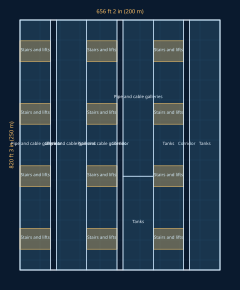
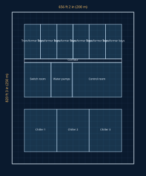
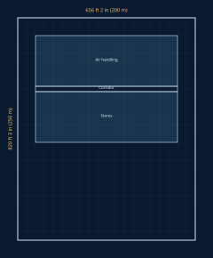

# P2-20 Arrivals Utility Plant: plan

Footprint 656 ft 2 in (200 m) × 820 ft 3 in (250 m) · structural grid 65 ft 7 in (20 m)

## Levels

| Level | Floor above deck | Height | Floor area |
|---|---|---|---|
| Level B1 · Plant level | −19 ft 8 in (6,000 mm) | 19 ft 8 in (6,000 mm) | 489,758 sq ft (45,500 m²) |
| Level 1 · Ground floor | 0 ft (0 mm) | 26 ft 3 in (8,000 mm) | 407,870 sq ft (37,892 m²) |
| Level 2 · Upper floor | 26 ft 3 in (8,000 mm) | 26 ft 3 in (8,000 mm) | 489,758 sq ft (45,500 m²) |

## Elements

| ID | Designation | Type | Name | Level(s) | Size / length | Area | Status |
|---|---|---|---|---|---|---|---|
| L1-001 | D5F3P2B5A2L1R1 | zone | Corridor | L1 | 19 ft 8 in (6,000 mm) × 820 ft 3 in (250 m) | 16,146 sq ft (1,500 m²) | proposed |
| L1-002 | D5F3P2B5A2L1R2 | zone | Corridor | L1 | 19 ft 8 in (6,000 mm) × 820 ft 3 in (250 m) | 16,146 sq ft (1,500 m²) | proposed |
| L1-003 | D5F3P2B5A2L1R3 | zone | Corridor | L1 | 19 ft 8 in (6,000 mm) × 820 ft 3 in (250 m) | 16,146 sq ft (1,500 m²) | proposed |
| L1-004 | D5F3P2B5A2L1R4 | room | Substation | L1 | 99 ft 5 in (30 m) × 68 ft 3 in (21 m) | 6,784 sq ft (630 m²) | proposed |
| L1-005 | D5F3P2B5A2L1R5 | room | Substation | L1 | 99 ft 5 in (30 m) × 136 ft 6 in (42 m) | 13,568 sq ft (1,260 m²) | proposed |
| L1-006 | D5F3P2B5A2L1R6 | room | Substation | L1 | 99 ft 5 in (30 m) × 136 ft 6 in (42 m) | 13,568 sq ft (1,260 m²) | proposed |
| L1-007 | D5F3P2B5A2L1R7 | room | Substation | L1 | 99 ft 5 in (30 m) × 136 ft 6 in (42 m) | 13,568 sq ft (1,260 m²) | proposed |
| L1-008 | D5F3P2B5A2L1R8 | room | Substation | L1 | 99 ft 5 in (30 m) × 68 ft 3 in (21 m) | 6,784 sq ft (630 m²) | proposed |
| L1-009 | D5F3P2B5A2L1R9 | room | Substation | L1 | 99 ft 9 in (30 m) × 478 ft 4 in (146 m) | 47,709 sq ft (4,432 m²) | proposed |
| L1-010 | D5F3P2B5A2L1R10 | room | Air handling | L1 | 99 ft 9 in (30 m) × 341 ft 10 in (104 m) | 34,097 sq ft (3,168 m²) | proposed |
| L1-011 | D5F3P2B5A2L1R11 | room | Air handling | L1 | 99 ft 5 in (30 m) × 68 ft 3 in (21 m) | 6,784 sq ft (630 m²) | proposed |
| L1-012 | D5F3P2B5A2L1R12 | room | Air handling | L1 | 99 ft 5 in (30 m) × 136 ft 6 in (42 m) | 13,568 sq ft (1,260 m²) | proposed |
| L1-013 | D5F3P2B5A2L1R13 | room | Air handling | L1 | 99 ft 5 in (30 m) × 136 ft 6 in (42 m) | 13,568 sq ft (1,260 m²) | proposed |
| L1-014 | D5F3P2B5A2L1R14 | room | Air handling | L1 | 99 ft 5 in (30 m) × 136 ft 6 in (42 m) | 13,568 sq ft (1,260 m²) | proposed |
| L1-015 | D5F3P2B5A2L1R15 | room | Air handling | L1 | 99 ft 5 in (30 m) × 68 ft 3 in (21 m) | 6,784 sq ft (630 m²) | proposed |
| L1-016 | D5F3P2B5A2L1R16 | room | Air handling | L1 | 99 ft 5 in (30 m) × 136 ft 10 in (42 m) | 13,600 sq ft (1,264 m²) | proposed |
| L1-017 | D5F3P2B5A2L1R17 | room | Water pumps and tanks | L1 | 99 ft 5 in (30 m) × 683 ft 5 in (208 m) | 67,936 sq ft (6,311 m²) | proposed |
| L1-018 | D5F3P2B5A2L1R18 | room | Water pumps and tanks | L1 | 99 ft 9 in (30 m) × 68 ft 3 in (21 m) | 6,806 sq ft (632 m²) | proposed |
| L1-019 | D5F3P2B5A2L1R19 | room | Water pumps and tanks | L1 | 99 ft 9 in (30 m) × 136 ft 6 in (42 m) | 13,612 sq ft (1,265 m²) | proposed |
| L1-020 | D5F3P2B5A2L1R20 | room | Water pumps and tanks | L1 | 99 ft 9 in (30 m) × 136 ft 6 in (42 m) | 13,612 sq ft (1,265 m²) | proposed |
| L1-021 | D5F3P2B5A2L1R21 | room | Control room | L1 | 99 ft 9 in (30 m) × 136 ft 6 in (42 m) | 13,612 sq ft (1,265 m²) | proposed |
| L1-022 | D5F3P2B5A2L1R22 | room | Control room | L1 | 99 ft 9 in (30 m) × 68 ft 3 in (21 m) | 6,806 sq ft (632 m²) | proposed |
| L1-023 | D5F3P2B5A2L1R23 | room | Workshop and stores | L1 | 99 ft 5 in (30 m) × 820 ft 3 in (250 m) | 81,537 sq ft (7,575 m²) | proposed |
| L1-024 | D5F3P2B5A2LB1R1, D5F3P2B5A2L1R24, D5F3P2B5A2L2R1 | core | Stairs and lifts | LB1, L1, L2 | 99 ft 5 in (30 m) × 68 ft 7 in (21 m) | 6,816 sq ft (633 m²) | proposed |
| L1-025 | D5F3P2B5A2LB1R2, D5F3P2B5A2L1R25, D5F3P2B5A2L2R2 | core | Stairs and lifts | LB1, L1, L2 | 99 ft 5 in (30 m) × 68 ft 7 in (21 m) | 6,816 sq ft (633 m²) | proposed |
| L1-026 | D5F3P2B5A2LB1R3, D5F3P2B5A2L1R26, D5F3P2B5A2L2R3 | core | Stairs and lifts | LB1, L1, L2 | 99 ft 5 in (30 m) × 68 ft 7 in (21 m) | 6,816 sq ft (633 m²) | proposed |
| L1-027 | D5F3P2B5A2LB1R4, D5F3P2B5A2L1R27, D5F3P2B5A2L2R4 | core | Stairs and lifts | LB1, L1, L2 | 99 ft 5 in (30 m) × 68 ft 7 in (21 m) | 6,816 sq ft (633 m²) | proposed |
| L1-028 | D5F3P2B5A2LB1R5, D5F3P2B5A2L1R28, D5F3P2B5A2L2R5 | core | Stairs and lifts | LB1, L1, L2 | 99 ft 5 in (30 m) × 68 ft 7 in (21 m) | 6,816 sq ft (633 m²) | proposed |
| L1-029 | D5F3P2B5A2LB1R6, D5F3P2B5A2L1R29, D5F3P2B5A2L2R6 | core | Stairs and lifts | LB1, L1, L2 | 99 ft 5 in (30 m) × 68 ft 7 in (21 m) | 6,816 sq ft (633 m²) | proposed |
| L1-030 | D5F3P2B5A2LB1R7, D5F3P2B5A2L1R30, D5F3P2B5A2L2R7 | core | Stairs and lifts | LB1, L1, L2 | 99 ft 5 in (30 m) × 68 ft 7 in (21 m) | 6,816 sq ft (633 m²) | proposed |
| L1-031 | D5F3P2B5A2LB1R8, D5F3P2B5A2L1R31, D5F3P2B5A2L2R8 | core | Stairs and lifts | LB1, L1, L2 | 99 ft 5 in (30 m) × 68 ft 7 in (21 m) | 6,816 sq ft (633 m²) | proposed |
| L1-032 | D5F3P2B5A2LB1R9, D5F3P2B5A2L1R32, D5F3P2B5A2L2R9 | core | Stairs and lifts | LB1, L1, L2 | 99 ft 9 in (30 m) × 68 ft 7 in (21 m) | 6,839 sq ft (635 m²) | proposed |
| L1-033 | D5F3P2B5A2LB1R10, D5F3P2B5A2L1R33, D5F3P2B5A2L2R10 | core | Stairs and lifts | LB1, L1, L2 | 99 ft 9 in (30 m) × 68 ft 7 in (21 m) | 6,839 sq ft (635 m²) | proposed |
| L1-034 | D5F3P2B5A2LB1R11, D5F3P2B5A2L1R34, D5F3P2B5A2L2R11 | core | Stairs and lifts | LB1, L1, L2 | 99 ft 9 in (30 m) × 68 ft 7 in (21 m) | 6,839 sq ft (635 m²) | proposed |
| L1-035 | D5F3P2B5A2LB1R12, D5F3P2B5A2L1R35, D5F3P2B5A2L2R12 | core | Stairs and lifts | LB1, L1, L2 | 99 ft 9 in (30 m) × 68 ft 7 in (21 m) | 6,839 sq ft (635 m²) | proposed |
| LT-001 | D5F3P2B5A2L2R13 | zone | Corridor | L2 | 19 ft 8 in (6,000 mm) × 820 ft 3 in (250 m) | 16,146 sq ft (1,500 m²) | proposed |
| LT-002 | D5F3P2B5A2L2R14 | zone | Corridor | L2 | 19 ft 8 in (6,000 mm) × 820 ft 3 in (250 m) | 16,146 sq ft (1,500 m²) | proposed |
| LT-003 | D5F3P2B5A2L2R15 | zone | Corridor | L2 | 19 ft 8 in (6,000 mm) × 820 ft 3 in (250 m) | 16,146 sq ft (1,500 m²) | proposed |
| LT-004 | D5F3P2B5A2L2R16 | room | Air handling (around the core) | L2 | 99 ft 5 in (30 m) × 820 ft 3 in (250 m) | 81,537 sq ft (7,575 m²) | proposed |
| LT-005 | D5F3P2B5A2L2R17 | room | Air handling | L2 | 99 ft 9 in (30 m) × 820 ft 3 in (250 m) | 81,806 sq ft (7,600 m²) | proposed |
| LT-006 | D5F3P2B5A2L2R18 | room | Air handling (around the core) | L2 | 99 ft 5 in (30 m) × 820 ft 3 in (250 m) | 81,537 sq ft (7,575 m²) | proposed |
| LT-007 | D5F3P2B5A2L2R19 | room | Switch rooms | L2 | 99 ft 5 in (30 m) × 820 ft 3 in (250 m) | 81,537 sq ft (7,575 m²) | proposed |
| LT-008 | D5F3P2B5A2L2R20 | room | Switch rooms (around the core) | L2 | 99 ft 9 in (30 m) × 683 ft 5 in (208 m) | 68,161 sq ft (6,332 m²) | proposed |
| LT-009 | D5F3P2B5A2L2R21 | room | Offices (around the core) | L2 | 99 ft 9 in (30 m) × 136 ft 10 in (42 m) | 13,645 sq ft (1,268 m²) | proposed |
| LT-010 | D5F3P2B5A2L2R22 | room | Offices | L2 | 99 ft 5 in (30 m) × 820 ft 3 in (250 m) | 81,537 sq ft (7,575 m²) | proposed |
| BB1-001 | D5F3P2B5A2LB1R13 | zone | Corridor | LB1 | 19 ft 8 in (6,000 mm) × 820 ft 3 in (250 m) | 16,146 sq ft (1,500 m²) | proposed |
| BB1-002 | D5F3P2B5A2LB1R14 | zone | Corridor | LB1 | 19 ft 8 in (6,000 mm) × 820 ft 3 in (250 m) | 16,146 sq ft (1,500 m²) | proposed |
| BB1-003 | D5F3P2B5A2LB1R15 | zone | Corridor | LB1 | 19 ft 8 in (6,000 mm) × 820 ft 3 in (250 m) | 16,146 sq ft (1,500 m²) | proposed |
| BB1-004 | D5F3P2B5A2LB1R16 | room | Pipe and cable galleries | LB1 | 99 ft 5 in (30 m) × 820 ft 3 in (250 m) | 81,537 sq ft (7,575 m²) | proposed |
| BB1-005 | D5F3P2B5A2LB1R17 | room | Pipe and cable galleries | LB1 | 99 ft 9 in (30 m) × 820 ft 3 in (250 m) | 81,806 sq ft (7,600 m²) | proposed |
| BB1-006 | D5F3P2B5A2LB1R18 | room | Pipe and cable galleries | LB1 | 99 ft 5 in (30 m) × 820 ft 3 in (250 m) | 81,537 sq ft (7,575 m²) | proposed |
| BB1-007 | D5F3P2B5A2LB1R19 | room | Pipe and cable galleries | LB1 | 99 ft 5 in (30 m) × 512 ft 6 in (156 m) | 50,944 sq ft (4,733 m²) | proposed |
| BB1-008 | D5F3P2B5A2LB1R20 | room | Tanks | LB1 | 99 ft 5 in (30 m) × 307 ft 9 in (94 m) | 30,593 sq ft (2,842 m²) | proposed |
| BB1-009 | D5F3P2B5A2LB1R21 | room | Tanks | LB1 | 99 ft 9 in (30 m) × 820 ft 3 in (250 m) | 81,806 sq ft (7,600 m²) | proposed |
| BB1-010 | D5F3P2B5A2LB1R22 | room | Tanks | LB1 | 99 ft 5 in (30 m) × 820 ft 3 in (250 m) | 81,537 sq ft (7,575 m²) | proposed |
| D-56 |  | door | Main entrance | L1 | 68 ft 3 in (21 m), 68 ft 3 in (21 m) wide | — | proposed |
| D-57 |  | door | Second entrance | L1 | 68 ft 3 in (21 m), 68 ft 3 in (21 m) wide | — | proposed |
| D-58 |  | door | Side door | L1 | 19 ft 8 in (6,000 mm), 19 ft 8 in (6,000 mm) wide | — | proposed |
| D-59 |  | door | Side door | L1 | 19 ft 8 in (6,000 mm), 19 ft 8 in (6,000 mm) wide | — | proposed |

## Drawings

### Level B1 · Plant level

### Level 1 · Ground floor

### Level 2 · Upper floor

