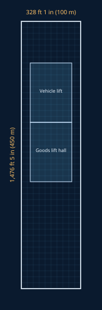

# P2-21 Service Shaft 1: plan

Footprint 328 ft 1 in (100 m) × 1,476 ft 5 in (450 m) · structural grid 32 ft 10 in (10 m)

## Levels

| Level | Floor above deck | Height | Floor area |
|---|---|---|---|
| Level B1 · Shaft head | −32 ft 10 in (10 m) | 32 ft 10 in (10 m) | 150,695 sq ft (14,000 m²) |
| Level 1 · Ground floor | 0 ft (0 mm) | 23 ft (7,000 mm) | 171,039 sq ft (15,890 m²) |
| Level 2 · Lift machine level | 23 ft (7,000 mm) | 19 ft 8 in (6,000 mm) | 150,695 sq ft (14,000 m²) |

## Elements

| ID | Designation | Type | Name | Level(s) | Size / length | Area | Status |
|---|---|---|---|---|---|---|---|
| E001 | D5F3P2B2A3L1R1 | zone | Corridor | L1 | 229 ft 8 in (70 m) × 9 ft 10 in (3,000 mm) | 2,260 sq ft (210 m²) | proposed |
| E002 | D5F3P2B2A3L1R2 | room | Shaft control room | L1 | 229 ft 8 in (70 m) × 44 ft 3 in (14 m) | 10,172 sq ft (945 m²) | proposed |
| E003 | D5F3P2B2A3L1R3 | room | Crew room | L1 | 229 ft 8 in (70 m) × 44 ft 3 in (14 m) | 10,172 sq ft (945 m²) | proposed |
| E004 | D5F3P2B2A3LB1R1, D5F3P2B2A3L1R4, D5F3P2B2A3L2R1 | room | Vehicle lift | LB1, L1, L2 | 229 ft 8 in (70 m) × 328 ft 1 in (100 m) | 75,347 sq ft (7,000 m²) | proposed |
| E005 | D5F3P2B2A3LB1R2, D5F3P2B2A3L1R5, D5F3P2B2A3L2R2 | room | Goods lift hall | LB1, L1, L2 | 229 ft 8 in (70 m) × 328 ft 1 in (100 m) | 75,347 sq ft (7,000 m²) | proposed |
| E006 | D5F3P2B2A3L1R6 | zone | Vehicle queue | L1 | 229 ft 8 in (70 m) × 524 ft 11 in (160 m) | 120,556 sq ft (11,200 m²) | proposed |

## Drawings

### Level B1 · Shaft head

### Level 1 · Ground floor

### Level 2 · Lift machine level

