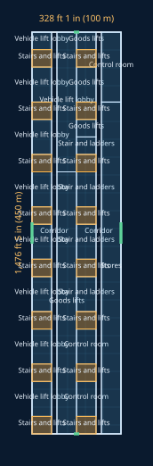

# P2-21 Service Shaft 1: plan

Footprint 328 ft 1 in (100 m) × 1,476 ft 5 in (450 m) · structural grid 65 ft 7 in (20 m)

## Levels

| Level | Floor above deck | Height | Floor area |
|---|---|---|---|
| Level B1 · Shaft head (down to the service layer) | −26 ft 3 in (8,000 mm) | 26 ft 3 in (8,000 mm) | 426,251 sq ft (39,600 m²) |
| Level 1 · Ground floor | 0 ft (0 mm) | 19 ft 8 in (6,000 mm) | 352,178 sq ft (32,718 m²) |
| Level 2 · Upper floor | 19 ft 8 in (6,000 mm) | 19 ft 8 in (6,000 mm) | 426,251 sq ft (39,600 m²) |

## Elements

| ID | Designation | Type | Name | Level(s) | Size / length | Area | Status |
|---|---|---|---|---|---|---|---|
| L1-001 | D5F3P2B2A3L1R1 | zone | Corridor | L1 | 19 ft 8 in (6,000 mm) × 1,476 ft 5 in (450 m) | 29,063 sq ft (2,700 m²) | proposed |
| L1-002 | D5F3P2B2A3L1R2 | zone | Corridor | L1 | 19 ft 8 in (6,000 mm) × 1,476 ft 5 in (450 m) | 29,063 sq ft (2,700 m²) | proposed |
| L1-003 | D5F3P2B2A3L1R3 | room | Vehicle lift lobby | L1 | 72 ft 2 in (22 m) × 64 ft 4 in (20 m) | 4,641 sq ft (431 m²) | proposed |
| L1-004 | D5F3P2B2A3L1R4 | room | Vehicle lift lobby | L1 | 72 ft 2 in (22 m) × 128 ft 7 in (39 m) | 9,283 sq ft (862 m²) | proposed |
| L1-005 | D5F3P2B2A3L1R5 | room | Vehicle lift lobby | L1 | 72 ft 2 in (22 m) × 128 ft 7 in (39 m) | 9,283 sq ft (862 m²) | proposed |
| L1-006 | D5F3P2B2A3L1R6 | room | Vehicle lift lobby | L1 | 72 ft 2 in (22 m) × 128 ft 7 in (39 m) | 9,283 sq ft (862 m²) | proposed |
| L1-007 | D5F3P2B2A3L1R7 | room | Vehicle lift lobby | L1 | 72 ft 2 in (22 m) × 128 ft 3 in (39 m) | 9,259 sq ft (860 m²) | proposed |
| L1-008 | D5F3P2B2A3L1R8 | room | Vehicle lift lobby | L1 | 72 ft 2 in (22 m) × 128 ft 3 in (39 m) | 9,259 sq ft (860 m²) | proposed |
| L1-009 | D5F3P2B2A3L1R9 | room | Vehicle lift lobby | L1 | 72 ft 2 in (22 m) × 128 ft 3 in (39 m) | 9,259 sq ft (860 m²) | proposed |
| L1-010 | D5F3P2B2A3L1R10 | room | Vehicle lift lobby | L1 | 72 ft 2 in (22 m) × 128 ft 3 in (39 m) | 9,259 sq ft (860 m²) | proposed |
| L1-011 | D5F3P2B2A3L1R11 | room | Vehicle lift lobby | L1 | 72 ft 2 in (22 m) × 513 ft 5 in (156 m) | 37,060 sq ft (3,443 m²) | proposed |
| L1-012 | D5F3P2B2A3L1R12 | room | Goods lifts | L1 | 72 ft 2 in (22 m) × 962 ft 11 in (294 m) | 69,503 sq ft (6,457 m²) | proposed |
| L1-013 | D5F3P2B2A3L1R13 | room | Goods lifts | L1 | 72 ft 2 in (22 m) × 64 ft 4 in (20 m) | 4,641 sq ft (431 m²) | proposed |
| L1-014 | D5F3P2B2A3L1R14 | room | Goods lifts | L1 | 72 ft 2 in (22 m) × 128 ft 7 in (39 m) | 9,283 sq ft (862 m²) | proposed |
| L1-015 | D5F3P2B2A3L1R15 | room | Goods lifts | L1 | 72 ft 2 in (22 m) × 64 ft 4 in (20 m) | 4,641 sq ft (431 m²) | proposed |
| L1-016 | D5F3P2B2A3L1R16 | room | Stair and ladders | L1 | 72 ft 2 in (22 m) × 64 ft 4 in (20 m) | 4,641 sq ft (431 m²) | proposed |
| L1-017 | D5F3P2B2A3L1R17 | room | Stair and ladders | L1 | 72 ft 2 in (22 m) × 128 ft 7 in (39 m) | 9,283 sq ft (862 m²) | proposed |
| L1-018 | D5F3P2B2A3L1R18 | room | Stair and ladders | L1 | 72 ft 2 in (22 m) × 128 ft 3 in (39 m) | 9,259 sq ft (860 m²) | proposed |
| L1-019 | D5F3P2B2A3L1R19 | room | Stair and ladders | L1 | 72 ft 2 in (22 m) × 128 ft 3 in (39 m) | 9,259 sq ft (860 m²) | proposed |
| L1-020 | D5F3P2B2A3L1R20 | room | Control room | L1 | 72 ft 2 in (22 m) × 128 ft 3 in (39 m) | 9,259 sq ft (860 m²) | proposed |
| L1-021 | D5F3P2B2A3L1R21 | room | Control room | L1 | 72 ft 2 in (22 m) × 128 ft 3 in (39 m) | 9,259 sq ft (860 m²) | proposed |
| L1-022 | D5F3P2B2A3L1R22 | room | Control room | L1 | 72 ft 2 in (22 m) × 256 ft 11 in (78 m) | 18,542 sq ft (1,723 m²) | proposed |
| L1-023 | D5F3P2B2A3L1R23 | room | Stores | L1 | 72 ft 2 in (22 m) × 1,219 ft 6 in (372 m) | 88,021 sq ft (8,177 m²) | proposed |
| L1-024 | D5F3P2B2A3LB1R1, D5F3P2B2A3L1R24, D5F3P2B2A3L2R1 | core | Stairs and lifts | LB1, L1, L2 | 72 ft 2 in (22 m) × 64 ft (20 m) | 4,618 sq ft (429 m²) | proposed |
| L1-025 | D5F3P2B2A3LB1R2, D5F3P2B2A3L1R25, D5F3P2B2A3L2R2 | core | Stairs and lifts | LB1, L1, L2 | 72 ft 2 in (22 m) × 64 ft (20 m) | 4,618 sq ft (429 m²) | proposed |
| L1-026 | D5F3P2B2A3LB1R3, D5F3P2B2A3L1R26, D5F3P2B2A3L2R3 | core | Stairs and lifts | LB1, L1, L2 | 72 ft 2 in (22 m) × 64 ft (20 m) | 4,618 sq ft (429 m²) | proposed |
| L1-027 | D5F3P2B2A3LB1R4, D5F3P2B2A3L1R27, D5F3P2B2A3L2R4 | core | Stairs and lifts | LB1, L1, L2 | 72 ft 2 in (22 m) × 64 ft (20 m) | 4,618 sq ft (429 m²) | proposed |
| L1-028 | D5F3P2B2A3LB1R5, D5F3P2B2A3L1R28, D5F3P2B2A3L2R5 | core | Stairs and lifts | LB1, L1, L2 | 72 ft 2 in (22 m) × 64 ft 4 in (20 m) | 4,641 sq ft (431 m²) | proposed |
| L1-029 | D5F3P2B2A3LB1R6, D5F3P2B2A3L1R29, D5F3P2B2A3L2R6 | core | Stairs and lifts | LB1, L1, L2 | 72 ft 2 in (22 m) × 64 ft 4 in (20 m) | 4,641 sq ft (431 m²) | proposed |
| L1-030 | D5F3P2B2A3LB1R7, D5F3P2B2A3L1R30, D5F3P2B2A3L2R7 | core | Stairs and lifts | LB1, L1, L2 | 72 ft 2 in (22 m) × 64 ft 4 in (20 m) | 4,641 sq ft (431 m²) | proposed |
| L1-031 | D5F3P2B2A3LB1R8, D5F3P2B2A3L1R31, D5F3P2B2A3L2R8 | core | Stairs and lifts | LB1, L1, L2 | 72 ft 2 in (22 m) × 64 ft 4 in (20 m) | 4,641 sq ft (431 m²) | proposed |
| L1-032 | D5F3P2B2A3LB1R9, D5F3P2B2A3L1R32, D5F3P2B2A3L2R9 | core | Stairs and lifts | LB1, L1, L2 | 72 ft 2 in (22 m) × 64 ft (20 m) | 4,618 sq ft (429 m²) | proposed |
| L1-033 | D5F3P2B2A3LB1R10, D5F3P2B2A3L1R33, D5F3P2B2A3L2R10 | core | Stairs and lifts | LB1, L1, L2 | 72 ft 2 in (22 m) × 64 ft (20 m) | 4,618 sq ft (429 m²) | proposed |
| L1-034 | D5F3P2B2A3LB1R11, D5F3P2B2A3L1R34, D5F3P2B2A3L2R11 | core | Stairs and lifts | LB1, L1, L2 | 72 ft 2 in (22 m) × 64 ft (20 m) | 4,618 sq ft (429 m²) | proposed |
| L1-035 | D5F3P2B2A3LB1R12, D5F3P2B2A3L1R35, D5F3P2B2A3L2R12 | core | Stairs and lifts | LB1, L1, L2 | 72 ft 2 in (22 m) × 64 ft (20 m) | 4,618 sq ft (429 m²) | proposed |
| L1-036 | D5F3P2B2A3LB1R13, D5F3P2B2A3L1R36, D5F3P2B2A3L2R13 | core | Stairs and lifts | LB1, L1, L2 | 72 ft 2 in (22 m) × 64 ft 4 in (20 m) | 4,641 sq ft (431 m²) | proposed |
| L1-037 | D5F3P2B2A3LB1R14, D5F3P2B2A3L1R37, D5F3P2B2A3L2R14 | core | Stairs and lifts | LB1, L1, L2 | 72 ft 2 in (22 m) × 64 ft 4 in (20 m) | 4,641 sq ft (431 m²) | proposed |
| L1-038 | D5F3P2B2A3LB1R15, D5F3P2B2A3L1R38, D5F3P2B2A3L2R15 | core | Stairs and lifts | LB1, L1, L2 | 72 ft 2 in (22 m) × 64 ft 4 in (20 m) | 4,641 sq ft (431 m²) | proposed |
| L1-039 | D5F3P2B2A3LB1R16, D5F3P2B2A3L1R39, D5F3P2B2A3L2R16 | core | Stairs and lifts | LB1, L1, L2 | 72 ft 2 in (22 m) × 64 ft 4 in (20 m) | 4,641 sq ft (431 m²) | proposed |
| LT-001 | D5F3P2B2A3L2R17 | zone | Corridor | L2 | 19 ft 8 in (6,000 mm) × 1,476 ft 5 in (450 m) | 29,063 sq ft (2,700 m²) | proposed |
| LT-002 | D5F3P2B2A3L2R18 | zone | Corridor | L2 | 19 ft 8 in (6,000 mm) × 1,476 ft 5 in (450 m) | 29,063 sq ft (2,700 m²) | proposed |
| LT-003 | D5F3P2B2A3L2R19 | room | Lift machine rooms (around the core) | L2 | 72 ft 2 in (22 m) × 1,476 ft 5 in (450 m) | 106,563 sq ft (9,900 m²) | proposed |
| LT-004 | D5F3P2B2A3L2R20 | room | Lift machine rooms | L2 | 72 ft 2 in (22 m) × 1,476 ft 5 in (450 m) | 106,563 sq ft (9,900 m²) | proposed |
| LT-005 | D5F3P2B2A3L2R21 | room | Ventilation plant (around the core) | L2 | 72 ft 2 in (22 m) × 1,476 ft 5 in (450 m) | 106,563 sq ft (9,900 m²) | proposed |
| LT-006 | D5F3P2B2A3L2R22 | room | Ventilation plant | L2 | 72 ft 2 in (22 m) × 1,476 ft 5 in (450 m) | 106,563 sq ft (9,900 m²) | proposed |
| BB1-001 | D5F3P2B2A3LB1R17 | zone | Corridor | LB1 | 19 ft 8 in (6,000 mm) × 1,476 ft 5 in (450 m) | 29,063 sq ft (2,700 m²) | proposed |
| BB1-002 | D5F3P2B2A3LB1R18 | zone | Corridor | LB1 | 19 ft 8 in (6,000 mm) × 1,476 ft 5 in (450 m) | 29,063 sq ft (2,700 m²) | proposed |
| BB1-003 | D5F3P2B2A3LB1R19 | room | Shaft opening | LB1 | 72 ft 2 in (22 m) × 1,476 ft 5 in (450 m) | 106,563 sq ft (9,900 m²) | proposed |
| BB1-004 | D5F3P2B2A3LB1R20 | room | Shaft opening | LB1 | 72 ft 2 in (22 m) × 1,476 ft 5 in (450 m) | 106,563 sq ft (9,900 m²) | proposed |
| BB1-005 | D5F3P2B2A3LB1R21 | room | Shaft opening | LB1 | 72 ft 2 in (22 m) × 590 ft 7 in (180 m) | 42,625 sq ft (3,960 m²) | proposed |
| BB1-006 | D5F3P2B2A3LB1R22 | room | Lift pits | LB1 | 72 ft 2 in (22 m) × 885 ft 10 in (270 m) | 63,938 sq ft (5,940 m²) | proposed |
| BB1-007 | D5F3P2B2A3LB1R23 | room | Lift pits | LB1 | 72 ft 2 in (22 m) × 1,476 ft 5 in (450 m) | 106,563 sq ft (9,900 m²) | proposed |
| D-53 |  | door | Main entrance | L1 | 78 ft 9 in (24 m), 78 ft 9 in (24 m) wide | — | proposed |
| D-54 |  | door | Second entrance | L1 | 78 ft 9 in (24 m), 78 ft 9 in (24 m) wide | — | proposed |
| D-55 |  | door | Side door | L1 | 19 ft 8 in (6,000 mm), 19 ft 8 in (6,000 mm) wide | — | proposed |
| D-56 |  | door | Side door | L1 | 19 ft 8 in (6,000 mm), 19 ft 8 in (6,000 mm) wide | — | proposed |

## Drawings

### Level B1 · Shaft head (down to the service layer)

### Level 1 · Ground floor

### Level 2 · Upper floor

