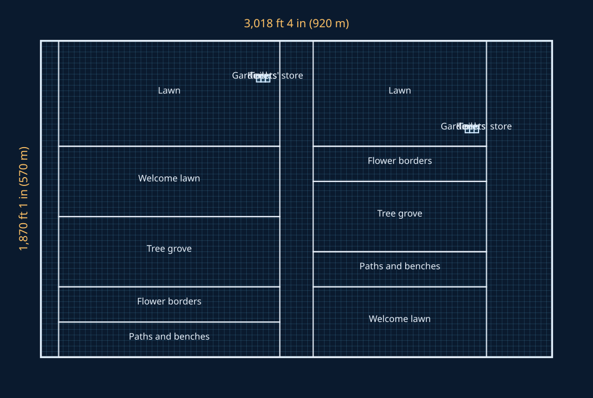

# P2-22 Bow Garden / Stern Garden: plan

Footprint 3,018 ft 4 in (920 m) × 1,870 ft 1 in (570 m) · structural grid 32 ft 10 in (10 m)

## Levels

| Level | Floor above deck | Height | Floor area |
|---|---|---|---|
| Level 1 · Ground | 0 ft (0 mm) | 13 ft 1 in (4,000 mm) | 6,200 sq ft (576 m²) |

## Elements

| ID | Designation | Type | Name | Level(s) | Size / length | Area | Status |
|---|---|---|---|---|---|---|---|
| E001 | D5F3P2B3A6R1 | zone | Lawn | L1 | 1,305 ft 9 in (398 m) × 623 ft 4 in (190 m) | 813,967 sq ft (75,620 m²) | proposed |
| E002 | D5F3P2B3A6R2 | room | Kiosk | L1 | 26 ft 3 in (8,000 mm) × 39 ft 4 in (12 m) | 1,033 sq ft (96 m²) | proposed |
| E003 | D5F3P2B3A6R3 | room | Toilets | L1 | 26 ft 3 in (8,000 mm) × 39 ft 4 in (12 m) | 1,033 sq ft (96 m²) | proposed |
| E004 | D5F3P2B3A6R4 | room | Gardeners' store | L1 | 26 ft 3 in (8,000 mm) × 39 ft 4 in (12 m) | 1,033 sq ft (96 m²) | proposed |
| E005 | D5F3P2B3A6R5 | zone | Welcome lawn | L1 | 1,305 ft 9 in (398 m) × 415 ft 8 in (127 m) | 542,787 sq ft (50,427 m²) | proposed |
| E006 | D5F3P2B3A6R6 | zone | Tree grove | L1 | 1,305 ft 9 in (398 m) × 415 ft 4 in (127 m) | 542,359 sq ft (50,387 m²) | proposed |
| E007 | D5F3P2B3A6R7 | zone | Flower borders | L1 | 1,305 ft 9 in (398 m) × 208 ft (63 m) | 271,608 sq ft (25,233 m²) | proposed |
| E008 | D5F3P2B3A6R8 | zone | Paths and benches | L1 | 1,305 ft 9 in (398 m) × 207 ft 8 in (63 m) | 271,180 sq ft (25,193 m²) | proposed |
| E009 | D5F3P2B3A6R9 | zone | Lawn | L1 | 1,023 ft 7 in (312 m) × 623 ft 4 in (190 m) | 638,085 sq ft (59,280 m²) | proposed |
| E010 | D5F3P2B3A6R10 | room | Kiosk | L1 | 26 ft 3 in (8,000 mm) × 39 ft 4 in (12 m) | 1,033 sq ft (96 m²) | proposed |
| E011 | D5F3P2B3A6R11 | room | Toilets | L1 | 26 ft 3 in (8,000 mm) × 39 ft 4 in (12 m) | 1,033 sq ft (96 m²) | proposed |
| E012 | D5F3P2B3A6R12 | room | Gardeners' store | L1 | 26 ft 3 in (8,000 mm) × 39 ft 4 in (12 m) | 1,033 sq ft (96 m²) | proposed |
| E013 | D5F3P2B3A6R13 | zone | Flower borders | L1 | 1,023 ft 7 in (312 m) × 207 ft 8 in (63 m) | 212,583 sq ft (19,750 m²) | proposed |
| E014 | D5F3P2B3A6R14 | zone | Tree grove | L1 | 1,023 ft 7 in (312 m) × 415 ft 8 in (127 m) | 425,502 sq ft (39,530 m²) | proposed |
| E015 | D5F3P2B3A6R15 | zone | Paths and benches | L1 | 1,023 ft 7 in (312 m) × 207 ft 8 in (63 m) | 212,583 sq ft (19,750 m²) | proposed |
| E016 | D5F3P2B3A6R16 | zone | Welcome lawn | L1 | 1,023 ft 7 in (312 m) × 415 ft 8 in (127 m) | 425,502 sq ft (39,530 m²) | proposed |

## Drawings

### Level 1 · Ground

