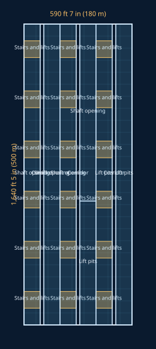
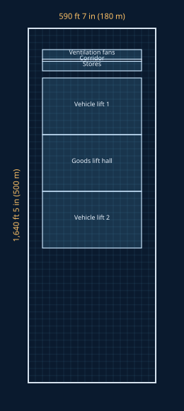

# P2-23 Service Shaft 2: plan

Footprint 590 ft 7 in (180 m) × 1,640 ft 5 in (500 m) · structural grid 65 ft 7 in (20 m)

## Levels

| Level | Floor above deck | Height | Floor area |
|---|---|---|---|
| Level B1 · Shaft head (down to the service layer) | −26 ft 3 in (8,000 mm) | 26 ft 3 in (8,000 mm) | 871,877 sq ft (81,000 m²) |
| Level 1 · Ground floor | 0 ft (0 mm) | 19 ft 8 in (6,000 mm) | 726,448 sq ft (67,489 m²) |
| Level 2 · Upper floor | 19 ft 8 in (6,000 mm) | 19 ft 8 in (6,000 mm) | 871,877 sq ft (81,000 m²) |

## Elements

| ID | Designation | Type | Name | Level(s) | Size / length | Area | Status |
|---|---|---|---|---|---|---|---|
| L1-001 | D5F3P2B5A3L1R1 | zone | Corridor | L1 | 19 ft 8 in (6,000 mm) × 1,640 ft 5 in (500 m) | 32,292 sq ft (3,000 m²) | proposed |
| L1-002 | D5F3P2B5A3L1R2 | zone | Corridor | L1 | 19 ft 8 in (6,000 mm) × 1,640 ft 5 in (500 m) | 32,292 sq ft (3,000 m²) | proposed |
| L1-003 | D5F3P2B5A3L1R3 | zone | Corridor | L1 | 19 ft 8 in (6,000 mm) × 1,640 ft 5 in (500 m) | 32,292 sq ft (3,000 m²) | proposed |
| L1-004 | D5F3P2B5A3L1R4 | room | Vehicle lift lobby | L1 | 88 ft 7 in (27 m) × 91 ft 2 in (28 m) | 8,079 sq ft (751 m²) | proposed |
| L1-005 | D5F3P2B5A3L1R5 | room | Vehicle lift lobby | L1 | 88 ft 7 in (27 m) × 182 ft 1 in (55 m) | 16,130 sq ft (1,498 m²) | proposed |
| L1-006 | D5F3P2B5A3L1R6 | room | Vehicle lift lobby | L1 | 88 ft 7 in (27 m) × 182 ft 1 in (56 m) | 16,130 sq ft (1,498 m²) | proposed |
| L1-007 | D5F3P2B5A3L1R7 | room | Vehicle lift lobby | L1 | 88 ft 7 in (27 m) × 182 ft 5 in (56 m) | 16,159 sq ft (1,501 m²) | proposed |
| L1-008 | D5F3P2B5A3L1R8 | room | Vehicle lift lobby | L1 | 88 ft 7 in (27 m) × 182 ft 1 in (56 m) | 16,130 sq ft (1,498 m²) | proposed |
| L1-009 | D5F3P2B5A3L1R9 | room | Vehicle lift lobby | L1 | 88 ft 7 in (27 m) × 182 ft 1 in (56 m) | 16,130 sq ft (1,498 m²) | proposed |
| L1-010 | D5F3P2B5A3L1R10 | room | Vehicle lift lobby | L1 | 88 ft 7 in (27 m) × 91 ft 2 in (28 m) | 8,079 sq ft (751 m²) | proposed |
| L1-011 | D5F3P2B5A3L1R11 | room | Vehicle lift lobby | L1 | 88 ft 7 in (27 m) × 1,367 ft 2 in (417 m) | 121,104 sq ft (11,251 m²) | proposed |
| L1-012 | D5F3P2B5A3L1R12 | room | Goods lifts | L1 | 88 ft 7 in (27 m) × 273 ft 4 in (83 m) | 24,209 sq ft (2,249 m²) | proposed |
| L1-013 | D5F3P2B5A3L1R13 | room | Goods lifts | L1 | 88 ft 7 in (27 m) × 91 ft 2 in (28 m) | 8,079 sq ft (751 m²) | proposed |
| L1-014 | D5F3P2B5A3L1R14 | room | Goods lifts | L1 | 88 ft 7 in (27 m) × 182 ft 1 in (55 m) | 16,130 sq ft (1,498 m²) | proposed |
| L1-015 | D5F3P2B5A3L1R15 | room | Goods lifts | L1 | 88 ft 7 in (27 m) × 182 ft 1 in (56 m) | 16,130 sq ft (1,498 m²) | proposed |
| L1-016 | D5F3P2B5A3L1R16 | room | Goods lifts | L1 | 88 ft 7 in (27 m) × 182 ft 5 in (56 m) | 16,159 sq ft (1,501 m²) | proposed |
| L1-017 | D5F3P2B5A3L1R17 | room | Goods lifts | L1 | 88 ft 7 in (27 m) × 182 ft 1 in (56 m) | 16,130 sq ft (1,498 m²) | proposed |
| L1-018 | D5F3P2B5A3L1R18 | room | Goods lifts | L1 | 88 ft 7 in (27 m) × 182 ft 1 in (56 m) | 16,130 sq ft (1,498 m²) | proposed |
| L1-019 | D5F3P2B5A3L1R19 | room | Goods lifts | L1 | 88 ft 7 in (27 m) × 91 ft 2 in (28 m) | 8,079 sq ft (751 m²) | proposed |
| L1-020 | D5F3P2B5A3L1R20 | room | Goods lifts | L1 | 88 ft 7 in (27 m) × 729 ft (222 m) | 64,577 sq ft (5,999 m²) | proposed |
| L1-021 | D5F3P2B5A3L1R21 | room | Stair and ladders | L1 | 88 ft 7 in (27 m) × 820 ft 3 in (250 m) | 72,656 sq ft (6,750 m²) | proposed |
| L1-022 | D5F3P2B5A3L1R22 | room | Control room | L1 | 88 ft 7 in (27 m) × 91 ft 2 in (28 m) | 8,079 sq ft (751 m²) | proposed |
| L1-023 | D5F3P2B5A3L1R23 | room | Control room | L1 | 88 ft 7 in (27 m) × 91 ft 2 in (28 m) | 8,079 sq ft (751 m²) | proposed |
| L1-024 | D5F3P2B5A3L1R24 | room | Control room | L1 | 88 ft 7 in (27 m) × 182 ft 1 in (55 m) | 16,130 sq ft (1,498 m²) | proposed |
| L1-025 | D5F3P2B5A3L1R25 | room | Control room | L1 | 88 ft 7 in (27 m) × 182 ft 1 in (56 m) | 16,130 sq ft (1,498 m²) | proposed |
| L1-026 | D5F3P2B5A3L1R26 | room | Control room | L1 | 88 ft 7 in (27 m) × 182 ft 5 in (56 m) | 16,159 sq ft (1,501 m²) | proposed |
| L1-027 | D5F3P2B5A3L1R27 | room | Control room | L1 | 88 ft 7 in (27 m) × 90 ft 11 in (28 m) | 8,050 sq ft (748 m²) | proposed |
| L1-028 | D5F3P2B5A3L1R28 | room | Stores | L1 | 88 ft 7 in (27 m) × 91 ft 2 in (28 m) | 8,079 sq ft (751 m²) | proposed |
| L1-029 | D5F3P2B5A3L1R29 | room | Stores | L1 | 88 ft 7 in (27 m) × 182 ft 1 in (56 m) | 16,130 sq ft (1,498 m²) | proposed |
| L1-030 | D5F3P2B5A3L1R30 | room | Stores | L1 | 88 ft 7 in (27 m) × 91 ft 2 in (28 m) | 8,079 sq ft (751 m²) | proposed |
| L1-031 | D5F3P2B5A3L1R31 | room | Stores | L1 | 88 ft 7 in (27 m) × 1,640 ft 5 in (500 m) | 145,313 sq ft (13,500 m²) | proposed |
| L1-032 | D5F3P2B5A3LB1R1, D5F3P2B5A3L1R32, D5F3P2B5A3L2R1 | core | Stairs and lifts | LB1, L1, L2 | 88 ft 7 in (27 m) × 91 ft 2 in (28 m) | 8,079 sq ft (751 m²) | proposed |
| L1-033 | D5F3P2B5A3LB1R2, D5F3P2B5A3L1R33, D5F3P2B5A3L2R2 | core | Stairs and lifts | LB1, L1, L2 | 88 ft 7 in (27 m) × 91 ft 2 in (28 m) | 8,079 sq ft (751 m²) | proposed |
| L1-034 | D5F3P2B5A3LB1R3, D5F3P2B5A3L1R34, D5F3P2B5A3L2R3 | core | Stairs and lifts | LB1, L1, L2 | 88 ft 7 in (27 m) × 91 ft 2 in (28 m) | 8,079 sq ft (751 m²) | proposed |
| L1-035 | D5F3P2B5A3LB1R4, D5F3P2B5A3L1R35, D5F3P2B5A3L2R4 | core | Stairs and lifts | LB1, L1, L2 | 88 ft 7 in (27 m) × 91 ft 2 in (28 m) | 8,079 sq ft (751 m²) | proposed |
| L1-036 | D5F3P2B5A3LB1R5, D5F3P2B5A3L1R36, D5F3P2B5A3L2R5 | core | Stairs and lifts | LB1, L1, L2 | 88 ft 7 in (27 m) × 91 ft 2 in (28 m) | 8,079 sq ft (751 m²) | proposed |
| L1-037 | D5F3P2B5A3LB1R6, D5F3P2B5A3L1R37, D5F3P2B5A3L2R6 | core | Stairs and lifts | LB1, L1, L2 | 88 ft 7 in (27 m) × 91 ft 2 in (28 m) | 8,079 sq ft (751 m²) | proposed |
| L1-038 | D5F3P2B5A3LB1R7, D5F3P2B5A3L1R38, D5F3P2B5A3L2R7 | core | Stairs and lifts | LB1, L1, L2 | 88 ft 7 in (27 m) × 91 ft 2 in (28 m) | 8,079 sq ft (751 m²) | proposed |
| L1-039 | D5F3P2B5A3LB1R8, D5F3P2B5A3L1R39, D5F3P2B5A3L2R8 | core | Stairs and lifts | LB1, L1, L2 | 88 ft 7 in (27 m) × 91 ft 2 in (28 m) | 8,079 sq ft (751 m²) | proposed |
| L1-040 | D5F3P2B5A3LB1R9, D5F3P2B5A3L1R40, D5F3P2B5A3L2R9 | core | Stairs and lifts | LB1, L1, L2 | 88 ft 7 in (27 m) × 91 ft 2 in (28 m) | 8,079 sq ft (751 m²) | proposed |
| L1-041 | D5F3P2B5A3LB1R10, D5F3P2B5A3L1R41, D5F3P2B5A3L2R10 | core | Stairs and lifts | LB1, L1, L2 | 88 ft 7 in (27 m) × 91 ft 2 in (28 m) | 8,079 sq ft (751 m²) | proposed |
| L1-042 | D5F3P2B5A3LB1R11, D5F3P2B5A3L1R42, D5F3P2B5A3L2R11 | core | Stairs and lifts | LB1, L1, L2 | 88 ft 7 in (27 m) × 91 ft 2 in (28 m) | 8,079 sq ft (751 m²) | proposed |
| L1-043 | D5F3P2B5A3LB1R12, D5F3P2B5A3L1R43, D5F3P2B5A3L2R12 | core | Stairs and lifts | LB1, L1, L2 | 88 ft 7 in (27 m) × 91 ft 2 in (28 m) | 8,079 sq ft (751 m²) | proposed |
| L1-044 | D5F3P2B5A3LB1R13, D5F3P2B5A3L1R44, D5F3P2B5A3L2R13 | core | Stairs and lifts | LB1, L1, L2 | 88 ft 7 in (27 m) × 91 ft 2 in (28 m) | 8,079 sq ft (751 m²) | proposed |
| L1-045 | D5F3P2B5A3LB1R14, D5F3P2B5A3L1R45, D5F3P2B5A3L2R14 | core | Stairs and lifts | LB1, L1, L2 | 88 ft 7 in (27 m) × 91 ft 2 in (28 m) | 8,079 sq ft (751 m²) | proposed |
| L1-046 | D5F3P2B5A3LB1R15, D5F3P2B5A3L1R46, D5F3P2B5A3L2R15 | core | Stairs and lifts | LB1, L1, L2 | 88 ft 7 in (27 m) × 91 ft 2 in (28 m) | 8,079 sq ft (751 m²) | proposed |
| L1-047 | D5F3P2B5A3LB1R16, D5F3P2B5A3L1R47, D5F3P2B5A3L2R16 | core | Stairs and lifts | LB1, L1, L2 | 88 ft 7 in (27 m) × 91 ft 2 in (28 m) | 8,079 sq ft (751 m²) | proposed |
| L1-048 | D5F3P2B5A3LB1R17, D5F3P2B5A3L1R48, D5F3P2B5A3L2R17 | core | Stairs and lifts | LB1, L1, L2 | 88 ft 7 in (27 m) × 91 ft 2 in (28 m) | 8,079 sq ft (751 m²) | proposed |
| L1-049 | D5F3P2B5A3LB1R18, D5F3P2B5A3L1R49, D5F3P2B5A3L2R18 | core | Stairs and lifts | LB1, L1, L2 | 88 ft 7 in (27 m) × 91 ft 2 in (28 m) | 8,079 sq ft (751 m²) | proposed |
| LT-001 | D5F3P2B5A3L2R19 | zone | Corridor | L2 | 19 ft 8 in (6,000 mm) × 1,640 ft 5 in (500 m) | 32,292 sq ft (3,000 m²) | proposed |
| LT-002 | D5F3P2B5A3L2R20 | zone | Corridor | L2 | 19 ft 8 in (6,000 mm) × 1,640 ft 5 in (500 m) | 32,292 sq ft (3,000 m²) | proposed |
| LT-003 | D5F3P2B5A3L2R21 | zone | Corridor | L2 | 19 ft 8 in (6,000 mm) × 1,640 ft 5 in (500 m) | 32,292 sq ft (3,000 m²) | proposed |
| LT-004 | D5F3P2B5A3L2R22 | room | Lift machine rooms (around the core) | L2 | 88 ft 7 in (27 m) × 1,640 ft 5 in (500 m) | 145,313 sq ft (13,500 m²) | proposed |
| LT-005 | D5F3P2B5A3L2R23 | room | Lift machine rooms | L2 | 88 ft 7 in (27 m) × 1,640 ft 5 in (500 m) | 145,313 sq ft (13,500 m²) | proposed |
| LT-006 | D5F3P2B5A3L2R24 | room | Lift machine rooms (around the core) | L2 | 88 ft 7 in (27 m) × 1,640 ft 5 in (500 m) | 145,313 sq ft (13,500 m²) | proposed |
| LT-007 | D5F3P2B5A3L2R25 | room | Ventilation plant | L2 | 88 ft 7 in (27 m) × 1,640 ft 5 in (500 m) | 145,313 sq ft (13,500 m²) | proposed |
| LT-008 | D5F3P2B5A3L2R26 | room | Ventilation plant (around the core) | L2 | 88 ft 7 in (27 m) × 1,640 ft 5 in (500 m) | 145,313 sq ft (13,500 m²) | proposed |
| LT-009 | D5F3P2B5A3L2R27 | room | Ventilation plant | L2 | 88 ft 7 in (27 m) × 1,640 ft 5 in (500 m) | 145,313 sq ft (13,500 m²) | proposed |
| BB1-001 | D5F3P2B5A3LB1R19 | zone | Corridor | LB1 | 19 ft 8 in (6,000 mm) × 1,640 ft 5 in (500 m) | 32,292 sq ft (3,000 m²) | proposed |
| BB1-002 | D5F3P2B5A3LB1R20 | zone | Corridor | LB1 | 19 ft 8 in (6,000 mm) × 1,640 ft 5 in (500 m) | 32,292 sq ft (3,000 m²) | proposed |
| BB1-003 | D5F3P2B5A3LB1R21 | zone | Corridor | LB1 | 19 ft 8 in (6,000 mm) × 1,640 ft 5 in (500 m) | 32,292 sq ft (3,000 m²) | proposed |
| BB1-004 | D5F3P2B5A3LB1R22 | room | Shaft opening | LB1 | 88 ft 7 in (27 m) × 1,640 ft 5 in (500 m) | 145,313 sq ft (13,500 m²) | proposed |
| BB1-005 | D5F3P2B5A3LB1R23 | room | Shaft opening | LB1 | 88 ft 7 in (27 m) × 1,640 ft 5 in (500 m) | 145,313 sq ft (13,500 m²) | proposed |
| BB1-006 | D5F3P2B5A3LB1R24 | room | Shaft opening | LB1 | 88 ft 7 in (27 m) × 1,640 ft 5 in (500 m) | 145,313 sq ft (13,500 m²) | proposed |
| BB1-007 | D5F3P2B5A3LB1R25 | room | Shaft opening | LB1 | 88 ft 7 in (27 m) × 964 ft 11 in (294 m) | 85,473 sq ft (7,941 m²) | proposed |
| BB1-008 | D5F3P2B5A3LB1R26 | room | Lift pits | LB1 | 88 ft 7 in (27 m) × 675 ft 6 in (206 m) | 59,840 sq ft (5,559 m²) | proposed |
| BB1-009 | D5F3P2B5A3LB1R27 | room | Lift pits | LB1 | 88 ft 7 in (27 m) × 1,640 ft 5 in (500 m) | 145,313 sq ft (13,500 m²) | proposed |
| BB1-010 | D5F3P2B5A3LB1R28 | room | Lift pits | LB1 | 88 ft 7 in (27 m) × 1,640 ft 5 in (500 m) | 145,313 sq ft (13,500 m²) | proposed |
| D-69 |  | door | Main entrance | L1 | 78 ft 9 in (24 m), 78 ft 9 in (24 m) wide | — | proposed |
| D-70 |  | door | Second entrance | L1 | 78 ft 9 in (24 m), 78 ft 9 in (24 m) wide | — | proposed |
| D-71 |  | door | Side door | L1 | 19 ft 8 in (6,000 mm), 19 ft 8 in (6,000 mm) wide | — | proposed |
| D-72 |  | door | Side door | L1 | 19 ft 8 in (6,000 mm), 19 ft 8 in (6,000 mm) wide | — | proposed |

## Drawings

### Level B1 · Shaft head (down to the service layer)

### Level 1 · Ground floor

### Level 2 · Upper floor

