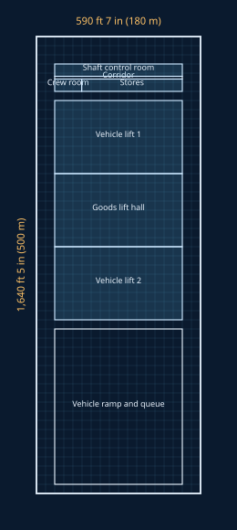

# P2-23 Service Shaft 2: plan

Footprint 590 ft 7 in (180 m) × 1,640 ft 5 in (500 m) · structural grid 32 ft 10 in (10 m)

## Levels

| Level | Floor above deck | Height | Floor area |
|---|---|---|---|
| Level B1 · Shaft head | −32 ft 10 in (10 m) | 32 ft 10 in (10 m) | 361,667 sq ft (33,600 m²) |
| Level 1 · Ground floor | 0 ft (0 mm) | 23 ft (7,000 mm) | 402,355 sq ft (37,380 m²) |
| Level 2 · Lift machine level | 23 ft (7,000 mm) | 19 ft 8 in (6,000 mm) | 402,355 sq ft (37,380 m²) |

## Elements

| ID | Designation | Type | Name | Level(s) | Size / length | Area | Status |
|---|---|---|---|---|---|---|---|
| E001 | D5F3P2B5A3L1R1 | zone | Corridor | L1 | 459 ft 4 in (140 m) × 9 ft 10 in (3,000 mm) | 4,521 sq ft (420 m²) | proposed |
| E002 | D5F3P2B5A3L1R2 | room | Shaft control room | L1 | 459 ft 4 in (140 m) × 44 ft 3 in (14 m) | 20,344 sq ft (1,890 m²) | proposed |
| E003 | D5F3P2B5A3L1R3 | room | Crew room | L1 | 97 ft 1 in (30 m) × 44 ft 3 in (14 m) | 4,301 sq ft (400 m²) | proposed |
| E004 | D5F3P2B5A3L1R4 | room | Stores | L1 | 362 ft 2 in (110 m) × 44 ft 3 in (14 m) | 16,043 sq ft (1,490 m²) | proposed |
| E005 | D5F3P2B5A3L2R1 | zone | Corridor | L2 | 459 ft 4 in (140 m) × 9 ft 10 in (3,000 mm) | 4,521 sq ft (420 m²) | proposed |
| E006 | D5F3P2B5A3L2R2 | room | Ventilation fans | L2 | 459 ft 4 in (140 m) × 44 ft 3 in (14 m) | 20,344 sq ft (1,890 m²) | proposed |
| E007 | D5F3P2B5A3L2R3 | room | Stores | L2 | 459 ft 4 in (140 m) × 44 ft 3 in (14 m) | 20,344 sq ft (1,890 m²) | proposed |
| E008 | D5F3P2B5A3LB1R1, D5F3P2B5A3L1R5, D5F3P2B5A3L2R4 | room | Vehicle lift 1 | LB1, L1, L2 | 459 ft 4 in (140 m) × 262 ft 6 in (80 m) | 120,556 sq ft (11,200 m²) | proposed |
| E009 | D5F3P2B5A3LB1R2, D5F3P2B5A3L1R6, D5F3P2B5A3L2R5 | room | Goods lift hall | LB1, L1, L2 | 459 ft 4 in (140 m) × 262 ft 6 in (80 m) | 120,556 sq ft (11,200 m²) | proposed |
| E010 | D5F3P2B5A3LB1R3, D5F3P2B5A3L1R7, D5F3P2B5A3L2R6 | room | Vehicle lift 2 | LB1, L1, L2 | 459 ft 4 in (140 m) × 262 ft 6 in (80 m) | 120,556 sq ft (11,200 m²) | proposed |
| E011 | D5F3P2B5A3L1R8 | zone | Vehicle ramp and queue | L1 | 459 ft 4 in (140 m) × 557 ft 9 in (170 m) | 256,181 sq ft (23,800 m²) | proposed |

## Drawings

### Level B1 · Shaft head

### Level 1 · Ground floor

### Level 2 · Lift machine level

