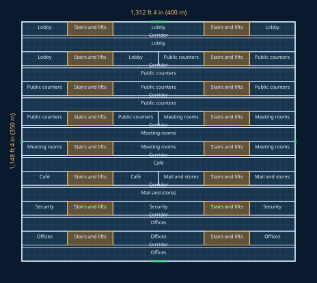
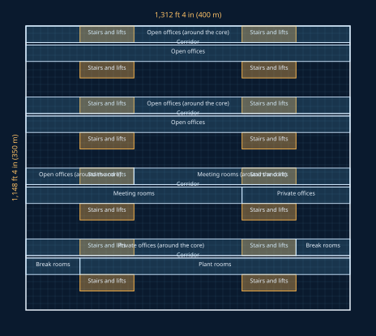

# P3-02 Stern Docks Private Flights Lounge: plan

Footprint 1,312 ft 4 in (400 m) × 1,148 ft 4 in (350 m) · structural grid 29 ft 6 in (9,000 mm)

## Levels

| Level | Floor above deck | Height | Floor area |
|---|---|---|---|
| Level 1 · Ground floor | 0 ft (0 mm) | 13 ft 9 in (4,200 mm) | 1,169,626 sq ft (108,662 m²) |
| Level 2 · Upper floor | 13 ft 9 in (4,200 mm) | 13 ft 9 in (4,200 mm) | 700,946 sq ft (65,120 m²) |
| Level 3 · Upper floor | 27 ft 7 in (8,400 mm) | 13 ft 9 in (4,200 mm) | 700,946 sq ft (65,120 m²) |
| Level 4 · Upper floor | 41 ft 4 in (13 m) | 13 ft 9 in (4,200 mm) | 700,946 sq ft (65,120 m²) |

## Elements

| ID | Designation | Type | Name | Level(s) | Size / length | Area | Status |
|---|---|---|---|---|---|---|---|
| L1-001 | D5F3P3B2A1L1R1 | zone | Corridor | L1 | 1,312 ft 4 in (400 m) × 9 ft 10 in (3,000 mm) | 12,917 sq ft (1,200 m²) | proposed |
| L1-002 | D5F3P3B2A1L1R2 | zone | Corridor | L1 | 1,312 ft 4 in (400 m) × 9 ft 10 in (3,000 mm) | 12,917 sq ft (1,200 m²) | proposed |
| L1-003 | D5F3P3B2A1L1R3 | zone | Corridor | L1 | 1,312 ft 4 in (400 m) × 9 ft 10 in (3,000 mm) | 12,917 sq ft (1,200 m²) | proposed |
| L1-004 | D5F3P3B2A1L1R4 | zone | Corridor | L1 | 1,312 ft 4 in (400 m) × 9 ft 10 in (3,000 mm) | 12,917 sq ft (1,200 m²) | proposed |
| L1-005 | D5F3P3B2A1L1R5 | zone | Corridor | L1 | 1,312 ft 4 in (400 m) × 9 ft 10 in (3,000 mm) | 12,917 sq ft (1,200 m²) | proposed |
| L1-006 | D5F3P3B2A1L1R6 | zone | Corridor | L1 | 1,312 ft 4 in (400 m) × 9 ft 10 in (3,000 mm) | 12,917 sq ft (1,200 m²) | proposed |
| L1-007 | D5F3P3B2A1L1R7 | zone | Corridor | L1 | 1,312 ft 4 in (400 m) × 9 ft 10 in (3,000 mm) | 12,917 sq ft (1,200 m²) | proposed |
| L1-008 | D5F3P3B2A1L1R8 | zone | Corridor | L1 | 1,312 ft 4 in (400 m) × 9 ft 10 in (3,000 mm) | 12,917 sq ft (1,200 m²) | proposed |
| L1-009 | D5F3P3B2A1L1R9 | room | Lobby | L1 | 218 ft 10 in (67 m) × 66 ft 11 in (20 m) | 14,646 sq ft (1,361 m²) | proposed |
| L1-010 | D5F3P3B2A1L1R10 | room | Lobby | L1 | 437 ft 8 in (133 m) × 66 ft 11 in (20 m) | 29,292 sq ft (2,721 m²) | proposed |
| L1-011 | D5F3P3B2A1L1R11 | room | Lobby | L1 | 218 ft 10 in (67 m) × 66 ft 11 in (20 m) | 14,646 sq ft (1,361 m²) | proposed |
| L1-012 | D5F3P3B2A1L1R12 | room | Lobby | L1 | 1,312 ft 4 in (400 m) × 66 ft 7 in (20 m) | 87,403 sq ft (8,120 m²) | proposed |
| L1-013 | D5F3P3B2A1L1R13 | room | Lobby | L1 | 218 ft 10 in (67 m) × 66 ft 11 in (20 m) | 14,646 sq ft (1,361 m²) | proposed |
| L1-014 | D5F3P3B2A1L1R14 | room | Lobby | L1 | 218 ft 10 in (67 m) × 66 ft 11 in (20 m) | 14,646 sq ft (1,361 m²) | proposed |
| L1-015 | D5F3P3B2A1L1R15 | room | Public counters | L1 | 218 ft 10 in (67 m) × 66 ft 11 in (20 m) | 14,646 sq ft (1,361 m²) | proposed |
| L1-016 | D5F3P3B2A1L1R16 | room | Public counters | L1 | 218 ft 10 in (67 m) × 66 ft 11 in (20 m) | 14,646 sq ft (1,361 m²) | proposed |
| L1-017 | D5F3P3B2A1L1R17 | room | Public counters | L1 | 1,312 ft 4 in (400 m) × 66 ft 11 in (20 m) | 87,834 sq ft (8,160 m²) | proposed |
| L1-018 | D5F3P3B2A1L1R18 | room | Public counters | L1 | 218 ft 10 in (67 m) × 66 ft 11 in (20 m) | 14,646 sq ft (1,361 m²) | proposed |
| L1-019 | D5F3P3B2A1L1R19 | room | Public counters | L1 | 437 ft 8 in (133 m) × 66 ft 11 in (20 m) | 29,292 sq ft (2,721 m²) | proposed |
| L1-020 | D5F3P3B2A1L1R20 | room | Public counters | L1 | 218 ft 10 in (67 m) × 66 ft 11 in (20 m) | 14,646 sq ft (1,361 m²) | proposed |
| L1-021 | D5F3P3B2A1L1R21 | room | Public counters | L1 | 1,312 ft 4 in (400 m) × 66 ft 7 in (20 m) | 87,403 sq ft (8,120 m²) | proposed |
| L1-022 | D5F3P3B2A1L1R22 | room | Public counters | L1 | 218 ft 10 in (67 m) × 66 ft 11 in (20 m) | 14,646 sq ft (1,361 m²) | proposed |
| L1-023 | D5F3P3B2A1L1R23 | room | Public counters | L1 | 218 ft 10 in (67 m) × 66 ft 11 in (20 m) | 14,646 sq ft (1,361 m²) | proposed |
| L1-024 | D5F3P3B2A1L1R24 | room | Meeting rooms | L1 | 218 ft 10 in (67 m) × 66 ft 11 in (20 m) | 14,646 sq ft (1,361 m²) | proposed |
| L1-025 | D5F3P3B2A1L1R25 | room | Meeting rooms | L1 | 218 ft 10 in (67 m) × 66 ft 11 in (20 m) | 14,646 sq ft (1,361 m²) | proposed |
| L1-026 | D5F3P3B2A1L1R26 | room | Meeting rooms | L1 | 1,312 ft 4 in (400 m) × 66 ft 11 in (20 m) | 87,834 sq ft (8,160 m²) | proposed |
| L1-027 | D5F3P3B2A1L1R27 | room | Meeting rooms | L1 | 218 ft 10 in (67 m) × 66 ft 11 in (20 m) | 14,646 sq ft (1,361 m²) | proposed |
| L1-028 | D5F3P3B2A1L1R28 | room | Meeting rooms | L1 | 437 ft 8 in (133 m) × 66 ft 11 in (20 m) | 29,292 sq ft (2,721 m²) | proposed |
| L1-029 | D5F3P3B2A1L1R29 | room | Meeting rooms | L1 | 218 ft 10 in (67 m) × 66 ft 11 in (20 m) | 14,646 sq ft (1,361 m²) | proposed |
| L1-030 | D5F3P3B2A1L1R30 | room | Café | L1 | 1,312 ft 4 in (400 m) × 66 ft 7 in (20 m) | 87,403 sq ft (8,120 m²) | proposed |
| L1-031 | D5F3P3B2A1L1R31 | room | Café | L1 | 218 ft 10 in (67 m) × 66 ft 11 in (20 m) | 14,646 sq ft (1,361 m²) | proposed |
| L1-032 | D5F3P3B2A1L1R32 | room | Café | L1 | 218 ft 10 in (67 m) × 66 ft 11 in (20 m) | 14,646 sq ft (1,361 m²) | proposed |
| L1-033 | D5F3P3B2A1L1R33 | room | Mail and stores | L1 | 218 ft 10 in (67 m) × 66 ft 11 in (20 m) | 14,646 sq ft (1,361 m²) | proposed |
| L1-034 | D5F3P3B2A1L1R34 | room | Mail and stores | L1 | 218 ft 10 in (67 m) × 66 ft 11 in (20 m) | 14,646 sq ft (1,361 m²) | proposed |
| L1-035 | D5F3P3B2A1L1R35 | room | Mail and stores | L1 | 1,312 ft 4 in (400 m) × 66 ft 11 in (20 m) | 87,834 sq ft (8,160 m²) | proposed |
| L1-036 | D5F3P3B2A1L1R36 | room | Security | L1 | 218 ft 10 in (67 m) × 66 ft 11 in (20 m) | 14,646 sq ft (1,361 m²) | proposed |
| L1-037 | D5F3P3B2A1L1R37 | room | Security | L1 | 437 ft 8 in (133 m) × 66 ft 11 in (20 m) | 29,292 sq ft (2,721 m²) | proposed |
| L1-038 | D5F3P3B2A1L1R38 | room | Security | L1 | 218 ft 10 in (67 m) × 66 ft 11 in (20 m) | 14,646 sq ft (1,361 m²) | proposed |
| L1-039 | D5F3P3B2A1L1R39 | room | Offices | L1 | 1,312 ft 4 in (400 m) × 66 ft 7 in (20 m) | 87,403 sq ft (8,120 m²) | proposed |
| L1-040 | D5F3P3B2A1L1R40 | room | Offices | L1 | 218 ft 10 in (67 m) × 66 ft 11 in (20 m) | 14,646 sq ft (1,361 m²) | proposed |
| L1-041 | D5F3P3B2A1L1R41 | room | Offices | L1 | 437 ft 8 in (133 m) × 66 ft 11 in (20 m) | 29,292 sq ft (2,721 m²) | proposed |
| L1-042 | D5F3P3B2A1L1R42 | room | Offices | L1 | 218 ft 10 in (67 m) × 66 ft 11 in (20 m) | 14,646 sq ft (1,361 m²) | proposed |
| L1-043 | D5F3P3B2A1L1R43 | room | Offices | L1 | 1,312 ft 4 in (400 m) × 66 ft 11 in (20 m) | 87,834 sq ft (8,160 m²) | proposed |
| L1-044 | D5F3P3B2A1L1R44, D5F3P3B2A1L2R1, D5F3P3B2A1L3R1, D5F3P3B2A1L4R1 | core | Stairs and lifts | L1, L2, L3, L4 | 218 ft 6 in (67 m) × 66 ft 11 in (20 m) | 14,624 sq ft (1,359 m²) | proposed |
| L1-045 | D5F3P3B2A1L1R45, D5F3P3B2A1L2R2, D5F3P3B2A1L3R2, D5F3P3B2A1L4R2 | core | Stairs and lifts | L1, L2, L3, L4 | 218 ft 6 in (67 m) × 66 ft 11 in (20 m) | 14,624 sq ft (1,359 m²) | proposed |
| L1-046 | D5F3P3B2A1L1R46, D5F3P3B2A1L2R3, D5F3P3B2A1L3R3, D5F3P3B2A1L4R3 | core | Stairs and lifts | L1, L2, L3, L4 | 218 ft 6 in (67 m) × 66 ft 11 in (20 m) | 14,624 sq ft (1,359 m²) | proposed |
| L1-047 | D5F3P3B2A1L1R47, D5F3P3B2A1L2R4, D5F3P3B2A1L3R4, D5F3P3B2A1L4R4 | core | Stairs and lifts | L1, L2, L3, L4 | 218 ft 6 in (67 m) × 66 ft 11 in (20 m) | 14,624 sq ft (1,359 m²) | proposed |
| L1-048 | D5F3P3B2A1L1R48, D5F3P3B2A1L2R5, D5F3P3B2A1L3R5, D5F3P3B2A1L4R5 | core | Stairs and lifts | L1, L2, L3, L4 | 218 ft 6 in (67 m) × 66 ft 11 in (20 m) | 14,624 sq ft (1,359 m²) | proposed |
| L1-049 | D5F3P3B2A1L1R49, D5F3P3B2A1L2R6, D5F3P3B2A1L3R6, D5F3P3B2A1L4R6 | core | Stairs and lifts | L1, L2, L3, L4 | 218 ft 6 in (67 m) × 66 ft 11 in (20 m) | 14,624 sq ft (1,359 m²) | proposed |
| L1-050 | D5F3P3B2A1L1R50, D5F3P3B2A1L2R7, D5F3P3B2A1L3R7, D5F3P3B2A1L4R7 | core | Stairs and lifts | L1, L2, L3, L4 | 218 ft 6 in (67 m) × 66 ft 11 in (20 m) | 14,624 sq ft (1,359 m²) | proposed |
| L1-051 | D5F3P3B2A1L1R51, D5F3P3B2A1L2R8, D5F3P3B2A1L3R8, D5F3P3B2A1L4R8 | core | Stairs and lifts | L1, L2, L3, L4 | 218 ft 6 in (67 m) × 66 ft 11 in (20 m) | 14,624 sq ft (1,359 m²) | proposed |
| L1-052 | D5F3P3B2A1L1R52, D5F3P3B2A1L2R9, D5F3P3B2A1L3R9, D5F3P3B2A1L4R9 | core | Stairs and lifts | L1, L2, L3, L4 | 218 ft 6 in (67 m) × 66 ft 11 in (20 m) | 14,624 sq ft (1,359 m²) | proposed |
| L1-053 | D5F3P3B2A1L1R53, D5F3P3B2A1L2R10, D5F3P3B2A1L3R10, D5F3P3B2A1L4R10 | core | Stairs and lifts | L1, L2, L3, L4 | 218 ft 6 in (67 m) × 66 ft 11 in (20 m) | 14,624 sq ft (1,359 m²) | proposed |
| L1-054 | D5F3P3B2A1L1R54, D5F3P3B2A1L2R11, D5F3P3B2A1L3R11, D5F3P3B2A1L4R11 | core | Stairs and lifts | L1, L2, L3, L4 | 218 ft 6 in (67 m) × 66 ft 11 in (20 m) | 14,624 sq ft (1,359 m²) | proposed |
| L1-055 | D5F3P3B2A1L1R55, D5F3P3B2A1L2R12, D5F3P3B2A1L3R12, D5F3P3B2A1L4R12 | core | Stairs and lifts | L1, L2, L3, L4 | 218 ft 6 in (67 m) × 66 ft 11 in (20 m) | 14,624 sq ft (1,359 m²) | proposed |
| L1-056 | D5F3P3B2A1L1R56, D5F3P3B2A1L2R13, D5F3P3B2A1L3R13, D5F3P3B2A1L4R13 | core | Stairs and lifts | L1, L2, L3, L4 | 218 ft 6 in (67 m) × 66 ft 11 in (20 m) | 14,624 sq ft (1,359 m²) | proposed |
| L1-057 | D5F3P3B2A1L1R57, D5F3P3B2A1L2R14, D5F3P3B2A1L3R14, D5F3P3B2A1L4R14 | core | Stairs and lifts | L1, L2, L3, L4 | 218 ft 6 in (67 m) × 66 ft 11 in (20 m) | 14,624 sq ft (1,359 m²) | proposed |
| L1-058 | D5F3P3B2A1L1R58, D5F3P3B2A1L2R15, D5F3P3B2A1L3R15, D5F3P3B2A1L4R15 | core | Stairs and lifts | L1, L2, L3, L4 | 218 ft 6 in (67 m) × 66 ft 11 in (20 m) | 14,624 sq ft (1,359 m²) | proposed |
| L1-059 | D5F3P3B2A1L1R59, D5F3P3B2A1L2R16, D5F3P3B2A1L3R16, D5F3P3B2A1L4R16 | core | Stairs and lifts | L1, L2, L3, L4 | 218 ft 6 in (67 m) × 66 ft 11 in (20 m) | 14,624 sq ft (1,359 m²) | proposed |
| LT-001 | D5F3P3B2A1L2R17, D5F3P3B2A1L3R17, D5F3P3B2A1L4R17 | zone | Corridor | L2, L3, L4 | 1,312 ft 4 in (400 m) × 9 ft 10 in (3,000 mm) | 12,917 sq ft (1,200 m²) | proposed |
| LT-002 | D5F3P3B2A1L2R18, D5F3P3B2A1L3R18, D5F3P3B2A1L4R18 | zone | Corridor | L2, L3, L4 | 1,312 ft 4 in (400 m) × 9 ft 10 in (3,000 mm) | 12,917 sq ft (1,200 m²) | proposed |
| LT-003 | D5F3P3B2A1L2R19, D5F3P3B2A1L3R19, D5F3P3B2A1L4R19 | zone | Corridor | L2, L3, L4 | 1,312 ft 4 in (400 m) × 9 ft 10 in (3,000 mm) | 12,917 sq ft (1,200 m²) | proposed |
| LT-004 | D5F3P3B2A1L2R20, D5F3P3B2A1L3R20, D5F3P3B2A1L4R20 | zone | Corridor | L2, L3, L4 | 1,312 ft 4 in (400 m) × 9 ft 10 in (3,000 mm) | 12,917 sq ft (1,200 m²) | proposed |
| LT-005 | D5F3P3B2A1L2R21, D5F3P3B2A1L3R21, D5F3P3B2A1L4R21 | room | Open offices (around the core) | L2, L3, L4 | 1,312 ft 4 in (400 m) × 66 ft 11 in (20 m) | 87,834 sq ft (8,160 m²) | proposed |
| LT-006 | D5F3P3B2A1L2R22, D5F3P3B2A1L3R22, D5F3P3B2A1L4R22 | room | Open offices | L2, L3, L4 | 1,312 ft 4 in (400 m) × 66 ft 7 in (20 m) | 87,403 sq ft (8,120 m²) | proposed |
| LT-007 | D5F3P3B2A1L2R23, D5F3P3B2A1L3R23, D5F3P3B2A1L4R23 | room | Open offices (around the core) | L2, L3, L4 | 1,312 ft 4 in (400 m) × 66 ft 11 in (20 m) | 87,834 sq ft (8,160 m²) | proposed |
| LT-008 | D5F3P3B2A1L2R24, D5F3P3B2A1L3R24, D5F3P3B2A1L4R24 | room | Open offices | L2, L3, L4 | 1,312 ft 4 in (400 m) × 66 ft 7 in (20 m) | 87,403 sq ft (8,120 m²) | proposed |
| LT-009 | D5F3P3B2A1L2R25, D5F3P3B2A1L3R25, D5F3P3B2A1L4R25 | room | Open offices (around the core) | L2, L3, L4 | 437 ft 4 in (133 m) × 66 ft 11 in (20 m) | 29,271 sq ft (2,719 m²) | proposed |
| LT-010 | D5F3P3B2A1L2R26, D5F3P3B2A1L3R26, D5F3P3B2A1L4R26 | room | Meeting rooms (around the core) | L2, L3, L4 | 875 ft (267 m) × 66 ft 11 in (20 m) | 58,563 sq ft (5,441 m²) | proposed |
| LT-011 | D5F3P3B2A1L2R27, D5F3P3B2A1L3R27, D5F3P3B2A1L4R27 | room | Meeting rooms | L2, L3, L4 | 875 ft (267 m) × 66 ft 7 in (20 m) | 58,276 sq ft (5,414 m²) | proposed |
| LT-012 | D5F3P3B2A1L2R28, D5F3P3B2A1L3R28, D5F3P3B2A1L4R28 | room | Private offices | L2, L3, L4 | 437 ft 4 in (133 m) × 66 ft 7 in (20 m) | 29,127 sq ft (2,706 m²) | proposed |
| LT-013 | D5F3P3B2A1L2R29, D5F3P3B2A1L3R29, D5F3P3B2A1L4R29 | room | Private offices (around the core) | L2, L3, L4 | 1,093 ft 6 in (333 m) × 66 ft 11 in (20 m) | 73,187 sq ft (6,799 m²) | proposed |
| LT-014 | D5F3P3B2A1L2R30, D5F3P3B2A1L3R30, D5F3P3B2A1L4R30 | room | Break rooms | L2, L3, L4 | 218 ft 10 in (67 m) × 66 ft 11 in (20 m) | 14,646 sq ft (1,361 m²) | proposed |
| LT-015 | D5F3P3B2A1L2R31, D5F3P3B2A1L3R31, D5F3P3B2A1L4R31 | room | Break rooms | L2, L3, L4 | 218 ft 10 in (67 m) × 66 ft 7 in (20 m) | 14,574 sq ft (1,354 m²) | proposed |
| LT-016 | D5F3P3B2A1L2R32, D5F3P3B2A1L3R32, D5F3P3B2A1L4R32 | room | Plant rooms | L2, L3, L4 | 1,093 ft 6 in (333 m) × 66 ft 7 in (20 m) | 72,829 sq ft (6,766 m²) | proposed |
| D-76 |  | door | Main entrance | L1 | 78 ft 9 in (24 m), 78 ft 9 in (24 m) wide | — | proposed |
| D-77 |  | door | Second entrance | L1 | 78 ft 9 in (24 m), 78 ft 9 in (24 m) wide | — | proposed |
| D-78 |  | door | Side door | L1 | 19 ft 8 in (6,000 mm), 19 ft 8 in (6,000 mm) wide | — | proposed |
| D-79 |  | door | Side door | L1 | 19 ft 8 in (6,000 mm), 19 ft 8 in (6,000 mm) wide | — | proposed |

## Drawings

### Level 1 · Ground floor

### Level 2 · Upper floor

### Level 3 · Upper floor

### Level 4 · Upper floor

