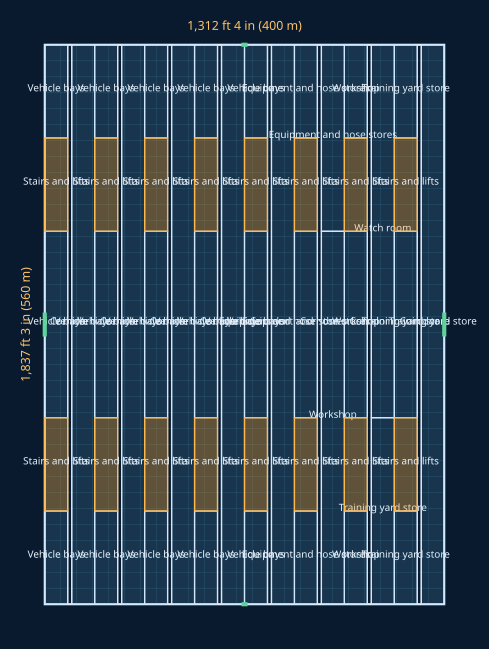
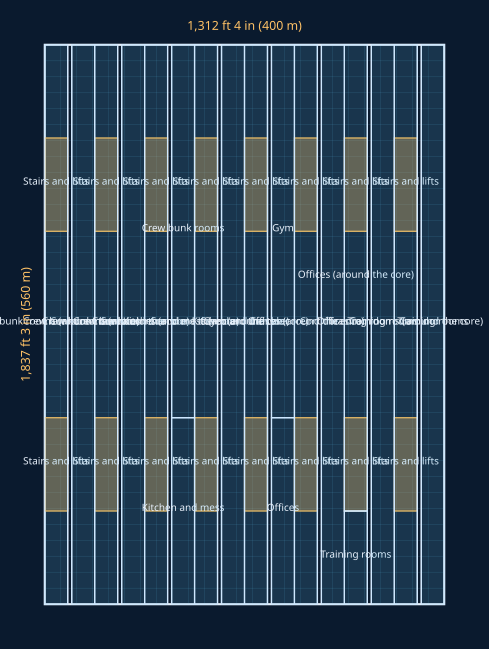
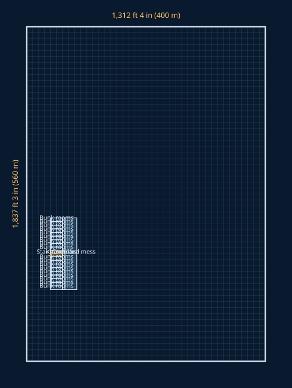
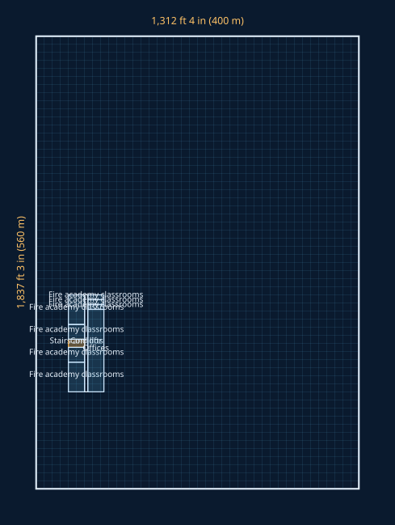

# P3-03 Stern Docks Fire Station: plan

Footprint 1,312 ft 4 in (400 m) × 1,837 ft 3 in (560 m) · structural grid 32 ft 10 in (10 m)

## Levels

| Level | Floor above deck | Height | Floor area |
|---|---|---|---|
| Level 1 · Ground floor | 0 ft (0 mm) | 14 ft 9 in (4,500 mm) | 299,237 sq ft (27,800 m²) |
| Level 2 · Level 2 | 14 ft 9 in (4,500 mm) | 14 ft 9 in (4,500 mm) | 299,237 sq ft (27,800 m²) |
| Level 3 · Level 3 | 29 ft 6 in (9,000 mm) | 13 ft 1 in (4,000 mm) | 49,514 sq ft (4,600 m²) |
| Level 4 · Level 4 | 42 ft 8 in (13 m) | 13 ft 1 in (4,000 mm) | 49,514 sq ft (4,600 m²) |
| Level 5 · Level 5 | 55 ft 9 in (17 m) | 13 ft 1 in (4,000 mm) | 49,514 sq ft (4,600 m²) |

## Elements

| ID | Designation | Type | Name | Level(s) | Size / length | Area | Status |
|---|---|---|---|---|---|---|---|
| E001 | D5F3P3B2A2L1R1 | zone | Training ground | L1 | 1,049 ft 10 in (320 m) × 853 ft (260 m) | 895,557 sq ft (83,200 m²) | proposed |
| E002 | D5F3P3B2A2L1R2, D5F3P3B2A2L2R1 | room | Hot-fire training rig (mock corvette) | L1, L2 | 196 ft 10 in (60 m) × 131 ft 3 in (40 m) | 25,833 sq ft (2,400 m²) | proposed |
| E003 | D5F3P3B2A2L1R3, D5F3P3B2A2L2R2, D5F3P3B2A2L3R1, D5F3P3B2A2L4R1, D5F3P3B2A2L5R1 | core | Stairs and lifts | L1, L2, L3, L4, L5 | 65 ft 7 in (20 m) × 32 ft 10 in (10 m) | 2,153 sq ft (200 m²) | proposed |
| E004 | D5F3P3B2A2L1R4 | zone | Corridor | L1 | 13 ft 1 in (4,000 mm) × 393 ft 8 in (120 m) | 5,167 sq ft (480 m²) | proposed |
| E005 | D5F3P3B2A2L1R5 | room | Watch room | L1 | 65 ft 7 in (20 m) × 180 ft 5 in (55 m) | 11,840 sq ft (1,100 m²) | proposed |
| E006 | D5F3P3B2A2L1R6 | room | Watch room | L1 | 65 ft 7 in (20 m) × 180 ft 5 in (55 m) | 11,840 sq ft (1,100 m²) | proposed |
| E007 | D5F3P3B2A2L1R7 | room | Breathing apparatus | L1 | 65 ft 7 in (20 m) × 65 ft 7 in (20 m) | 4,306 sq ft (400 m²) | proposed |
| E008 | D5F3P3B2A2L1R8 | room | Decontamination | L1 | 65 ft 7 in (20 m) × 49 ft 3 in (15 m) | 3,229 sq ft (300 m²) | proposed |
| E009 | D5F3P3B2A2L1R9 | room | Stores | L1 | 65 ft 7 in (20 m) × 278 ft 10 in (85 m) | 18,299 sq ft (1,700 m²) | proposed |
| E010 | D5F3P3B2A2L2R3, D5F3P3B2A2L3R2 | zone | Corridor | L2, L3 | 13 ft 1 in (4,000 mm) × 393 ft 8 in (120 m) | 5,167 sq ft (480 m²) | proposed |
| E011 | D5F3P3B2A2L2R4, D5F3P3B2A2L3R3 | room | Bunk rooms | L2, L3 | 65 ft 7 in (20 m) × 20 ft (6,100 mm) | 1,313 sq ft (122 m²) | proposed |
| E012 | D5F3P3B2A2L2R5, D5F3P3B2A2L3R4 | room | Bunk rooms | L2, L3 | 65 ft 7 in (20 m) × 20 ft (6,100 mm) | 1,313 sq ft (122 m²) | proposed |
| E013 | D5F3P3B2A2L2R6, D5F3P3B2A2L3R5 | room | Bunk rooms | L2, L3 | 65 ft 7 in (20 m) × 20 ft (6,100 mm) | 1,313 sq ft (122 m²) | proposed |
| E014 | D5F3P3B2A2L2R7, D5F3P3B2A2L3R6 | room | Bunk rooms | L2, L3 | 65 ft 7 in (20 m) × 20 ft (6,100 mm) | 1,313 sq ft (122 m²) | proposed |
| E015 | D5F3P3B2A2L2R8, D5F3P3B2A2L3R7 | room | Bunk rooms | L2, L3 | 65 ft 7 in (20 m) × 20 ft 4 in (6,200 mm) | 1,335 sq ft (124 m²) | proposed |
| E016 | D5F3P3B2A2L2R9, D5F3P3B2A2L3R8 | room | Bunk rooms | L2, L3 | 65 ft 7 in (20 m) × 20 ft (6,100 mm) | 1,313 sq ft (122 m²) | proposed |
| E017 | D5F3P3B2A2L2R10, D5F3P3B2A2L3R9 | room | Bunk rooms | L2, L3 | 65 ft 7 in (20 m) × 20 ft (6,100 mm) | 1,313 sq ft (122 m²) | proposed |
| E018 | D5F3P3B2A2L2R11, D5F3P3B2A2L3R10 | room | Bunk rooms | L2, L3 | 65 ft 7 in (20 m) × 20 ft (6,100 mm) | 1,313 sq ft (122 m²) | proposed |
| E019 | D5F3P3B2A2L2R12, D5F3P3B2A2L3R11 | room | Bunk rooms | L2, L3 | 65 ft 7 in (20 m) × 20 ft (6,100 mm) | 1,313 sq ft (122 m²) | proposed |
| E020 | D5F3P3B2A2L2R13, D5F3P3B2A2L3R12 | room | Bunk rooms | L2, L3 | 65 ft 7 in (20 m) × 20 ft (6,100 mm) | 1,313 sq ft (122 m²) | proposed |
| E021 | D5F3P3B2A2L2R14, D5F3P3B2A2L3R13 | room | Bunk rooms | L2, L3 | 65 ft 7 in (20 m) × 20 ft (6,100 mm) | 1,313 sq ft (122 m²) | proposed |
| E022 | D5F3P3B2A2L2R15, D5F3P3B2A2L3R14 | room | Bunk rooms | L2, L3 | 65 ft 7 in (20 m) × 20 ft (6,100 mm) | 1,313 sq ft (122 m²) | proposed |
| E023 | D5F3P3B2A2L2R16, D5F3P3B2A2L3R15 | room | Bunk rooms | L2, L3 | 65 ft 7 in (20 m) × 20 ft (6,100 mm) | 1,313 sq ft (122 m²) | proposed |
| E024 | D5F3P3B2A2L2R17, D5F3P3B2A2L3R16 | room | Bunk rooms | L2, L3 | 65 ft 7 in (20 m) × 20 ft 4 in (6,200 mm) | 1,335 sq ft (124 m²) | proposed |
| E025 | D5F3P3B2A2L2R18, D5F3P3B2A2L3R17 | room | Bunk rooms | L2, L3 | 65 ft 7 in (20 m) × 20 ft (6,100 mm) | 1,313 sq ft (122 m²) | proposed |
| E026 | D5F3P3B2A2L2R19, D5F3P3B2A2L3R18 | room | Bunk rooms | L2, L3 | 65 ft 7 in (20 m) × 20 ft (6,100 mm) | 1,313 sq ft (122 m²) | proposed |
| E027 | D5F3P3B2A2L2R20, D5F3P3B2A2L3R19 | room | Bunk rooms | L2, L3 | 65 ft 7 in (20 m) × 20 ft (6,100 mm) | 1,313 sq ft (122 m²) | proposed |
| E028 | D5F3P3B2A2L2R21, D5F3P3B2A2L3R20 | room | Bunk rooms | L2, L3 | 65 ft 7 in (20 m) × 20 ft (6,100 mm) | 1,313 sq ft (122 m²) | proposed |
| E029 | D5F3P3B2A2L2R22, D5F3P3B2A2L3R21 | room | Kitchen and mess | L2, L3 | 65 ft 7 in (20 m) × 393 ft 8 in (120 m) | 25,833 sq ft (2,400 m²) | proposed |
| E030 | D5F3P3B2A2L4R2, D5F3P3B2A2L5R2 | zone | Corridor | L4, L5 | 13 ft 1 in (4,000 mm) × 393 ft 8 in (120 m) | 5,167 sq ft (480 m²) | proposed |
| E031 | D5F3P3B2A2L4R3, D5F3P3B2A2L5R3 | room | Fire academy classrooms | L4, L5 | 65 ft 7 in (20 m) × 120 ft 5 in (37 m) | 7,901 sq ft (734 m²) | proposed |
| E032 | D5F3P3B2A2L4R4, D5F3P3B2A2L5R4 | room | Fire academy classrooms | L4, L5 | 65 ft 7 in (20 m) × 60 ft (18 m) | 3,940 sq ft (366 m²) | proposed |
| E033 | D5F3P3B2A2L4R5, D5F3P3B2A2L5R5 | room | Fire academy classrooms | L4, L5 | 65 ft 7 in (20 m) × 60 ft (18 m) | 3,940 sq ft (366 m²) | proposed |
| E034 | D5F3P3B2A2L4R6, D5F3P3B2A2L5R6 | room | Fire academy classrooms | L4, L5 | 65 ft 7 in (20 m) × 120 ft 5 in (37 m) | 7,901 sq ft (734 m²) | proposed |
| E035 | D5F3P3B2A2L4R7, D5F3P3B2A2L5R7 | room | Fire academy classrooms | L4, L5 | 65 ft 7 in (20 m) × 19 ft 8 in (6,000 mm) | 1,292 sq ft (120 m²) | proposed |
| E036 | D5F3P3B2A2L4R8, D5F3P3B2A2L5R8 | room | Fire academy classrooms | L4, L5 | 65 ft 7 in (20 m) × 19 ft 8 in (6,000 mm) | 1,292 sq ft (120 m²) | proposed |
| E037 | D5F3P3B2A2L4R9, D5F3P3B2A2L5R9 | room | Fire academy classrooms | L4, L5 | 65 ft 7 in (20 m) × 19 ft 8 in (6,000 mm) | 1,292 sq ft (120 m²) | proposed |
| E038 | D5F3P3B2A2L4R10, D5F3P3B2A2L5R10 | room | Offices | L4, L5 | 65 ft 7 in (20 m) × 334 ft 8 in (102 m) | 21,958 sq ft (2,040 m²) | proposed |
| E039 | D5F3P3B2A2L1R10, D5F3P3B2A2L2R23 | room | Heavy dock tender | L1, L2 | 106 ft 8 in (32 m) × 262 ft 6 in (80 m) | 27,986 sq ft (2,600 m²) | proposed |
| E040 | D5F3P3B2A2L1R11, D5F3P3B2A2L2R24 | room | Heavy dock tender | L1, L2 | 106 ft 8 in (32 m) × 262 ft 6 in (80 m) | 27,986 sq ft (2,600 m²) | proposed |
| E041 | D5F3P3B2A2L1R12, D5F3P3B2A2L2R25 | room | Foam tender | L1, L2 | 106 ft 8 in (32 m) × 262 ft 6 in (80 m) | 27,986 sq ft (2,600 m²) | proposed |
| E042 | D5F3P3B2A2L1R13, D5F3P3B2A2L2R26 | room | Foam tender | L1, L2 | 106 ft 8 in (32 m) × 262 ft 6 in (80 m) | 27,986 sq ft (2,600 m²) | proposed |
| E043 | D5F3P3B2A2L1R14, D5F3P3B2A2L2R27 | room | Rescue unit | L1, L2 | 106 ft 8 in (32 m) × 262 ft 6 in (80 m) | 27,986 sq ft (2,600 m²) | proposed |
| E044 | D5F3P3B2A2L1R15, D5F3P3B2A2L2R28 | room | Aerial platform | L1, L2 | 106 ft 8 in (32 m) × 262 ft 6 in (80 m) | 27,986 sq ft (2,600 m²) | proposed |
| E045 | D5F3P3B2A2L1R16, D5F3P3B2A2L2R29 | room | Hazmat unit | L1, L2 | 106 ft 8 in (32 m) × 262 ft 6 in (80 m) | 27,986 sq ft (2,600 m²) | proposed |
| E046 | D5F3P3B2A2L1R17, D5F3P3B2A2L2R30 | room | Command car | L1, L2 | 106 ft 8 in (32 m) × 262 ft 6 in (80 m) | 27,986 sq ft (2,600 m²) | proposed |
| E047 | D5F3P3B2A2L1R18 | zone | Road apron | L1 | 984 ft 3 in (300 m) × 131 ft 3 in (40 m) | 129,167 sq ft (12,000 m²) | proposed |
| E048 |  | door | Appliance doors (road) | L1 | 853 ft (260 m), 853 ft (260 m) wide | — | proposed |

## Drawings

### Level 1 · Ground floor

### Level 2 · Level 2

### Level 3 · Level 3

### Level 4 · Level 4

### Level 5 · Level 5

