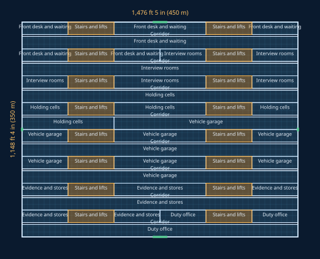
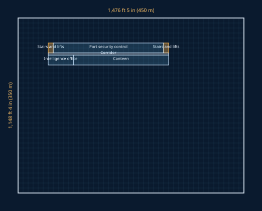

# P3-04 Stern Docks Police Post: plan

Footprint 1,476 ft 5 in (450 m) × 1,148 ft 4 in (350 m) · structural grid 32 ft 10 in (10 m)

## Levels

| Level | Floor above deck | Height | Floor area |
|---|---|---|---|
| Level 1 · Ground floor | 0 ft (0 mm) | 13 ft 9 in (4,200 mm) | 228,195 sq ft (21,200 m²) |
| Level 2 · Level 2 | 13 ft 9 in (4,200 mm) | 13 ft 9 in (4,200 mm) | 228,195 sq ft (21,200 m²) |
| Level 3 · Level 3 | 27 ft 7 in (8,400 mm) | 13 ft 9 in (4,200 mm) | 99,028 sq ft (9,200 m²) |

## Elements

| ID | Designation | Type | Name | Level(s) | Size / length | Area | Status |
|---|---|---|---|---|---|---|---|
| E001 | D5F3P3B3A1L1R1 | zone | Dockside frontage | L1 | 1,476 ft 5 in (450 m) × 131 ft 3 in (40 m) | 193,750 sq ft (18,000 m²) | proposed |
| E002 | D5F3P3B3A1L1R2, D5F3P3B3A1L2R1, D5F3P3B3A1L3R1 | core | Stairs and lifts | L1, L2, L3 | 32 ft 10 in (10 m) × 65 ft 7 in (20 m) | 2,153 sq ft (200 m²) | proposed |
| E003 | D5F3P3B3A1L1R3, D5F3P3B3A1L2R2, D5F3P3B3A1L3R2 | core | Stairs and lifts | L1, L2, L3 | 32 ft 10 in (10 m) × 65 ft 7 in (20 m) | 2,153 sq ft (200 m²) | proposed |
| E004 | D5F3P3B3A1L1R4 | zone | Corridor | L1 | 787 ft 5 in (240 m) × 13 ft 1 in (4,000 mm) | 10,333 sq ft (960 m²) | proposed |
| E005 | D5F3P3B3A1L1R5 | room | Front desk and waiting | L1 | 721 ft 9 in (220 m) × 65 ft 7 in (20 m) | 47,361 sq ft (4,400 m²) | proposed |
| E006 | D5F3P3B3A1L1R6 | room | Customs search rooms | L1 | 6 ft 7 in (2,000 mm) × 65 ft 7 in (20 m) | 431 sq ft (40 m²) | proposed |
| E007 | D5F3P3B3A1L1R7 | room | Customs search rooms | L1 | 6 ft 7 in (2,000 mm) × 65 ft 7 in (20 m) | 431 sq ft (40 m²) | proposed |
| E008 | D5F3P3B3A1L1R8 | room | Customs search rooms | L1 | 6 ft 7 in (2,000 mm) × 65 ft 7 in (20 m) | 431 sq ft (40 m²) | proposed |
| E009 | D5F3P3B3A1L1R9 | room | Customs search rooms | L1 | 6 ft 7 in (2,000 mm) × 65 ft 7 in (20 m) | 431 sq ft (40 m²) | proposed |
| E010 | D5F3P3B3A1L1R10 | room | Customs search rooms | L1 | 6 ft 7 in (2,000 mm) × 65 ft 7 in (20 m) | 431 sq ft (40 m²) | proposed |
| E011 | D5F3P3B3A1L1R11 | room | Customs search rooms | L1 | 6 ft 7 in (2,000 mm) × 65 ft 7 in (20 m) | 431 sq ft (40 m²) | proposed |
| E012 | D5F3P3B3A1L1R12 | room | Interview rooms | L1 | 4 ft 11 in (1,500 mm) × 65 ft 7 in (20 m) | 323 sq ft (30 m²) | proposed |
| E013 | D5F3P3B3A1L1R13 | room | Interview rooms | L1 | 4 ft 11 in (1,500 mm) × 65 ft 7 in (20 m) | 323 sq ft (30 m²) | proposed |
| E014 | D5F3P3B3A1L1R14 | room | Interview rooms | L1 | 4 ft 11 in (1,500 mm) × 65 ft 7 in (20 m) | 323 sq ft (30 m²) | proposed |
| E015 | D5F3P3B3A1L1R15 | room | Interview rooms | L1 | 4 ft 11 in (1,500 mm) × 65 ft 7 in (20 m) | 323 sq ft (30 m²) | proposed |
| E016 | D5F3P3B3A1L1R16 | room | Holding rooms | L1 | 2 ft 4 in (700 mm) × 65 ft 7 in (20 m) | 151 sq ft (14 m²) | proposed |
| E017 | D5F3P3B3A1L1R17 | room | Holding rooms | L1 | 2 ft 4 in (700 mm) × 65 ft 7 in (20 m) | 151 sq ft (14 m²) | proposed |
| E018 | D5F3P3B3A1L1R18 | room | Holding rooms | L1 | 2 ft 4 in (700 mm) × 65 ft 7 in (20 m) | 151 sq ft (14 m²) | proposed |
| E019 | D5F3P3B3A1L1R19 | room | Holding rooms | L1 | 2 ft 4 in (700 mm) × 65 ft 7 in (20 m) | 151 sq ft (14 m²) | proposed |
| E020 | D5F3P3B3A1L1R20 | room | Holding rooms | L1 | 2 ft 4 in (700 mm) × 65 ft 7 in (20 m) | 151 sq ft (14 m²) | proposed |
| E021 | D5F3P3B3A1L1R21 | room | Holding rooms | L1 | 2 ft 4 in (700 mm) × 65 ft 7 in (20 m) | 151 sq ft (14 m²) | proposed |
| E022 | D5F3P3B3A1L1R22 | room | Holding rooms | L1 | 2 ft 4 in (700 mm) × 65 ft 7 in (20 m) | 151 sq ft (14 m²) | proposed |
| E023 | D5F3P3B3A1L1R23 | room | Holding rooms | L1 | 2 ft 4 in (700 mm) × 65 ft 7 in (20 m) | 151 sq ft (14 m²) | proposed |
| E024 | D5F3P3B3A1L1R24 | room | Holding rooms | L1 | 2 ft 4 in (700 mm) × 65 ft 7 in (20 m) | 151 sq ft (14 m²) | proposed |
| E025 | D5F3P3B3A1L1R25 | room | Holding rooms | L1 | 2 ft 4 in (700 mm) × 65 ft 7 in (20 m) | 151 sq ft (14 m²) | proposed |
| E026 | D5F3P3B3A1L1R26 | room | Toilets | L1 | 705 ft 5 in (215 m) × 65 ft 7 in (20 m) | 46,285 sq ft (4,300 m²) | proposed |
| E027 | D5F3P3B3A1L2R3 | zone | Corridor | L2 | 787 ft 5 in (240 m) × 13 ft 1 in (4,000 mm) | 10,333 sq ft (960 m²) | proposed |
| E028 | D5F3P3B3A1L2R4 | room | Marine unit room | L2 | 721 ft 9 in (220 m) × 65 ft 7 in (20 m) | 47,361 sq ft (4,400 m²) | proposed |
| E029 | D5F3P3B3A1L2R5 | room | Open office | L2 | 706 ft 8 in (215 m) × 65 ft 7 in (20 m) | 46,371 sq ft (4,308 m²) | proposed |
| E030 | D5F3P3B3A1L2R6 | room | Briefing room | L2 | 80 ft 9 in (25 m) × 65 ft 7 in (20 m) | 5,296 sq ft (492 m²) | proposed |
| E031 | D5F3P3B3A1L3R3 | zone | Corridor | L3 | 787 ft 5 in (240 m) × 13 ft 1 in (4,000 mm) | 10,333 sq ft (960 m²) | proposed |
| E032 | D5F3P3B3A1L3R4 | room | Port security control | L3 | 721 ft 9 in (220 m) × 65 ft 7 in (20 m) | 47,361 sq ft (4,400 m²) | proposed |
| E033 | D5F3P3B3A1L3R5 | room | Intelligence office | L3 | 164 ft 1 in (50 m) × 65 ft 7 in (20 m) | 10,764 sq ft (1,000 m²) | proposed |
| E034 | D5F3P3B3A1L3R6 | room | Canteen | L3 | 623 ft 4 in (190 m) × 65 ft 7 in (20 m) | 40,903 sq ft (3,800 m²) | proposed |
| E035 | D5F3P3B3A1L1R27, D5F3P3B3A1L2R7 | room | Patrol launch bay | L1, L2 | 328 ft 1 in (100 m) × 131 ft 3 in (40 m) | 43,056 sq ft (4,000 m²) | proposed |
| E036 | D5F3P3B3A1L1R28, D5F3P3B3A1L2R8 | room | Patrol launch bay | L1, L2 | 328 ft 1 in (100 m) × 131 ft 3 in (40 m) | 43,056 sq ft (4,000 m²) | proposed |
| E037 | D5F3P3B3A1L1R29, D5F3P3B3A1L2R9 | room | Drone hangar | L1, L2 | 328 ft 1 in (100 m) × 131 ft 3 in (40 m) | 43,056 sq ft (4,000 m²) | proposed |
| E038 | D5F3P3B3A1L1R30 | zone | Secure yard | L1 | 787 ft 5 in (240 m) × 656 ft 2 in (200 m) | 516,668 sq ft (48,000 m²) | proposed |
| E039 |  | door | Public entrance | L1 | 65 ft 7 in (20 m), 65 ft 7 in (20 m) wide | — | proposed |

## Drawings

### Level 1 · Ground floor

### Level 2 · Level 2

### Level 3 · Level 3

