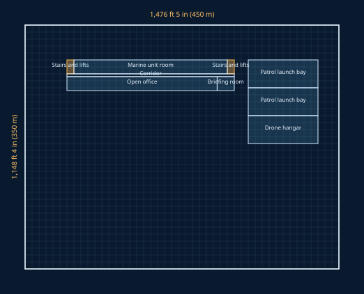

# P3-04 Stern Docks Police Post: plan

Footprint 1,476 ft 5 in (450 m) × 1,148 ft 4 in (350 m) · structural grid 29 ft 6 in (9,000 mm)

## Levels

| Level | Floor above deck | Height | Floor area |
|---|---|---|---|
| Level 1 · Ground floor | 0 ft (0 mm) | 13 ft 1 in (4,000 mm) | 1,315,565 sq ft (122,220 m²) |
| Level 2 · Upper floor | 13 ft 1 in (4,000 mm) | 13 ft 1 in (4,000 mm) | 788,564 sq ft (73,260 m²) |
| Level 3 · Upper floor | 26 ft 3 in (8,000 mm) | 13 ft 1 in (4,000 mm) | 788,564 sq ft (73,260 m²) |

## Elements

| ID | Designation | Type | Name | Level(s) | Size / length | Area | Status |
|---|---|---|---|---|---|---|---|
| L1-001 | D5F3P3B3A1L1R1 | zone | Corridor | L1 | 1,476 ft 5 in (450 m) × 9 ft 10 in (3,000 mm) | 14,531 sq ft (1,350 m²) | proposed |
| L1-002 | D5F3P3B3A1L1R2 | zone | Corridor | L1 | 1,476 ft 5 in (450 m) × 9 ft 10 in (3,000 mm) | 14,531 sq ft (1,350 m²) | proposed |
| L1-003 | D5F3P3B3A1L1R3 | zone | Corridor | L1 | 1,476 ft 5 in (450 m) × 9 ft 10 in (3,000 mm) | 14,531 sq ft (1,350 m²) | proposed |
| L1-004 | D5F3P3B3A1L1R4 | zone | Corridor | L1 | 1,476 ft 5 in (450 m) × 9 ft 10 in (3,000 mm) | 14,531 sq ft (1,350 m²) | proposed |
| L1-005 | D5F3P3B3A1L1R5 | zone | Corridor | L1 | 1,476 ft 5 in (450 m) × 9 ft 10 in (3,000 mm) | 14,531 sq ft (1,350 m²) | proposed |
| L1-006 | D5F3P3B3A1L1R6 | zone | Corridor | L1 | 1,476 ft 5 in (450 m) × 9 ft 10 in (3,000 mm) | 14,531 sq ft (1,350 m²) | proposed |
| L1-007 | D5F3P3B3A1L1R7 | zone | Corridor | L1 | 1,476 ft 5 in (450 m) × 9 ft 10 in (3,000 mm) | 14,531 sq ft (1,350 m²) | proposed |
| L1-008 | D5F3P3B3A1L1R8 | zone | Corridor | L1 | 1,476 ft 5 in (450 m) × 9 ft 10 in (3,000 mm) | 14,531 sq ft (1,350 m²) | proposed |
| L1-009 | D5F3P3B3A1L1R9 | room | Front desk and waiting | L1 | 246 ft 1 in (75 m) × 66 ft 11 in (20 m) | 16,469 sq ft (1,530 m²) | proposed |
| L1-010 | D5F3P3B3A1L1R10 | room | Front desk and waiting | L1 | 492 ft 2 in (150 m) × 66 ft 11 in (20 m) | 32,938 sq ft (3,060 m²) | proposed |
| L1-011 | D5F3P3B3A1L1R11 | room | Front desk and waiting | L1 | 246 ft 1 in (75 m) × 66 ft 11 in (20 m) | 16,469 sq ft (1,530 m²) | proposed |
| L1-012 | D5F3P3B3A1L1R12 | room | Front desk and waiting | L1 | 1,476 ft 5 in (450 m) × 66 ft 7 in (20 m) | 98,328 sq ft (9,135 m²) | proposed |
| L1-013 | D5F3P3B3A1L1R13 | room | Front desk and waiting | L1 | 246 ft 1 in (75 m) × 66 ft 11 in (20 m) | 16,469 sq ft (1,530 m²) | proposed |
| L1-014 | D5F3P3B3A1L1R14 | room | Front desk and waiting | L1 | 246 ft 1 in (75 m) × 66 ft 11 in (20 m) | 16,469 sq ft (1,530 m²) | proposed |
| L1-015 | D5F3P3B3A1L1R15 | room | Interview rooms | L1 | 246 ft 1 in (75 m) × 66 ft 11 in (20 m) | 16,469 sq ft (1,530 m²) | proposed |
| L1-016 | D5F3P3B3A1L1R16 | room | Interview rooms | L1 | 246 ft 1 in (75 m) × 66 ft 11 in (20 m) | 16,469 sq ft (1,530 m²) | proposed |
| L1-017 | D5F3P3B3A1L1R17 | room | Interview rooms | L1 | 1,476 ft 5 in (450 m) × 66 ft 11 in (20 m) | 98,813 sq ft (9,180 m²) | proposed |
| L1-018 | D5F3P3B3A1L1R18 | room | Interview rooms | L1 | 246 ft 1 in (75 m) × 66 ft 11 in (20 m) | 16,469 sq ft (1,530 m²) | proposed |
| L1-019 | D5F3P3B3A1L1R19 | room | Interview rooms | L1 | 492 ft 2 in (150 m) × 66 ft 11 in (20 m) | 32,938 sq ft (3,060 m²) | proposed |
| L1-020 | D5F3P3B3A1L1R20 | room | Interview rooms | L1 | 246 ft 1 in (75 m) × 66 ft 11 in (20 m) | 16,469 sq ft (1,530 m²) | proposed |
| L1-021 | D5F3P3B3A1L1R21 | room | Holding cells | L1 | 1,476 ft 5 in (450 m) × 66 ft 7 in (20 m) | 98,328 sq ft (9,135 m²) | proposed |
| L1-022 | D5F3P3B3A1L1R22 | room | Holding cells | L1 | 246 ft 1 in (75 m) × 66 ft 11 in (20 m) | 16,469 sq ft (1,530 m²) | proposed |
| L1-023 | D5F3P3B3A1L1R23 | room | Holding cells | L1 | 492 ft 2 in (150 m) × 66 ft 11 in (20 m) | 32,938 sq ft (3,060 m²) | proposed |
| L1-024 | D5F3P3B3A1L1R24 | room | Holding cells | L1 | 246 ft 1 in (75 m) × 66 ft 11 in (20 m) | 16,469 sq ft (1,530 m²) | proposed |
| L1-025 | D5F3P3B3A1L1R25 | room | Holding cells | L1 | 492 ft 2 in (150 m) × 66 ft 11 in (20 m) | 32,938 sq ft (3,060 m²) | proposed |
| L1-026 | D5F3P3B3A1L1R26 | room | Vehicle garage | L1 | 984 ft 3 in (300 m) × 66 ft 11 in (20 m) | 65,875 sq ft (6,120 m²) | proposed |
| L1-027 | D5F3P3B3A1L1R27 | room | Vehicle garage | L1 | 246 ft 1 in (75 m) × 66 ft 11 in (20 m) | 16,469 sq ft (1,530 m²) | proposed |
| L1-028 | D5F3P3B3A1L1R28 | room | Vehicle garage | L1 | 492 ft 2 in (150 m) × 66 ft 11 in (20 m) | 32,938 sq ft (3,060 m²) | proposed |
| L1-029 | D5F3P3B3A1L1R29 | room | Vehicle garage | L1 | 246 ft 1 in (75 m) × 66 ft 11 in (20 m) | 16,469 sq ft (1,530 m²) | proposed |
| L1-030 | D5F3P3B3A1L1R30 | room | Vehicle garage | L1 | 1,476 ft 5 in (450 m) × 66 ft 7 in (20 m) | 98,328 sq ft (9,135 m²) | proposed |
| L1-031 | D5F3P3B3A1L1R31 | room | Vehicle garage | L1 | 246 ft 1 in (75 m) × 66 ft 11 in (20 m) | 16,469 sq ft (1,530 m²) | proposed |
| L1-032 | D5F3P3B3A1L1R32 | room | Vehicle garage | L1 | 492 ft 2 in (150 m) × 66 ft 11 in (20 m) | 32,938 sq ft (3,060 m²) | proposed |
| L1-033 | D5F3P3B3A1L1R33 | room | Vehicle garage | L1 | 246 ft 1 in (75 m) × 66 ft 11 in (20 m) | 16,469 sq ft (1,530 m²) | proposed |
| L1-034 | D5F3P3B3A1L1R34 | room | Vehicle garage | L1 | 1,476 ft 5 in (450 m) × 66 ft 11 in (20 m) | 98,813 sq ft (9,180 m²) | proposed |
| L1-035 | D5F3P3B3A1L1R35 | room | Evidence and stores | L1 | 246 ft 1 in (75 m) × 66 ft 11 in (20 m) | 16,469 sq ft (1,530 m²) | proposed |
| L1-036 | D5F3P3B3A1L1R36 | room | Evidence and stores | L1 | 492 ft 2 in (150 m) × 66 ft 11 in (20 m) | 32,938 sq ft (3,060 m²) | proposed |
| L1-037 | D5F3P3B3A1L1R37 | room | Evidence and stores | L1 | 246 ft 1 in (75 m) × 66 ft 11 in (20 m) | 16,469 sq ft (1,530 m²) | proposed |
| L1-038 | D5F3P3B3A1L1R38 | room | Evidence and stores | L1 | 1,476 ft 5 in (450 m) × 66 ft 7 in (20 m) | 98,328 sq ft (9,135 m²) | proposed |
| L1-039 | D5F3P3B3A1L1R39 | room | Evidence and stores | L1 | 246 ft 1 in (75 m) × 66 ft 11 in (20 m) | 16,469 sq ft (1,530 m²) | proposed |
| L1-040 | D5F3P3B3A1L1R40 | room | Evidence and stores | L1 | 246 ft 1 in (75 m) × 66 ft 11 in (20 m) | 16,469 sq ft (1,530 m²) | proposed |
| L1-041 | D5F3P3B3A1L1R41 | room | Duty office | L1 | 246 ft 1 in (75 m) × 66 ft 11 in (20 m) | 16,469 sq ft (1,530 m²) | proposed |
| L1-042 | D5F3P3B3A1L1R42 | room | Duty office | L1 | 246 ft 1 in (75 m) × 66 ft 11 in (20 m) | 16,469 sq ft (1,530 m²) | proposed |
| L1-043 | D5F3P3B3A1L1R43 | room | Duty office | L1 | 1,476 ft 5 in (450 m) × 66 ft 11 in (20 m) | 98,813 sq ft (9,180 m²) | proposed |
| L1-044 | D5F3P3B3A1L1R44, D5F3P3B3A1L2R1, D5F3P3B3A1L3R1 | core | Stairs and lifts | L1, L2, L3 | 246 ft 1 in (75 m) × 66 ft 11 in (20 m) | 16,469 sq ft (1,530 m²) | proposed |
| L1-045 | D5F3P3B3A1L1R45, D5F3P3B3A1L2R2, D5F3P3B3A1L3R2 | core | Stairs and lifts | L1, L2, L3 | 246 ft 1 in (75 m) × 66 ft 11 in (20 m) | 16,469 sq ft (1,530 m²) | proposed |
| L1-046 | D5F3P3B3A1L1R46, D5F3P3B3A1L2R3, D5F3P3B3A1L3R3 | core | Stairs and lifts | L1, L2, L3 | 246 ft 1 in (75 m) × 66 ft 11 in (20 m) | 16,469 sq ft (1,530 m²) | proposed |
| L1-047 | D5F3P3B3A1L1R47, D5F3P3B3A1L2R4, D5F3P3B3A1L3R4 | core | Stairs and lifts | L1, L2, L3 | 246 ft 1 in (75 m) × 66 ft 11 in (20 m) | 16,469 sq ft (1,530 m²) | proposed |
| L1-048 | D5F3P3B3A1L1R48, D5F3P3B3A1L2R5, D5F3P3B3A1L3R5 | core | Stairs and lifts | L1, L2, L3 | 246 ft 1 in (75 m) × 66 ft 11 in (20 m) | 16,469 sq ft (1,530 m²) | proposed |
| L1-049 | D5F3P3B3A1L1R49, D5F3P3B3A1L2R6, D5F3P3B3A1L3R6 | core | Stairs and lifts | L1, L2, L3 | 246 ft 1 in (75 m) × 66 ft 11 in (20 m) | 16,469 sq ft (1,530 m²) | proposed |
| L1-050 | D5F3P3B3A1L1R50, D5F3P3B3A1L2R7, D5F3P3B3A1L3R7 | core | Stairs and lifts | L1, L2, L3 | 246 ft 1 in (75 m) × 66 ft 11 in (20 m) | 16,469 sq ft (1,530 m²) | proposed |
| L1-051 | D5F3P3B3A1L1R51, D5F3P3B3A1L2R8, D5F3P3B3A1L3R8 | core | Stairs and lifts | L1, L2, L3 | 246 ft 1 in (75 m) × 66 ft 11 in (20 m) | 16,469 sq ft (1,530 m²) | proposed |
| L1-052 | D5F3P3B3A1L1R52, D5F3P3B3A1L2R9, D5F3P3B3A1L3R9 | core | Stairs and lifts | L1, L2, L3 | 246 ft 1 in (75 m) × 66 ft 11 in (20 m) | 16,469 sq ft (1,530 m²) | proposed |
| L1-053 | D5F3P3B3A1L1R53, D5F3P3B3A1L2R10, D5F3P3B3A1L3R10 | core | Stairs and lifts | L1, L2, L3 | 246 ft 1 in (75 m) × 66 ft 11 in (20 m) | 16,469 sq ft (1,530 m²) | proposed |
| L1-054 | D5F3P3B3A1L1R54, D5F3P3B3A1L2R11, D5F3P3B3A1L3R11 | core | Stairs and lifts | L1, L2, L3 | 246 ft 1 in (75 m) × 66 ft 11 in (20 m) | 16,469 sq ft (1,530 m²) | proposed |
| L1-055 | D5F3P3B3A1L1R55, D5F3P3B3A1L2R12, D5F3P3B3A1L3R12 | core | Stairs and lifts | L1, L2, L3 | 246 ft 1 in (75 m) × 66 ft 11 in (20 m) | 16,469 sq ft (1,530 m²) | proposed |
| L1-056 | D5F3P3B3A1L1R56, D5F3P3B3A1L2R13, D5F3P3B3A1L3R13 | core | Stairs and lifts | L1, L2, L3 | 246 ft 1 in (75 m) × 66 ft 11 in (20 m) | 16,469 sq ft (1,530 m²) | proposed |
| L1-057 | D5F3P3B3A1L1R57, D5F3P3B3A1L2R14, D5F3P3B3A1L3R14 | core | Stairs and lifts | L1, L2, L3 | 246 ft 1 in (75 m) × 66 ft 11 in (20 m) | 16,469 sq ft (1,530 m²) | proposed |
| L1-058 | D5F3P3B3A1L1R58, D5F3P3B3A1L2R15, D5F3P3B3A1L3R15 | core | Stairs and lifts | L1, L2, L3 | 246 ft 1 in (75 m) × 66 ft 11 in (20 m) | 16,469 sq ft (1,530 m²) | proposed |
| L1-059 | D5F3P3B3A1L1R59, D5F3P3B3A1L2R16, D5F3P3B3A1L3R16 | core | Stairs and lifts | L1, L2, L3 | 246 ft 1 in (75 m) × 66 ft 11 in (20 m) | 16,469 sq ft (1,530 m²) | proposed |
| LT-001 | D5F3P3B3A1L2R17, D5F3P3B3A1L3R17 | zone | Corridor | L2, L3 | 1,476 ft 5 in (450 m) × 9 ft 10 in (3,000 mm) | 14,531 sq ft (1,350 m²) | proposed |
| LT-002 | D5F3P3B3A1L2R18, D5F3P3B3A1L3R18 | zone | Corridor | L2, L3 | 1,476 ft 5 in (450 m) × 9 ft 10 in (3,000 mm) | 14,531 sq ft (1,350 m²) | proposed |
| LT-003 | D5F3P3B3A1L2R19, D5F3P3B3A1L3R19 | zone | Corridor | L2, L3 | 1,476 ft 5 in (450 m) × 9 ft 10 in (3,000 mm) | 14,531 sq ft (1,350 m²) | proposed |
| LT-004 | D5F3P3B3A1L2R20, D5F3P3B3A1L3R20 | zone | Corridor | L2, L3 | 1,476 ft 5 in (450 m) × 9 ft 10 in (3,000 mm) | 14,531 sq ft (1,350 m²) | proposed |
| LT-005 | D5F3P3B3A1L2R21, D5F3P3B3A1L3R21 | room | Offices (around the core) | L2, L3 | 1,476 ft 5 in (450 m) × 66 ft 11 in (20 m) | 98,813 sq ft (9,180 m²) | proposed |
| LT-006 | D5F3P3B3A1L2R22, D5F3P3B3A1L3R22 | room | Offices | L2, L3 | 1,476 ft 5 in (450 m) × 66 ft 7 in (20 m) | 98,328 sq ft (9,135 m²) | proposed |
| LT-007 | D5F3P3B3A1L2R23, D5F3P3B3A1L3R23 | room | Offices (around the core) | L2, L3 | 1,476 ft 5 in (450 m) × 66 ft 11 in (20 m) | 98,813 sq ft (9,180 m²) | proposed |
| LT-008 | D5F3P3B3A1L2R24, D5F3P3B3A1L3R24 | room | Offices | L2, L3 | 1,476 ft 5 in (450 m) × 66 ft 7 in (20 m) | 98,328 sq ft (9,135 m²) | proposed |
| LT-009 | D5F3P3B3A1L2R25, D5F3P3B3A1L3R25 | room | Briefing rooms (around the core) | L2, L3 | 1,476 ft 5 in (450 m) × 66 ft 11 in (20 m) | 98,813 sq ft (9,180 m²) | proposed |
| LT-010 | D5F3P3B3A1L2R26, D5F3P3B3A1L3R26 | room | Briefing rooms | L2, L3 | 246 ft 1 in (75 m) × 66 ft 7 in (20 m) | 16,388 sq ft (1,522 m²) | proposed |
| LT-011 | D5F3P3B3A1L2R27, D5F3P3B3A1L3R27 | room | Control room | L2, L3 | 1,230 ft 4 in (375 m) × 66 ft 7 in (20 m) | 81,940 sq ft (7,612 m²) | proposed |
| LT-012 | D5F3P3B3A1L2R28, D5F3P3B3A1L3R28 | room | Lockers and showers (around the core) | L2, L3 | 1,476 ft 5 in (450 m) × 66 ft 11 in (20 m) | 98,813 sq ft (9,180 m²) | proposed |
| LT-013 | D5F3P3B3A1L2R29, D5F3P3B3A1L3R29 | room | Lockers and showers | L2, L3 | 246 ft 1 in (75 m) × 66 ft 7 in (20 m) | 16,388 sq ft (1,522 m²) | proposed |
| LT-014 | D5F3P3B3A1L2R30, D5F3P3B3A1L3R30 | room | Canteen | L2, L3 | 1,230 ft 4 in (375 m) × 66 ft 7 in (20 m) | 81,940 sq ft (7,613 m²) | proposed |
| D-74 |  | door | Main entrance | L1 | 78 ft 9 in (24 m), 78 ft 9 in (24 m) wide | — | proposed |
| D-75 |  | door | Second entrance | L1 | 78 ft 9 in (24 m), 78 ft 9 in (24 m) wide | — | proposed |
| D-76 |  | door | Side door | L1 | 19 ft 8 in (6,000 mm), 19 ft 8 in (6,000 mm) wide | — | proposed |
| D-77 |  | door | Side door | L1 | 19 ft 8 in (6,000 mm), 19 ft 8 in (6,000 mm) wide | — | proposed |

## Drawings

### Level 1 · Ground floor

### Level 2 · Upper floor

### Level 3 · Upper floor

