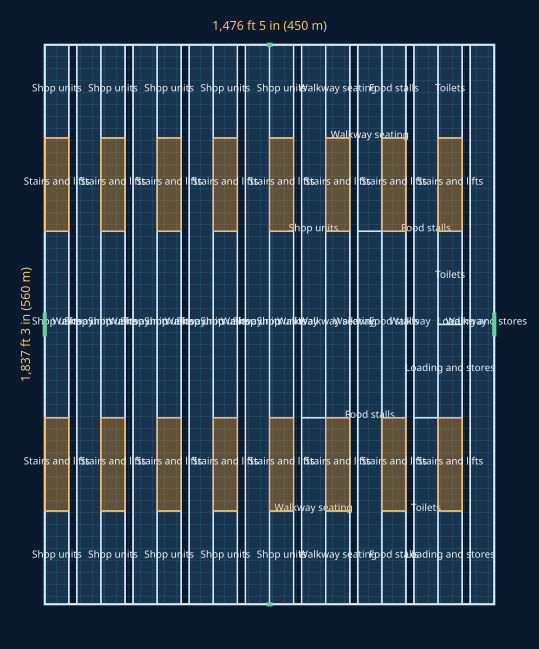
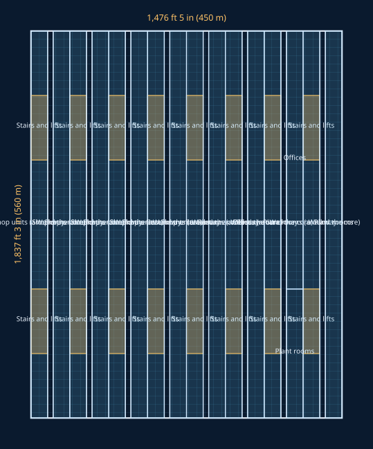

# P3-05 Stern Docks Chandlery: plan

Footprint 1,476 ft 5 in (450 m) × 1,837 ft 3 in (560 m) · structural grid 32 ft 10 in (10 m)

## Levels

| Level | Floor above deck | Height | Floor area |
|---|---|---|---|
| Level 1 · Trade floor | 0 ft (0 mm) | 19 ft 8 in (6,000 mm) | 1,124,183 sq ft (104,440 m²) |
| Level 2 · Upper floor | 19 ft 8 in (6,000 mm) | 16 ft 5 in (5,000 mm) | 1,124,183 sq ft (104,440 m²) |

## Elements

| ID | Designation | Type | Name | Level(s) | Size / length | Area | Status |
|---|---|---|---|---|---|---|---|
| E001 | D5F3P3B3A2L1R1, D5F3P3B3A2L2R1 | room | Bonded spares | L1, L2 | 303 ft 6 in (92 m) × 721 ft 9 in (220 m) | 219,046 sq ft (20,350 m²) | proposed |
| E002 | D5F3P3B3A2L1R2, D5F3P3B3A2L2R2 | room | Bonded provisions (chilled) | L1, L2 | 303 ft 6 in (92 m) × 721 ft 9 in (220 m) | 219,046 sq ft (20,350 m²) | proposed |
| E003 | D5F3P3B3A2L1R3, D5F3P3B3A2L2R3 | room | Weapons-grade parts (secure) | L1, L2 | 303 ft 6 in (92 m) × 721 ft 9 in (220 m) | 219,046 sq ft (20,350 m²) | proposed |
| E004 | D5F3P3B3A2L1R4, D5F3P3B3A2L2R4 | room | Heavy parts | L1, L2 | 303 ft 6 in (92 m) × 721 ft 9 in (220 m) | 219,046 sq ft (20,350 m²) | proposed |
| E005 | D5F3P3B3A2L1R5 | zone | Loading yard | L1 | 1,213 ft 11 in (370 m) × 295 ft 3 in (90 m) | 358,438 sq ft (33,300 m²) | proposed |
| E006 | D5F3P3B3A2L1R6, D5F3P3B3A2L2R5 | core | Stairs and lifts | L1, L2 | 32 ft 10 in (10 m) × 105 ft (32 m) | 3,444 sq ft (320 m²) | proposed |
| E007 | D5F3P3B3A2L1R7, D5F3P3B3A2L2R6 | core | Stairs and lifts | L1, L2 | 32 ft 10 in (10 m) × 105 ft (32 m) | 3,444 sq ft (320 m²) | proposed |
| E008 | D5F3P3B3A2L1R8 | zone | Corridor | L1 | 1,213 ft 11 in (370 m) × 19 ft 8 in (6,000 mm) | 23,896 sq ft (2,220 m²) | proposed |
| E009 | D5F3P3B3A2L1R9 | room | Trade counter | L1 | 765 ft 5 in (233 m) × 105 ft (32 m) | 80,359 sq ft (7,466 m²) | proposed |
| E010 | D5F3P3B3A2L1R10 | room | Frigate supply office | L1 | 382 ft 10 in (117 m) × 105 ft (32 m) | 40,197 sq ft (3,734 m²) | proposed |
| E011 | D5F3P3B3A2L1R11 | room | Crew outfitters | L1 | 256 ft 3 in (78 m) × 105 ft (32 m) | 26,901 sq ft (2,499 m²) | proposed |
| E012 | D5F3P3B3A2L1R12 | room | Provisions counter | L1 | 256 ft 3 in (78 m) × 105 ft (32 m) | 26,901 sq ft (2,499 m²) | proposed |
| E013 | D5F3P3B3A2L1R13 | room | Café | L1 | 701 ft 5 in (214 m) × 105 ft (32 m) | 73,642 sq ft (6,842 m²) | proposed |
| E014 | D5F3P3B3A2L2R7 | zone | Corridor | L2 | 1,213 ft 11 in (370 m) × 19 ft 8 in (6,000 mm) | 23,896 sq ft (2,220 m²) | proposed |
| E015 | D5F3P3B3A2L2R8 | room | Contract office | L2 | 1,148 ft 4 in (350 m) × 105 ft (32 m) | 120,556 sq ft (11,200 m²) | proposed |
| E016 | D5F3P3B3A2L2R9 | room | Customs bond office | L2 | 82 ft (25 m) × 105 ft (32 m) | 8,611 sq ft (800 m²) | proposed |
| E017 | D5F3P3B3A2L2R10 | room | Offices | L2 | 1,131 ft 11 in (345 m) × 105 ft (32 m) | 118,834 sq ft (11,040 m²) | proposed |
| E018 | D5F3P3B3A2L1R14 | zone | Customer forecourt | L1 | 1,213 ft 11 in (370 m) × 295 ft 3 in (90 m) | 358,438 sq ft (33,300 m²) | proposed |
| E019 |  | door | Trade entrance | L1 | 65 ft 7 in (20 m), 65 ft 7 in (20 m) wide | — | proposed |

## Drawings

### Level 1 · Trade floor

### Level 2 · Upper floor

