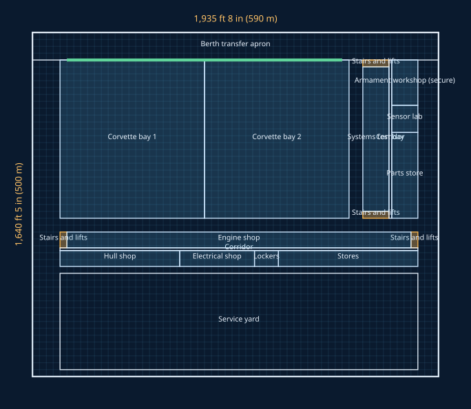
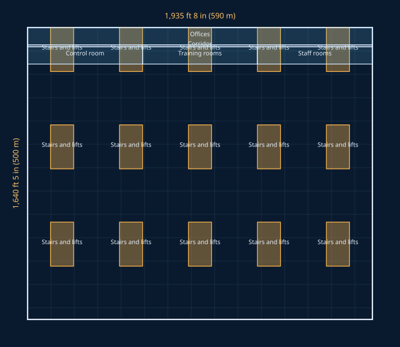
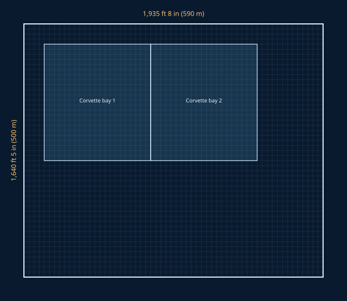

# P3-06 Corvette Service: plan

Footprint 1,935 ft 8 in (590 m) × 1,640 ft 5 in (500 m) · structural grid 32 ft 10 in (10 m)

## Levels

| Level | Floor above deck | Height | Floor area |
|---|---|---|---|
| Level 1 · Ground floor | 0 ft (0 mm) | 19 ft 8 in (6,000 mm) | 1,472,288 sq ft (136,780 m²) |
| Level 2 · Level 2 | 19 ft 8 in (6,000 mm) | 19 ft 8 in (6,000 mm) | 1,472,288 sq ft (136,780 m²) |
| Level 3 · Shed upper | 39 ft 4 in (12 m) | 23 ft (7,000 mm) | 1,039,794 sq ft (96,600 m²) |
| Level 4 · Shed upper | 62 ft 4 in (19 m) | 23 ft (7,000 mm) | 1,039,794 sq ft (96,600 m²) |
| Level 5 · Shed roof space | 85 ft 4 in (26 m) | 19 ft 8 in (6,000 mm) | 1,039,794 sq ft (96,600 m²) |

## Elements

| ID | Designation | Type | Name | Level(s) | Size / length | Area | Status |
|---|---|---|---|---|---|---|---|
| E001 | D5F3P3B4A1L1R1 | zone | Berth transfer apron | L1 | 1,935 ft 8 in (590 m) × 131 ft 3 in (40 m) | 254,028 sq ft (23,600 m²) | proposed |
| E002 | D5F3P3B4A1L1R2, D5F3P3B4A1L2R1, D5F3P3B4A1L3R1, D5F3P3B4A1L4R1, D5F3P3B4A1L5R1 | room | Corvette bay 1 | L1, L2, L3, L4, L5 | 689 ft (210 m) × 754 ft 7 in (230 m) | 519,897 sq ft (48,300 m²) | proposed |
| E003 | D5F3P3B4A1L1R3, D5F3P3B4A1L2R2, D5F3P3B4A1L3R2, D5F3P3B4A1L4R2, D5F3P3B4A1L5R2 | room | Corvette bay 2 | L1, L2, L3, L4, L5 | 689 ft (210 m) × 754 ft 7 in (230 m) | 519,897 sq ft (48,300 m²) | proposed |
| E004 | D5F3P3B4A1L1R4, D5F3P3B4A1L2R3 | core | Stairs and lifts | L1, L2 | 124 ft 8 in (38 m) × 32 ft 10 in (10 m) | 4,090 sq ft (380 m²) | proposed |
| E005 | D5F3P3B4A1L1R5, D5F3P3B4A1L2R4 | core | Stairs and lifts | L1, L2 | 124 ft 8 in (38 m) × 32 ft 10 in (10 m) | 4,090 sq ft (380 m²) | proposed |
| E006 | D5F3P3B4A1L1R6 | zone | Corridor | L1 | 13 ft 1 in (4,000 mm) × 754 ft 7 in (230 m) | 9,903 sq ft (920 m²) | proposed |
| E007 | D5F3P3B4A1L1R7 | room | Systems test bay | L1 | 124 ft 8 in (38 m) × 689 ft (210 m) | 85,896 sq ft (7,980 m²) | proposed |
| E008 | D5F3P3B4A1L1R8 | room | Armament workshop (secure) | L1 | 124 ft 8 in (38 m) × 215 ft 11 in (66 m) | 26,914 sq ft (2,500 m²) | proposed |
| E009 | D5F3P3B4A1L1R9 | room | Sensor lab | L1 | 124 ft 8 in (38 m) × 129 ft 7 in (40 m) | 16,157 sq ft (1,501 m²) | proposed |
| E010 | D5F3P3B4A1L1R10 | room | Parts store | L1 | 124 ft 8 in (38 m) × 409 ft 1 in (125 m) | 51,006 sq ft (4,739 m²) | proposed |
| E011 | D5F3P3B4A1L2R5 | zone | Corridor | L2 | 13 ft 1 in (4,000 mm) × 754 ft 7 in (230 m) | 9,903 sq ft (920 m²) | proposed |
| E012 | D5F3P3B4A1L2R6 | room | Engineering office | L2 | 124 ft 8 in (38 m) × 689 ft (210 m) | 85,896 sq ft (7,980 m²) | proposed |
| E013 | D5F3P3B4A1L2R7 | room | Crew liaison | L2 | 124 ft 8 in (38 m) × 51 ft 10 in (16 m) | 6,463 sq ft (600 m²) | proposed |
| E014 | D5F3P3B4A1L2R8 | room | Offices | L2 | 124 ft 8 in (38 m) × 702 ft 9 in (214 m) | 87,614 sq ft (8,140 m²) | proposed |
| E015 | D5F3P3B4A1L1R11, D5F3P3B4A1L2R9 | core | Stairs and lifts | L1, L2 | 32 ft 10 in (10 m) × 75 ft 6 in (23 m) | 2,476 sq ft (230 m²) | proposed |
| E016 | D5F3P3B4A1L1R12, D5F3P3B4A1L2R10 | core | Stairs and lifts | L1, L2 | 32 ft 10 in (10 m) × 75 ft 6 in (23 m) | 2,476 sq ft (230 m²) | proposed |
| E017 | D5F3P3B4A1L1R13 | zone | Corridor | L1 | 1,706 ft (520 m) × 13 ft 1 in (4,000 mm) | 22,389 sq ft (2,080 m²) | proposed |
| E018 | D5F3P3B4A1L1R14 | room | Engine shop | L1 | 1,640 ft 5 in (500 m) × 75 ft 6 in (23 m) | 123,785 sq ft (11,500 m²) | proposed |
| E019 | D5F3P3B4A1L1R15 | room | Hull shop | L1 | 570 ft 6 in (174 m) × 75 ft 6 in (23 m) | 43,052 sq ft (4,000 m²) | proposed |
| E020 | D5F3P3B4A1L1R16 | room | Electrical shop | L1 | 356 ft 8 in (109 m) × 75 ft 6 in (23 m) | 26,911 sq ft (2,500 m²) | proposed |
| E021 | D5F3P3B4A1L1R17 | room | Lockers | L1 | 114 ft 2 in (35 m) × 75 ft 6 in (23 m) | 8,615 sq ft (800 m²) | proposed |
| E022 | D5F3P3B4A1L1R18 | room | Stores | L1 | 664 ft 8 in (203 m) × 75 ft 6 in (23 m) | 50,158 sq ft (4,660 m²) | proposed |
| E023 | D5F3P3B4A1L2R11 | zone | Corridor | L2 | 1,706 ft (520 m) × 13 ft 1 in (4,000 mm) | 22,389 sq ft (2,080 m²) | proposed |
| E024 | D5F3P3B4A1L2R12 | room | Canteen | L2 | 1,640 ft 5 in (500 m) × 75 ft 6 in (23 m) | 123,785 sq ft (11,500 m²) | proposed |
| E025 | D5F3P3B4A1L2R13 | room | Planning | L2 | 213 ft 11 in (65 m) × 75 ft 6 in (23 m) | 16,142 sq ft (1,500 m²) | proposed |
| E026 | D5F3P3B4A1L2R14 | room | Offices | L2 | 1,492 ft 2 in (455 m) × 75 ft 6 in (23 m) | 112,595 sq ft (10,460 m²) | proposed |
| E027 | D5F3P3B4A1L1R19 | zone | Service yard | L1 | 1,706 ft (520 m) × 459 ft 4 in (140 m) | 783,613 sq ft (72,800 m²) | proposed |
| E028 |  | door | Corvette shed door | L1 | 1,312 ft 4 in (400 m), 1,312 ft 4 in (400 m) wide | — | proposed |

## Drawings

### Level 1 · Ground floor

### Level 2 · Level 2

### Level 3 · Shed upper

### Level 4 · Shed upper

### Level 5 · Shed roof space

