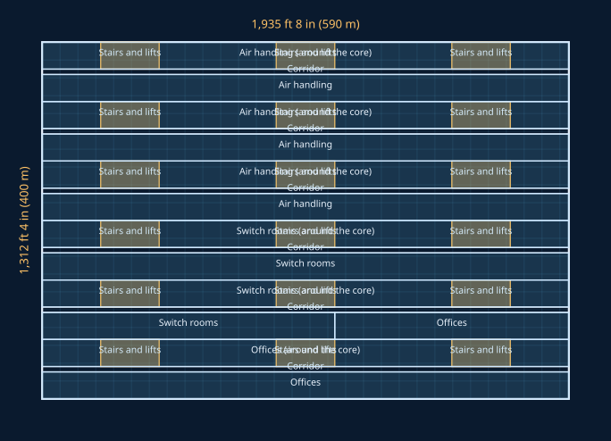

# P3-07 Stern Docks Fuel Depot: plan

Footprint 1,935 ft 8 in (590 m) × 1,312 ft 4 in (400 m) · structural grid 32 ft 10 in (10 m)

## Levels

| Level | Floor above deck | Height | Floor area |
|---|---|---|---|
| Level 1 · Ground | 0 ft (0 mm) | 29 ft 6 in (9,000 mm) | 496,001 sq ft (46,080 m²) |
| Level 2 · Tank tops | 29 ft 6 in (9,000 mm) | 29 ft 6 in (9,000 mm) | 348,751 sq ft (32,400 m²) |

## Elements

| ID | Designation | Type | Name | Level(s) | Size / length | Area | Status |
|---|---|---|---|---|---|---|---|
| E001 | D5F3P3B5A1L1R1 | zone | Spill wall | L1 | 1,377 ft 11 in (420 m) × 1,049 ft 10 in (320 m) | 1,446,670 sq ft (134,400 m²) | proposed |
| E002 | D5F3P3B5A1L1R2, D5F3P3B5A1L2R1 | room | Bunker tank 1 | L1, L2 | 196 ft 10 in (60 m) × 196 ft 10 in (60 m) | 38,750 sq ft (3,600 m²) | proposed |
| E003 | D5F3P3B5A1L1R3, D5F3P3B5A1L2R2 | room | Bunker tank 2 | L1, L2 | 196 ft 10 in (60 m) × 196 ft 10 in (60 m) | 38,750 sq ft (3,600 m²) | proposed |
| E004 | D5F3P3B5A1L1R4, D5F3P3B5A1L2R3 | room | Bunker tank 3 | L1, L2 | 196 ft 10 in (60 m) × 196 ft 10 in (60 m) | 38,750 sq ft (3,600 m²) | proposed |
| E005 | D5F3P3B5A1L1R5, D5F3P3B5A1L2R4 | room | Bunker tank 4 | L1, L2 | 196 ft 10 in (60 m) × 196 ft 10 in (60 m) | 38,750 sq ft (3,600 m²) | proposed |
| E006 | D5F3P3B5A1L1R6, D5F3P3B5A1L2R5 | room | Bunker tank 5 | L1, L2 | 196 ft 10 in (60 m) × 196 ft 10 in (60 m) | 38,750 sq ft (3,600 m²) | proposed |
| E007 | D5F3P3B5A1L1R7, D5F3P3B5A1L2R6 | room | Bunker tank 6 | L1, L2 | 196 ft 10 in (60 m) × 196 ft 10 in (60 m) | 38,750 sq ft (3,600 m²) | proposed |
| E008 | D5F3P3B5A1L1R8, D5F3P3B5A1L2R7 | room | Bunker tank 7 | L1, L2 | 196 ft 10 in (60 m) × 196 ft 10 in (60 m) | 38,750 sq ft (3,600 m²) | proposed |
| E009 | D5F3P3B5A1L1R9, D5F3P3B5A1L2R8 | room | Bunker tank 8 | L1, L2 | 196 ft 10 in (60 m) × 196 ft 10 in (60 m) | 38,750 sq ft (3,600 m²) | proposed |
| E010 | D5F3P3B5A1L1R10, D5F3P3B5A1L2R9 | room | Bunker tank 9 | L1, L2 | 196 ft 10 in (60 m) × 196 ft 10 in (60 m) | 38,750 sq ft (3,600 m²) | proposed |
| E011 | D5F3P3B5A1L1R11 | zone | Corridor | L1 | 13 ft 1 in (4,000 mm) × 590 ft 7 in (180 m) | 7,750 sq ft (720 m²) | proposed |
| E012 | D5F3P3B5A1L1R12 | room | Bunker pumps | L1 | 124 ft 8 in (38 m) × 590 ft 7 in (180 m) | 73,625 sq ft (6,840 m²) | proposed |
| E013 | D5F3P3B5A1L1R13 | room | Filter room | L1 | 124 ft 8 in (38 m) × 129 ft 7 in (40 m) | 16,157 sq ft (1,501 m²) | proposed |
| E014 | D5F3P3B5A1L1R14 | room | Control room | L1 | 124 ft 8 in (38 m) × 68 ft 11 in (21 m) | 8,590 sq ft (798 m²) | proposed |
| E015 | D5F3P3B5A1L1R15 | room | Fuel lab | L1 | 124 ft 8 in (38 m) × 43 ft 4 in (13 m) | 5,399 sq ft (502 m²) | proposed |
| E016 | D5F3P3B5A1L1R16 | room | Crew room | L1 | 124 ft 8 in (38 m) × 348 ft 9 in (106 m) | 43,480 sq ft (4,039 m²) | proposed |
| E017 | D5F3P3B5A1L1R17 | zone | Truck bay | L1 | 295 ft 3 in (90 m) × 426 ft 6 in (130 m) | 125,938 sq ft (11,700 m²) | proposed |

## Drawings

### Level 1 · Ground

### Level 2 · Tank tops

