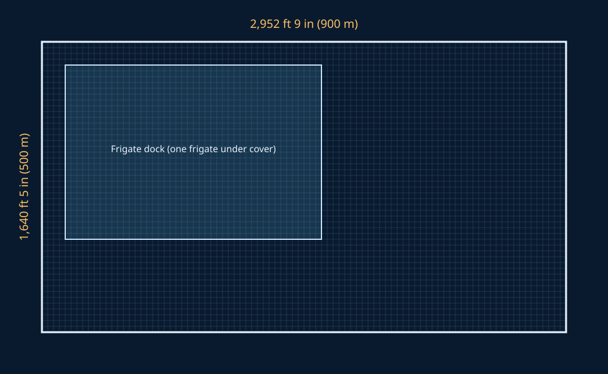

# P3-08 Frigate Service Yard: plan

Footprint 2,952 ft 9 in (900 m) × 1,640 ft 5 in (500 m) · structural grid 32 ft 10 in (10 m)

## Levels

| Level | Floor above deck | Height | Floor area |
|---|---|---|---|
| Level 1 · Ground floor | 0 ft (0 mm) | 19 ft 8 in (6,000 mm) | 1,888,743 sq ft (175,470 m²) |
| Level 2 · Level 2 | 19 ft 8 in (6,000 mm) | 19 ft 8 in (6,000 mm) | 1,888,743 sq ft (175,470 m²) |
| Level 3 · Shed | 39 ft 4 in (12 m) | 26 ft 3 in (8,000 mm) | 1,420,836 sq ft (132,000 m²) |
| Level 4 · Shed | 65 ft 7 in (20 m) | 26 ft 3 in (8,000 mm) | 1,420,836 sq ft (132,000 m²) |
| Level 5 · Shed | 91 ft 10 in (28 m) | 26 ft 3 in (8,000 mm) | 1,420,836 sq ft (132,000 m²) |
| Level 6 · Shed roof space | 118 ft 1 in (36 m) | 19 ft 8 in (6,000 mm) | 1,420,836 sq ft (132,000 m²) |

## Elements

| ID | Designation | Type | Name | Level(s) | Size / length | Area | Status |
|---|---|---|---|---|---|---|---|
| E001 | D5F3P3B7A1L1R1 | zone | Berth transfer apron | L1 | 2,952 ft 9 in (900 m) × 131 ft 3 in (40 m) | 387,501 sq ft (36,000 m²) | proposed |
| E002 | D5F3P3B7A1L1R2, D5F3P3B7A1L2R1, D5F3P3B7A1L3R1, D5F3P3B7A1L4R1, D5F3P3B7A1L5R1, D5F3P3B7A1L6R1 | room | Frigate dock (one frigate under cover) | L1, L2, L3, L4, L5, L6 | 1,443 ft 7 in (440 m) × 984 ft 3 in (300 m) | 1,420,836 sq ft (132,000 m²) | proposed |
| E003 | D5F3P3B7A1L1R3 | zone | Crane yard | L1 | 1,181 ft 1 in (360 m) × 984 ft 3 in (300 m) | 1,162,502 sq ft (108,000 m²) | proposed |
| E004 | D5F3P3B7A1L1R4, D5F3P3B7A1L2R2 | core | Stairs and lifts | L1, L2 | 32 ft 10 in (10 m) × 88 ft 7 in (27 m) | 2,906 sq ft (270 m²) | proposed |
| E005 | D5F3P3B7A1L1R5, D5F3P3B7A1L2R3 | core | Stairs and lifts | L1, L2 | 32 ft 10 in (10 m) × 88 ft 7 in (27 m) | 2,906 sq ft (270 m²) | proposed |
| E006 | D5F3P3B7A1L1R6, D5F3P3B7A1L2R4 | core | Stairs and lifts | L1, L2 | 32 ft 10 in (10 m) × 88 ft 7 in (27 m) | 2,906 sq ft (270 m²) | proposed |
| E007 | D5F3P3B7A1L1R7 | zone | Corridor | L1 | 2,690 ft 3 in (820 m) × 19 ft 8 in (6,000 mm) | 52,958 sq ft (4,920 m²) | proposed |
| E008 | D5F3P3B7A1L1R8 | room | Engine overhaul shop | L1 | 1,295 ft 11 in (395 m) × 88 ft 7 in (27 m) | 114,797 sq ft (10,665 m²) | proposed |
| E009 | D5F3P3B7A1L1R9 | room | Engine overhaul shop | L1 | 185 ft (56 m) × 88 ft 7 in (27 m) | 16,391 sq ft (1,523 m²) | proposed |
| E010 | D5F3P3B7A1L1R10 | room | Hull plate shop | L1 | 1,110 ft 11 in (339 m) × 88 ft 7 in (27 m) | 98,406 sq ft (9,142 m²) | proposed |
| E011 | D5F3P3B7A1L1R11 | room | Armour and shield shop | L1 | 607 ft 7 in (185 m) × 88 ft 7 in (27 m) | 53,824 sq ft (5,000 m²) | proposed |
| E012 | D5F3P3B7A1L1R12 | room | Pipe and power shop | L1 | 485 ft 11 in (148 m) × 88 ft 7 in (27 m) | 43,042 sq ft (3,999 m²) | proposed |
| E013 | D5F3P3B7A1L1R13 | room | Tool store | L1 | 182 ft 5 in (56 m) × 88 ft 7 in (27 m) | 16,159 sq ft (1,501 m²) | proposed |
| E014 | D5F3P3B7A1L1R14 | room | Locker rooms | L1 | 121 ft 5 in (37 m) × 88 ft 7 in (27 m) | 10,753 sq ft (999 m²) | proposed |
| E015 | D5F3P3B7A1L1R15 | room | Locker rooms | L1 | 121 ft 9 in (37 m) × 88 ft 7 in (27 m) | 10,782 sq ft (1,002 m²) | proposed |
| E016 | D5F3P3B7A1L1R16 | room | Stores | L1 | 1,171 ft 3 in (357 m) × 88 ft 7 in (27 m) | 103,753 sq ft (9,639 m²) | proposed |
| E017 | D5F3P3B7A1L2R5 | zone | Corridor | L2 | 2,690 ft 3 in (820 m) × 19 ft 8 in (6,000 mm) | 52,958 sq ft (4,920 m²) | proposed |
| E018 | D5F3P3B7A1L2R6 | room | Canteen | L2 | 1,295 ft 11 in (395 m) × 88 ft 7 in (27 m) | 114,797 sq ft (10,665 m²) | proposed |
| E019 | D5F3P3B7A1L2R7 | room | Canteen | L2 | 1,295 ft 11 in (395 m) × 88 ft 7 in (27 m) | 114,797 sq ft (10,665 m²) | proposed |
| E020 | D5F3P3B7A1L2R8 | room | Planning and drawing office | L2 | 485 ft 11 in (148 m) × 88 ft 7 in (27 m) | 43,042 sq ft (3,999 m²) | proposed |
| E021 | D5F3P3B7A1L2R9 | room | Training rooms | L2 | 36 ft 9 in (11 m) × 88 ft 7 in (27 m) | 3,255 sq ft (302 m²) | proposed |
| E022 | D5F3P3B7A1L2R10 | room | Training rooms | L2 | 36 ft 5 in (11 m) × 88 ft 7 in (27 m) | 3,226 sq ft (300 m²) | proposed |
| E023 | D5F3P3B7A1L2R11 | room | Training rooms | L2 | 36 ft 5 in (11 m) × 88 ft 7 in (27 m) | 3,226 sq ft (300 m²) | proposed |
| E024 | D5F3P3B7A1L2R12 | room | Training rooms | L2 | 36 ft 5 in (11 m) × 88 ft 7 in (27 m) | 3,226 sq ft (300 m²) | proposed |
| E025 | D5F3P3B7A1L2R13 | room | Offices | L2 | 2,058 ft 5 in (627 m) × 88 ft 7 in (27 m) | 182,339 sq ft (16,940 m²) | proposed |
| E026 | D5F3P3B7A1L1R17 | zone | Road-side parking | L1 | 2,690 ft 3 in (820 m) × 196 ft 10 in (60 m) | 529,584 sq ft (49,200 m²) | proposed |
| E027 |  | door | Frigate shed door | L1 | 1,377 ft 11 in (420 m), 1,377 ft 11 in (420 m) wide | — | proposed |

## Drawings

### Level 1 · Ground floor

### Level 2 · Level 2

### Level 3 · Shed

### Level 4 · Shed

### Level 5 · Shed

### Level 6 · Shed roof space

