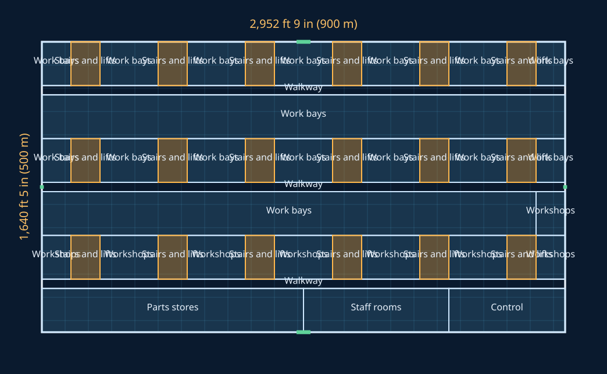
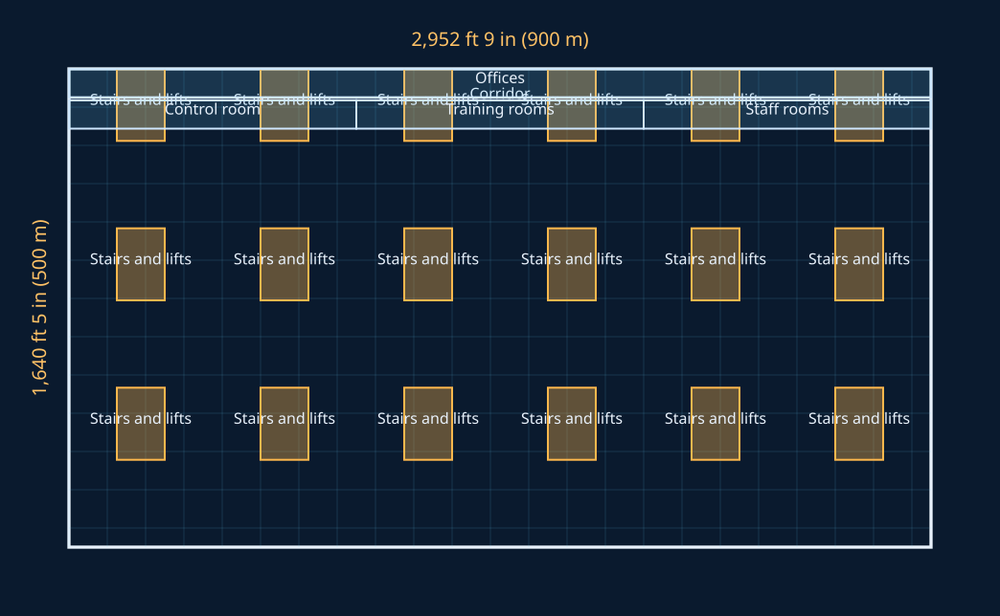

# P3-08 Frigate Service Yard: plan

Footprint 2,952 ft 9 in (900 m) × 1,640 ft 5 in (500 m) · structural grid 131 ft 3 in (40 m)

## Levels

| Level | Floor above deck | Height | Floor area |
|---|---|---|---|
| Level 1 · Ground floor | 0 ft (0 mm) | 65 ft 7 in (20 m) | 3,648,966 sq ft (339,000 m²) |
| Level 2 · Office level | 65 ft 7 in (20 m) | 14 ft 9 in (4,500 mm) | 576,407 sq ft (53,550 m²) |

## Elements

| ID | Designation | Type | Name | Level(s) | Size / length | Area | Status |
|---|---|---|---|---|---|---|---|
| L1-001 | D5F3P3B7A1L1R1 | zone | Walkway | L1 | 2,952 ft 9 in (900 m) × 52 ft 6 in (16 m) | 155,000 sq ft (14,400 m²) | proposed |
| L1-002 | D5F3P3B7A1L1R2 | zone | Walkway | L1 | 2,952 ft 9 in (900 m) × 52 ft 6 in (16 m) | 155,000 sq ft (14,400 m²) | proposed |
| L1-003 | D5F3P3B7A1L1R3 | zone | Walkway | L1 | 2,952 ft 9 in (900 m) × 52 ft 6 in (16 m) | 155,000 sq ft (14,400 m²) | proposed |
| L1-004 | D5F3P3B7A1L1R4 | room | Work bays | L1 | 164 ft 1 in (50 m) × 247 ft 1 in (75 m) | 40,526 sq ft (3,765 m²) | proposed |
| L1-005 | D5F3P3B7A1L1R5 | room | Work bays | L1 | 328 ft 1 in (100 m) × 247 ft 1 in (75 m) | 81,052 sq ft (7,530 m²) | proposed |
| L1-006 | D5F3P3B7A1L1R6 | room | Work bays | L1 | 328 ft 1 in (100 m) × 247 ft 1 in (75 m) | 81,052 sq ft (7,530 m²) | proposed |
| L1-007 | D5F3P3B7A1L1R7 | room | Work bays | L1 | 328 ft 1 in (100 m) × 247 ft 1 in (75 m) | 81,052 sq ft (7,530 m²) | proposed |
| L1-008 | D5F3P3B7A1L1R8 | room | Work bays | L1 | 328 ft 1 in (100 m) × 247 ft 1 in (75 m) | 81,052 sq ft (7,530 m²) | proposed |
| L1-009 | D5F3P3B7A1L1R9 | room | Work bays | L1 | 328 ft 1 in (100 m) × 247 ft 1 in (75 m) | 81,052 sq ft (7,530 m²) | proposed |
| L1-010 | D5F3P3B7A1L1R10 | room | Work bays | L1 | 164 ft 1 in (50 m) × 247 ft 1 in (75 m) | 40,526 sq ft (3,765 m²) | proposed |
| L1-011 | D5F3P3B7A1L1R11 | room | Work bays | L1 | 2,952 ft 9 in (900 m) × 247 ft 5 in (75 m) | 730,439 sq ft (67,860 m²) | proposed |
| L1-012 | D5F3P3B7A1L1R12 | room | Work bays | L1 | 164 ft 1 in (50 m) × 247 ft 1 in (75 m) | 40,526 sq ft (3,765 m²) | proposed |
| L1-013 | D5F3P3B7A1L1R13 | room | Work bays | L1 | 328 ft 1 in (100 m) × 247 ft 1 in (75 m) | 81,052 sq ft (7,530 m²) | proposed |
| L1-014 | D5F3P3B7A1L1R14 | room | Work bays | L1 | 328 ft 1 in (100 m) × 247 ft 1 in (75 m) | 81,052 sq ft (7,530 m²) | proposed |
| L1-015 | D5F3P3B7A1L1R15 | room | Work bays | L1 | 328 ft 1 in (100 m) × 247 ft 1 in (75 m) | 81,052 sq ft (7,530 m²) | proposed |
| L1-016 | D5F3P3B7A1L1R16 | room | Work bays | L1 | 328 ft 1 in (100 m) × 247 ft 1 in (75 m) | 81,052 sq ft (7,530 m²) | proposed |
| L1-017 | D5F3P3B7A1L1R17 | room | Work bays | L1 | 328 ft 1 in (100 m) × 247 ft 1 in (75 m) | 81,052 sq ft (7,530 m²) | proposed |
| L1-018 | D5F3P3B7A1L1R18 | room | Work bays | L1 | 164 ft 1 in (50 m) × 247 ft 1 in (75 m) | 40,526 sq ft (3,765 m²) | proposed |
| L1-019 | D5F3P3B7A1L1R19 | room | Work bays | L1 | 2,788 ft 9 in (850 m) × 247 ft 1 in (75 m) | 688,944 sq ft (64,005 m²) | proposed |
| L1-020 | D5F3P3B7A1L1R20 | room | Workshops | L1 | 164 ft 1 in (50 m) × 247 ft 1 in (75 m) | 40,526 sq ft (3,765 m²) | proposed |
| L1-021 | D5F3P3B7A1L1R21 | room | Workshops | L1 | 164 ft 1 in (50 m) × 247 ft 5 in (75 m) | 40,580 sq ft (3,770 m²) | proposed |
| L1-022 | D5F3P3B7A1L1R22 | room | Workshops | L1 | 328 ft 1 in (100 m) × 247 ft 5 in (75 m) | 81,160 sq ft (7,540 m²) | proposed |
| L1-023 | D5F3P3B7A1L1R23 | room | Workshops | L1 | 328 ft 1 in (100 m) × 247 ft 5 in (75 m) | 81,160 sq ft (7,540 m²) | proposed |
| L1-024 | D5F3P3B7A1L1R24 | room | Workshops | L1 | 328 ft 1 in (100 m) × 247 ft 5 in (75 m) | 81,160 sq ft (7,540 m²) | proposed |
| L1-025 | D5F3P3B7A1L1R25 | room | Workshops | L1 | 328 ft 1 in (100 m) × 247 ft 5 in (75 m) | 81,160 sq ft (7,540 m²) | proposed |
| L1-026 | D5F3P3B7A1L1R26 | room | Workshops | L1 | 328 ft 1 in (100 m) × 247 ft 5 in (75 m) | 81,160 sq ft (7,540 m²) | proposed |
| L1-027 | D5F3P3B7A1L1R27 | room | Workshops | L1 | 164 ft 1 in (50 m) × 247 ft 5 in (75 m) | 40,580 sq ft (3,770 m²) | proposed |
| L1-028 | D5F3P3B7A1L1R28 | room | Parts stores | L1 | 1,476 ft 5 in (450 m) × 247 ft 1 in (75 m) | 364,735 sq ft (33,885 m²) | proposed |
| L1-029 | D5F3P3B7A1L1R29 | room | Staff rooms | L1 | 820 ft 3 in (250 m) × 247 ft 1 in (75 m) | 202,631 sq ft (18,825 m²) | proposed |
| L1-030 | D5F3P3B7A1L1R30 | room | Control | L1 | 656 ft 2 in (200 m) × 247 ft 1 in (75 m) | 162,105 sq ft (15,060 m²) | proposed |
| L1-031 | D5F3P3B7A1L1R31, D5F3P3B7A1L2R1 | core | Stairs and lifts | L1, L2 | 164 ft 1 in (50 m) × 247 ft 1 in (75 m) | 40,526 sq ft (3,765 m²) | proposed |
| L1-032 | D5F3P3B7A1L1R32, D5F3P3B7A1L2R2 | core | Stairs and lifts | L1, L2 | 164 ft 1 in (50 m) × 247 ft 1 in (75 m) | 40,526 sq ft (3,765 m²) | proposed |
| L1-033 | D5F3P3B7A1L1R33, D5F3P3B7A1L2R3 | core | Stairs and lifts | L1, L2 | 164 ft 1 in (50 m) × 247 ft 1 in (75 m) | 40,526 sq ft (3,765 m²) | proposed |
| L1-034 | D5F3P3B7A1L1R34, D5F3P3B7A1L2R4 | core | Stairs and lifts | L1, L2 | 164 ft 1 in (50 m) × 247 ft 1 in (75 m) | 40,526 sq ft (3,765 m²) | proposed |
| L1-035 | D5F3P3B7A1L1R35, D5F3P3B7A1L2R5 | core | Stairs and lifts | L1, L2 | 164 ft 1 in (50 m) × 247 ft 1 in (75 m) | 40,526 sq ft (3,765 m²) | proposed |
| L1-036 | D5F3P3B7A1L1R36, D5F3P3B7A1L2R6 | core | Stairs and lifts | L1, L2 | 164 ft 1 in (50 m) × 247 ft 1 in (75 m) | 40,526 sq ft (3,765 m²) | proposed |
| L1-037 | D5F3P3B7A1L1R37, D5F3P3B7A1L2R7 | core | Stairs and lifts | L1, L2 | 164 ft 1 in (50 m) × 247 ft 1 in (75 m) | 40,526 sq ft (3,765 m²) | proposed |
| L1-038 | D5F3P3B7A1L1R38, D5F3P3B7A1L2R8 | core | Stairs and lifts | L1, L2 | 164 ft 1 in (50 m) × 247 ft 1 in (75 m) | 40,526 sq ft (3,765 m²) | proposed |
| L1-039 | D5F3P3B7A1L1R39, D5F3P3B7A1L2R9 | core | Stairs and lifts | L1, L2 | 164 ft 1 in (50 m) × 247 ft 1 in (75 m) | 40,526 sq ft (3,765 m²) | proposed |
| L1-040 | D5F3P3B7A1L1R40, D5F3P3B7A1L2R10 | core | Stairs and lifts | L1, L2 | 164 ft 1 in (50 m) × 247 ft 1 in (75 m) | 40,526 sq ft (3,765 m²) | proposed |
| L1-041 | D5F3P3B7A1L1R41, D5F3P3B7A1L2R11 | core | Stairs and lifts | L1, L2 | 164 ft 1 in (50 m) × 247 ft 1 in (75 m) | 40,526 sq ft (3,765 m²) | proposed |
| L1-042 | D5F3P3B7A1L1R42, D5F3P3B7A1L2R12 | core | Stairs and lifts | L1, L2 | 164 ft 1 in (50 m) × 247 ft 1 in (75 m) | 40,526 sq ft (3,765 m²) | proposed |
| L1-043 | D5F3P3B7A1L1R43, D5F3P3B7A1L2R13 | core | Stairs and lifts | L1, L2 | 164 ft 1 in (50 m) × 247 ft 5 in (75 m) | 40,580 sq ft (3,770 m²) | proposed |
| L1-044 | D5F3P3B7A1L1R44, D5F3P3B7A1L2R14 | core | Stairs and lifts | L1, L2 | 164 ft 1 in (50 m) × 247 ft 5 in (75 m) | 40,580 sq ft (3,770 m²) | proposed |
| L1-045 | D5F3P3B7A1L1R45, D5F3P3B7A1L2R15 | core | Stairs and lifts | L1, L2 | 164 ft 1 in (50 m) × 247 ft 5 in (75 m) | 40,580 sq ft (3,770 m²) | proposed |
| L1-046 | D5F3P3B7A1L1R46, D5F3P3B7A1L2R16 | core | Stairs and lifts | L1, L2 | 164 ft 1 in (50 m) × 247 ft 5 in (75 m) | 40,580 sq ft (3,770 m²) | proposed |
| L1-047 | D5F3P3B7A1L1R47, D5F3P3B7A1L2R17 | core | Stairs and lifts | L1, L2 | 164 ft 1 in (50 m) × 247 ft 5 in (75 m) | 40,580 sq ft (3,770 m²) | proposed |
| L1-048 | D5F3P3B7A1L1R48, D5F3P3B7A1L2R18 | core | Stairs and lifts | L1, L2 | 164 ft 1 in (50 m) × 247 ft 5 in (75 m) | 40,580 sq ft (3,770 m²) | proposed |
| L2-001 | D5F3P3B7A1L2R19 | zone | Corridor | L2 | 2,952 ft 9 in (900 m) × 9 ft 10 in (3,000 mm) | 29,063 sq ft (2,700 m²) | proposed |
| L2-002 | D5F3P3B7A1L2R20 | room | Offices | L2 | 2,952 ft 9 in (900 m) × 97 ft 9 in (30 m) | 288,688 sq ft (26,820 m²) | proposed |
| L2-003 | D5F3P3B7A1L2R21 | room | Control room | L2 | 984 ft 3 in (300 m) × 97 ft 5 in (30 m) | 95,906 sq ft (8,910 m²) | proposed |
| L2-004 | D5F3P3B7A1L2R22 | room | Training rooms | L2 | 984 ft 3 in (300 m) × 97 ft 5 in (30 m) | 95,906 sq ft (8,910 m²) | proposed |
| L2-005 | D5F3P3B7A1L2R23 | room | Staff rooms | L2 | 984 ft 3 in (300 m) × 97 ft 5 in (30 m) | 95,906 sq ft (8,910 m²) | proposed |
| D-54 |  | door | Main entrance | L1 | 78 ft 9 in (24 m), 78 ft 9 in (24 m) wide | — | proposed |
| D-55 |  | door | Second entrance | L1 | 78 ft 9 in (24 m), 78 ft 9 in (24 m) wide | — | proposed |
| D-56 |  | door | Side door | L1 | 19 ft 8 in (6,000 mm), 19 ft 8 in (6,000 mm) wide | — | proposed |
| D-57 |  | door | Side door | L1 | 19 ft 8 in (6,000 mm), 19 ft 8 in (6,000 mm) wide | — | proposed |

## Drawings

### Level 1 · Ground floor

### Level 2 · Office level

