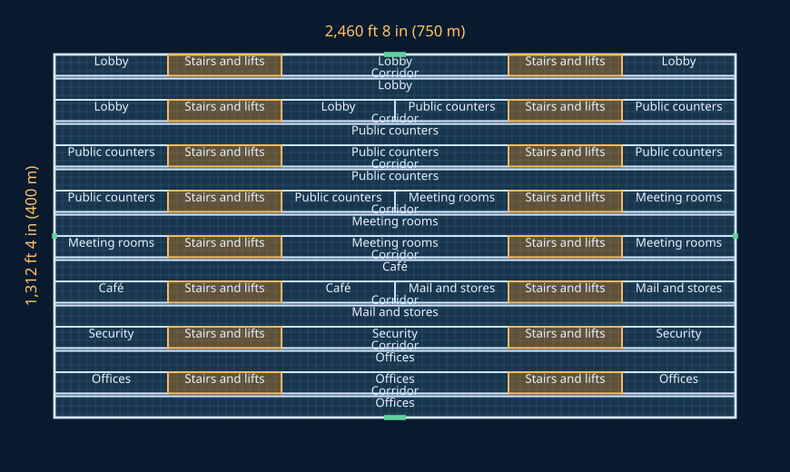
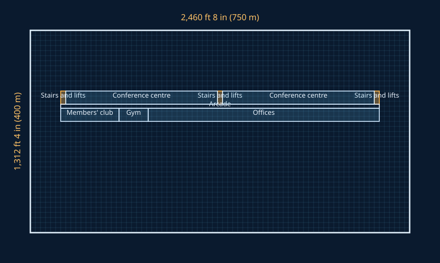
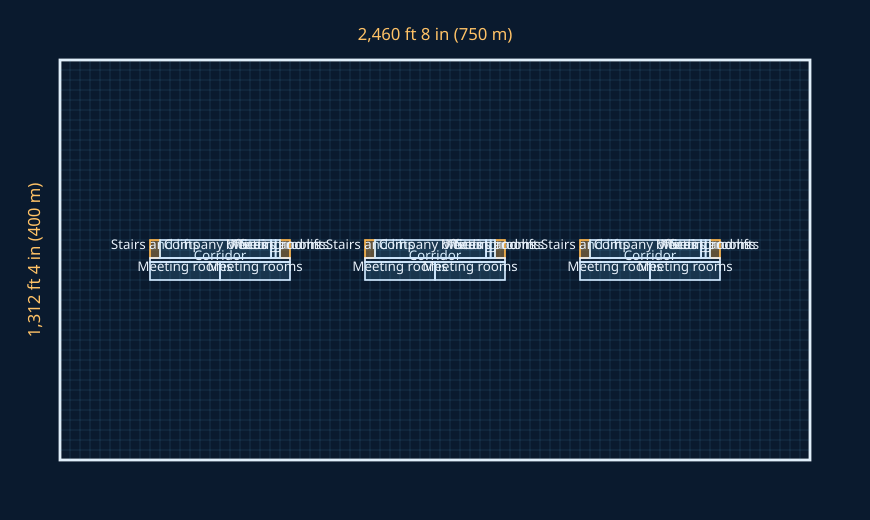
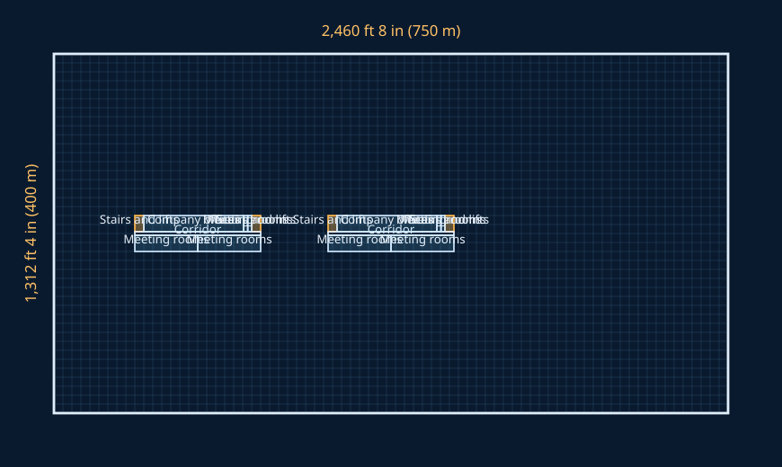
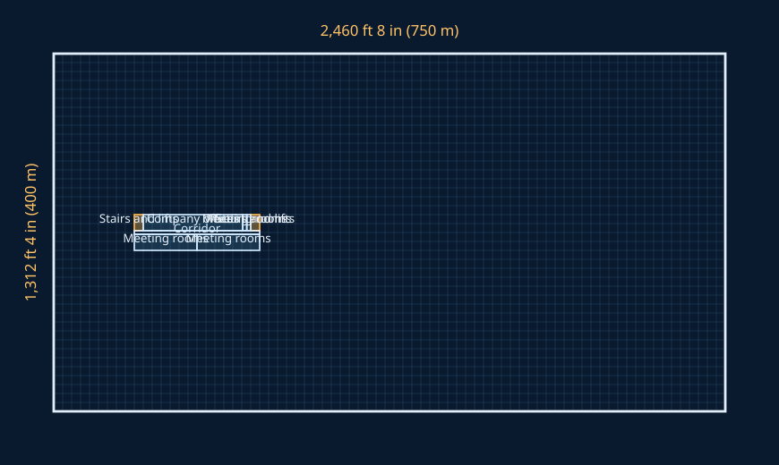

# P3-09 Company Berth Offices: plan

Footprint 2,460 ft 8 in (750 m) × 1,312 ft 4 in (400 m) · structural grid 32 ft 10 in (10 m)

## Levels

| Level | Floor above deck | Height | Floor area |
|---|---|---|---|
| Level 1 · Podium | 0 ft (0 mm) | 19 ft 8 in (6,000 mm) | 344,230 sq ft (31,980 m²) |
| Level 2 · Podium | 19 ft 8 in (6,000 mm) | 16 ft 5 in (5,000 mm) | 344,230 sq ft (31,980 m²) |
| Level 3 · Tower | 36 ft 1 in (11 m) | 13 ft 1 in (4,000 mm) | 151,125 sq ft (14,040 m²) |
| Level 4 · Tower | 49 ft 3 in (15 m) | 13 ft 1 in (4,000 mm) | 151,125 sq ft (14,040 m²) |
| Level 5 · Tower | 62 ft 4 in (19 m) | 13 ft 1 in (4,000 mm) | 151,125 sq ft (14,040 m²) |
| Level 6 · Tower | 75 ft 6 in (23 m) | 13 ft 1 in (4,000 mm) | 151,125 sq ft (14,040 m²) |
| Level 7 · Tower | 88 ft 7 in (27 m) | 13 ft 1 in (4,000 mm) | 100,750 sq ft (9,360 m²) |
| Level 8 · Tower | 101 ft 8 in (31 m) | 13 ft 1 in (4,000 mm) | 100,750 sq ft (9,360 m²) |
| Level 9 · Tower | 114 ft 10 in (35 m) | 13 ft 1 in (4,000 mm) | 50,375 sq ft (4,680 m²) |
| Level 10 · Tower | 127 ft 11 in (39 m) | 13 ft 1 in (4,000 mm) | 50,375 sq ft (4,680 m²) |

## Elements

| ID | Designation | Type | Name | Level(s) | Size / length | Area | Status |
|---|---|---|---|---|---|---|---|
| E001 | D5F3P3B8A1L1R1, D5F3P3B8A1L2R1 | core | Stairs and lifts | L1, L2 | 32 ft 10 in (10 m) × 85 ft 4 in (26 m) | 2,799 sq ft (260 m²) | proposed |
| E002 | D5F3P3B8A1L1R2, D5F3P3B8A1L2R2 | core | Stairs and lifts | L1, L2 | 32 ft 10 in (10 m) × 85 ft 4 in (26 m) | 2,799 sq ft (260 m²) | proposed |
| E003 | D5F3P3B8A1L1R3, D5F3P3B8A1L2R3 | core | Stairs and lifts | L1, L2 | 32 ft 10 in (10 m) × 85 ft 4 in (26 m) | 2,799 sq ft (260 m²) | proposed |
| E004 | D5F3P3B8A1L1R4 | zone | Arcade | L1 | 2,066 ft 11 in (630 m) × 26 ft 3 in (8,000 mm) | 54,250 sq ft (5,040 m²) | proposed |
| E005 | D5F3P3B8A1L1R5 | room | Shared reception | L1 | 656 ft 2 in (200 m) × 85 ft 4 in (26 m) | 55,972 sq ft (5,200 m²) | proposed |
| E006 | D5F3P3B8A1L1R6 | room | Berth leasing hall | L1 | 328 ft 1 in (100 m) × 85 ft 4 in (26 m) | 27,986 sq ft (2,600 m²) | proposed |
| E007 | D5F3P3B8A1L1R7 | room | Berth leasing hall | L1 | 984 ft 3 in (300 m) × 85 ft 4 in (26 m) | 83,959 sq ft (7,800 m²) | proposed |
| E008 | D5F3P3B8A1L1R8 | room | Bank | L1 | 189 ft 4 in (58 m) × 85 ft 4 in (26 m) | 16,148 sq ft (1,500 m²) | proposed |
| E009 | D5F3P3B8A1L1R9 | room | Insurers and brokers | L1 | 378 ft 7 in (115 m) × 85 ft 4 in (26 m) | 32,296 sq ft (3,000 m²) | proposed |
| E010 | D5F3P3B8A1L1R10 | room | Restaurants | L1 | 75 ft 9 in (23 m) × 85 ft 4 in (26 m) | 6,465 sq ft (601 m²) | proposed |
| E011 | D5F3P3B8A1L1R11 | room | Restaurants | L1 | 75 ft 6 in (23 m) × 85 ft 4 in (26 m) | 6,437 sq ft (598 m²) | proposed |
| E012 | D5F3P3B8A1L1R12 | room | Restaurants | L1 | 75 ft 9 in (23 m) × 85 ft 4 in (26 m) | 6,465 sq ft (601 m²) | proposed |
| E013 | D5F3P3B8A1L1R13 | room | Shops | L1 | 25 ft 3 in (7,700 mm) × 85 ft 4 in (26 m) | 2,155 sq ft (200 m²) | proposed |
| E014 | D5F3P3B8A1L1R14 | room | Shops | L1 | 25 ft 3 in (7,700 mm) × 85 ft 4 in (26 m) | 2,155 sq ft (200 m²) | proposed |
| E015 | D5F3P3B8A1L1R15 | room | Shops | L1 | 25 ft 3 in (7,700 mm) × 85 ft 4 in (26 m) | 2,155 sq ft (200 m²) | proposed |
| E016 | D5F3P3B8A1L1R16 | room | Shops | L1 | 25 ft 3 in (7,700 mm) × 85 ft 4 in (26 m) | 2,155 sq ft (200 m²) | proposed |
| E017 | D5F3P3B8A1L1R17 | room | Shops | L1 | 25 ft 3 in (7,700 mm) × 85 ft 4 in (26 m) | 2,155 sq ft (200 m²) | proposed |
| E018 | D5F3P3B8A1L1R18 | room | Shops | L1 | 25 ft 3 in (7,700 mm) × 85 ft 4 in (26 m) | 2,155 sq ft (200 m²) | proposed |
| E019 | D5F3P3B8A1L1R19 | room | Toilets | L1 | 1,120 ft 5 in (342 m) × 85 ft 4 in (26 m) | 95,573 sq ft (8,879 m²) | proposed |
| E020 | D5F3P3B8A1L2R4 | zone | Arcade | L2 | 2,066 ft 11 in (630 m) × 26 ft 3 in (8,000 mm) | 54,250 sq ft (5,040 m²) | proposed |
| E021 | D5F3P3B8A1L2R5 | room | Conference centre | L2 | 984 ft 3 in (300 m) × 85 ft 4 in (26 m) | 83,959 sq ft (7,800 m²) | proposed |
| E022 | D5F3P3B8A1L2R6 | room | Conference centre | L2 | 984 ft 3 in (300 m) × 85 ft 4 in (26 m) | 83,959 sq ft (7,800 m²) | proposed |
| E023 | D5F3P3B8A1L2R7 | room | Members' club | L2 | 378 ft 7 in (115 m) × 85 ft 4 in (26 m) | 32,296 sq ft (3,000 m²) | proposed |
| E024 | D5F3P3B8A1L2R8 | room | Gym | L2 | 189 ft 4 in (58 m) × 85 ft 4 in (26 m) | 16,148 sq ft (1,500 m²) | proposed |
| E025 | D5F3P3B8A1L2R9 | room | Offices | L2 | 1,499 ft (457 m) × 85 ft 4 in (26 m) | 127,869 sq ft (11,879 m²) | proposed |
| E026 | D5F3P3B8A1L3R1, D5F3P3B8A1L4R1, D5F3P3B8A1L5R1, D5F3P3B8A1L6R1, D5F3P3B8A1L7R1, D5F3P3B8A1L8R1, D5F3P3B8A1L9R1, D5F3P3B8A1L10R1 | core | Stairs and lifts | L3, L4, L5, L6, L7, L8, L9, L10 | 32 ft 10 in (10 m) × 59 ft 1 in (18 m) | 1,938 sq ft (180 m²) | proposed |
| E027 | D5F3P3B8A1L3R2, D5F3P3B8A1L4R2, D5F3P3B8A1L5R2, D5F3P3B8A1L6R2, D5F3P3B8A1L7R2, D5F3P3B8A1L8R2, D5F3P3B8A1L9R2, D5F3P3B8A1L10R2 | core | Stairs and lifts | L3, L4, L5, L6, L7, L8, L9, L10 | 32 ft 10 in (10 m) × 59 ft 1 in (18 m) | 1,938 sq ft (180 m²) | proposed |
| E028 | D5F3P3B8A1L3R3, D5F3P3B8A1L4R3, D5F3P3B8A1L5R3, D5F3P3B8A1L6R3, D5F3P3B8A1L7R3, D5F3P3B8A1L8R3, D5F3P3B8A1L9R3, D5F3P3B8A1L10R3 | zone | Corridor | L3, L4, L5, L6, L7, L8, L9, L10 | 459 ft 4 in (140 m) × 13 ft 1 in (4,000 mm) | 6,028 sq ft (560 m²) | proposed |
| E029 | D5F3P3B8A1L3R4, D5F3P3B8A1L4R4, D5F3P3B8A1L5R4, D5F3P3B8A1L6R4, D5F3P3B8A1L7R4, D5F3P3B8A1L8R4, D5F3P3B8A1L9R4, D5F3P3B8A1L10R4 | room | Company offices | L3, L4, L5, L6, L7, L8, L9, L10 | 364 ft 6 in (111 m) × 59 ft 1 in (18 m) | 21,526 sq ft (2,000 m²) | proposed |
| E030 | D5F3P3B8A1L3R5, D5F3P3B8A1L4R5, D5F3P3B8A1L5R5, D5F3P3B8A1L6R5, D5F3P3B8A1L7R5, D5F3P3B8A1L8R5, D5F3P3B8A1L9R5, D5F3P3B8A1L10R5 | room | Meeting rooms | L3, L4, L5, L6, L7, L8, L9, L10 | 14 ft 9 in (4,500 mm) × 59 ft 1 in (18 m) | 872 sq ft (81 m²) | proposed |
| E031 | D5F3P3B8A1L3R6, D5F3P3B8A1L4R6, D5F3P3B8A1L5R6, D5F3P3B8A1L6R6, D5F3P3B8A1L7R6, D5F3P3B8A1L8R6, D5F3P3B8A1L9R6, D5F3P3B8A1L10R6 | room | Meeting rooms | L3, L4, L5, L6, L7, L8, L9, L10 | 14 ft 5 in (4,400 mm) × 59 ft 1 in (18 m) | 853 sq ft (79 m²) | proposed |
| E032 | D5F3P3B8A1L3R7, D5F3P3B8A1L4R7, D5F3P3B8A1L5R7, D5F3P3B8A1L6R7, D5F3P3B8A1L7R7, D5F3P3B8A1L8R7, D5F3P3B8A1L9R7, D5F3P3B8A1L10R7 | room | Meeting rooms | L3, L4, L5, L6, L7, L8, L9, L10 | 229 ft 8 in (70 m) × 59 ft 1 in (18 m) | 13,563 sq ft (1,260 m²) | proposed |
| E033 | D5F3P3B8A1L3R8, D5F3P3B8A1L4R8, D5F3P3B8A1L5R8, D5F3P3B8A1L6R8, D5F3P3B8A1L7R8, D5F3P3B8A1L8R8, D5F3P3B8A1L9R8, D5F3P3B8A1L10R8 | room | Meeting rooms | L3, L4, L5, L6, L7, L8, L9, L10 | 229 ft 8 in (70 m) × 59 ft 1 in (18 m) | 13,563 sq ft (1,260 m²) | proposed |
| E034 | D5F3P3B8A1L3R9, D5F3P3B8A1L4R9, D5F3P3B8A1L5R9, D5F3P3B8A1L6R9, D5F3P3B8A1L7R9, D5F3P3B8A1L8R9 | core | Stairs and lifts | L3, L4, L5, L6, L7, L8 | 32 ft 10 in (10 m) × 59 ft 1 in (18 m) | 1,938 sq ft (180 m²) | proposed |
| E035 | D5F3P3B8A1L3R10, D5F3P3B8A1L4R10, D5F3P3B8A1L5R10, D5F3P3B8A1L6R10, D5F3P3B8A1L7R10, D5F3P3B8A1L8R10 | core | Stairs and lifts | L3, L4, L5, L6, L7, L8 | 32 ft 10 in (10 m) × 59 ft 1 in (18 m) | 1,938 sq ft (180 m²) | proposed |
| E036 | D5F3P3B8A1L3R11, D5F3P3B8A1L4R11, D5F3P3B8A1L5R11, D5F3P3B8A1L6R11, D5F3P3B8A1L7R11, D5F3P3B8A1L8R11 | zone | Corridor | L3, L4, L5, L6, L7, L8 | 459 ft 4 in (140 m) × 13 ft 1 in (4,000 mm) | 6,028 sq ft (560 m²) | proposed |
| E037 | D5F3P3B8A1L3R12, D5F3P3B8A1L4R12, D5F3P3B8A1L5R12, D5F3P3B8A1L6R12, D5F3P3B8A1L7R12, D5F3P3B8A1L8R12 | room | Company offices | L3, L4, L5, L6, L7, L8 | 364 ft 6 in (111 m) × 59 ft 1 in (18 m) | 21,526 sq ft (2,000 m²) | proposed |
| E038 | D5F3P3B8A1L3R13, D5F3P3B8A1L4R13, D5F3P3B8A1L5R13, D5F3P3B8A1L6R13, D5F3P3B8A1L7R13, D5F3P3B8A1L8R13 | room | Meeting rooms | L3, L4, L5, L6, L7, L8 | 14 ft 9 in (4,500 mm) × 59 ft 1 in (18 m) | 872 sq ft (81 m²) | proposed |
| E039 | D5F3P3B8A1L3R14, D5F3P3B8A1L4R14, D5F3P3B8A1L5R14, D5F3P3B8A1L6R14, D5F3P3B8A1L7R14, D5F3P3B8A1L8R14 | room | Meeting rooms | L3, L4, L5, L6, L7, L8 | 14 ft 5 in (4,400 mm) × 59 ft 1 in (18 m) | 853 sq ft (79 m²) | proposed |
| E040 | D5F3P3B8A1L3R15, D5F3P3B8A1L4R15, D5F3P3B8A1L5R15, D5F3P3B8A1L6R15, D5F3P3B8A1L7R15, D5F3P3B8A1L8R15 | room | Meeting rooms | L3, L4, L5, L6, L7, L8 | 229 ft 8 in (70 m) × 59 ft 1 in (18 m) | 13,563 sq ft (1,260 m²) | proposed |
| E041 | D5F3P3B8A1L3R16, D5F3P3B8A1L4R16, D5F3P3B8A1L5R16, D5F3P3B8A1L6R16, D5F3P3B8A1L7R16, D5F3P3B8A1L8R16 | room | Meeting rooms | L3, L4, L5, L6, L7, L8 | 229 ft 8 in (70 m) × 59 ft 1 in (18 m) | 13,563 sq ft (1,260 m²) | proposed |
| E042 | D5F3P3B8A1L3R17, D5F3P3B8A1L4R17, D5F3P3B8A1L5R17, D5F3P3B8A1L6R17 | core | Stairs and lifts | L3, L4, L5, L6 | 32 ft 10 in (10 m) × 59 ft 1 in (18 m) | 1,938 sq ft (180 m²) | proposed |
| E043 | D5F3P3B8A1L3R18, D5F3P3B8A1L4R18, D5F3P3B8A1L5R18, D5F3P3B8A1L6R18 | core | Stairs and lifts | L3, L4, L5, L6 | 32 ft 10 in (10 m) × 59 ft 1 in (18 m) | 1,938 sq ft (180 m²) | proposed |
| E044 | D5F3P3B8A1L3R19, D5F3P3B8A1L4R19, D5F3P3B8A1L5R19, D5F3P3B8A1L6R19 | zone | Corridor | L3, L4, L5, L6 | 459 ft 4 in (140 m) × 13 ft 1 in (4,000 mm) | 6,028 sq ft (560 m²) | proposed |
| E045 | D5F3P3B8A1L3R20, D5F3P3B8A1L4R20, D5F3P3B8A1L5R20, D5F3P3B8A1L6R20 | room | Company offices | L3, L4, L5, L6 | 364 ft 6 in (111 m) × 59 ft 1 in (18 m) | 21,526 sq ft (2,000 m²) | proposed |
| E046 | D5F3P3B8A1L3R21, D5F3P3B8A1L4R21, D5F3P3B8A1L5R21, D5F3P3B8A1L6R21 | room | Meeting rooms | L3, L4, L5, L6 | 14 ft 9 in (4,500 mm) × 59 ft 1 in (18 m) | 872 sq ft (81 m²) | proposed |
| E047 | D5F3P3B8A1L3R22, D5F3P3B8A1L4R22, D5F3P3B8A1L5R22, D5F3P3B8A1L6R22 | room | Meeting rooms | L3, L4, L5, L6 | 14 ft 5 in (4,400 mm) × 59 ft 1 in (18 m) | 853 sq ft (79 m²) | proposed |
| E048 | D5F3P3B8A1L3R23, D5F3P3B8A1L4R23, D5F3P3B8A1L5R23, D5F3P3B8A1L6R23 | room | Meeting rooms | L3, L4, L5, L6 | 229 ft 8 in (70 m) × 59 ft 1 in (18 m) | 13,563 sq ft (1,260 m²) | proposed |
| E049 | D5F3P3B8A1L3R24, D5F3P3B8A1L4R24, D5F3P3B8A1L5R24, D5F3P3B8A1L6R24 | room | Meeting rooms | L3, L4, L5, L6 | 229 ft 8 in (70 m) × 59 ft 1 in (18 m) | 13,563 sq ft (1,260 m²) | proposed |
| E050 | D5F3P3B8A1L1R20 | zone | Garden terraces | L1 | 2,066 ft 11 in (630 m) × 164 ft 1 in (50 m) | 339,063 sq ft (31,500 m²) | proposed |
| E051 | D5F3P3B8A1L1R21 | zone | Company plaza | L1 | 2,066 ft 11 in (630 m) × 328 ft 1 in (100 m) | 678,126 sq ft (63,000 m²) | proposed |
| E052 | D5F3P3B8A1L1R22 | zone | Dock-side gardens | L1 | 2,066 ft 11 in (630 m) × 295 ft 3 in (90 m) | 610,314 sq ft (56,700 m²) | proposed |
| E053 |  | door | Main entrance | L1 | 65 ft 7 in (20 m), 65 ft 7 in (20 m) wide | — | proposed |

## Drawings

### Level 1 · Podium

### Level 2 · Podium

### Level 3 · Tower

### Level 4 · Tower

### Level 5 · Tower

### Level 6 · Tower

### Level 7 · Tower

### Level 8 · Tower

### Level 9 · Tower

### Level 10 · Tower

