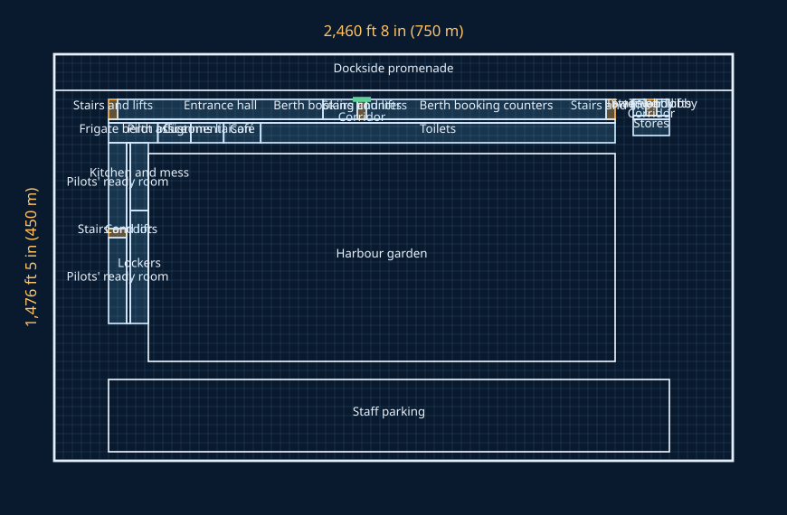
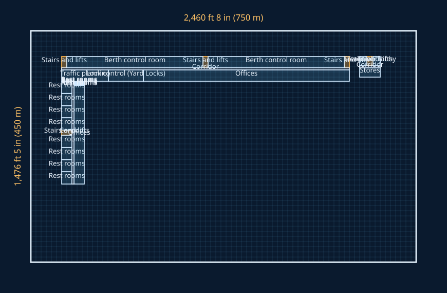
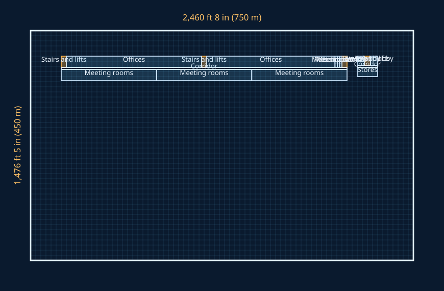
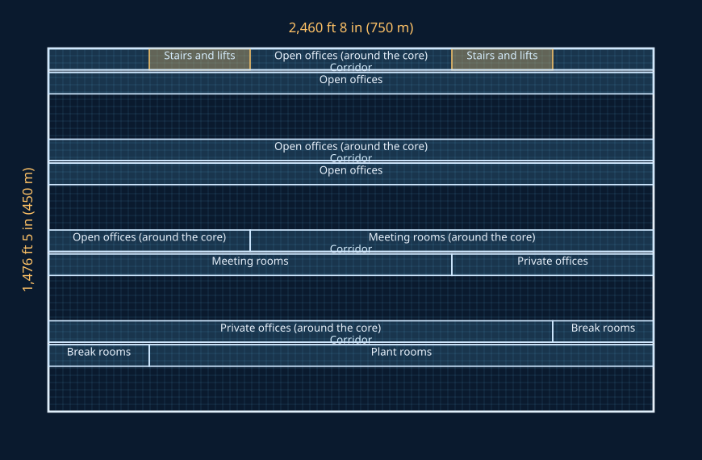
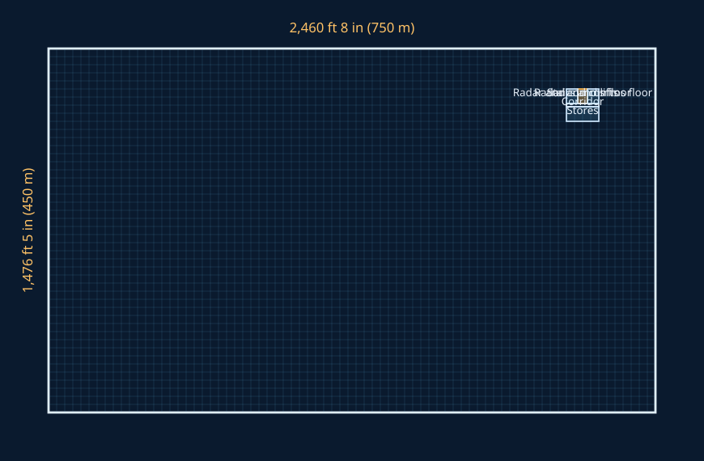
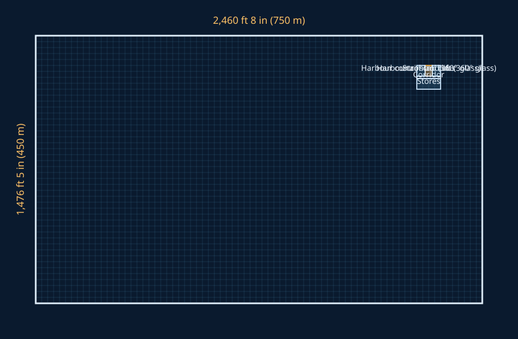

# P3-10 Stern Harbourmaster: plan

Footprint 2,460 ft 8 in (750 m) × 1,476 ft 5 in (450 m) · structural grid 32 ft 10 in (10 m)

## Levels

| Level | Floor above deck | Height | Floor area |
|---|---|---|---|
| Level 1 · Ground floor | 0 ft (0 mm) | 16 ft 5 in (5,000 mm) | 355,252 sq ft (33,004 m²) |
| Level 2 · Level 2 | 16 ft 5 in (5,000 mm) | 13 ft 1 in (4,000 mm) | 355,252 sq ft (33,004 m²) |
| Level 3 · Level 3 | 29 ft 6 in (9,000 mm) | 13 ft 1 in (4,000 mm) | 271,294 sq ft (25,204 m²) |
| Level 4 · Tower | 42 ft 8 in (13 m) | 13 ft 1 in (4,000 mm) | 13,175 sq ft (1,224 m²) |
| Level 5 · Tower | 55 ft 9 in (17 m) | 13 ft 1 in (4,000 mm) | 13,175 sq ft (1,224 m²) |
| Level 6 · Tower | 68 ft 11 in (21 m) | 13 ft 1 in (4,000 mm) | 13,175 sq ft (1,224 m²) |
| Level 7 · Tower | 82 ft (25 m) | 13 ft 1 in (4,000 mm) | 13,175 sq ft (1,224 m²) |
| Level 8 · Tower | 95 ft 2 in (29 m) | 13 ft 1 in (4,000 mm) | 13,175 sq ft (1,224 m²) |
| Level 9 · Tower | 108 ft 3 in (33 m) | 13 ft 1 in (4,000 mm) | 13,175 sq ft (1,224 m²) |
| Level 10 · Tower | 121 ft 5 in (37 m) | 13 ft 1 in (4,000 mm) | 13,175 sq ft (1,224 m²) |
| Level 11 · Tower | 134 ft 6 in (41 m) | 13 ft 1 in (4,000 mm) | 13,175 sq ft (1,224 m²) |
| Level 12 · Harbour control cab | 147 ft 8 in (45 m) | 19 ft 8 in (6,000 mm) | 13,175 sq ft (1,224 m²) |

## Elements

| ID | Designation | Type | Name | Level(s) | Size / length | Area | Status |
|---|---|---|---|---|---|---|---|
| E001 | D5F3P3B12A1L1R1 | zone | Dockside promenade | L1 | 2,460 ft 8 in (750 m) × 131 ft 3 in (40 m) | 322,917 sq ft (30,000 m²) | proposed |
| E002 | D5F3P3B12A1L1R2, D5F3P3B12A1L2R1, D5F3P3B12A1L3R1 | core | Stairs and lifts | L1, L2, L3 | 32 ft 10 in (10 m) × 72 ft 2 in (22 m) | 2,368 sq ft (220 m²) | proposed |
| E003 | D5F3P3B12A1L1R3, D5F3P3B12A1L2R2, D5F3P3B12A1L3R2 | core | Stairs and lifts | L1, L2, L3 | 32 ft 10 in (10 m) × 72 ft 2 in (22 m) | 2,368 sq ft (220 m²) | proposed |
| E004 | D5F3P3B12A1L1R4, D5F3P3B12A1L2R3, D5F3P3B12A1L3R3 | core | Stairs and lifts | L1, L2, L3 | 32 ft 10 in (10 m) × 72 ft 2 in (22 m) | 2,368 sq ft (220 m²) | proposed |
| E005 | D5F3P3B12A1L1R5 | zone | Corridor | L1 | 1,837 ft 3 in (560 m) × 13 ft 1 in (4,000 mm) | 24,111 sq ft (2,240 m²) | proposed |
| E006 | D5F3P3B12A1L1R6 | room | Entrance hall | L1 | 745 ft 1 in (227 m) × 72 ft 2 in (22 m) | 53,779 sq ft (4,996 m²) | proposed |
| E007 | D5F3P3B12A1L1R7 | room | Berth booking counters | L1 | 124 ft 4 in (38 m) × 72 ft 2 in (22 m) | 8,975 sq ft (834 m²) | proposed |
| E008 | D5F3P3B12A1L1R8 | room | Berth booking counters | L1 | 869 ft 5 in (265 m) × 72 ft 2 in (22 m) | 62,754 sq ft (5,830 m²) | proposed |
| E009 | D5F3P3B12A1L1R9 | room | Frigate berth office | L1 | 178 ft 10 in (54 m) × 72 ft 2 in (22 m) | 12,906 sq ft (1,199 m²) | proposed |
| E010 | D5F3P3B12A1L1R10 | room | Pilot assignment | L1 | 119 ft 5 in (36 m) × 72 ft 2 in (22 m) | 8,620 sq ft (801 m²) | proposed |
| E011 | D5F3P3B12A1L1R11 | room | Customs liaison | L1 | 119 ft 5 in (36 m) × 72 ft 2 in (22 m) | 8,620 sq ft (801 m²) | proposed |
| E012 | D5F3P3B12A1L1R12 | room | Café | L1 | 134 ft 2 in (41 m) × 72 ft 2 in (22 m) | 9,685 sq ft (900 m²) | proposed |
| E013 | D5F3P3B12A1L1R13 | room | Toilets | L1 | 1,285 ft 5 in (392 m) × 72 ft 2 in (22 m) | 92,781 sq ft (8,620 m²) | proposed |
| E014 | D5F3P3B12A1L2R4 | zone | Corridor | L2 | 1,837 ft 3 in (560 m) × 13 ft 1 in (4,000 mm) | 24,111 sq ft (2,240 m²) | proposed |
| E015 | D5F3P3B12A1L2R5 | room | Berth control room | L2 | 869 ft 5 in (265 m) × 72 ft 2 in (22 m) | 62,754 sq ft (5,830 m²) | proposed |
| E016 | D5F3P3B12A1L2R6 | room | Berth control room | L2 | 869 ft 5 in (265 m) × 72 ft 2 in (22 m) | 62,754 sq ft (5,830 m²) | proposed |
| E017 | D5F3P3B12A1L2R7 | room | Traffic planning | L2 | 298 ft 3 in (91 m) × 72 ft 2 in (22 m) | 21,526 sq ft (2,000 m²) | proposed |
| E018 | D5F3P3B12A1L2R8 | room | Lock control (Yard Locks) | L2 | 223 ft 9 in (68 m) × 72 ft 2 in (22 m) | 16,150 sq ft (1,500 m²) | proposed |
| E019 | D5F3P3B12A1L2R9 | room | Offices | L2 | 1,315 ft 3 in (401 m) × 72 ft 2 in (22 m) | 94,936 sq ft (8,820 m²) | proposed |
| E020 | D5F3P3B12A1L3R4 | zone | Corridor | L3 | 1,837 ft 3 in (560 m) × 13 ft 1 in (4,000 mm) | 24,111 sq ft (2,240 m²) | proposed |
| E021 | D5F3P3B12A1L3R5 | room | Offices | L3 | 869 ft 5 in (265 m) × 72 ft 2 in (22 m) | 62,754 sq ft (5,830 m²) | proposed |
| E022 | D5F3P3B12A1L3R6 | room | Offices | L3 | 824 ft 10 in (251 m) × 72 ft 2 in (22 m) | 59,533 sq ft (5,531 m²) | proposed |
| E023 | D5F3P3B12A1L3R7 | room | Meeting rooms | L3 | 14 ft 9 in (4,500 mm) × 72 ft 2 in (22 m) | 1,066 sq ft (99 m²) | proposed |
| E024 | D5F3P3B12A1L3R8 | room | Meeting rooms | L3 | 15 ft 1 in (4,600 mm) × 72 ft 2 in (22 m) | 1,089 sq ft (101 m²) | proposed |
| E025 | D5F3P3B12A1L3R9 | room | Meeting rooms | L3 | 14 ft 9 in (4,500 mm) × 72 ft 2 in (22 m) | 1,066 sq ft (99 m²) | proposed |
| E026 | D5F3P3B12A1L3R10 | room | Meeting rooms | L3 | 612 ft 6 in (187 m) × 72 ft 2 in (22 m) | 44,212 sq ft (4,107 m²) | proposed |
| E027 | D5F3P3B12A1L3R11 | room | Meeting rooms | L3 | 612 ft 2 in (187 m) × 72 ft 2 in (22 m) | 44,188 sq ft (4,105 m²) | proposed |
| E028 | D5F3P3B12A1L3R12 | room | Meeting rooms | L3 | 612 ft 6 in (187 m) × 72 ft 2 in (22 m) | 44,212 sq ft (4,107 m²) | proposed |
| E029 | D5F3P3B12A1L1R14, D5F3P3B12A1L2R10, D5F3P3B12A1L3R13, D5F3P3B12A1L4R1, D5F3P3B12A1L5R1, D5F3P3B12A1L6R1, D5F3P3B12A1L7R1, D5F3P3B12A1L8R1, D5F3P3B12A1L9R1, D5F3P3B12A1L10R1, D5F3P3B12A1L11R1, D5F3P3B12A1L12R1 | core | Stairs and lifts | L1, L2, L3, L4, L5, L6, L7, L8, L9, L10, L11, L12 | 39 ft 4 in (12 m) × 59 ft 1 in (18 m) | 2,325 sq ft (216 m²) | proposed |
| E030 | D5F3P3B12A1L1R15, D5F3P3B12A1L2R11, D5F3P3B12A1L3R14 | zone | Corridor | L1, L2, L3 | 131 ft 3 in (40 m) × 13 ft 1 in (4,000 mm) | 1,722 sq ft (160 m²) | proposed |
| E031 | D5F3P3B12A1L1R16, D5F3P3B12A1L2R12, D5F3P3B12A1L3R15 | room | Tower lobby | L1, L2, L3 | 45 ft 11 in (14 m) × 59 ft 1 in (18 m) | 2,713 sq ft (252 m²) | proposed |
| E032 | D5F3P3B12A1L1R17, D5F3P3B12A1L2R13, D5F3P3B12A1L3R16 | room | Tower lobby | L1, L2, L3 | 45 ft 11 in (14 m) × 59 ft 1 in (18 m) | 2,713 sq ft (252 m²) | proposed |
| E033 | D5F3P3B12A1L1R18, D5F3P3B12A1L2R14, D5F3P3B12A1L3R17 | room | Stores | L1, L2, L3 | 131 ft 3 in (40 m) × 59 ft 1 in (18 m) | 7,750 sq ft (720 m²) | proposed |
| E034 | D5F3P3B12A1L4R2, D5F3P3B12A1L5R2, D5F3P3B12A1L6R2, D5F3P3B12A1L7R2, D5F3P3B12A1L8R2, D5F3P3B12A1L9R2, D5F3P3B12A1L10R2, D5F3P3B12A1L11R2 | zone | Corridor | L4, L5, L6, L7, L8, L9, L10, L11 | 131 ft 3 in (40 m) × 13 ft 1 in (4,000 mm) | 1,722 sq ft (160 m²) | proposed |
| E035 | D5F3P3B12A1L4R3, D5F3P3B12A1L5R3, D5F3P3B12A1L6R3, D5F3P3B12A1L7R3, D5F3P3B12A1L8R3, D5F3P3B12A1L9R3, D5F3P3B12A1L10R3, D5F3P3B12A1L11R3 | room | Radar and comms floor | L4, L5, L6, L7, L8, L9, L10, L11 | 45 ft 11 in (14 m) × 59 ft 1 in (18 m) | 2,713 sq ft (252 m²) | proposed |
| E036 | D5F3P3B12A1L4R4, D5F3P3B12A1L5R4, D5F3P3B12A1L6R4, D5F3P3B12A1L7R4, D5F3P3B12A1L8R4, D5F3P3B12A1L9R4, D5F3P3B12A1L10R4, D5F3P3B12A1L11R4 | room | Radar and comms floor | L4, L5, L6, L7, L8, L9, L10, L11 | 45 ft 11 in (14 m) × 59 ft 1 in (18 m) | 2,713 sq ft (252 m²) | proposed |
| E037 | D5F3P3B12A1L4R5, D5F3P3B12A1L5R5, D5F3P3B12A1L6R5, D5F3P3B12A1L7R5, D5F3P3B12A1L8R5, D5F3P3B12A1L9R5, D5F3P3B12A1L10R5, D5F3P3B12A1L11R5 | room | Stores | L4, L5, L6, L7, L8, L9, L10, L11 | 131 ft 3 in (40 m) × 59 ft 1 in (18 m) | 7,750 sq ft (720 m²) | proposed |
| E038 | D5F3P3B12A1L12R2 | zone | Corridor | L12 | 131 ft 3 in (40 m) × 13 ft 1 in (4,000 mm) | 1,722 sq ft (160 m²) | proposed |
| E039 | D5F3P3B12A1L12R3 | room | Harbour control cab (360° glass) | L12 | 45 ft 11 in (14 m) × 59 ft 1 in (18 m) | 2,713 sq ft (252 m²) | proposed |
| E040 | D5F3P3B12A1L12R4 | room | Harbour control cab (360° glass) | L12 | 45 ft 11 in (14 m) × 59 ft 1 in (18 m) | 2,713 sq ft (252 m²) | proposed |
| E041 | D5F3P3B12A1L12R5 | room | Stores | L12 | 131 ft 3 in (40 m) × 59 ft 1 in (18 m) | 7,750 sq ft (720 m²) | proposed |
| E042 | D5F3P3B12A1L1R19, D5F3P3B12A1L2R15 | core | Stairs and lifts | L1, L2 | 65 ft 7 in (20 m) × 32 ft 10 in (10 m) | 2,153 sq ft (200 m²) | proposed |
| E043 | D5F3P3B12A1L1R20 | zone | Corridor | L1 | 13 ft 1 in (4,000 mm) × 656 ft 2 in (200 m) | 8,611 sq ft (800 m²) | proposed |
| E044 | D5F3P3B12A1L1R21 | room | Pilots' ready room | L1 | 65 ft 7 in (20 m) × 311 ft 8 in (95 m) | 20,451 sq ft (1,900 m²) | proposed |
| E045 | D5F3P3B12A1L1R22 | room | Pilots' ready room | L1 | 65 ft 7 in (20 m) × 311 ft 8 in (95 m) | 20,451 sq ft (1,900 m²) | proposed |
| E046 | D5F3P3B12A1L1R23 | room | Kitchen and mess | L1 | 65 ft 7 in (20 m) × 246 ft 1 in (75 m) | 16,146 sq ft (1,500 m²) | proposed |
| E047 | D5F3P3B12A1L1R24 | room | Lockers | L1 | 65 ft 7 in (20 m) × 410 ft 1 in (125 m) | 26,910 sq ft (2,500 m²) | proposed |
| E048 | D5F3P3B12A1L2R16 | zone | Corridor | L2 | 13 ft 1 in (4,000 mm) × 656 ft 2 in (200 m) | 8,611 sq ft (800 m²) | proposed |
| E049 | D5F3P3B12A1L2R17 | room | Rest rooms | L2 | 65 ft 7 in (20 m) × 78 ft 1 in (24 m) | 5,124 sq ft (476 m²) | proposed |
| E050 | D5F3P3B12A1L2R18 | room | Rest rooms | L2 | 65 ft 7 in (20 m) × 77 ft 9 in (24 m) | 5,102 sq ft (474 m²) | proposed |
| E051 | D5F3P3B12A1L2R19 | room | Rest rooms | L2 | 65 ft 7 in (20 m) × 77 ft 9 in (24 m) | 5,102 sq ft (474 m²) | proposed |
| E052 | D5F3P3B12A1L2R20 | room | Rest rooms | L2 | 65 ft 7 in (20 m) × 78 ft 1 in (24 m) | 5,124 sq ft (476 m²) | proposed |
| E053 | D5F3P3B12A1L2R21 | room | Rest rooms | L2 | 65 ft 7 in (20 m) × 78 ft 1 in (24 m) | 5,124 sq ft (476 m²) | proposed |
| E054 | D5F3P3B12A1L2R22 | room | Rest rooms | L2 | 65 ft 7 in (20 m) × 77 ft 9 in (24 m) | 5,102 sq ft (474 m²) | proposed |
| E055 | D5F3P3B12A1L2R23 | room | Rest rooms | L2 | 65 ft 7 in (20 m) × 77 ft 9 in (24 m) | 5,102 sq ft (474 m²) | proposed |
| E056 | D5F3P3B12A1L2R24 | room | Rest rooms | L2 | 65 ft 7 in (20 m) × 78 ft 1 in (24 m) | 5,124 sq ft (476 m²) | proposed |
| E057 | D5F3P3B12A1L2R25 | room | Rest rooms | L2 | 65 ft 7 in (20 m) × 3 ft 3 in (1,000 mm) | 215 sq ft (20 m²) | proposed |
| E058 | D5F3P3B12A1L2R26 | room | Rest rooms | L2 | 65 ft 7 in (20 m) × 3 ft 3 in (1,000 mm) | 215 sq ft (20 m²) | proposed |
| E059 | D5F3P3B12A1L2R27 | room | Rest rooms | L2 | 65 ft 7 in (20 m) × 3 ft 3 in (1,000 mm) | 215 sq ft (20 m²) | proposed |
| E060 | D5F3P3B12A1L2R28 | room | Rest rooms | L2 | 65 ft 7 in (20 m) × 3 ft 3 in (1,000 mm) | 215 sq ft (20 m²) | proposed |
| E061 | D5F3P3B12A1L2R29 | room | Rest rooms | L2 | 65 ft 7 in (20 m) × 3 ft 3 in (1,000 mm) | 215 sq ft (20 m²) | proposed |
| E062 | D5F3P3B12A1L2R30 | room | Rest rooms | L2 | 65 ft 7 in (20 m) × 3 ft 3 in (1,000 mm) | 215 sq ft (20 m²) | proposed |
| E063 | D5F3P3B12A1L2R31 | room | Rest rooms | L2 | 65 ft 7 in (20 m) × 3 ft 3 in (1,000 mm) | 215 sq ft (20 m²) | proposed |
| E064 | D5F3P3B12A1L2R32 | room | Rest rooms | L2 | 65 ft 7 in (20 m) × 3 ft 3 in (1,000 mm) | 215 sq ft (20 m²) | proposed |
| E065 | D5F3P3B12A1L2R33 | room | Offices | L2 | 65 ft 7 in (20 m) × 629 ft 11 in (192 m) | 41,333 sq ft (3,840 m²) | proposed |
| E066 | D5F3P3B12A1L1R25 | zone | Harbour garden | L1 | 1,692 ft 11 in (516 m) × 754 ft 7 in (230 m) | 1,277,461 sq ft (118,680 m²) | proposed |
| E067 | D5F3P3B12A1L1R26 | zone | Staff parking | L1 | 2,034 ft 1 in (620 m) × 262 ft 6 in (80 m) | 533,890 sq ft (49,600 m²) | proposed |
| E068 |  | door | Main entrance | L1 | 65 ft 7 in (20 m), 65 ft 7 in (20 m) wide | — | proposed |

## Drawings

### Level 1 · Ground floor

### Level 2 · Level 2

### Level 3 · Level 3

### Level 4 · Tower

### Level 5 · Tower

### Level 6 · Tower

### Level 7 · Tower

### Level 8 · Tower

### Level 9 · Tower

### Level 10 · Tower

### Level 11 · Tower

### Level 12 · Harbour control cab

