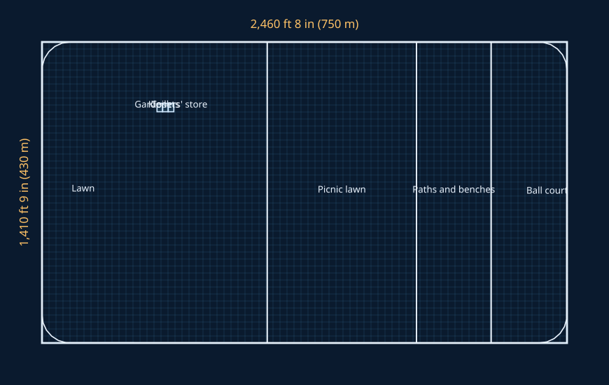

# P3-11 Dock Park: plan

Footprint 2,460 ft 8 in (750 m) × 1,410 ft 9 in (430 m) · structural grid 32 ft 10 in (10 m)

## Levels

| Level | Floor above deck | Height | Floor area |
|---|---|---|---|
| Level 1 · Ground | 0 ft (0 mm) | 13 ft 1 in (4,000 mm) | 3,100 sq ft (288 m²) |

## Elements

| ID | Designation | Type | Name | Level(s) | Size / length | Area | Status |
|---|---|---|---|---|---|---|---|
| E001 | D5F3P3B13A1R1 | zone | Lawn | L1 | 1,055 ft 5 in (322 m) × 1,410 ft 1 in (430 m) | 1,479,289 sq ft (137,430 m²) | proposed |
| E002 | D5F3P3B13A1R2 | room | Kiosk | L1 | 26 ft 3 in (8,000 mm) × 39 ft 4 in (12 m) | 1,033 sq ft (96 m²) | proposed |
| E003 | D5F3P3B13A1R3 | room | Toilets | L1 | 26 ft 3 in (8,000 mm) × 39 ft 4 in (12 m) | 1,033 sq ft (96 m²) | proposed |
| E004 | D5F3P3B13A1R4 | room | Gardeners' store | L1 | 26 ft 3 in (8,000 mm) × 39 ft 4 in (12 m) | 1,033 sq ft (96 m²) | proposed |
| E005 | D5F3P3B13A1R5 | zone | Picnic lawn | L1 | 699 ft 6 in (213 m) × 1,409 ft 9 in (430 m) | 985,874 sq ft (91,591 m²) | proposed |
| E006 | D5F3P3B13A1R6 | zone | Paths and benches | L1 | 350 ft 1 in (107 m) × 1,409 ft 9 in (430 m) | 493,400 sq ft (45,838 m²) | proposed |
| E007 | D5F3P3B13A1R7 | zone | Ball court | L1 | 355 ft 8 in (108 m) × 1,409 ft 5 in (430 m) | 492,946 sq ft (45,796 m²) | proposed |

## Drawings

### Level 1 · Ground

