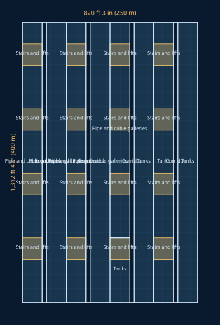
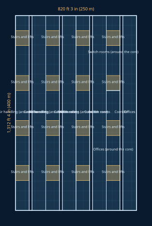

# P3-12 Stern Docks Utility Plant: plan

Footprint 820 ft 3 in (250 m) × 1,312 ft 4 in (400 m) · structural grid 65 ft 7 in (20 m)

## Levels

| Level | Floor above deck | Height | Floor area |
|---|---|---|---|
| Level B1 · Plant level | −19 ft 8 in (6,000 mm) | 19 ft 8 in (6,000 mm) | 973,058 sq ft (90,400 m²) |
| Level 1 · Ground floor | 0 ft (0 mm) | 26 ft 3 in (8,000 mm) | 823,450 sq ft (76,501 m²) |
| Level 2 · Upper floor | 26 ft 3 in (8,000 mm) | 26 ft 3 in (8,000 mm) | 973,058 sq ft (90,400 m²) |

## Elements

| ID | Designation | Type | Name | Level(s) | Size / length | Area | Status |
|---|---|---|---|---|---|---|---|
| L1-001 | D5F3P3B15A1L1R1 | zone | Corridor | L1 | 19 ft 8 in (6,000 mm) × 1,312 ft 4 in (400 m) | 25,833 sq ft (2,400 m²) | proposed |
| L1-002 | D5F3P3B15A1L1R2 | zone | Corridor | L1 | 19 ft 8 in (6,000 mm) × 1,312 ft 4 in (400 m) | 25,833 sq ft (2,400 m²) | proposed |
| L1-003 | D5F3P3B15A1L1R3 | zone | Corridor | L1 | 19 ft 8 in (6,000 mm) × 1,312 ft 4 in (400 m) | 25,833 sq ft (2,400 m²) | proposed |
| L1-004 | D5F3P3B15A1L1R4 | zone | Corridor | L1 | 19 ft 8 in (6,000 mm) × 1,312 ft 4 in (400 m) | 25,833 sq ft (2,400 m²) | proposed |
| L1-005 | D5F3P3B15A1L1R5 | room | Substation | L1 | 92 ft 6 in (28 m) × 101 ft 1 in (31 m) | 9,349 sq ft (869 m²) | proposed |
| L1-006 | D5F3P3B15A1L1R6 | room | Substation | L1 | 92 ft 6 in (28 m) × 202 ft 1 in (62 m) | 18,698 sq ft (1,737 m²) | proposed |
| L1-007 | D5F3P3B15A1L1R7 | room | Substation | L1 | 92 ft 6 in (28 m) × 202 ft 1 in (62 m) | 18,698 sq ft (1,737 m²) | proposed |
| L1-008 | D5F3P3B15A1L1R8 | room | Substation | L1 | 92 ft 6 in (28 m) × 201 ft 9 in (62 m) | 18,668 sq ft (1,734 m²) | proposed |
| L1-009 | D5F3P3B15A1L1R9 | room | Substation | L1 | 92 ft 6 in (28 m) × 201 ft 9 in (62 m) | 18,668 sq ft (1,734 m²) | proposed |
| L1-010 | D5F3P3B15A1L1R10 | room | Substation | L1 | 92 ft 10 in (28 m) × 1,312 ft 4 in (400 m) | 121,847 sq ft (11,320 m²) | proposed |
| L1-011 | D5F3P3B15A1L1R11 | room | Air handling | L1 | 92 ft 10 in (28 m) × 101 ft 1 in (31 m) | 9,382 sq ft (872 m²) | proposed |
| L1-012 | D5F3P3B15A1L1R12 | room | Air handling | L1 | 92 ft 10 in (28 m) × 202 ft 1 in (62 m) | 18,765 sq ft (1,743 m²) | proposed |
| L1-013 | D5F3P3B15A1L1R13 | room | Air handling | L1 | 92 ft 10 in (28 m) × 202 ft 1 in (62 m) | 18,765 sq ft (1,743 m²) | proposed |
| L1-014 | D5F3P3B15A1L1R14 | room | Air handling | L1 | 92 ft 10 in (28 m) × 201 ft 9 in (62 m) | 18,734 sq ft (1,740 m²) | proposed |
| L1-015 | D5F3P3B15A1L1R15 | room | Air handling | L1 | 92 ft 10 in (28 m) × 201 ft 9 in (62 m) | 18,734 sq ft (1,740 m²) | proposed |
| L1-016 | D5F3P3B15A1L1R16 | room | Air handling | L1 | 92 ft 6 in (28 m) × 1,312 ft 4 in (400 m) | 121,417 sq ft (11,280 m²) | proposed |
| L1-017 | D5F3P3B15A1L1R17 | room | Water pumps and tanks | L1 | 92 ft 6 in (28 m) × 101 ft 1 in (31 m) | 9,349 sq ft (869 m²) | proposed |
| L1-018 | D5F3P3B15A1L1R18 | room | Water pumps and tanks | L1 | 92 ft 6 in (28 m) × 202 ft 1 in (62 m) | 18,698 sq ft (1,737 m²) | proposed |
| L1-019 | D5F3P3B15A1L1R19 | room | Water pumps and tanks | L1 | 92 ft 6 in (28 m) × 202 ft 1 in (62 m) | 18,698 sq ft (1,737 m²) | proposed |
| L1-020 | D5F3P3B15A1L1R20 | room | Water pumps and tanks | L1 | 92 ft 6 in (28 m) × 201 ft 9 in (62 m) | 18,668 sq ft (1,734 m²) | proposed |
| L1-021 | D5F3P3B15A1L1R21 | room | Water pumps and tanks | L1 | 92 ft 6 in (28 m) × 201 ft 9 in (62 m) | 18,668 sq ft (1,734 m²) | proposed |
| L1-022 | D5F3P3B15A1L1R22 | room | Water pumps and tanks | L1 | 92 ft 10 in (28 m) × 1,312 ft 4 in (400 m) | 121,847 sq ft (11,320 m²) | proposed |
| L1-023 | D5F3P3B15A1L1R23 | room | Control room | L1 | 92 ft 10 in (28 m) × 101 ft 1 in (31 m) | 9,382 sq ft (872 m²) | proposed |
| L1-024 | D5F3P3B15A1L1R24 | room | Control room | L1 | 92 ft 10 in (28 m) × 202 ft 1 in (62 m) | 18,765 sq ft (1,743 m²) | proposed |
| L1-025 | D5F3P3B15A1L1R25 | room | Control room | L1 | 92 ft 10 in (28 m) × 101 ft 1 in (31 m) | 9,382 sq ft (872 m²) | proposed |
| L1-026 | D5F3P3B15A1L1R26 | room | Workshop and stores | L1 | 92 ft 10 in (28 m) × 101 ft 1 in (31 m) | 9,382 sq ft (872 m²) | proposed |
| L1-027 | D5F3P3B15A1L1R27 | room | Workshop and stores | L1 | 92 ft 10 in (28 m) × 201 ft 9 in (62 m) | 18,734 sq ft (1,740 m²) | proposed |
| L1-028 | D5F3P3B15A1L1R28 | room | Workshop and stores | L1 | 92 ft 10 in (28 m) × 201 ft 9 in (62 m) | 18,734 sq ft (1,740 m²) | proposed |
| L1-029 | D5F3P3B15A1L1R29 | room | Workshop and stores | L1 | 92 ft 6 in (28 m) × 1,312 ft 4 in (400 m) | 121,417 sq ft (11,280 m²) | proposed |
| L1-030 | D5F3P3B15A1LB1R1, D5F3P3B15A1L1R30, D5F3P3B15A1L2R1 | core | Stairs and lifts | LB1, L1, L2 | 92 ft 6 in (28 m) × 100 ft 9 in (31 m) | 9,319 sq ft (866 m²) | proposed |
| L1-031 | D5F3P3B15A1LB1R2, D5F3P3B15A1L1R31, D5F3P3B15A1L2R2 | core | Stairs and lifts | LB1, L1, L2 | 92 ft 6 in (28 m) × 100 ft 9 in (31 m) | 9,319 sq ft (866 m²) | proposed |
| L1-032 | D5F3P3B15A1LB1R3, D5F3P3B15A1L1R32, D5F3P3B15A1L2R3 | core | Stairs and lifts | LB1, L1, L2 | 92 ft 6 in (28 m) × 101 ft 1 in (31 m) | 9,349 sq ft (869 m²) | proposed |
| L1-033 | D5F3P3B15A1LB1R4, D5F3P3B15A1L1R33, D5F3P3B15A1L2R4 | core | Stairs and lifts | LB1, L1, L2 | 92 ft 6 in (28 m) × 101 ft 1 in (31 m) | 9,349 sq ft (869 m²) | proposed |
| L1-034 | D5F3P3B15A1LB1R5, D5F3P3B15A1L1R34, D5F3P3B15A1L2R5 | core | Stairs and lifts | LB1, L1, L2 | 92 ft 10 in (28 m) × 100 ft 9 in (31 m) | 9,352 sq ft (869 m²) | proposed |
| L1-035 | D5F3P3B15A1LB1R6, D5F3P3B15A1L1R35, D5F3P3B15A1L2R6 | core | Stairs and lifts | LB1, L1, L2 | 92 ft 10 in (28 m) × 100 ft 9 in (31 m) | 9,352 sq ft (869 m²) | proposed |
| L1-036 | D5F3P3B15A1LB1R7, D5F3P3B15A1L1R36, D5F3P3B15A1L2R7 | core | Stairs and lifts | LB1, L1, L2 | 92 ft 10 in (28 m) × 101 ft 1 in (31 m) | 9,382 sq ft (872 m²) | proposed |
| L1-037 | D5F3P3B15A1LB1R8, D5F3P3B15A1L1R37, D5F3P3B15A1L2R8 | core | Stairs and lifts | LB1, L1, L2 | 92 ft 10 in (28 m) × 101 ft 1 in (31 m) | 9,382 sq ft (872 m²) | proposed |
| L1-038 | D5F3P3B15A1LB1R9, D5F3P3B15A1L1R38, D5F3P3B15A1L2R9 | core | Stairs and lifts | LB1, L1, L2 | 92 ft 6 in (28 m) × 100 ft 9 in (31 m) | 9,319 sq ft (866 m²) | proposed |
| L1-039 | D5F3P3B15A1LB1R10, D5F3P3B15A1L1R39, D5F3P3B15A1L2R10 | core | Stairs and lifts | LB1, L1, L2 | 92 ft 6 in (28 m) × 100 ft 9 in (31 m) | 9,319 sq ft (866 m²) | proposed |
| L1-040 | D5F3P3B15A1LB1R11, D5F3P3B15A1L1R40, D5F3P3B15A1L2R11 | core | Stairs and lifts | LB1, L1, L2 | 92 ft 6 in (28 m) × 101 ft 1 in (31 m) | 9,349 sq ft (869 m²) | proposed |
| L1-041 | D5F3P3B15A1LB1R12, D5F3P3B15A1L1R41, D5F3P3B15A1L2R12 | core | Stairs and lifts | LB1, L1, L2 | 92 ft 6 in (28 m) × 101 ft 1 in (31 m) | 9,349 sq ft (869 m²) | proposed |
| L1-042 | D5F3P3B15A1LB1R13, D5F3P3B15A1L1R42, D5F3P3B15A1L2R13 | core | Stairs and lifts | LB1, L1, L2 | 92 ft 10 in (28 m) × 100 ft 9 in (31 m) | 9,352 sq ft (869 m²) | proposed |
| L1-043 | D5F3P3B15A1LB1R14, D5F3P3B15A1L1R43, D5F3P3B15A1L2R14 | core | Stairs and lifts | LB1, L1, L2 | 92 ft 10 in (28 m) × 100 ft 9 in (31 m) | 9,352 sq ft (869 m²) | proposed |
| L1-044 | D5F3P3B15A1LB1R15, D5F3P3B15A1L1R44, D5F3P3B15A1L2R15 | core | Stairs and lifts | LB1, L1, L2 | 92 ft 10 in (28 m) × 101 ft 1 in (31 m) | 9,382 sq ft (872 m²) | proposed |
| L1-045 | D5F3P3B15A1LB1R16, D5F3P3B15A1L1R45, D5F3P3B15A1L2R16 | core | Stairs and lifts | LB1, L1, L2 | 92 ft 10 in (28 m) × 101 ft 1 in (31 m) | 9,382 sq ft (872 m²) | proposed |
| LT-001 | D5F3P3B15A1L2R17 | zone | Corridor | L2 | 19 ft 8 in (6,000 mm) × 1,312 ft 4 in (400 m) | 25,833 sq ft (2,400 m²) | proposed |
| LT-002 | D5F3P3B15A1L2R18 | zone | Corridor | L2 | 19 ft 8 in (6,000 mm) × 1,312 ft 4 in (400 m) | 25,833 sq ft (2,400 m²) | proposed |
| LT-003 | D5F3P3B15A1L2R19 | zone | Corridor | L2 | 19 ft 8 in (6,000 mm) × 1,312 ft 4 in (400 m) | 25,833 sq ft (2,400 m²) | proposed |
| LT-004 | D5F3P3B15A1L2R20 | zone | Corridor | L2 | 19 ft 8 in (6,000 mm) × 1,312 ft 4 in (400 m) | 25,833 sq ft (2,400 m²) | proposed |
| LT-005 | D5F3P3B15A1L2R21 | room | Air handling (around the core) | L2 | 92 ft 6 in (28 m) × 1,312 ft 4 in (400 m) | 121,417 sq ft (11,280 m²) | proposed |
| LT-006 | D5F3P3B15A1L2R22 | room | Air handling | L2 | 92 ft 10 in (28 m) × 1,312 ft 4 in (400 m) | 121,847 sq ft (11,320 m²) | proposed |
| LT-007 | D5F3P3B15A1L2R23 | room | Air handling (around the core) | L2 | 92 ft 10 in (28 m) × 1,312 ft 4 in (400 m) | 121,847 sq ft (11,320 m²) | proposed |
| LT-008 | D5F3P3B15A1L2R24 | room | Air handling | L2 | 92 ft 6 in (28 m) × 1,312 ft 4 in (400 m) | 121,417 sq ft (11,280 m²) | proposed |
| LT-009 | D5F3P3B15A1L2R25 | room | Switch rooms (around the core) | L2 | 92 ft 6 in (28 m) × 1,312 ft 4 in (400 m) | 121,417 sq ft (11,280 m²) | proposed |
| LT-010 | D5F3P3B15A1L2R26 | room | Switch rooms | L2 | 92 ft 10 in (28 m) × 1,312 ft 4 in (400 m) | 121,847 sq ft (11,320 m²) | proposed |
| LT-011 | D5F3P3B15A1L2R27 | room | Switch rooms (around the core) | L2 | 92 ft 10 in (28 m) × 504 ft 7 in (154 m) | 46,850 sq ft (4,353 m²) | proposed |
| LT-012 | D5F3P3B15A1L2R28 | room | Offices (around the core) | L2 | 92 ft 10 in (28 m) × 807 ft 9 in (246 m) | 74,997 sq ft (6,967 m²) | proposed |
| LT-013 | D5F3P3B15A1L2R29 | room | Offices | L2 | 92 ft 6 in (28 m) × 1,312 ft 4 in (400 m) | 121,417 sq ft (11,280 m²) | proposed |
| BB1-001 | D5F3P3B15A1LB1R17 | zone | Corridor | LB1 | 19 ft 8 in (6,000 mm) × 1,312 ft 4 in (400 m) | 25,833 sq ft (2,400 m²) | proposed |
| BB1-002 | D5F3P3B15A1LB1R18 | zone | Corridor | LB1 | 19 ft 8 in (6,000 mm) × 1,312 ft 4 in (400 m) | 25,833 sq ft (2,400 m²) | proposed |
| BB1-003 | D5F3P3B15A1LB1R19 | zone | Corridor | LB1 | 19 ft 8 in (6,000 mm) × 1,312 ft 4 in (400 m) | 25,833 sq ft (2,400 m²) | proposed |
| BB1-004 | D5F3P3B15A1LB1R20 | zone | Corridor | LB1 | 19 ft 8 in (6,000 mm) × 1,312 ft 4 in (400 m) | 25,833 sq ft (2,400 m²) | proposed |
| BB1-005 | D5F3P3B15A1LB1R21 | room | Pipe and cable galleries | LB1 | 92 ft 6 in (28 m) × 1,312 ft 4 in (400 m) | 121,417 sq ft (11,280 m²) | proposed |
| BB1-006 | D5F3P3B15A1LB1R22 | room | Pipe and cable galleries | LB1 | 92 ft 10 in (28 m) × 1,312 ft 4 in (400 m) | 121,847 sq ft (11,320 m²) | proposed |
| BB1-007 | D5F3P3B15A1LB1R23 | room | Pipe and cable galleries | LB1 | 92 ft 10 in (28 m) × 1,312 ft 4 in (400 m) | 121,847 sq ft (11,320 m²) | proposed |
| BB1-008 | D5F3P3B15A1LB1R24 | room | Pipe and cable galleries | LB1 | 92 ft 6 in (28 m) × 1,312 ft 4 in (400 m) | 121,417 sq ft (11,280 m²) | proposed |
| BB1-009 | D5F3P3B15A1LB1R25 | room | Pipe and cable galleries | LB1 | 92 ft 6 in (28 m) × 1,009 ft 6 in (308 m) | 93,400 sq ft (8,677 m²) | proposed |
| BB1-010 | D5F3P3B15A1LB1R26 | room | Tanks | LB1 | 92 ft 6 in (28 m) × 302 ft 10 in (92 m) | 28,017 sq ft (2,603 m²) | proposed |
| BB1-011 | D5F3P3B15A1LB1R27 | room | Tanks | LB1 | 92 ft 10 in (28 m) × 1,312 ft 4 in (400 m) | 121,847 sq ft (11,320 m²) | proposed |
| BB1-012 | D5F3P3B15A1LB1R28 | room | Tanks | LB1 | 92 ft 10 in (28 m) × 1,312 ft 4 in (400 m) | 121,847 sq ft (11,320 m²) | proposed |
| BB1-013 | D5F3P3B15A1LB1R29 | room | Tanks | LB1 | 92 ft 6 in (28 m) × 1,312 ft 4 in (400 m) | 121,417 sq ft (11,280 m²) | proposed |
| D-72 |  | door | Main entrance | L1 | 78 ft 9 in (24 m), 78 ft 9 in (24 m) wide | — | proposed |
| D-73 |  | door | Second entrance | L1 | 78 ft 9 in (24 m), 78 ft 9 in (24 m) wide | — | proposed |
| D-74 |  | door | Side door | L1 | 19 ft 8 in (6,000 mm), 19 ft 8 in (6,000 mm) wide | — | proposed |
| D-75 |  | door | Side door | L1 | 19 ft 8 in (6,000 mm), 19 ft 8 in (6,000 mm) wide | — | proposed |

## Drawings

### Level B1 · Plant level

### Level 1 · Ground floor

### Level 2 · Upper floor

