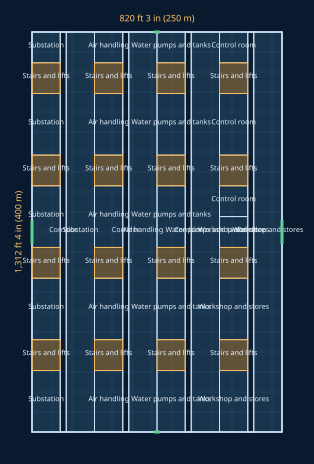

# P3-12 Stern Docks Utility Plant: plan

Footprint 820 ft 3 in (250 m) × 1,312 ft 4 in (400 m) · structural grid 32 ft 10 in (10 m)

## Levels

| Level | Floor above deck | Height | Floor area |
|---|---|---|---|
| Level 1 · Ground floor | 0 ft (0 mm) | 26 ft 3 in (8,000 mm) | 579,098 sq ft (53,800 m²) |
| Level 2 · Upper plant | 26 ft 3 in (8,000 mm) | 19 ft 8 in (6,000 mm) | 376,737 sq ft (35,000 m²) |

## Elements

| ID | Designation | Type | Name | Level(s) | Size / length | Area | Status |
|---|---|---|---|---|---|---|---|
| E001 | D5F3P3B15A1L1R1 | zone | Corridor | L1 | 656 ft 2 in (200 m) × 19 ft 8 in (6,000 mm) | 12,917 sq ft (1,200 m²) | proposed |
| E002 | D5F3P3B15A1L1R2 | room | Transformer bays | L1 | 109 ft 3 in (33 m) × 154 ft 2 in (47 m) | 16,847 sq ft (1,565 m²) | proposed |
| E003 | D5F3P3B15A1L1R3 | room | Transformer bays | L1 | 109 ft 7 in (33 m) × 154 ft 2 in (47 m) | 16,897 sq ft (1,570 m²) | proposed |
| E004 | D5F3P3B15A1L1R4 | room | Transformer bays | L1 | 109 ft 3 in (33 m) × 154 ft 2 in (47 m) | 16,847 sq ft (1,565 m²) | proposed |
| E005 | D5F3P3B15A1L1R5 | room | Transformer bays | L1 | 109 ft 3 in (33 m) × 154 ft 2 in (47 m) | 16,847 sq ft (1,565 m²) | proposed |
| E006 | D5F3P3B15A1L1R6 | room | Transformer bays | L1 | 109 ft 7 in (33 m) × 154 ft 2 in (47 m) | 16,897 sq ft (1,570 m²) | proposed |
| E007 | D5F3P3B15A1L1R7 | room | Transformer bays | L1 | 109 ft 3 in (33 m) × 154 ft 2 in (47 m) | 16,847 sq ft (1,565 m²) | proposed |
| E008 | D5F3P3B15A1L1R8 | room | Switch room | L1 | 209 ft 4 in (64 m) × 154 ft 2 in (47 m) | 32,277 sq ft (2,999 m²) | proposed |
| E009 | D5F3P3B15A1L1R9 | room | Battery room | L1 | 104 ft 8 in (32 m) × 154 ft 2 in (47 m) | 16,138 sq ft (1,499 m²) | proposed |
| E010 | D5F3P3B15A1L1R10 | room | Control room | L1 | 342 ft 2 in (104 m) × 154 ft 2 in (47 m) | 52,766 sq ft (4,902 m²) | proposed |
| E011 | D5F3P3B15A1L1R11, D5F3P3B15A1L2R1 | room | Chiller hall | L1, L2 | 218 ft 10 in (67 m) × 459 ft 4 in (140 m) | 100,513 sq ft (9,338 m²) | proposed |
| E012 | D5F3P3B15A1L1R12, D5F3P3B15A1L2R2 | room | Air handling hall | L1, L2 | 218 ft 6 in (67 m) × 459 ft 4 in (140 m) | 100,363 sq ft (9,324 m²) | proposed |
| E013 | D5F3P3B15A1L1R13, D5F3P3B15A1L2R3 | room | Water pump hall | L1, L2 | 218 ft 10 in (67 m) × 459 ft 4 in (140 m) | 100,513 sq ft (9,338 m²) | proposed |
| E014 | D5F3P3B15A1L1R14, D5F3P3B15A1L2R4 | room | Water tank | L1, L2 | 328 ft 1 in (100 m) × 229 ft 8 in (70 m) | 75,347 sq ft (7,000 m²) | proposed |

## Drawings

### Level 1 · Ground floor

### Level 2 · Upper plant

