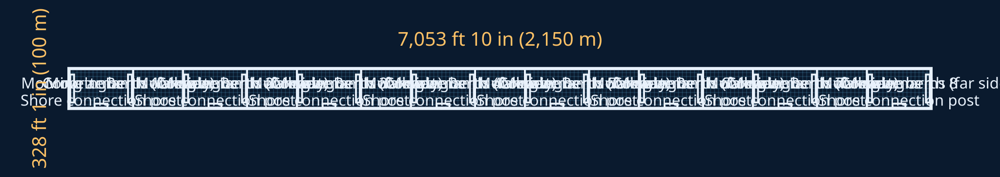

# P3-15 Corvette Berths: plan

Footprint 7,053 ft 10 in (2,150 m) × 328 ft 1 in (100 m) · structural grid 32 ft 10 in (10 m)

## Levels

| Level | Floor above deck | Height | Floor area |
|---|---|---|---|
| Level 1 · Berth floor | 0 ft (0 mm) | 13 ft 1 in (4,000 mm) | — |

## Elements

| ID | Designation | Type | Name | Level(s) | Size / length | Area | Status |
|---|---|---|---|---|---|---|---|
| E001 | D5F3P3B1A1R1 | zone | Corvette berth 1 | L1 | 524 ft 11 in (160 m) × 328 ft 1 in (100 m) | 172,223 sq ft (16,000 m²) | proposed |
| E002 |  | fixture | Mooring arms | L1 | 31 ft 6 in (9,600 mm) × 229 ft 8 in (70 m) | 7,233 sq ft (672 m²) | proposed |
| E003 |  | fixture | Mooring arms (far side) | L1 | 31 ft 6 in (9,600 mm) × 229 ft 8 in (70 m) | 7,233 sq ft (672 m²) | proposed |
| E004 |  | fixture | Shore connection post | L1 | 105 ft (32 m) × 32 ft 10 in (10 m) | 3,444 sq ft (320 m²) | proposed |
| E005 | D5F3P3B1A1R2 | zone | Berth walkway | L1 | 407 ft 10 in (124 m) × 328 ft 1 in (100 m) | 133,795 sq ft (12,430 m²) | proposed |
| E006 | D5F3P3B1A1R3 | zone | Corvette berth 2 | L1 | 524 ft 11 in (160 m) × 328 ft 1 in (100 m) | 172,223 sq ft (16,000 m²) | proposed |
| E007 |  | fixture | Mooring arms | L1 | 31 ft 6 in (9,600 mm) × 229 ft 8 in (70 m) | 7,233 sq ft (672 m²) | proposed |
| E008 |  | fixture | Mooring arms (far side) | L1 | 31 ft 6 in (9,600 mm) × 229 ft 8 in (70 m) | 7,233 sq ft (672 m²) | proposed |
| E009 |  | fixture | Shore connection post | L1 | 105 ft (32 m) × 32 ft 10 in (10 m) | 3,444 sq ft (320 m²) | proposed |
| E010 | D5F3P3B1A1R4 | zone | Berth walkway | L1 | 407 ft 10 in (124 m) × 328 ft 1 in (100 m) | 133,795 sq ft (12,430 m²) | proposed |
| E011 | D5F3P3B1A1R5 | zone | Corvette berth 3 | L1 | 524 ft 11 in (160 m) × 328 ft 1 in (100 m) | 172,223 sq ft (16,000 m²) | proposed |
| E012 |  | fixture | Mooring arms | L1 | 31 ft 6 in (9,600 mm) × 229 ft 8 in (70 m) | 7,233 sq ft (672 m²) | proposed |
| E013 |  | fixture | Mooring arms (far side) | L1 | 31 ft 6 in (9,600 mm) × 229 ft 8 in (70 m) | 7,233 sq ft (672 m²) | proposed |
| E014 |  | fixture | Shore connection post | L1 | 105 ft (32 m) × 32 ft 10 in (10 m) | 3,444 sq ft (320 m²) | proposed |
| E015 | D5F3P3B1A1R6 | zone | Berth walkway | L1 | 407 ft 10 in (124 m) × 328 ft 1 in (100 m) | 133,795 sq ft (12,430 m²) | proposed |
| E016 | D5F3P3B1A1R7 | zone | Corvette berth 4 | L1 | 524 ft 11 in (160 m) × 328 ft 1 in (100 m) | 172,223 sq ft (16,000 m²) | proposed |
| E017 |  | fixture | Mooring arms | L1 | 31 ft 6 in (9,600 mm) × 229 ft 8 in (70 m) | 7,233 sq ft (672 m²) | proposed |
| E018 |  | fixture | Mooring arms (far side) | L1 | 31 ft 6 in (9,600 mm) × 229 ft 8 in (70 m) | 7,233 sq ft (672 m²) | proposed |
| E019 |  | fixture | Shore connection post | L1 | 105 ft (32 m) × 32 ft 10 in (10 m) | 3,444 sq ft (320 m²) | proposed |
| E020 | D5F3P3B1A1R8 | zone | Berth walkway | L1 | 407 ft 6 in (124 m) × 328 ft 1 in (100 m) | 133,688 sq ft (12,420 m²) | proposed |
| E021 | D5F3P3B1A1R9 | zone | Corvette berth 5 | L1 | 524 ft 11 in (160 m) × 328 ft 1 in (100 m) | 172,223 sq ft (16,000 m²) | proposed |
| E022 |  | fixture | Mooring arms | L1 | 31 ft 6 in (9,600 mm) × 229 ft 8 in (70 m) | 7,233 sq ft (672 m²) | proposed |
| E023 |  | fixture | Mooring arms (far side) | L1 | 31 ft 6 in (9,600 mm) × 229 ft 8 in (70 m) | 7,233 sq ft (672 m²) | proposed |
| E024 |  | fixture | Shore connection post | L1 | 105 ft (32 m) × 32 ft 10 in (10 m) | 3,444 sq ft (320 m²) | proposed |
| E025 | D5F3P3B1A1R10 | zone | Berth walkway | L1 | 407 ft 10 in (124 m) × 328 ft 1 in (100 m) | 133,795 sq ft (12,430 m²) | proposed |
| E026 | D5F3P3B1A1R11 | zone | Corvette berth 6 | L1 | 524 ft 11 in (160 m) × 328 ft 1 in (100 m) | 172,223 sq ft (16,000 m²) | proposed |
| E027 |  | fixture | Mooring arms | L1 | 31 ft 6 in (9,600 mm) × 229 ft 8 in (70 m) | 7,233 sq ft (672 m²) | proposed |
| E028 |  | fixture | Mooring arms (far side) | L1 | 31 ft 6 in (9,600 mm) × 229 ft 8 in (70 m) | 7,233 sq ft (672 m²) | proposed |
| E029 |  | fixture | Shore connection post | L1 | 105 ft (32 m) × 32 ft 10 in (10 m) | 3,444 sq ft (320 m²) | proposed |
| E030 | D5F3P3B1A1R12 | zone | Berth walkway | L1 | 407 ft 10 in (124 m) × 328 ft 1 in (100 m) | 133,795 sq ft (12,430 m²) | proposed |
| E031 | D5F3P3B1A1R13 | zone | Corvette berth 7 | L1 | 524 ft 11 in (160 m) × 328 ft 1 in (100 m) | 172,223 sq ft (16,000 m²) | proposed |
| E032 |  | fixture | Mooring arms | L1 | 31 ft 6 in (9,600 mm) × 229 ft 8 in (70 m) | 7,233 sq ft (672 m²) | proposed |
| E033 |  | fixture | Mooring arms (far side) | L1 | 31 ft 6 in (9,600 mm) × 229 ft 8 in (70 m) | 7,233 sq ft (672 m²) | proposed |
| E034 |  | fixture | Shore connection post | L1 | 105 ft (32 m) × 32 ft 10 in (10 m) | 3,444 sq ft (320 m²) | proposed |
| E035 | D5F3P3B1A1R14 | zone | Berth walkway | L1 | 407 ft 10 in (124 m) × 328 ft 1 in (100 m) | 133,795 sq ft (12,430 m²) | proposed |
| E036 | D5F3P3B1A1R15 | zone | Corvette berth 8 | L1 | 524 ft 11 in (160 m) × 328 ft 1 in (100 m) | 172,223 sq ft (16,000 m²) | proposed |
| E037 |  | fixture | Mooring arms | L1 | 31 ft 6 in (9,600 mm) × 229 ft 8 in (70 m) | 7,233 sq ft (672 m²) | proposed |
| E038 |  | fixture | Mooring arms (far side) | L1 | 31 ft 6 in (9,600 mm) × 229 ft 8 in (70 m) | 7,233 sq ft (672 m²) | proposed |
| E039 |  | fixture | Shore connection post | L1 | 105 ft (32 m) × 32 ft 10 in (10 m) | 3,444 sq ft (320 m²) | proposed |

## Drawings

### Level 1 · Berth floor

