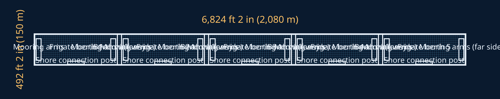

# P3-16 Frigate Berths: plan

Footprint 6,824 ft 2 in (2,080 m) × 492 ft 2 in (150 m) · structural grid 32 ft 10 in (10 m)

## Levels

| Level | Floor above deck | Height | Floor area |
|---|---|---|---|
| Level 1 · Berth floor | 0 ft (0 mm) | 13 ft 1 in (4,000 mm) | — |

## Elements

| ID | Designation | Type | Name | Level(s) | Size / length | Area | Status |
|---|---|---|---|---|---|---|---|
| E001 | D5F3P3B6A2R1 | zone | Frigate berth 1 | L1 | 1,312 ft 4 in (400 m) × 492 ft 2 in (150 m) | 645,835 sq ft (60,000 m²) | proposed |
| E002 |  | fixture | Mooring arms | L1 | 78 ft 9 in (24 m) × 344 ft 6 in (105 m) | 27,125 sq ft (2,520 m²) | proposed |
| E003 |  | fixture | Mooring arms (far side) | L1 | 78 ft 9 in (24 m) × 344 ft 6 in (105 m) | 27,125 sq ft (2,520 m²) | proposed |
| E004 |  | fixture | Shore connection post | L1 | 262 ft 6 in (80 m) × 49 ft 3 in (15 m) | 12,917 sq ft (1,200 m²) | proposed |
| E005 | D5F3P3B6A2R2 | zone | Berth walkway | L1 | 65 ft 7 in (20 m) × 492 ft 2 in (150 m) | 32,292 sq ft (3,000 m²) | proposed |
| E006 | D5F3P3B6A2R3 | zone | Frigate berth 2 | L1 | 1,312 ft 4 in (400 m) × 492 ft 2 in (150 m) | 645,835 sq ft (60,000 m²) | proposed |
| E007 |  | fixture | Mooring arms | L1 | 78 ft 9 in (24 m) × 344 ft 6 in (105 m) | 27,125 sq ft (2,520 m²) | proposed |
| E008 |  | fixture | Mooring arms (far side) | L1 | 78 ft 9 in (24 m) × 344 ft 6 in (105 m) | 27,125 sq ft (2,520 m²) | proposed |
| E009 |  | fixture | Shore connection post | L1 | 262 ft 6 in (80 m) × 49 ft 3 in (15 m) | 12,917 sq ft (1,200 m²) | proposed |
| E010 | D5F3P3B6A2R4 | zone | Berth walkway | L1 | 65 ft 7 in (20 m) × 492 ft 2 in (150 m) | 32,292 sq ft (3,000 m²) | proposed |
| E011 | D5F3P3B6A2R5 | zone | Frigate berth 3 | L1 | 1,312 ft 4 in (400 m) × 492 ft 2 in (150 m) | 645,835 sq ft (60,000 m²) | proposed |
| E012 |  | fixture | Mooring arms | L1 | 78 ft 9 in (24 m) × 344 ft 6 in (105 m) | 27,125 sq ft (2,520 m²) | proposed |
| E013 |  | fixture | Mooring arms (far side) | L1 | 78 ft 9 in (24 m) × 344 ft 6 in (105 m) | 27,125 sq ft (2,520 m²) | proposed |
| E014 |  | fixture | Shore connection post | L1 | 262 ft 6 in (80 m) × 49 ft 3 in (15 m) | 12,917 sq ft (1,200 m²) | proposed |
| E015 | D5F3P3B6A2R6 | zone | Berth walkway | L1 | 65 ft 7 in (20 m) × 492 ft 2 in (150 m) | 32,292 sq ft (3,000 m²) | proposed |
| E016 | D5F3P3B6A2R7 | zone | Frigate berth 4 | L1 | 1,312 ft 4 in (400 m) × 492 ft 2 in (150 m) | 645,835 sq ft (60,000 m²) | proposed |
| E017 |  | fixture | Mooring arms | L1 | 78 ft 9 in (24 m) × 344 ft 6 in (105 m) | 27,125 sq ft (2,520 m²) | proposed |
| E018 |  | fixture | Mooring arms (far side) | L1 | 78 ft 9 in (24 m) × 344 ft 6 in (105 m) | 27,125 sq ft (2,520 m²) | proposed |
| E019 |  | fixture | Shore connection post | L1 | 262 ft 6 in (80 m) × 49 ft 3 in (15 m) | 12,917 sq ft (1,200 m²) | proposed |
| E020 | D5F3P3B6A2R8 | zone | Berth walkway | L1 | 65 ft 7 in (20 m) × 492 ft 2 in (150 m) | 32,292 sq ft (3,000 m²) | proposed |
| E021 | D5F3P3B6A2R9 | zone | Frigate berth 5 | L1 | 1,312 ft 4 in (400 m) × 492 ft 2 in (150 m) | 645,835 sq ft (60,000 m²) | proposed |
| E022 |  | fixture | Mooring arms | L1 | 78 ft 9 in (24 m) × 344 ft 6 in (105 m) | 27,125 sq ft (2,520 m²) | proposed |
| E023 |  | fixture | Mooring arms (far side) | L1 | 78 ft 9 in (24 m) × 344 ft 6 in (105 m) | 27,125 sq ft (2,520 m²) | proposed |
| E024 |  | fixture | Shore connection post | L1 | 262 ft 6 in (80 m) × 49 ft 3 in (15 m) | 12,917 sq ft (1,200 m²) | proposed |

## Drawings

### Level 1 · Berth floor

