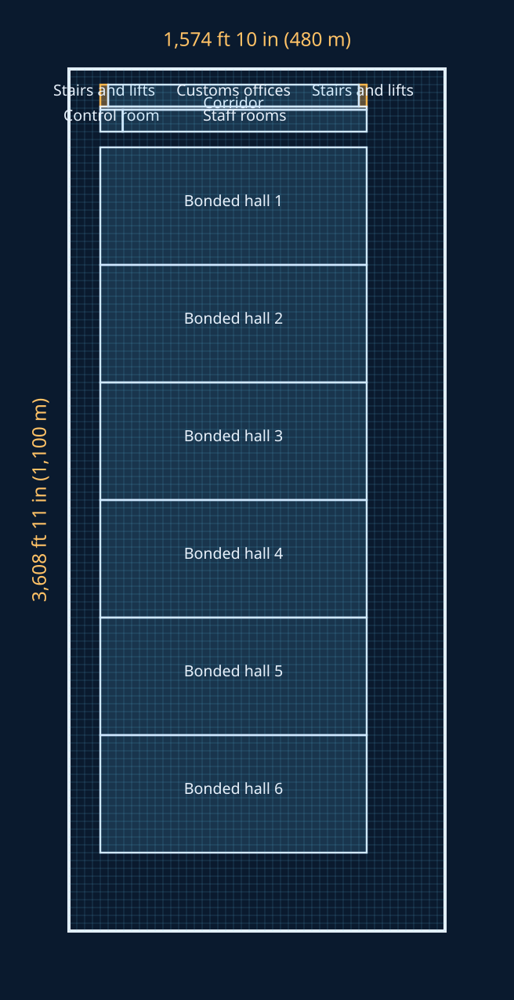
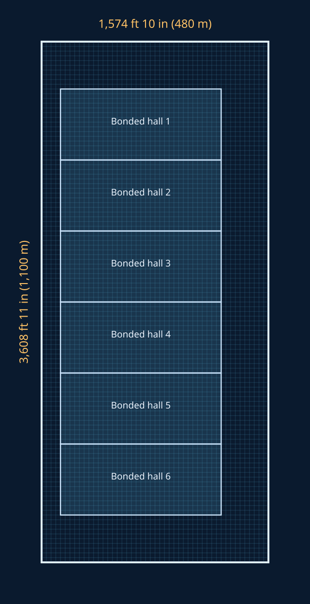

# P4-01 Bonded Warehouse A: plan

Footprint 1,574 ft 10 in (480 m) × 3,608 ft 11 in (1,100 m) · structural grid 32 ft 10 in (10 m)

## Levels

| Level | Floor above deck | Height | Floor area |
|---|---|---|---|
| Level 1 · Ground floor | 0 ft (0 mm) | 19 ft 8 in (6,000 mm) | 3,492,674 sq ft (324,480 m²) |
| Level 2 · Upper | 19 ft 8 in (6,000 mm) | 19 ft 8 in (6,000 mm) | 3,492,674 sq ft (324,480 m²) |
| Level 3 · Rack top | 39 ft 4 in (12 m) | 19 ft 8 in (6,000 mm) | 3,293,757 sq ft (306,000 m²) |

## Elements

| ID | Designation | Type | Name | Level(s) | Size / length | Area | Status |
|---|---|---|---|---|---|---|---|
| E001 | D5F3P4B1A1L1R1, D5F3P4B1A1L2R1 | core | Stairs and lifts | L1, L2 | 32 ft 10 in (10 m) × 91 ft 10 in (28 m) | 3,014 sq ft (280 m²) | proposed |
| E002 | D5F3P4B1A1L1R2, D5F3P4B1A1L2R2 | core | Stairs and lifts | L1, L2 | 32 ft 10 in (10 m) × 91 ft 10 in (28 m) | 3,014 sq ft (280 m²) | proposed |
| E003 | D5F3P4B1A1L1R3 | zone | Corridor | L1 | 1,115 ft 6 in (340 m) × 13 ft 1 in (4,000 mm) | 14,639 sq ft (1,360 m²) | proposed |
| E004 | D5F3P4B1A1L1R4 | room | Inspection hall | L1 | 1,049 ft 10 in (320 m) × 91 ft 10 in (28 m) | 96,445 sq ft (8,960 m²) | proposed |
| E005 | D5F3P4B1A1L1R5 | room | X-ray tunnel | L1 | 234 ft 3 in (71 m) × 91 ft 10 in (28 m) | 21,519 sq ft (1,999 m²) | proposed |
| E006 | D5F3P4B1A1L1R6 | room | Sample lab | L1 | 93 ft 10 in (29 m) × 91 ft 10 in (28 m) | 8,620 sq ft (801 m²) | proposed |
| E007 | D5F3P4B1A1L1R7 | room | Seized goods store | L1 | 140 ft 9 in (43 m) × 91 ft 10 in (28 m) | 12,930 sq ft (1,201 m²) | proposed |
| E008 | D5F3P4B1A1L1R8 | room | Customs desk | L1 | 646 ft 8 in (197 m) × 91 ft 10 in (28 m) | 59,404 sq ft (5,519 m²) | proposed |
| E009 | D5F3P4B1A1L2R3 | zone | Corridor | L2 | 1,115 ft 6 in (340 m) × 13 ft 1 in (4,000 mm) | 14,639 sq ft (1,360 m²) | proposed |
| E010 | D5F3P4B1A1L2R4 | room | Customs offices | L2 | 1,049 ft 10 in (320 m) × 91 ft 10 in (28 m) | 96,445 sq ft (8,960 m²) | proposed |
| E011 | D5F3P4B1A1L2R5 | room | Control room | L2 | 93 ft 10 in (29 m) × 91 ft 10 in (28 m) | 8,620 sq ft (801 m²) | proposed |
| E012 | D5F3P4B1A1L2R6 | room | Staff rooms | L2 | 1,021 ft 8 in (311 m) × 91 ft 10 in (28 m) | 93,853 sq ft (8,719 m²) | proposed |
| E013 | D5F3P4B1A1L1R9, D5F3P4B1A1L2R7, D5F3P4B1A1L3R1 | room | Bonded hall 1 | L1, L2, L3 | 1,115 ft 6 in (340 m) × 492 ft 2 in (150 m) | 548,959 sq ft (51,000 m²) | proposed |
| E014 | D5F3P4B1A1L1R10, D5F3P4B1A1L2R8, D5F3P4B1A1L3R2 | room | Bonded hall 2 | L1, L2, L3 | 1,115 ft 6 in (340 m) × 492 ft 2 in (150 m) | 548,959 sq ft (51,000 m²) | proposed |
| E015 | D5F3P4B1A1L1R11, D5F3P4B1A1L2R9, D5F3P4B1A1L3R3 | room | Bonded hall 3 | L1, L2, L3 | 1,115 ft 6 in (340 m) × 492 ft 2 in (150 m) | 548,959 sq ft (51,000 m²) | proposed |
| E016 | D5F3P4B1A1L1R12, D5F3P4B1A1L2R10, D5F3P4B1A1L3R4 | room | Bonded hall 4 | L1, L2, L3 | 1,115 ft 6 in (340 m) × 492 ft 2 in (150 m) | 548,959 sq ft (51,000 m²) | proposed |
| E017 | D5F3P4B1A1L1R13, D5F3P4B1A1L2R11, D5F3P4B1A1L3R5 | room | Bonded hall 5 | L1, L2, L3 | 1,115 ft 6 in (340 m) × 492 ft 2 in (150 m) | 548,959 sq ft (51,000 m²) | proposed |
| E018 | D5F3P4B1A1L1R14, D5F3P4B1A1L2R12, D5F3P4B1A1L3R6 | room | Bonded hall 6 | L1, L2, L3 | 1,115 ft 6 in (340 m) × 492 ft 2 in (150 m) | 548,959 sq ft (51,000 m²) | proposed |
| E019 | D5F3P4B1A1L1R15 | zone | Truck docks (F35 Street side) | L1 | 328 ft 1 in (100 m) × 2,952 ft 9 in (900 m) | 968,752 sq ft (90,000 m²) | proposed |
| E020 | D5F3P4B1A1L1R16 | zone | Staff parking | L1 | 1,115 ft 6 in (340 m) × 262 ft 6 in (80 m) | 292,778 sq ft (27,200 m²) | proposed |

## Drawings

### Level 1 · Ground floor

### Level 2 · Upper

### Level 3 · Rack top

