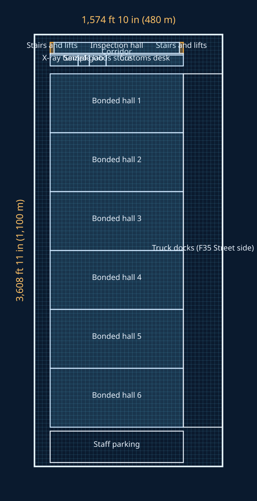

# P4-01 Bonded Warehouse A: plan

Footprint 1,574 ft 10 in (480 m) × 3,608 ft 11 in (1,100 m) · structural grid 98 ft 5 in (30 m)

## Levels

| Level | Floor above deck | Height | Floor area |
|---|---|---|---|
| Level 1 · Ground floor | 0 ft (0 mm) | 45 ft 11 in (14 m) | 4,328,229 sq ft (402,106 m²) |
| Level 2 · Office level | 45 ft 11 in (14 m) | 14 ft 9 in (4,500 mm) | 674,897 sq ft (62,700 m²) |

## Elements

| ID | Designation | Type | Name | Level(s) | Size / length | Area | Status |
|---|---|---|---|---|---|---|---|
| L1-001 | D5F3P4B1A1L1R1 | zone | Walkway | L1 | 39 ft 4 in (12 m) × 3,608 ft 11 in (1,100 m) | 142,084 sq ft (13,200 m²) | proposed |
| L1-002 | D5F3P4B1A1L1R2 | zone | Walkway | L1 | 39 ft 4 in (12 m) × 3,608 ft 11 in (1,100 m) | 142,084 sq ft (13,200 m²) | proposed |
| L1-003 | D5F3P4B1A1L1R3 | zone | Walkway | L1 | 39 ft 4 in (12 m) × 3,608 ft 11 in (1,100 m) | 142,084 sq ft (13,200 m²) | proposed |
| L1-004 | D5F3P4B1A1L1R4 | zone | Walkway | L1 | 39 ft 4 in (12 m) × 3,608 ft 11 in (1,100 m) | 142,084 sq ft (13,200 m²) | proposed |
| L1-005 | D5F3P4B1A1L1R5 | room | Storage halls | L1 | 177 ft 2 in (54 m) × 277 ft 7 in (85 m) | 49,174 sq ft (4,568 m²) | proposed |
| L1-006 | D5F3P4B1A1L1R6 | room | Storage halls | L1 | 177 ft 2 in (54 m) × 555 ft 5 in (169 m) | 98,406 sq ft (9,142 m²) | proposed |
| L1-007 | D5F3P4B1A1L1R7 | room | Storage halls | L1 | 177 ft 2 in (54 m) × 555 ft 1 in (169 m) | 98,348 sq ft (9,137 m²) | proposed |
| L1-008 | D5F3P4B1A1L1R8 | room | Storage halls | L1 | 177 ft 2 in (54 m) × 555 ft 5 in (169 m) | 98,406 sq ft (9,142 m²) | proposed |
| L1-009 | D5F3P4B1A1L1R9 | room | Storage halls | L1 | 177 ft 2 in (54 m) × 555 ft 1 in (169 m) | 98,348 sq ft (9,137 m²) | proposed |
| L1-010 | D5F3P4B1A1L1R10 | room | Storage halls | L1 | 177 ft 2 in (54 m) × 3,608 ft 11 in (1,100 m) | 639,376 sq ft (59,400 m²) | proposed |
| L1-011 | D5F3P4B1A1L1R11 | room | Storage halls | L1 | 177 ft 2 in (54 m) × 277 ft 7 in (85 m) | 49,174 sq ft (4,568 m²) | proposed |
| L1-012 | D5F3P4B1A1L1R12 | room | Storage halls | L1 | 177 ft 2 in (54 m) × 555 ft 5 in (169 m) | 98,406 sq ft (9,142 m²) | proposed |
| L1-013 | D5F3P4B1A1L1R13 | room | Storage halls | L1 | 177 ft 2 in (54 m) × 555 ft 1 in (169 m) | 98,348 sq ft (9,137 m²) | proposed |
| L1-014 | D5F3P4B1A1L1R14 | room | Storage halls | L1 | 177 ft 2 in (54 m) × 555 ft 5 in (169 m) | 98,406 sq ft (9,142 m²) | proposed |
| L1-015 | D5F3P4B1A1L1R15 | room | Storage halls | L1 | 177 ft 2 in (54 m) × 555 ft 1 in (169 m) | 98,348 sq ft (9,137 m²) | proposed |
| L1-016 | D5F3P4B1A1L1R16 | room | Storage halls | L1 | 177 ft 2 in (54 m) × 3,608 ft 11 in (1,100 m) | 639,376 sq ft (59,400 m²) | proposed |
| L1-017 | D5F3P4B1A1L1R17 | room | Storage halls | L1 | 177 ft 2 in (54 m) × 277 ft 7 in (85 m) | 49,174 sq ft (4,568 m²) | proposed |
| L1-018 | D5F3P4B1A1L1R18 | room | Storage halls | L1 | 177 ft 2 in (54 m) × 555 ft 5 in (169 m) | 98,406 sq ft (9,142 m²) | proposed |
| L1-019 | D5F3P4B1A1L1R19 | room | Storage halls | L1 | 177 ft 2 in (54 m) × 555 ft 1 in (169 m) | 98,348 sq ft (9,137 m²) | proposed |
| L1-020 | D5F3P4B1A1L1R20 | room | Storage halls | L1 | 177 ft 2 in (54 m) × 555 ft 5 in (169 m) | 98,406 sq ft (9,142 m²) | proposed |
| L1-021 | D5F3P4B1A1L1R21 | room | Storage halls | L1 | 177 ft 2 in (54 m) × 555 ft 1 in (169 m) | 98,348 sq ft (9,137 m²) | proposed |
| L1-022 | D5F3P4B1A1L1R22 | room | Sorting floor | L1 | 177 ft 2 in (54 m) × 3,608 ft 11 in (1,100 m) | 639,376 sq ft (59,400 m²) | proposed |
| L1-023 | D5F3P4B1A1L1R23 | room | Loading docks | L1 | 177 ft 2 in (54 m) × 277 ft 7 in (85 m) | 49,174 sq ft (4,568 m²) | proposed |
| L1-024 | D5F3P4B1A1L1R24 | room | Loading docks | L1 | 177 ft 2 in (54 m) × 555 ft 5 in (169 m) | 98,406 sq ft (9,142 m²) | proposed |
| L1-025 | D5F3P4B1A1L1R25 | room | Loading docks | L1 | 177 ft 2 in (54 m) × 555 ft 1 in (169 m) | 98,348 sq ft (9,137 m²) | proposed |
| L1-026 | D5F3P4B1A1L1R26 | room | Loading docks | L1 | 177 ft 2 in (54 m) × 555 ft 5 in (169 m) | 98,406 sq ft (9,142 m²) | proposed |
| L1-027 | D5F3P4B1A1L1R27 | room | Loading docks | L1 | 177 ft 2 in (54 m) × 555 ft 1 in (169 m) | 98,348 sq ft (9,137 m²) | proposed |
| L1-028 | D5F3P4B1A1L1R28 | room | Loading docks | L1 | 177 ft 2 in (54 m) × 1,110 ft 7 in (338 m) | 196,754 sq ft (18,279 m²) | proposed |
| L1-029 | D5F3P4B1A1L1R29 | room | Inspection rooms | L1 | 177 ft 2 in (54 m) × 1,387 ft 10 in (423 m) | 245,869 sq ft (22,842 m²) | proposed |
| L1-030 | D5F3P4B1A1L1R30 | room | Staff rooms | L1 | 177 ft 2 in (54 m) × 1,110 ft 7 in (338 m) | 196,754 sq ft (18,279 m²) | proposed |
| L1-031 | D5F3P4B1A1L1R31, D5F3P4B1A1L2R1 | core | Stairs and lifts | L1, L2 | 177 ft 2 in (54 m) × 277 ft 7 in (85 m) | 49,174 sq ft (4,568 m²) | proposed |
| L1-032 | D5F3P4B1A1L1R32, D5F3P4B1A1L2R2 | core | Stairs and lifts | L1, L2 | 177 ft 2 in (54 m) × 277 ft 7 in (85 m) | 49,174 sq ft (4,568 m²) | proposed |
| L1-033 | D5F3P4B1A1L1R33, D5F3P4B1A1L2R3 | core | Stairs and lifts | L1, L2 | 177 ft 2 in (54 m) × 277 ft 7 in (85 m) | 49,174 sq ft (4,568 m²) | proposed |
| L1-034 | D5F3P4B1A1L1R34, D5F3P4B1A1L2R4 | core | Stairs and lifts | L1, L2 | 177 ft 2 in (54 m) × 277 ft 7 in (85 m) | 49,174 sq ft (4,568 m²) | proposed |
| L1-035 | D5F3P4B1A1L1R35, D5F3P4B1A1L2R5 | core | Stairs and lifts | L1, L2 | 177 ft 2 in (54 m) × 277 ft 7 in (85 m) | 49,174 sq ft (4,568 m²) | proposed |
| L1-036 | D5F3P4B1A1L1R36, D5F3P4B1A1L2R6 | core | Stairs and lifts | L1, L2 | 177 ft 2 in (54 m) × 277 ft 7 in (85 m) | 49,174 sq ft (4,568 m²) | proposed |
| L1-037 | D5F3P4B1A1L1R37, D5F3P4B1A1L2R7 | core | Stairs and lifts | L1, L2 | 177 ft 2 in (54 m) × 277 ft 7 in (85 m) | 49,174 sq ft (4,568 m²) | proposed |
| L1-038 | D5F3P4B1A1L1R38, D5F3P4B1A1L2R8 | core | Stairs and lifts | L1, L2 | 177 ft 2 in (54 m) × 277 ft 7 in (85 m) | 49,174 sq ft (4,568 m²) | proposed |
| L1-039 | D5F3P4B1A1L1R39, D5F3P4B1A1L2R9 | core | Stairs and lifts | L1, L2 | 177 ft 2 in (54 m) × 277 ft 7 in (85 m) | 49,174 sq ft (4,568 m²) | proposed |
| L1-040 | D5F3P4B1A1L1R40, D5F3P4B1A1L2R10 | core | Stairs and lifts | L1, L2 | 177 ft 2 in (54 m) × 277 ft 7 in (85 m) | 49,174 sq ft (4,568 m²) | proposed |
| L1-041 | D5F3P4B1A1L1R41, D5F3P4B1A1L2R11 | core | Stairs and lifts | L1, L2 | 177 ft 2 in (54 m) × 277 ft 7 in (85 m) | 49,174 sq ft (4,568 m²) | proposed |
| L1-042 | D5F3P4B1A1L1R42, D5F3P4B1A1L2R12 | core | Stairs and lifts | L1, L2 | 177 ft 2 in (54 m) × 277 ft 7 in (85 m) | 49,174 sq ft (4,568 m²) | proposed |
| L1-043 | D5F3P4B1A1L1R43, D5F3P4B1A1L2R13 | core | Stairs and lifts | L1, L2 | 177 ft 2 in (54 m) × 277 ft 7 in (85 m) | 49,174 sq ft (4,568 m²) | proposed |
| L1-044 | D5F3P4B1A1L1R44, D5F3P4B1A1L2R14 | core | Stairs and lifts | L1, L2 | 177 ft 2 in (54 m) × 277 ft 7 in (85 m) | 49,174 sq ft (4,568 m²) | proposed |
| L1-045 | D5F3P4B1A1L1R45, D5F3P4B1A1L2R15 | core | Stairs and lifts | L1, L2 | 177 ft 2 in (54 m) × 277 ft 7 in (85 m) | 49,174 sq ft (4,568 m²) | proposed |
| L1-046 | D5F3P4B1A1L1R46, D5F3P4B1A1L2R16 | core | Stairs and lifts | L1, L2 | 177 ft 2 in (54 m) × 277 ft 7 in (85 m) | 49,174 sq ft (4,568 m²) | proposed |
| L2-001 | D5F3P4B1A1L2R17 | zone | Corridor | L2 | 9 ft 10 in (3,000 mm) × 3,608 ft 11 in (1,100 m) | 35,521 sq ft (3,300 m²) | proposed |
| L2-002 | D5F3P4B1A1L2R18 | room | Offices | L2 | 93 ft 6 in (28 m) × 3,608 ft 11 in (1,100 m) | 337,449 sq ft (31,350 m²) | proposed |
| L2-003 | D5F3P4B1A1L2R19 | room | Offices | L2 | 93 ft 6 in (28 m) × 601 ft 5 in (183 m) | 56,231 sq ft (5,224 m²) | proposed |
| L2-004 | D5F3P4B1A1L2R20 | room | Control room | L2 | 93 ft 6 in (28 m) × 1,804 ft 6 in (550 m) | 168,724 sq ft (15,675 m²) | proposed |
| L2-005 | D5F3P4B1A1L2R21 | room | Staff rooms | L2 | 93 ft 6 in (28 m) × 1,203 ft 1 in (367 m) | 112,493 sq ft (10,451 m²) | proposed |
| D-52 |  | door | Main entrance | L1 | 78 ft 9 in (24 m), 78 ft 9 in (24 m) wide | — | proposed |
| D-53 |  | door | Second entrance | L1 | 78 ft 9 in (24 m), 78 ft 9 in (24 m) wide | — | proposed |
| D-54 |  | door | Side door | L1 | 19 ft 8 in (6,000 mm), 19 ft 8 in (6,000 mm) wide | — | proposed |
| D-55 |  | door | Side door | L1 | 19 ft 8 in (6,000 mm), 19 ft 8 in (6,000 mm) wide | — | proposed |

## Drawings

### Level 1 · Ground floor

### Level 2 · Office level

