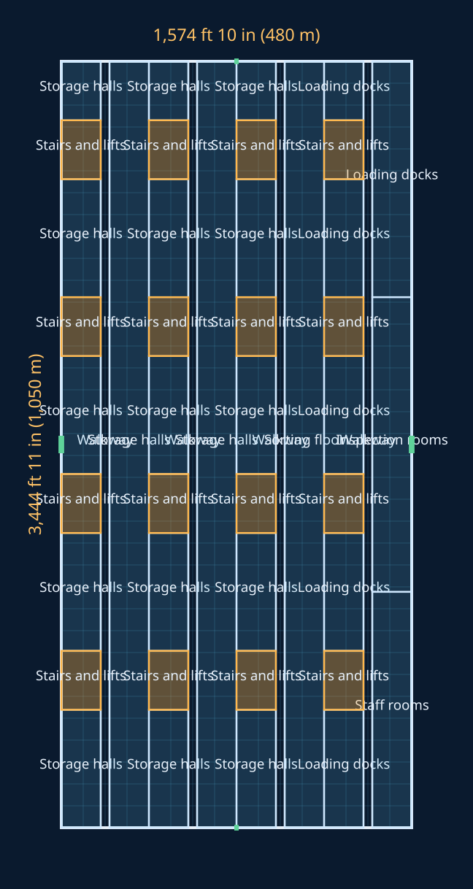

# P4-02 Bonded Warehouse B: plan

Footprint 1,574 ft 10 in (480 m) × 3,444 ft 11 in (1,050 m) · structural grid 32 ft 10 in (10 m)

## Levels

| Level | Floor above deck | Height | Floor area |
|---|---|---|---|
| Level 1 · Lower deck | 0 ft (0 mm) | 26 ft 3 in (8,000 mm) | 3,314,531 sq ft (307,930 m²) |
| Level 2 · Upper deck | 26 ft 3 in (8,000 mm) | 26 ft 3 in (8,000 mm) | 3,314,531 sq ft (307,930 m²) |

## Elements

| ID | Designation | Type | Name | Level(s) | Size / length | Area | Status |
|---|---|---|---|---|---|---|---|
| E001 | D5F3P4B1A2L1R1, D5F3P4B1A2L2R1 | core | Stairs and lifts | L1, L2 | 551 ft 2 in (168 m) × 32 ft 10 in (10 m) | 18,083 sq ft (1,680 m²) | proposed |
| E002 | D5F3P4B1A2L1R2, D5F3P4B1A2L2R2 | core | Stairs and lifts | L1, L2 | 551 ft 2 in (168 m) × 32 ft 10 in (10 m) | 18,083 sq ft (1,680 m²) | proposed |
| E003 | D5F3P4B1A2L1R3, D5F3P4B1A2L2R3 | core | Stairs and lifts | L1, L2 | 551 ft 2 in (168 m) × 32 ft 10 in (10 m) | 18,083 sq ft (1,680 m²) | proposed |
| E004 | D5F3P4B1A2L1R4, D5F3P4B1A2L2R4 | zone | Truck aisle | L1, L2 | 78 ft 9 in (24 m) × 2,755 ft 11 in (840 m) | 217,000 sq ft (20,160 m²) | proposed |
| E005 | D5F3P4B1A2L1R5, D5F3P4B1A2L2R5 | room | Bonded bay | L1, L2 | 551 ft 2 in (168 m) × 295 ft 3 in (90 m) | 162,750 sq ft (15,120 m²) | proposed |
| E006 | D5F3P4B1A2L1R6, D5F3P4B1A2L2R6 | room | Bonded bay | L1, L2 | 551 ft 2 in (168 m) × 295 ft 3 in (90 m) | 162,750 sq ft (15,120 m²) | proposed |
| E007 | D5F3P4B1A2L1R7, D5F3P4B1A2L2R7 | room | Bonded bay | L1, L2 | 551 ft 2 in (168 m) × 295 ft 3 in (90 m) | 162,750 sq ft (15,120 m²) | proposed |
| E008 | D5F3P4B1A2L1R8, D5F3P4B1A2L2R8 | room | Bonded bay | L1, L2 | 551 ft 2 in (168 m) × 295 ft 3 in (90 m) | 162,750 sq ft (15,120 m²) | proposed |
| E009 | D5F3P4B1A2L1R9, D5F3P4B1A2L2R9 | room | Bonded bay | L1, L2 | 551 ft 2 in (168 m) × 147 ft 8 in (45 m) | 81,375 sq ft (7,560 m²) | proposed |
| E010 | D5F3P4B1A2L1R10, D5F3P4B1A2L2R10 | room | Bonded bay | L1, L2 | 551 ft 2 in (168 m) × 147 ft 8 in (45 m) | 81,375 sq ft (7,560 m²) | proposed |
| E011 | D5F3P4B1A2L1R11, D5F3P4B1A2L2R11 | room | Bonded bay | L1, L2 | 551 ft 2 in (168 m) × 295 ft 3 in (90 m) | 162,750 sq ft (15,120 m²) | proposed |
| E012 | D5F3P4B1A2L1R12, D5F3P4B1A2L2R12 | room | Bonded bay | L1, L2 | 551 ft 2 in (168 m) × 295 ft 3 in (90 m) | 162,750 sq ft (15,120 m²) | proposed |
| E013 | D5F3P4B1A2L1R13, D5F3P4B1A2L2R13 | room | Bonded bay | L1, L2 | 551 ft 2 in (168 m) × 295 ft 3 in (90 m) | 162,750 sq ft (15,120 m²) | proposed |
| E014 | D5F3P4B1A2L1R14, D5F3P4B1A2L2R14 | room | Bonded bay | L1, L2 | 551 ft 2 in (168 m) × 295 ft 3 in (90 m) | 162,750 sq ft (15,120 m²) | proposed |
| E015 | D5F3P4B1A2L1R15, D5F3P4B1A2L2R15 | room | Bonded bay | L1, L2 | 551 ft 2 in (168 m) × 306 ft 1 in (93 m) | 168,718 sq ft (15,674 m²) | proposed |
| E016 | D5F3P4B1A2L1R16, D5F3P4B1A2L2R16 | room | Bonded bay | L1, L2 | 551 ft 2 in (168 m) × 306 ft 5 in (93 m) | 168,899 sq ft (15,691 m²) | proposed |
| E017 | D5F3P4B1A2L1R17, D5F3P4B1A2L2R17 | room | Bonded bay | L1, L2 | 551 ft 2 in (168 m) × 306 ft 1 in (93 m) | 168,718 sq ft (15,674 m²) | proposed |
| E018 | D5F3P4B1A2L1R18, D5F3P4B1A2L2R18 | room | Bonded bay | L1, L2 | 551 ft 2 in (168 m) × 306 ft 1 in (93 m) | 168,718 sq ft (15,674 m²) | proposed |
| E019 | D5F3P4B1A2L1R19, D5F3P4B1A2L2R19 | room | Bonded bay | L1, L2 | 551 ft 2 in (168 m) × 306 ft 5 in (93 m) | 168,899 sq ft (15,691 m²) | proposed |
| E020 | D5F3P4B1A2L1R20, D5F3P4B1A2L2R20 | room | Bonded bay | L1, L2 | 551 ft 2 in (168 m) × 306 ft 1 in (93 m) | 168,718 sq ft (15,674 m²) | proposed |
| E021 | D5F3P4B1A2L1R21, D5F3P4B1A2L2R21 | room | Bonded bay | L1, L2 | 551 ft 2 in (168 m) × 306 ft 1 in (93 m) | 168,718 sq ft (15,674 m²) | proposed |
| E022 | D5F3P4B1A2L1R22, D5F3P4B1A2L2R22 | room | Bonded bay | L1, L2 | 551 ft 2 in (168 m) × 306 ft 5 in (93 m) | 168,899 sq ft (15,691 m²) | proposed |
| E023 | D5F3P4B1A2L1R23, D5F3P4B1A2L2R23 | room | Bonded bay | L1, L2 | 551 ft 2 in (168 m) × 306 ft 1 in (93 m) | 168,718 sq ft (15,674 m²) | proposed |
| E024 | D5F3P4B1A2L1R24, D5F3P4B1A2L2R24 | room | Truck ramp to the upper deck | L1, L2 | 196 ft 10 in (60 m) × 787 ft 5 in (240 m) | 155,000 sq ft (14,400 m²) | proposed |
| E025 | D5F3P4B1A2L1R25, D5F3P4B1A2L2R25 | core | Stairs and lifts | L1, L2 | 32 ft 10 in (10 m) × 75 ft 6 in (23 m) | 2,476 sq ft (230 m²) | proposed |
| E026 | D5F3P4B1A2L1R26 | zone | Corridor | L1 | 1,181 ft 1 in (360 m) × 13 ft 1 in (4,000 mm) | 15,500 sq ft (1,440 m²) | proposed |
| E027 | D5F3P4B1A2L1R27 | room | Customs desk | L1 | 510 ft 6 in (156 m) × 75 ft 6 in (23 m) | 38,522 sq ft (3,579 m²) | proposed |
| E028 | D5F3P4B1A2L1R28 | room | Tenant reception | L1 | 63 ft 8 in (19 m) × 75 ft 6 in (23 m) | 4,803 sq ft (446 m²) | proposed |
| E029 | D5F3P4B1A2L1R29 | room | Tenant reception | L1 | 574 ft 2 in (175 m) × 75 ft 6 in (23 m) | 43,325 sq ft (4,025 m²) | proposed |
| E030 | D5F3P4B1A2L1R30 | room | Inspection room | L1 | 285 ft 5 in (87 m) × 75 ft 6 in (23 m) | 21,539 sq ft (2,001 m²) | proposed |
| E031 | D5F3P4B1A2L1R31 | room | Stores | L1 | 895 ft 8 in (273 m) × 75 ft 6 in (23 m) | 67,587 sq ft (6,279 m²) | proposed |
| E032 | D5F3P4B1A2L2R26 | zone | Corridor | L2 | 1,181 ft 1 in (360 m) × 13 ft 1 in (4,000 mm) | 15,500 sq ft (1,440 m²) | proposed |
| E033 | D5F3P4B1A2L2R27 | room | Tenant offices | L2 | 574 ft 2 in (175 m) × 75 ft 6 in (23 m) | 43,325 sq ft (4,025 m²) | proposed |
| E034 | D5F3P4B1A2L2R28 | room | Tenant offices | L2 | 574 ft 2 in (175 m) × 75 ft 6 in (23 m) | 43,325 sq ft (4,025 m²) | proposed |
| E035 | D5F3P4B1A2L2R29 | room | Stores | L2 | 1,181 ft 1 in (360 m) × 75 ft 6 in (23 m) | 89,125 sq ft (8,280 m²) | proposed |
| E036 | D5F3P4B1A2L1R32 | zone | Truck yard | L1 | 262 ft 6 in (80 m) × 2,296 ft 7 in (700 m) | 602,779 sq ft (56,000 m²) | proposed |

## Drawings

### Level 1 · Lower deck

### Level 2 · Upper deck

