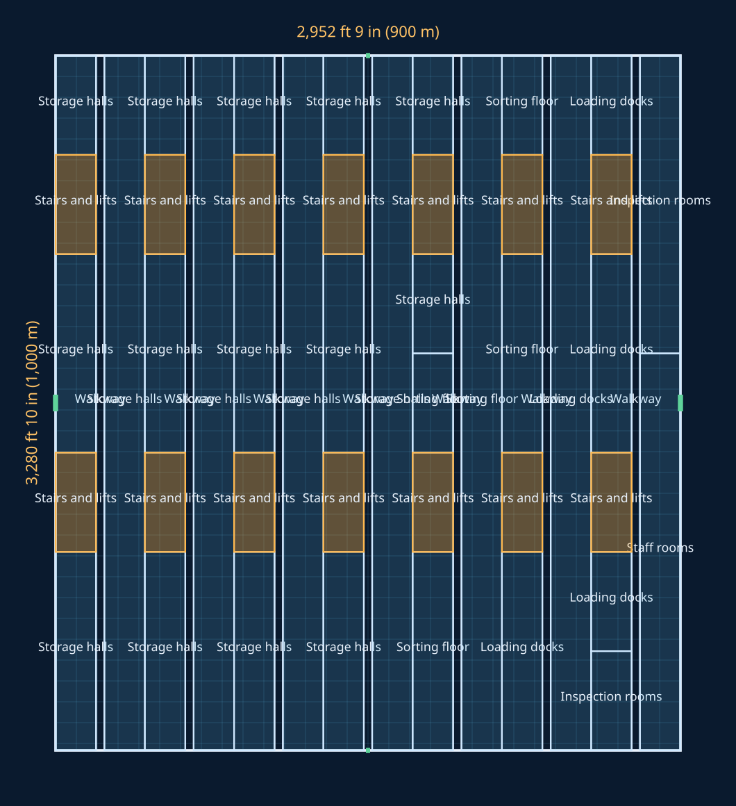
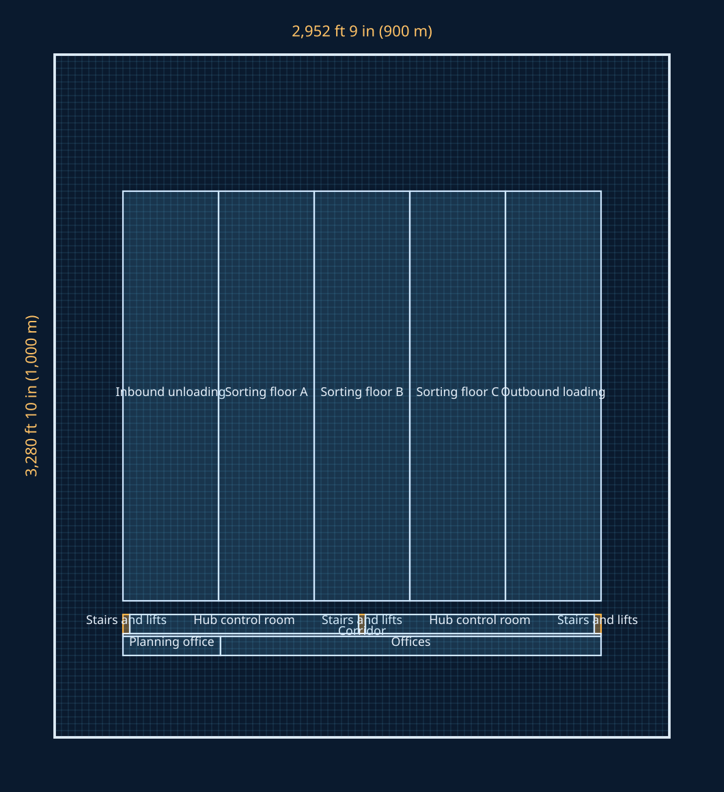

# P4-03 Cargo Sorting Hub: plan

Footprint 2,952 ft 9 in (900 m) × 3,280 ft 10 in (1,000 m) · structural grid 98 ft 5 in (30 m)

## Levels

| Level | Floor above deck | Height | Floor area |
|---|---|---|---|
| Level 1 · Ground floor | 0 ft (0 mm) | 45 ft 11 in (14 m) | 7,528,650 sq ft (699,434 m²) |
| Level 2 · Office level | 45 ft 11 in (14 m) | 14 ft 9 in (4,500 mm) | 1,178,648 sq ft (109,500 m²) |

## Elements

| ID | Designation | Type | Name | Level(s) | Size / length | Area | Status |
|---|---|---|---|---|---|---|---|
| L1-001 | D5F3P4B4A1L1R1 | zone | Walkway | L1 | 39 ft 4 in (12 m) × 3,280 ft 10 in (1,000 m) | 129,167 sq ft (12,000 m²) | proposed |
| L1-002 | D5F3P4B4A1L1R2 | zone | Walkway | L1 | 39 ft 4 in (12 m) × 3,280 ft 10 in (1,000 m) | 129,167 sq ft (12,000 m²) | proposed |
| L1-003 | D5F3P4B4A1L1R3 | zone | Walkway | L1 | 39 ft 4 in (12 m) × 3,280 ft 10 in (1,000 m) | 129,167 sq ft (12,000 m²) | proposed |
| L1-004 | D5F3P4B4A1L1R4 | zone | Walkway | L1 | 39 ft 4 in (12 m) × 3,280 ft 10 in (1,000 m) | 129,167 sq ft (12,000 m²) | proposed |
| L1-005 | D5F3P4B4A1L1R5 | zone | Walkway | L1 | 39 ft 4 in (12 m) × 3,280 ft 10 in (1,000 m) | 129,167 sq ft (12,000 m²) | proposed |
| L1-006 | D5F3P4B4A1L1R6 | zone | Walkway | L1 | 39 ft 4 in (12 m) × 3,280 ft 10 in (1,000 m) | 129,167 sq ft (12,000 m²) | proposed |
| L1-007 | D5F3P4B4A1L1R7 | zone | Walkway | L1 | 39 ft 4 in (12 m) × 3,280 ft 10 in (1,000 m) | 129,167 sq ft (12,000 m²) | proposed |
| L1-008 | D5F3P4B4A1L1R8 | room | Storage halls | L1 | 191 ft 3 in (58 m) × 468 ft 10 in (143 m) | 89,675 sq ft (8,331 m²) | proposed |
| L1-009 | D5F3P4B4A1L1R9 | room | Storage halls | L1 | 191 ft 3 in (58 m) × 937 ft 4 in (286 m) | 179,287 sq ft (16,656 m²) | proposed |
| L1-010 | D5F3P4B4A1L1R10 | room | Storage halls | L1 | 191 ft 3 in (58 m) × 937 ft 4 in (286 m) | 179,287 sq ft (16,656 m²) | proposed |
| L1-011 | D5F3P4B4A1L1R11 | room | Storage halls | L1 | 191 ft 3 in (58 m) × 3,280 ft 10 in (1,000 m) | 627,536 sq ft (58,300 m²) | proposed |
| L1-012 | D5F3P4B4A1L1R12 | room | Storage halls | L1 | 191 ft 3 in (58 m) × 468 ft 10 in (143 m) | 89,675 sq ft (8,331 m²) | proposed |
| L1-013 | D5F3P4B4A1L1R13 | room | Storage halls | L1 | 191 ft 3 in (58 m) × 937 ft 4 in (286 m) | 179,287 sq ft (16,656 m²) | proposed |
| L1-014 | D5F3P4B4A1L1R14 | room | Storage halls | L1 | 191 ft 3 in (58 m) × 937 ft 4 in (286 m) | 179,287 sq ft (16,656 m²) | proposed |
| L1-015 | D5F3P4B4A1L1R15 | room | Storage halls | L1 | 190 ft 11 in (58 m) × 3,280 ft 10 in (1,000 m) | 626,460 sq ft (58,200 m²) | proposed |
| L1-016 | D5F3P4B4A1L1R16 | room | Storage halls | L1 | 191 ft 3 in (58 m) × 468 ft 10 in (143 m) | 89,675 sq ft (8,331 m²) | proposed |
| L1-017 | D5F3P4B4A1L1R17 | room | Storage halls | L1 | 191 ft 3 in (58 m) × 937 ft 4 in (286 m) | 179,287 sq ft (16,656 m²) | proposed |
| L1-018 | D5F3P4B4A1L1R18 | room | Storage halls | L1 | 191 ft 3 in (58 m) × 937 ft 4 in (286 m) | 179,287 sq ft (16,656 m²) | proposed |
| L1-019 | D5F3P4B4A1L1R19 | room | Storage halls | L1 | 191 ft 3 in (58 m) × 3,280 ft 10 in (1,000 m) | 627,536 sq ft (58,300 m²) | proposed |
| L1-020 | D5F3P4B4A1L1R20 | room | Storage halls | L1 | 191 ft 3 in (58 m) × 468 ft 10 in (143 m) | 89,675 sq ft (8,331 m²) | proposed |
| L1-021 | D5F3P4B4A1L1R21 | room | Storage halls | L1 | 191 ft 3 in (58 m) × 937 ft 4 in (286 m) | 179,287 sq ft (16,656 m²) | proposed |
| L1-022 | D5F3P4B4A1L1R22 | room | Storage halls | L1 | 191 ft 3 in (58 m) × 937 ft 4 in (286 m) | 179,287 sq ft (16,656 m²) | proposed |
| L1-023 | D5F3P4B4A1L1R23 | room | Storage halls | L1 | 191 ft 3 in (58 m) × 3,280 ft 10 in (1,000 m) | 627,536 sq ft (58,300 m²) | proposed |
| L1-024 | D5F3P4B4A1L1R24 | room | Storage halls | L1 | 191 ft 3 in (58 m) × 468 ft 10 in (143 m) | 89,675 sq ft (8,331 m²) | proposed |
| L1-025 | D5F3P4B4A1L1R25 | room | Storage halls | L1 | 191 ft 3 in (58 m) × 468 ft 10 in (143 m) | 89,675 sq ft (8,331 m²) | proposed |
| L1-026 | D5F3P4B4A1L1R26 | room | Sorting floor | L1 | 191 ft 3 in (58 m) × 468 ft 6 in (143 m) | 89,612 sq ft (8,325 m²) | proposed |
| L1-027 | D5F3P4B4A1L1R27 | room | Sorting floor | L1 | 191 ft 3 in (58 m) × 937 ft 4 in (286 m) | 179,287 sq ft (16,656 m²) | proposed |
| L1-028 | D5F3P4B4A1L1R28 | room | Sorting floor | L1 | 191 ft 3 in (58 m) × 3,280 ft 10 in (1,000 m) | 627,536 sq ft (58,300 m²) | proposed |
| L1-029 | D5F3P4B4A1L1R29 | room | Sorting floor | L1 | 190 ft 11 in (58 m) × 468 ft 10 in (143 m) | 89,521 sq ft (8,317 m²) | proposed |
| L1-030 | D5F3P4B4A1L1R30 | room | Sorting floor | L1 | 190 ft 11 in (58 m) × 937 ft 4 in (286 m) | 178,980 sq ft (16,628 m²) | proposed |
| L1-031 | D5F3P4B4A1L1R31 | room | Loading docks | L1 | 190 ft 11 in (58 m) × 937 ft 4 in (286 m) | 178,980 sq ft (16,628 m²) | proposed |
| L1-032 | D5F3P4B4A1L1R32 | room | Loading docks | L1 | 191 ft 3 in (58 m) × 3,280 ft 10 in (1,000 m) | 627,536 sq ft (58,300 m²) | proposed |
| L1-033 | D5F3P4B4A1L1R33 | room | Loading docks | L1 | 191 ft 3 in (58 m) × 468 ft 10 in (143 m) | 89,675 sq ft (8,331 m²) | proposed |
| L1-034 | D5F3P4B4A1L1R34 | room | Loading docks | L1 | 191 ft 3 in (58 m) × 937 ft 4 in (286 m) | 179,287 sq ft (16,656 m²) | proposed |
| L1-035 | D5F3P4B4A1L1R35 | room | Loading docks | L1 | 191 ft 3 in (58 m) × 468 ft 6 in (143 m) | 89,612 sq ft (8,325 m²) | proposed |
| L1-036 | D5F3P4B4A1L1R36 | room | Inspection rooms | L1 | 191 ft 3 in (58 m) × 468 ft 10 in (143 m) | 89,675 sq ft (8,331 m²) | proposed |
| L1-037 | D5F3P4B4A1L1R37 | room | Inspection rooms | L1 | 191 ft 3 in (58 m) × 1,406 ft 2 in (429 m) | 268,962 sq ft (24,987 m²) | proposed |
| L1-038 | D5F3P4B4A1L1R38 | room | Staff rooms | L1 | 191 ft 3 in (58 m) × 1,874 ft 8 in (571 m) | 358,574 sq ft (33,313 m²) | proposed |
| L1-039 | D5F3P4B4A1L1R39, D5F3P4B4A1L2R1 | core | Stairs and lifts | L1, L2 | 191 ft 3 in (58 m) × 468 ft 6 in (143 m) | 89,612 sq ft (8,325 m²) | proposed |
| L1-040 | D5F3P4B4A1L1R40, D5F3P4B4A1L2R2 | core | Stairs and lifts | L1, L2 | 191 ft 3 in (58 m) × 468 ft 10 in (143 m) | 89,675 sq ft (8,331 m²) | proposed |
| L1-041 | D5F3P4B4A1L1R41, D5F3P4B4A1L2R3 | core | Stairs and lifts | L1, L2 | 191 ft 3 in (58 m) × 468 ft 6 in (143 m) | 89,612 sq ft (8,325 m²) | proposed |
| L1-042 | D5F3P4B4A1L1R42, D5F3P4B4A1L2R4 | core | Stairs and lifts | L1, L2 | 191 ft 3 in (58 m) × 468 ft 10 in (143 m) | 89,675 sq ft (8,331 m²) | proposed |
| L1-043 | D5F3P4B4A1L1R43, D5F3P4B4A1L2R5 | core | Stairs and lifts | L1, L2 | 191 ft 3 in (58 m) × 468 ft 6 in (143 m) | 89,612 sq ft (8,325 m²) | proposed |
| L1-044 | D5F3P4B4A1L1R44, D5F3P4B4A1L2R6 | core | Stairs and lifts | L1, L2 | 191 ft 3 in (58 m) × 468 ft 10 in (143 m) | 89,675 sq ft (8,331 m²) | proposed |
| L1-045 | D5F3P4B4A1L1R45, D5F3P4B4A1L2R7 | core | Stairs and lifts | L1, L2 | 191 ft 3 in (58 m) × 468 ft 6 in (143 m) | 89,612 sq ft (8,325 m²) | proposed |
| L1-046 | D5F3P4B4A1L1R46, D5F3P4B4A1L2R8 | core | Stairs and lifts | L1, L2 | 191 ft 3 in (58 m) × 468 ft 10 in (143 m) | 89,675 sq ft (8,331 m²) | proposed |
| L1-047 | D5F3P4B4A1L1R47, D5F3P4B4A1L2R9 | core | Stairs and lifts | L1, L2 | 191 ft 3 in (58 m) × 468 ft 6 in (143 m) | 89,612 sq ft (8,325 m²) | proposed |
| L1-048 | D5F3P4B4A1L1R48, D5F3P4B4A1L2R10 | core | Stairs and lifts | L1, L2 | 191 ft 3 in (58 m) × 468 ft 10 in (143 m) | 89,675 sq ft (8,331 m²) | proposed |
| L1-049 | D5F3P4B4A1L1R49, D5F3P4B4A1L2R11 | core | Stairs and lifts | L1, L2 | 190 ft 11 in (58 m) × 468 ft 6 in (143 m) | 89,458 sq ft (8,311 m²) | proposed |
| L1-050 | D5F3P4B4A1L1R50, D5F3P4B4A1L2R12 | core | Stairs and lifts | L1, L2 | 190 ft 11 in (58 m) × 468 ft 10 in (143 m) | 89,521 sq ft (8,317 m²) | proposed |
| L1-051 | D5F3P4B4A1L1R51, D5F3P4B4A1L2R13 | core | Stairs and lifts | L1, L2 | 191 ft 3 in (58 m) × 468 ft 6 in (143 m) | 89,612 sq ft (8,325 m²) | proposed |
| L1-052 | D5F3P4B4A1L1R52, D5F3P4B4A1L2R14 | core | Stairs and lifts | L1, L2 | 191 ft 3 in (58 m) × 468 ft 10 in (143 m) | 89,675 sq ft (8,331 m²) | proposed |
| L2-001 | D5F3P4B4A1L2R15 | zone | Corridor | L2 | 9 ft 10 in (3,000 mm) × 3,280 ft 10 in (1,000 m) | 32,292 sq ft (3,000 m²) | proposed |
| L2-002 | D5F3P4B4A1L2R16 | room | Offices | L2 | 179 ft 6 in (55 m) × 3,280 ft 10 in (1,000 m) | 588,786 sq ft (54,700 m²) | proposed |
| L2-003 | D5F3P4B4A1L2R17 | room | Offices | L2 | 179 ft 9 in (55 m) × 546 ft 11 in (167 m) | 98,330 sq ft (9,135 m²) | proposed |
| L2-004 | D5F3P4B4A1L2R18 | room | Control room | L2 | 179 ft 9 in (55 m) × 1,640 ft 5 in (500 m) | 294,931 sq ft (27,400 m²) | proposed |
| L2-005 | D5F3P4B4A1L2R19 | room | Staff rooms | L2 | 179 ft 9 in (55 m) × 1,093 ft 6 in (333 m) | 196,601 sq ft (18,265 m²) | proposed |
| D-58 |  | door | Main entrance | L1 | 78 ft 9 in (24 m), 78 ft 9 in (24 m) wide | — | proposed |
| D-59 |  | door | Second entrance | L1 | 78 ft 9 in (24 m), 78 ft 9 in (24 m) wide | — | proposed |
| D-60 |  | door | Side door | L1 | 19 ft 8 in (6,000 mm), 19 ft 8 in (6,000 mm) wide | — | proposed |
| D-61 |  | door | Side door | L1 | 19 ft 8 in (6,000 mm), 19 ft 8 in (6,000 mm) wide | — | proposed |

## Drawings

### Level 1 · Ground floor

### Level 2 · Office level

