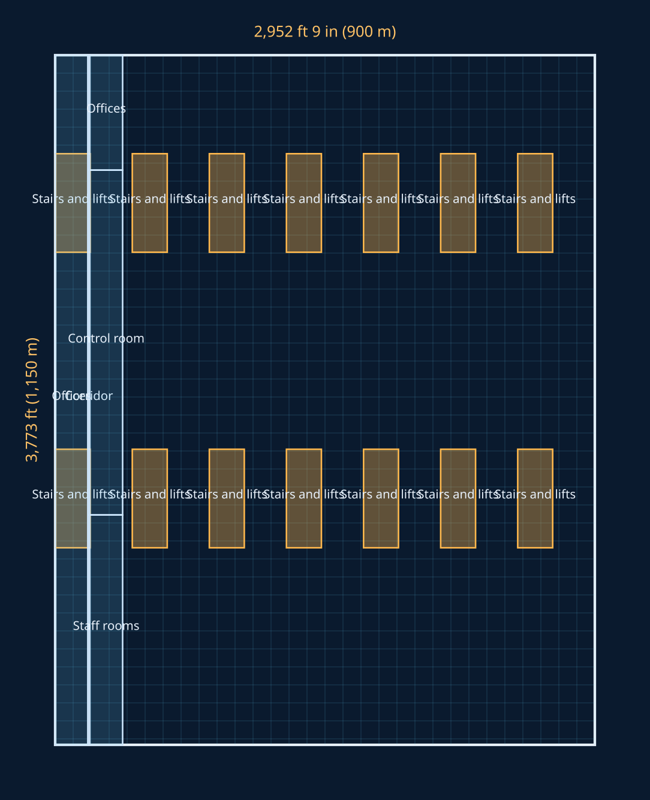
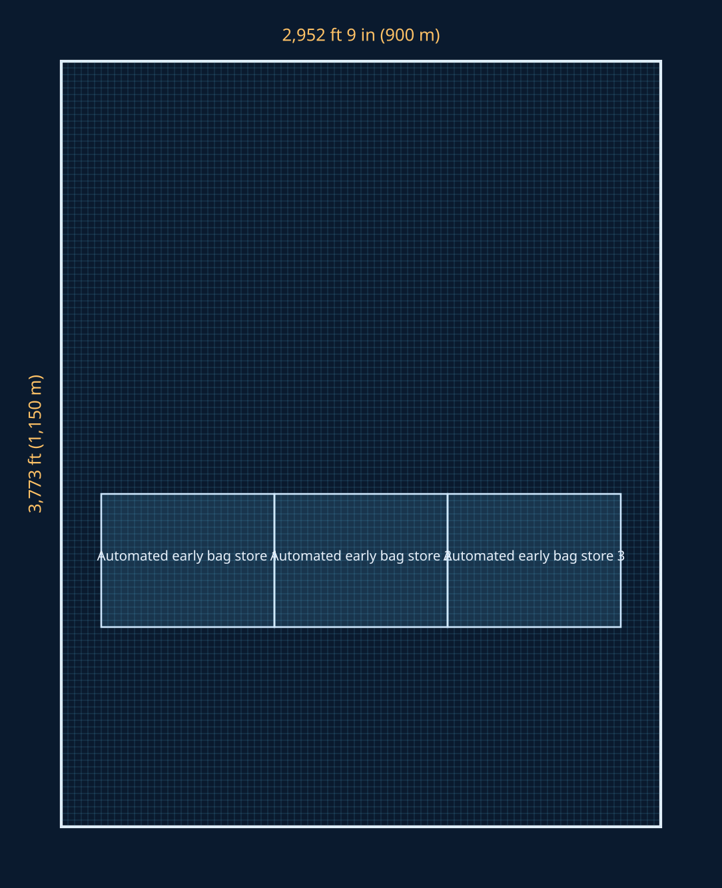

# P4-04 Baggage Logistics: plan

Footprint 2,952 ft 9 in (900 m) × 3,773 ft (1,150 m) · structural grid 32 ft 10 in (10 m)

## Levels

| Level | Floor above deck | Height | Floor area |
|---|---|---|---|
| Level 1 · Ground floor | 0 ft (0 mm) | 23 ft (7,000 mm) | 7,345,723 sq ft (682,440 m²) |
| Level 2 · Sorter level | 23 ft (7,000 mm) | 19 ft 8 in (6,000 mm) | 6,506,138 sq ft (604,440 m²) |
| Level 3 · Store top | 42 ft 8 in (13 m) | 19 ft 8 in (6,000 mm) | 1,679,170 sq ft (156,000 m²) |

## Elements

| ID | Designation | Type | Name | Level(s) | Size / length | Area | Status |
|---|---|---|---|---|---|---|---|
| E001 | D5F3P4B4A2L1R1, D5F3P4B4A2L2R1 | core | Stairs and lifts | L1, L2 | 32 ft 10 in (10 m) × 91 ft 10 in (28 m) | 3,014 sq ft (280 m²) | proposed |
| E002 | D5F3P4B4A2L1R2, D5F3P4B4A2L2R2 | core | Stairs and lifts | L1, L2 | 32 ft 10 in (10 m) × 91 ft 10 in (28 m) | 3,014 sq ft (280 m²) | proposed |
| E003 | D5F3P4B4A2L1R3, D5F3P4B4A2L2R3 | core | Stairs and lifts | L1, L2 | 32 ft 10 in (10 m) × 91 ft 10 in (28 m) | 3,014 sq ft (280 m²) | proposed |
| E004 | D5F3P4B4A2L1R4 | zone | Corridor | L1 | 2,559 ft 1 in (780 m) × 13 ft 1 in (4,000 mm) | 33,583 sq ft (3,120 m²) | proposed |
| E005 | D5F3P4B4A2L1R5 | room | Staff entrance | L1 | 703 ft 1 in (214 m) × 91 ft 10 in (28 m) | 64,588 sq ft (6,000 m²) | proposed |
| E006 | D5F3P4B4A2L1R6 | room | Lockers and showers | L1 | 527 ft 3 in (161 m) × 91 ft 10 in (28 m) | 48,433 sq ft (4,500 m²) | proposed |
| E007 | D5F3P4B4A2L1R7 | room | Lockers and showers | L1 | 1,230 ft 4 in (375 m) × 91 ft 10 in (28 m) | 113,021 sq ft (10,500 m²) | proposed |
| E008 | D5F3P4B4A2L1R8 | room | Canteen | L1 | 468 ft 10 in (143 m) × 91 ft 10 in (28 m) | 43,069 sq ft (4,001 m²) | proposed |
| E009 | D5F3P4B4A2L1R9 | room | Lost luggage store | L1 | 351 ft 5 in (107 m) × 91 ft 10 in (28 m) | 32,279 sq ft (2,999 m²) | proposed |
| E010 | D5F3P4B4A2L1R10 | room | Stores | L1 | 1,738 ft 10 in (530 m) × 91 ft 10 in (28 m) | 159,736 sq ft (14,840 m²) | proposed |
| E011 | D5F3P4B4A2L2R4 | zone | Corridor | L2 | 2,559 ft 1 in (780 m) × 13 ft 1 in (4,000 mm) | 33,583 sq ft (3,120 m²) | proposed |
| E012 | D5F3P4B4A2L2R5 | room | Baggage control room | L2 | 1,230 ft 4 in (375 m) × 91 ft 10 in (28 m) | 113,021 sq ft (10,500 m²) | proposed |
| E013 | D5F3P4B4A2L2R6 | room | Baggage control room | L2 | 1,230 ft 4 in (375 m) × 91 ft 10 in (28 m) | 113,021 sq ft (10,500 m²) | proposed |
| E014 | D5F3P4B4A2L2R7 | room | Engineering office | L2 | 351 ft 5 in (107 m) × 91 ft 10 in (28 m) | 32,279 sq ft (2,999 m²) | proposed |
| E015 | D5F3P4B4A2L2R8 | room | Offices | L2 | 2,207 ft 8 in (673 m) × 91 ft 10 in (28 m) | 202,805 sq ft (18,841 m²) | proposed |
| E016 | D5F3P4B4A2L1R11, D5F3P4B4A2L2R9 | room | Sorter loop 1 (arrivals) | L1, L2 | 426 ft 6 in (130 m) × 1,706 ft (520 m) | 727,640 sq ft (67,600 m²) | proposed |
| E017 | D5F3P4B4A2L1R12, D5F3P4B4A2L2R10 | room | Sorter loop 2 (arrivals) | L1, L2 | 426 ft 6 in (130 m) × 1,706 ft (520 m) | 727,640 sq ft (67,600 m²) | proposed |
| E018 | D5F3P4B4A2L1R13, D5F3P4B4A2L2R11 | room | Screening hall | L1, L2 | 426 ft 6 in (130 m) × 1,706 ft (520 m) | 727,640 sq ft (67,600 m²) | proposed |
| E019 | D5F3P4B4A2L1R14, D5F3P4B4A2L2R12 | room | Sorter loop 3 (departures) | L1, L2 | 426 ft 6 in (130 m) × 1,706 ft (520 m) | 727,640 sq ft (67,600 m²) | proposed |
| E020 | D5F3P4B4A2L1R15, D5F3P4B4A2L2R13 | room | Sorter loop 4 (departures) | L1, L2 | 426 ft 6 in (130 m) × 1,706 ft (520 m) | 727,640 sq ft (67,600 m²) | proposed |
| E021 | D5F3P4B4A2L1R16, D5F3P4B4A2L2R14 | room | Transfer bags | L1, L2 | 426 ft 6 in (130 m) × 1,706 ft (520 m) | 727,640 sq ft (67,600 m²) | proposed |
| E022 | D5F3P4B4A2L1R17, D5F3P4B4A2L2R15, D5F3P4B4A2L3R1 | room | Automated early bag store 1 | L1, L2, L3 | 853 ft (260 m) × 656 ft 2 in (200 m) | 559,723 sq ft (52,000 m²) | proposed |
| E023 | D5F3P4B4A2L1R18, D5F3P4B4A2L2R16, D5F3P4B4A2L3R2 | room | Automated early bag store 2 | L1, L2, L3 | 853 ft (260 m) × 656 ft 2 in (200 m) | 559,723 sq ft (52,000 m²) | proposed |
| E024 | D5F3P4B4A2L1R19, D5F3P4B4A2L2R17, D5F3P4B4A2L3R3 | room | Automated early bag store 3 | L1, L2, L3 | 853 ft (260 m) × 656 ft 2 in (200 m) | 559,723 sq ft (52,000 m²) | proposed |
| E025 | D5F3P4B4A2L1R20 | room | Baggage tug bay | L1 | 639 ft 9 in (195 m) × 328 ft 1 in (100 m) | 209,896 sq ft (19,500 m²) | proposed |
| E026 | D5F3P4B4A2L1R21 | room | Cart store | L1 | 639 ft 9 in (195 m) × 328 ft 1 in (100 m) | 209,896 sq ft (19,500 m²) | proposed |
| E027 | D5F3P4B4A2L1R22 | room | Charging bay | L1 | 639 ft 9 in (195 m) × 328 ft 1 in (100 m) | 209,896 sq ft (19,500 m²) | proposed |
| E028 | D5F3P4B4A2L1R23 | room | Tug workshop | L1 | 639 ft 9 in (195 m) × 328 ft 1 in (100 m) | 209,896 sq ft (19,500 m²) | proposed |
| E029 | D5F3P4B4A2L1R24 | zone | Baggage tunnel portals (to P2 Arrivals and P5 Terminals) | L1 | 2,559 ft 1 in (780 m) × 492 ft 2 in (150 m) | 1,259,378 sq ft (117,000 m²) | proposed |

## Drawings

### Level 1 · Ground floor

### Level 2 · Sorter level

### Level 3 · Store top

