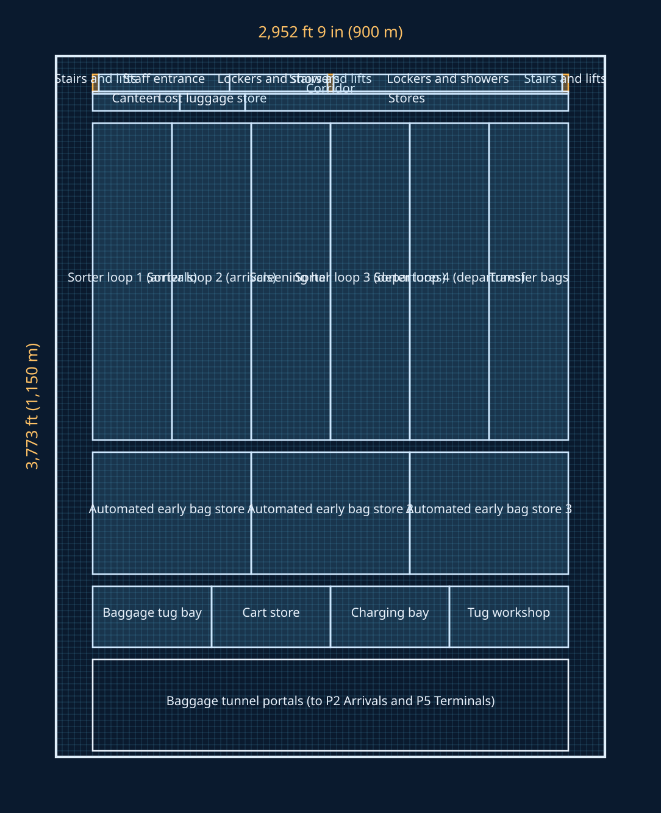

# P4-04 Baggage Logistics: plan

Footprint 2,952 ft 9 in (900 m) × 3,773 ft (1,150 m) · structural grid 98 ft 5 in (30 m)

## Levels

| Level | Floor above deck | Height | Floor area |
|---|---|---|---|
| Level 1 · Ground floor | 0 ft (0 mm) | 45 ft 11 in (14 m) | 8,657,750 sq ft (804,331 m²) |
| Level 2 · Office level | 45 ft 11 in (14 m) | 14 ft 9 in (4,500 mm) | 1,355,446 sq ft (125,925 m²) |

## Elements

| ID | Designation | Type | Name | Level(s) | Size / length | Area | Status |
|---|---|---|---|---|---|---|---|
| L1-001 | D5F3P4B4A2L1R1 | zone | Walkway | L1 | 39 ft 4 in (12 m) × 3,773 ft (1,150 m) | 148,542 sq ft (13,800 m²) | proposed |
| L1-002 | D5F3P4B4A2L1R2 | zone | Walkway | L1 | 39 ft 4 in (12 m) × 3,773 ft (1,150 m) | 148,542 sq ft (13,800 m²) | proposed |
| L1-003 | D5F3P4B4A2L1R3 | zone | Walkway | L1 | 39 ft 4 in (12 m) × 3,773 ft (1,150 m) | 148,542 sq ft (13,800 m²) | proposed |
| L1-004 | D5F3P4B4A2L1R4 | zone | Walkway | L1 | 39 ft 4 in (12 m) × 3,773 ft (1,150 m) | 148,542 sq ft (13,800 m²) | proposed |
| L1-005 | D5F3P4B4A2L1R5 | zone | Walkway | L1 | 39 ft 4 in (12 m) × 3,773 ft (1,150 m) | 148,542 sq ft (13,800 m²) | proposed |
| L1-006 | D5F3P4B4A2L1R6 | zone | Walkway | L1 | 39 ft 4 in (12 m) × 3,773 ft (1,150 m) | 148,542 sq ft (13,800 m²) | proposed |
| L1-007 | D5F3P4B4A2L1R7 | zone | Walkway | L1 | 39 ft 4 in (12 m) × 3,773 ft (1,150 m) | 148,542 sq ft (13,800 m²) | proposed |
| L1-008 | D5F3P4B4A2L1R8 | room | Storage halls | L1 | 191 ft 3 in (58 m) × 539 ft 1 in (164 m) | 103,104 sq ft (9,579 m²) | proposed |
| L1-009 | D5F3P4B4A2L1R9 | room | Storage halls | L1 | 191 ft 3 in (58 m) × 1,077 ft 9 in (328 m) | 206,146 sq ft (19,152 m²) | proposed |
| L1-010 | D5F3P4B4A2L1R10 | room | Storage halls | L1 | 191 ft 3 in (58 m) × 1,078 ft 1 in (329 m) | 206,208 sq ft (19,157 m²) | proposed |
| L1-011 | D5F3P4B4A2L1R11 | room | Storage halls | L1 | 191 ft 3 in (58 m) × 3,773 ft (1,150 m) | 721,666 sq ft (67,045 m²) | proposed |
| L1-012 | D5F3P4B4A2L1R12 | room | Storage halls | L1 | 191 ft 3 in (58 m) × 539 ft 1 in (164 m) | 103,104 sq ft (9,579 m²) | proposed |
| L1-013 | D5F3P4B4A2L1R13 | room | Storage halls | L1 | 191 ft 3 in (58 m) × 1,077 ft 9 in (328 m) | 206,146 sq ft (19,152 m²) | proposed |
| L1-014 | D5F3P4B4A2L1R14 | room | Storage halls | L1 | 191 ft 3 in (58 m) × 1,078 ft 1 in (329 m) | 206,208 sq ft (19,157 m²) | proposed |
| L1-015 | D5F3P4B4A2L1R15 | room | Storage halls | L1 | 190 ft 11 in (58 m) × 3,773 ft (1,150 m) | 720,429 sq ft (66,930 m²) | proposed |
| L1-016 | D5F3P4B4A2L1R16 | room | Storage halls | L1 | 191 ft 3 in (58 m) × 539 ft 1 in (164 m) | 103,104 sq ft (9,579 m²) | proposed |
| L1-017 | D5F3P4B4A2L1R17 | room | Storage halls | L1 | 191 ft 3 in (58 m) × 1,077 ft 9 in (328 m) | 206,146 sq ft (19,152 m²) | proposed |
| L1-018 | D5F3P4B4A2L1R18 | room | Storage halls | L1 | 191 ft 3 in (58 m) × 1,078 ft 1 in (329 m) | 206,208 sq ft (19,157 m²) | proposed |
| L1-019 | D5F3P4B4A2L1R19 | room | Storage halls | L1 | 191 ft 3 in (58 m) × 3,773 ft (1,150 m) | 721,666 sq ft (67,045 m²) | proposed |
| L1-020 | D5F3P4B4A2L1R20 | room | Storage halls | L1 | 191 ft 3 in (58 m) × 539 ft 1 in (164 m) | 103,104 sq ft (9,579 m²) | proposed |
| L1-021 | D5F3P4B4A2L1R21 | room | Storage halls | L1 | 191 ft 3 in (58 m) × 1,077 ft 9 in (328 m) | 206,146 sq ft (19,152 m²) | proposed |
| L1-022 | D5F3P4B4A2L1R22 | room | Storage halls | L1 | 191 ft 3 in (58 m) × 1,078 ft 1 in (329 m) | 206,208 sq ft (19,157 m²) | proposed |
| L1-023 | D5F3P4B4A2L1R23 | room | Storage halls | L1 | 191 ft 3 in (58 m) × 3,773 ft (1,150 m) | 721,666 sq ft (67,045 m²) | proposed |
| L1-024 | D5F3P4B4A2L1R24 | room | Storage halls | L1 | 191 ft 3 in (58 m) × 539 ft 1 in (164 m) | 103,104 sq ft (9,579 m²) | proposed |
| L1-025 | D5F3P4B4A2L1R25 | room | Storage halls | L1 | 191 ft 3 in (58 m) × 539 ft 1 in (164 m) | 103,104 sq ft (9,579 m²) | proposed |
| L1-026 | D5F3P4B4A2L1R26 | room | Sorting floor | L1 | 191 ft 3 in (58 m) × 538 ft 9 in (164 m) | 103,041 sq ft (9,573 m²) | proposed |
| L1-027 | D5F3P4B4A2L1R27 | room | Sorting floor | L1 | 191 ft 3 in (58 m) × 1,078 ft 1 in (329 m) | 206,208 sq ft (19,157 m²) | proposed |
| L1-028 | D5F3P4B4A2L1R28 | room | Sorting floor | L1 | 191 ft 3 in (58 m) × 3,773 ft (1,150 m) | 721,666 sq ft (67,045 m²) | proposed |
| L1-029 | D5F3P4B4A2L1R29 | room | Sorting floor | L1 | 190 ft 11 in (58 m) × 539 ft 1 in (164 m) | 102,927 sq ft (9,562 m²) | proposed |
| L1-030 | D5F3P4B4A2L1R30 | room | Sorting floor | L1 | 190 ft 11 in (58 m) × 1,077 ft 9 in (328 m) | 205,792 sq ft (19,119 m²) | proposed |
| L1-031 | D5F3P4B4A2L1R31 | room | Loading docks | L1 | 190 ft 11 in (58 m) × 1,078 ft 1 in (329 m) | 205,855 sq ft (19,125 m²) | proposed |
| L1-032 | D5F3P4B4A2L1R32 | room | Loading docks | L1 | 191 ft 3 in (58 m) × 3,773 ft (1,150 m) | 721,666 sq ft (67,045 m²) | proposed |
| L1-033 | D5F3P4B4A2L1R33 | room | Loading docks | L1 | 191 ft 3 in (58 m) × 539 ft 1 in (164 m) | 103,104 sq ft (9,579 m²) | proposed |
| L1-034 | D5F3P4B4A2L1R34 | room | Loading docks | L1 | 191 ft 3 in (58 m) × 1,077 ft 9 in (328 m) | 206,146 sq ft (19,152 m²) | proposed |
| L1-035 | D5F3P4B4A2L1R35 | room | Loading docks | L1 | 191 ft 3 in (58 m) × 539 ft 1 in (164 m) | 103,104 sq ft (9,579 m²) | proposed |
| L1-036 | D5F3P4B4A2L1R36 | room | Inspection rooms | L1 | 191 ft 3 in (58 m) × 539 ft 1 in (164 m) | 103,104 sq ft (9,579 m²) | proposed |
| L1-037 | D5F3P4B4A2L1R37 | room | Inspection rooms | L1 | 191 ft 3 in (58 m) × 1,617 ft 2 in (493 m) | 309,313 sq ft (28,736 m²) | proposed |
| L1-038 | D5F3P4B4A2L1R38 | room | Staff rooms | L1 | 191 ft 3 in (58 m) × 2,155 ft 10 in (657 m) | 412,354 sq ft (38,309 m²) | proposed |
| L1-039 | D5F3P4B4A2L1R39, D5F3P4B4A2L2R1 | core | Stairs and lifts | L1, L2 | 191 ft 3 in (58 m) × 539 ft 1 in (164 m) | 103,104 sq ft (9,579 m²) | proposed |
| L1-040 | D5F3P4B4A2L1R40, D5F3P4B4A2L2R2 | core | Stairs and lifts | L1, L2 | 191 ft 3 in (58 m) × 539 ft 1 in (164 m) | 103,104 sq ft (9,579 m²) | proposed |
| L1-041 | D5F3P4B4A2L1R41, D5F3P4B4A2L2R3 | core | Stairs and lifts | L1, L2 | 191 ft 3 in (58 m) × 539 ft 1 in (164 m) | 103,104 sq ft (9,579 m²) | proposed |
| L1-042 | D5F3P4B4A2L1R42, D5F3P4B4A2L2R4 | core | Stairs and lifts | L1, L2 | 191 ft 3 in (58 m) × 539 ft 1 in (164 m) | 103,104 sq ft (9,579 m²) | proposed |
| L1-043 | D5F3P4B4A2L1R43, D5F3P4B4A2L2R5 | core | Stairs and lifts | L1, L2 | 191 ft 3 in (58 m) × 539 ft 1 in (164 m) | 103,104 sq ft (9,579 m²) | proposed |
| L1-044 | D5F3P4B4A2L1R44, D5F3P4B4A2L2R6 | core | Stairs and lifts | L1, L2 | 191 ft 3 in (58 m) × 539 ft 1 in (164 m) | 103,104 sq ft (9,579 m²) | proposed |
| L1-045 | D5F3P4B4A2L1R45, D5F3P4B4A2L2R7 | core | Stairs and lifts | L1, L2 | 191 ft 3 in (58 m) × 539 ft 1 in (164 m) | 103,104 sq ft (9,579 m²) | proposed |
| L1-046 | D5F3P4B4A2L1R46, D5F3P4B4A2L2R8 | core | Stairs and lifts | L1, L2 | 191 ft 3 in (58 m) × 539 ft 1 in (164 m) | 103,104 sq ft (9,579 m²) | proposed |
| L1-047 | D5F3P4B4A2L1R47, D5F3P4B4A2L2R9 | core | Stairs and lifts | L1, L2 | 191 ft 3 in (58 m) × 539 ft 1 in (164 m) | 103,104 sq ft (9,579 m²) | proposed |
| L1-048 | D5F3P4B4A2L1R48, D5F3P4B4A2L2R10 | core | Stairs and lifts | L1, L2 | 191 ft 3 in (58 m) × 539 ft 1 in (164 m) | 103,104 sq ft (9,579 m²) | proposed |
| L1-049 | D5F3P4B4A2L1R49, D5F3P4B4A2L2R11 | core | Stairs and lifts | L1, L2 | 190 ft 11 in (58 m) × 539 ft 1 in (164 m) | 102,927 sq ft (9,562 m²) | proposed |
| L1-050 | D5F3P4B4A2L1R50, D5F3P4B4A2L2R12 | core | Stairs and lifts | L1, L2 | 190 ft 11 in (58 m) × 539 ft 1 in (164 m) | 102,927 sq ft (9,562 m²) | proposed |
| L1-051 | D5F3P4B4A2L1R51, D5F3P4B4A2L2R13 | core | Stairs and lifts | L1, L2 | 191 ft 3 in (58 m) × 539 ft 1 in (164 m) | 103,104 sq ft (9,579 m²) | proposed |
| L1-052 | D5F3P4B4A2L1R52, D5F3P4B4A2L2R14 | core | Stairs and lifts | L1, L2 | 191 ft 3 in (58 m) × 539 ft 1 in (164 m) | 103,104 sq ft (9,579 m²) | proposed |
| L2-001 | D5F3P4B4A2L2R15 | zone | Corridor | L2 | 9 ft 10 in (3,000 mm) × 3,773 ft (1,150 m) | 37,135 sq ft (3,450 m²) | proposed |
| L2-002 | D5F3P4B4A2L2R16 | room | Offices | L2 | 179 ft 6 in (55 m) × 3,773 ft (1,150 m) | 677,104 sq ft (62,905 m²) | proposed |
| L2-003 | D5F3P4B4A2L2R17 | room | Offices | L2 | 179 ft 9 in (55 m) × 628 ft 11 in (192 m) | 113,077 sq ft (10,505 m²) | proposed |
| L2-004 | D5F3P4B4A2L2R18 | room | Control room | L2 | 179 ft 9 in (55 m) × 1,886 ft 6 in (575 m) | 339,171 sq ft (31,510 m²) | proposed |
| L2-005 | D5F3P4B4A2L2R19 | room | Staff rooms | L2 | 179 ft 9 in (55 m) × 1,257 ft 7 in (383 m) | 226,094 sq ft (21,005 m²) | proposed |
| D-58 |  | door | Main entrance | L1 | 78 ft 9 in (24 m), 78 ft 9 in (24 m) wide | — | proposed |
| D-59 |  | door | Second entrance | L1 | 78 ft 9 in (24 m), 78 ft 9 in (24 m) wide | — | proposed |
| D-60 |  | door | Side door | L1 | 19 ft 8 in (6,000 mm), 19 ft 8 in (6,000 mm) wide | — | proposed |
| D-61 |  | door | Side door | L1 | 19 ft 8 in (6,000 mm), 19 ft 8 in (6,000 mm) wide | — | proposed |

## Drawings

### Level 1 · Ground floor

### Level 2 · Office level

