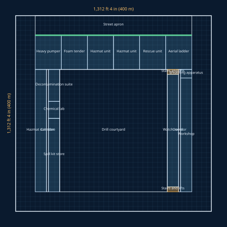
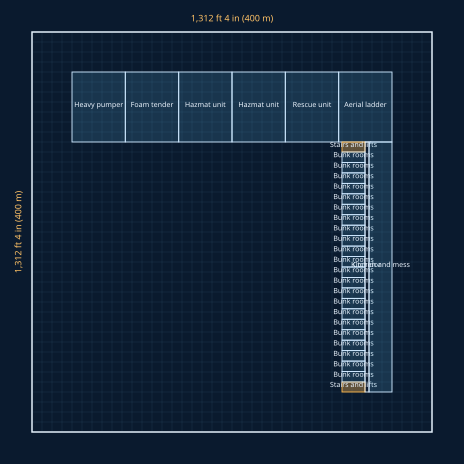
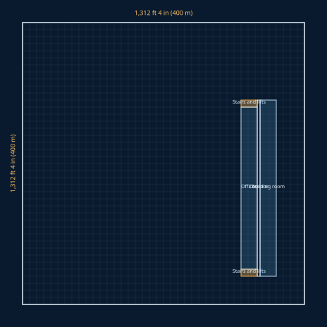

# P4-05 Freight Fire Station: plan

Footprint 1,312 ft 4 in (400 m) × 1,312 ft 4 in (400 m) · structural grid 32 ft 10 in (10 m)

## Levels

| Level | Floor above deck | Height | Floor area |
|---|---|---|---|
| Level 1 · Ground floor | 0 ft (0 mm) | 14 ft 9 in (4,500 mm) | 483,730 sq ft (44,940 m²) |
| Level 2 · Level 2 | 14 ft 9 in (4,500 mm) | 14 ft 9 in (4,500 mm) | 359,945 sq ft (33,440 m²) |
| Level 3 · Level 3 | 29 ft 6 in (9,000 mm) | 14 ft 9 in (4,500 mm) | 118,834 sq ft (11,040 m²) |

## Elements

| ID | Designation | Type | Name | Level(s) | Size / length | Area | Status |
|---|---|---|---|---|---|---|---|
| E001 | D5F3P4B6A1L1R1 | zone | Street apron | L1 | 1,049 ft 10 in (320 m) × 131 ft 3 in (40 m) | 137,778 sq ft (12,800 m²) | proposed |
| E002 | D5F3P4B6A1L1R2, D5F3P4B6A1L2R1 | room | Heavy pumper | L1, L2 | 174 ft 10 in (53 m) × 229 ft 8 in (70 m) | 40,160 sq ft (3,731 m²) | proposed |
| E003 | D5F3P4B6A1L1R3, D5F3P4B6A1L2R2 | room | Foam tender | L1, L2 | 175 ft 2 in (53 m) × 229 ft 8 in (70 m) | 40,235 sq ft (3,738 m²) | proposed |
| E004 | D5F3P4B6A1L1R4, D5F3P4B6A1L2R3 | room | Hazmat unit | L1, L2 | 174 ft 10 in (53 m) × 229 ft 8 in (70 m) | 40,160 sq ft (3,731 m²) | proposed |
| E005 | D5F3P4B6A1L1R5, D5F3P4B6A1L2R4 | room | Hazmat unit | L1, L2 | 174 ft 10 in (53 m) × 229 ft 8 in (70 m) | 40,160 sq ft (3,731 m²) | proposed |
| E006 | D5F3P4B6A1L1R6, D5F3P4B6A1L2R5 | room | Rescue unit | L1, L2 | 175 ft 2 in (53 m) × 229 ft 8 in (70 m) | 40,235 sq ft (3,738 m²) | proposed |
| E007 | D5F3P4B6A1L1R7, D5F3P4B6A1L2R6 | room | Aerial ladder | L1, L2 | 174 ft 10 in (53 m) × 229 ft 8 in (70 m) | 40,160 sq ft (3,731 m²) | proposed |
| E008 | D5F3P4B6A1L1R8 | zone | Corridor | L1 | 13 ft 1 in (4,000 mm) × 820 ft 3 in (250 m) | 10,764 sq ft (1,000 m²) | proposed |
| E009 | D5F3P4B6A1L1R9 | room | Hazmat suit store | L1 | 75 ft 6 in (23 m) × 820 ft 3 in (250 m) | 61,892 sq ft (5,750 m²) | proposed |
| E010 | D5F3P4B6A1L1R10 | room | Decontamination suite | L1 | 75 ft 6 in (23 m) × 213 ft 11 in (65 m) | 16,142 sq ft (1,500 m²) | proposed |
| E011 | D5F3P4B6A1L1R11 | room | Chemical lab | L1 | 75 ft 6 in (23 m) × 114 ft 2 in (35 m) | 8,615 sq ft (800 m²) | proposed |
| E012 | D5F3P4B6A1L1R12 | room | Spill kit store | L1 | 75 ft 6 in (23 m) × 492 ft 2 in (150 m) | 37,135 sq ft (3,450 m²) | proposed |
| E013 | D5F3P4B6A1L1R13, D5F3P4B6A1L2R7, D5F3P4B6A1L3R1 | core | Stairs and lifts | L1, L2, L3 | 75 ft 6 in (23 m) × 32 ft 10 in (10 m) | 2,476 sq ft (230 m²) | proposed |
| E014 | D5F3P4B6A1L1R14, D5F3P4B6A1L2R8, D5F3P4B6A1L3R2 | core | Stairs and lifts | L1, L2, L3 | 75 ft 6 in (23 m) × 32 ft 10 in (10 m) | 2,476 sq ft (230 m²) | proposed |
| E015 | D5F3P4B6A1L1R15 | zone | Corridor | L1 | 13 ft 1 in (4,000 mm) × 820 ft 3 in (250 m) | 10,764 sq ft (1,000 m²) | proposed |
| E016 | D5F3P4B6A1L1R16 | room | Watch room | L1 | 75 ft 6 in (23 m) × 754 ft 7 in (230 m) | 56,941 sq ft (5,290 m²) | proposed |
| E017 | D5F3P4B6A1L1R17 | room | Breathing apparatus | L1 | 75 ft 6 in (23 m) × 57 ft 1 in (17 m) | 4,308 sq ft (400 m²) | proposed |
| E018 | D5F3P4B6A1L1R18 | room | Workshop | L1 | 75 ft 6 in (23 m) × 763 ft 1 in (233 m) | 57,585 sq ft (5,350 m²) | proposed |
| E019 | D5F3P4B6A1L2R9 | zone | Corridor | L2 | 13 ft 1 in (4,000 mm) × 820 ft 3 in (250 m) | 10,764 sq ft (1,000 m²) | proposed |
| E020 | D5F3P4B6A1L2R10 | room | Bunk rooms | L2 | 75 ft 6 in (23 m) × 34 ft 5 in (10 m) | 2,599 sq ft (242 m²) | proposed |
| E021 | D5F3P4B6A1L2R11 | room | Bunk rooms | L2 | 75 ft 6 in (23 m) × 34 ft 1 in (10 m) | 2,575 sq ft (239 m²) | proposed |
| E022 | D5F3P4B6A1L2R12 | room | Bunk rooms | L2 | 75 ft 6 in (23 m) × 34 ft 5 in (10 m) | 2,599 sq ft (242 m²) | proposed |
| E023 | D5F3P4B6A1L2R13 | room | Bunk rooms | L2 | 75 ft 6 in (23 m) × 34 ft 1 in (10 m) | 2,575 sq ft (239 m²) | proposed |
| E024 | D5F3P4B6A1L2R14 | room | Bunk rooms | L2 | 75 ft 6 in (23 m) × 34 ft 5 in (10 m) | 2,599 sq ft (242 m²) | proposed |
| E025 | D5F3P4B6A1L2R15 | room | Bunk rooms | L2 | 75 ft 6 in (23 m) × 34 ft 1 in (10 m) | 2,575 sq ft (239 m²) | proposed |
| E026 | D5F3P4B6A1L2R16 | room | Bunk rooms | L2 | 75 ft 6 in (23 m) × 34 ft 5 in (10 m) | 2,599 sq ft (242 m²) | proposed |
| E027 | D5F3P4B6A1L2R17 | room | Bunk rooms | L2 | 75 ft 6 in (23 m) × 34 ft 1 in (10 m) | 2,575 sq ft (239 m²) | proposed |
| E028 | D5F3P4B6A1L2R18 | room | Bunk rooms | L2 | 75 ft 6 in (23 m) × 34 ft 5 in (10 m) | 2,599 sq ft (242 m²) | proposed |
| E029 | D5F3P4B6A1L2R19 | room | Bunk rooms | L2 | 75 ft 6 in (23 m) × 34 ft 1 in (10 m) | 2,575 sq ft (239 m²) | proposed |
| E030 | D5F3P4B6A1L2R20 | room | Bunk rooms | L2 | 75 ft 6 in (23 m) × 34 ft 5 in (10 m) | 2,599 sq ft (242 m²) | proposed |
| E031 | D5F3P4B6A1L2R21 | room | Bunk rooms | L2 | 75 ft 6 in (23 m) × 34 ft 5 in (10 m) | 2,599 sq ft (242 m²) | proposed |
| E032 | D5F3P4B6A1L2R22 | room | Bunk rooms | L2 | 75 ft 6 in (23 m) × 34 ft 1 in (10 m) | 2,575 sq ft (239 m²) | proposed |
| E033 | D5F3P4B6A1L2R23 | room | Bunk rooms | L2 | 75 ft 6 in (23 m) × 34 ft 5 in (10 m) | 2,599 sq ft (242 m²) | proposed |
| E034 | D5F3P4B6A1L2R24 | room | Bunk rooms | L2 | 75 ft 6 in (23 m) × 34 ft 1 in (10 m) | 2,575 sq ft (239 m²) | proposed |
| E035 | D5F3P4B6A1L2R25 | room | Bunk rooms | L2 | 75 ft 6 in (23 m) × 34 ft 5 in (10 m) | 2,599 sq ft (242 m²) | proposed |
| E036 | D5F3P4B6A1L2R26 | room | Bunk rooms | L2 | 75 ft 6 in (23 m) × 34 ft 1 in (10 m) | 2,575 sq ft (239 m²) | proposed |
| E037 | D5F3P4B6A1L2R27 | room | Bunk rooms | L2 | 75 ft 6 in (23 m) × 34 ft 5 in (10 m) | 2,599 sq ft (242 m²) | proposed |
| E038 | D5F3P4B6A1L2R28 | room | Bunk rooms | L2 | 75 ft 6 in (23 m) × 34 ft 1 in (10 m) | 2,575 sq ft (239 m²) | proposed |
| E039 | D5F3P4B6A1L2R29 | room | Bunk rooms | L2 | 75 ft 6 in (23 m) × 34 ft 5 in (10 m) | 2,599 sq ft (242 m²) | proposed |
| E040 | D5F3P4B6A1L2R30 | room | Bunk rooms | L2 | 75 ft 6 in (23 m) × 34 ft 1 in (10 m) | 2,575 sq ft (239 m²) | proposed |
| E041 | D5F3P4B6A1L2R31 | room | Bunk rooms | L2 | 75 ft 6 in (23 m) × 34 ft 5 in (10 m) | 2,599 sq ft (242 m²) | proposed |
| E042 | D5F3P4B6A1L2R32 | room | Kitchen and mess | L2 | 75 ft 6 in (23 m) × 820 ft 3 in (250 m) | 61,892 sq ft (5,750 m²) | proposed |
| E043 | D5F3P4B6A1L3R3 | zone | Corridor | L3 | 13 ft 1 in (4,000 mm) × 820 ft 3 in (250 m) | 10,764 sq ft (1,000 m²) | proposed |
| E044 | D5F3P4B6A1L3R4 | room | Offices | L3 | 75 ft 6 in (23 m) × 754 ft 7 in (230 m) | 56,941 sq ft (5,290 m²) | proposed |
| E045 | D5F3P4B6A1L3R5 | room | Training room | L3 | 75 ft 6 in (23 m) × 820 ft 3 in (250 m) | 61,892 sq ft (5,750 m²) | proposed |
| E046 | D5F3P4B6A1L1R19 | zone | Drill courtyard | L1 | 721 ft 9 in (220 m) × 820 ft 3 in (250 m) | 592,015 sq ft (55,000 m²) | proposed |
| E047 |  | door | Appliance doors | L1 | 1,049 ft 10 in (320 m), 1,049 ft 10 in (320 m) wide | — | proposed |

## Drawings

### Level 1 · Ground floor

### Level 2 · Level 2

### Level 3 · Level 3

