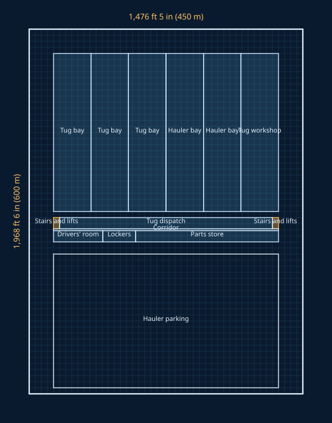
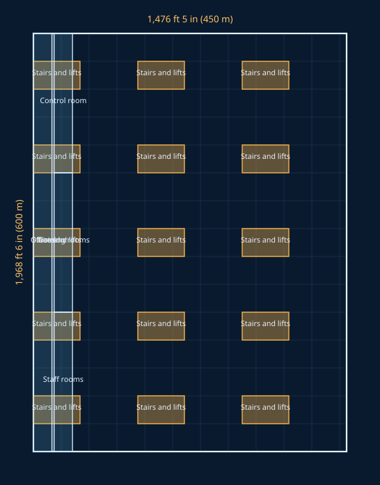

# P4-06 Tug Park: plan

Footprint 1,476 ft 5 in (450 m) × 1,968 ft 6 in (600 m) · structural grid 32 ft 10 in (10 m)

## Levels

| Level | Floor above deck | Height | Floor area |
|---|---|---|---|
| Level 1 · Ground floor | 0 ft (0 mm) | 32 ft 10 in (10 m) | 1,178,864 sq ft (109,520 m²) |
| Level 2 · Upper | 32 ft 10 in (10 m) | 16 ft 5 in (5,000 mm) | 1,178,864 sq ft (109,520 m²) |

## Elements

| ID | Designation | Type | Name | Level(s) | Size / length | Area | Status |
|---|---|---|---|---|---|---|---|
| E001 | D5F3P4B6A2L1R1, D5F3P4B6A2L2R1 | room | Tug bay | L1, L2 | 202 ft 5 in (62 m) × 853 ft (260 m) | 172,675 sq ft (16,042 m²) | proposed |
| E002 | D5F3P4B6A2L1R2, D5F3P4B6A2L2R2 | room | Tug bay | L1, L2 | 202 ft 1 in (62 m) × 853 ft (260 m) | 172,395 sq ft (16,016 m²) | proposed |
| E003 | D5F3P4B6A2L1R3, D5F3P4B6A2L2R3 | room | Tug bay | L1, L2 | 202 ft 5 in (62 m) × 853 ft (260 m) | 172,675 sq ft (16,042 m²) | proposed |
| E004 | D5F3P4B6A2L1R4, D5F3P4B6A2L2R4 | room | Hauler bay | L1, L2 | 202 ft 5 in (62 m) × 853 ft (260 m) | 172,675 sq ft (16,042 m²) | proposed |
| E005 | D5F3P4B6A2L1R5, D5F3P4B6A2L2R5 | room | Hauler bay | L1, L2 | 202 ft 1 in (62 m) × 853 ft (260 m) | 172,395 sq ft (16,016 m²) | proposed |
| E006 | D5F3P4B6A2L1R6, D5F3P4B6A2L2R6 | room | Tug workshop | L1, L2 | 202 ft 5 in (62 m) × 853 ft (260 m) | 172,675 sq ft (16,042 m²) | proposed |
| E007 | D5F3P4B6A2L1R7, D5F3P4B6A2L2R7 | core | Stairs and lifts | L1, L2 | 32 ft 10 in (10 m) × 60 ft 8 in (18 m) | 1,991 sq ft (185 m²) | proposed |
| E008 | D5F3P4B6A2L1R8, D5F3P4B6A2L2R8 | core | Stairs and lifts | L1, L2 | 32 ft 10 in (10 m) × 60 ft 8 in (18 m) | 1,991 sq ft (185 m²) | proposed |
| E009 | D5F3P4B6A2L1R9 | zone | Corridor | L1 | 1,213 ft 11 in (370 m) × 9 ft 10 in (3,000 mm) | 11,948 sq ft (1,110 m²) | proposed |
| E010 | D5F3P4B6A2L1R10 | room | Tug dispatch | L1 | 1,148 ft 4 in (350 m) × 60 ft 8 in (18 m) | 69,696 sq ft (6,475 m²) | proposed |
| E011 | D5F3P4B6A2L1R11 | room | Drivers' room | L1 | 266 ft 1 in (81 m) × 60 ft 8 in (18 m) | 16,150 sq ft (1,500 m²) | proposed |
| E012 | D5F3P4B6A2L1R12 | room | Lockers | L1 | 177 ft 2 in (54 m) × 60 ft 8 in (18 m) | 10,753 sq ft (999 m²) | proposed |
| E013 | D5F3P4B6A2L1R13 | room | Parts store | L1 | 770 ft 8 in (235 m) × 60 ft 8 in (18 m) | 46,776 sq ft (4,346 m²) | proposed |
| E014 | D5F3P4B6A2L2R9 | zone | Corridor | L2 | 1,213 ft 11 in (370 m) × 9 ft 10 in (3,000 mm) | 11,948 sq ft (1,110 m²) | proposed |
| E015 | D5F3P4B6A2L2R10 | room | Fleet control | L2 | 1,148 ft 4 in (350 m) × 60 ft 8 in (18 m) | 69,696 sq ft (6,475 m²) | proposed |
| E016 | D5F3P4B6A2L2R11 | room | Offices | L2 | 1,213 ft 11 in (370 m) × 60 ft 8 in (18 m) | 73,679 sq ft (6,845 m²) | proposed |
| E017 | D5F3P4B6A2L1R14 | zone | Hauler parking | L1 | 1,213 ft 11 in (370 m) × 721 ft 9 in (220 m) | 876,182 sq ft (81,400 m²) | proposed |

## Drawings

### Level 1 · Ground floor

### Level 2 · Upper

