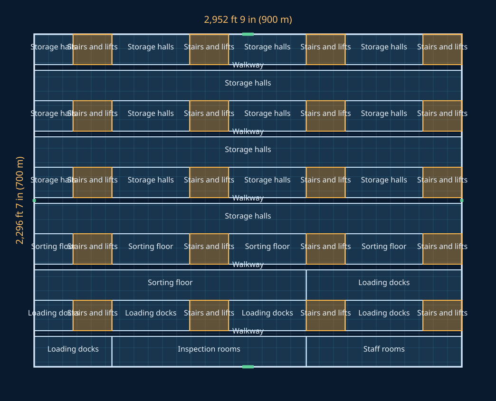
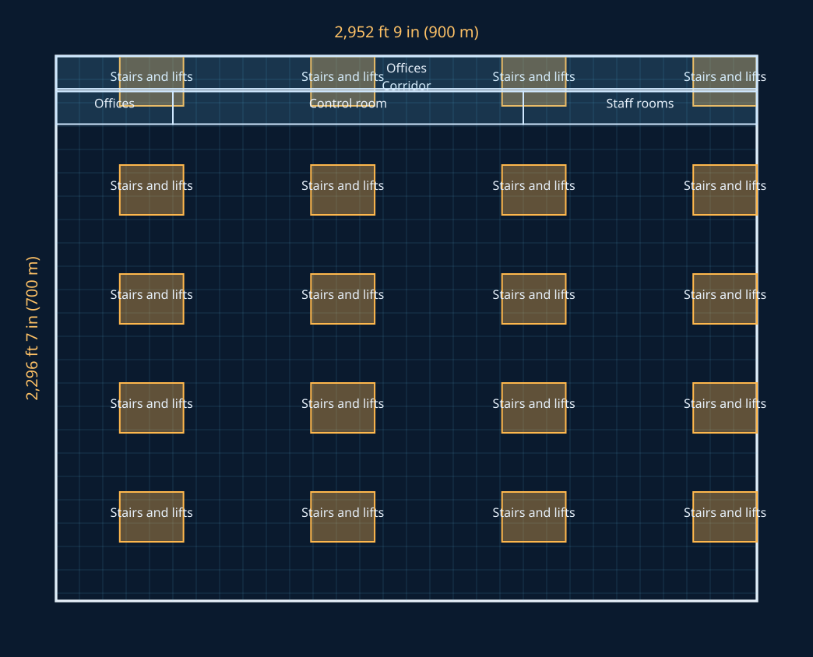

# P4-07 Cold Store: plan

Footprint 2,952 ft 9 in (900 m) × 2,296 ft 7 in (700 m) · structural grid 98 ft 5 in (30 m)

## Levels

| Level | Floor above deck | Height | Floor area |
|---|---|---|---|
| Level 1 · Ground floor | 0 ft (0 mm) | 45 ft 11 in (14 m) | 5,072,988 sq ft (471,296 m²) |
| Level 2 · Office level | 45 ft 11 in (14 m) | 14 ft 9 in (4,500 mm) | 818,595 sq ft (76,050 m²) |

## Elements

| ID | Designation | Type | Name | Level(s) | Size / length | Area | Status |
|---|---|---|---|---|---|---|---|
| L1-001 | D5F3P4B6A3L1R1 | zone | Walkway | L1 | 2,952 ft 9 in (900 m) × 39 ft 4 in (12 m) | 116,250 sq ft (10,800 m²) | proposed |
| L1-002 | D5F3P4B6A3L1R2 | zone | Walkway | L1 | 2,952 ft 9 in (900 m) × 39 ft 4 in (12 m) | 116,250 sq ft (10,800 m²) | proposed |
| L1-003 | D5F3P4B6A3L1R3 | zone | Walkway | L1 | 2,952 ft 9 in (900 m) × 39 ft 4 in (12 m) | 116,250 sq ft (10,800 m²) | proposed |
| L1-004 | D5F3P4B6A3L1R4 | zone | Walkway | L1 | 2,952 ft 9 in (900 m) × 39 ft 4 in (12 m) | 116,250 sq ft (10,800 m²) | proposed |
| L1-005 | D5F3P4B6A3L1R5 | zone | Walkway | L1 | 2,952 ft 9 in (900 m) × 39 ft 4 in (12 m) | 116,250 sq ft (10,800 m²) | proposed |
| L1-006 | D5F3P4B6A3L1R6 | room | Storage halls | L1 | 268 ft 4 in (82 m) × 210 ft (64 m) | 56,351 sq ft (5,235 m²) | proposed |
| L1-007 | D5F3P4B6A3L1R7 | room | Storage halls | L1 | 537 ft 1 in (164 m) × 210 ft (64 m) | 112,771 sq ft (10,477 m²) | proposed |
| L1-008 | D5F3P4B6A3L1R8 | room | Storage halls | L1 | 536 ft 9 in (164 m) × 210 ft (64 m) | 112,702 sq ft (10,470 m²) | proposed |
| L1-009 | D5F3P4B6A3L1R9 | room | Storage halls | L1 | 537 ft 1 in (164 m) × 210 ft (64 m) | 112,771 sq ft (10,477 m²) | proposed |
| L1-010 | D5F3P4B6A3L1R10 | room | Storage halls | L1 | 2,952 ft 9 in (900 m) × 210 ft (64 m) | 620,001 sq ft (57,600 m²) | proposed |
| L1-011 | D5F3P4B6A3L1R11 | room | Storage halls | L1 | 268 ft 4 in (82 m) × 210 ft (64 m) | 56,351 sq ft (5,235 m²) | proposed |
| L1-012 | D5F3P4B6A3L1R12 | room | Storage halls | L1 | 537 ft 1 in (164 m) × 210 ft (64 m) | 112,771 sq ft (10,477 m²) | proposed |
| L1-013 | D5F3P4B6A3L1R13 | room | Storage halls | L1 | 536 ft 9 in (164 m) × 210 ft (64 m) | 112,702 sq ft (10,470 m²) | proposed |
| L1-014 | D5F3P4B6A3L1R14 | room | Storage halls | L1 | 537 ft 1 in (164 m) × 210 ft (64 m) | 112,771 sq ft (10,477 m²) | proposed |
| L1-015 | D5F3P4B6A3L1R15 | room | Storage halls | L1 | 2,952 ft 9 in (900 m) × 210 ft (64 m) | 620,001 sq ft (57,600 m²) | proposed |
| L1-016 | D5F3P4B6A3L1R16 | room | Storage halls | L1 | 268 ft 4 in (82 m) × 210 ft (64 m) | 56,351 sq ft (5,235 m²) | proposed |
| L1-017 | D5F3P4B6A3L1R17 | room | Storage halls | L1 | 537 ft 1 in (164 m) × 210 ft (64 m) | 112,771 sq ft (10,477 m²) | proposed |
| L1-018 | D5F3P4B6A3L1R18 | room | Storage halls | L1 | 536 ft 9 in (164 m) × 210 ft (64 m) | 112,702 sq ft (10,470 m²) | proposed |
| L1-019 | D5F3P4B6A3L1R19 | room | Storage halls | L1 | 537 ft 1 in (164 m) × 210 ft (64 m) | 112,771 sq ft (10,477 m²) | proposed |
| L1-020 | D5F3P4B6A3L1R20 | room | Storage halls | L1 | 2,952 ft 9 in (900 m) × 210 ft (64 m) | 620,001 sq ft (57,600 m²) | proposed |
| L1-021 | D5F3P4B6A3L1R21 | room | Sorting floor | L1 | 268 ft 4 in (82 m) × 210 ft (64 m) | 56,351 sq ft (5,235 m²) | proposed |
| L1-022 | D5F3P4B6A3L1R22 | room | Sorting floor | L1 | 537 ft 1 in (164 m) × 210 ft (64 m) | 112,771 sq ft (10,477 m²) | proposed |
| L1-023 | D5F3P4B6A3L1R23 | room | Sorting floor | L1 | 536 ft 9 in (164 m) × 210 ft (64 m) | 112,702 sq ft (10,470 m²) | proposed |
| L1-024 | D5F3P4B6A3L1R24 | room | Sorting floor | L1 | 537 ft 1 in (164 m) × 210 ft (64 m) | 112,771 sq ft (10,477 m²) | proposed |
| L1-025 | D5F3P4B6A3L1R25 | room | Sorting floor | L1 | 1,878 ft 11 in (573 m) × 210 ft (64 m) | 394,527 sq ft (36,653 m²) | proposed |
| L1-026 | D5F3P4B6A3L1R26 | room | Loading docks | L1 | 1,073 ft 10 in (327 m) × 210 ft (64 m) | 225,474 sq ft (20,947 m²) | proposed |
| L1-027 | D5F3P4B6A3L1R27 | room | Loading docks | L1 | 268 ft 4 in (82 m) × 210 ft (64 m) | 56,351 sq ft (5,235 m²) | proposed |
| L1-028 | D5F3P4B6A3L1R28 | room | Loading docks | L1 | 537 ft 1 in (164 m) × 210 ft (64 m) | 112,771 sq ft (10,477 m²) | proposed |
| L1-029 | D5F3P4B6A3L1R29 | room | Loading docks | L1 | 536 ft 9 in (164 m) × 210 ft (64 m) | 112,702 sq ft (10,470 m²) | proposed |
| L1-030 | D5F3P4B6A3L1R30 | room | Loading docks | L1 | 537 ft 1 in (164 m) × 210 ft (64 m) | 112,771 sq ft (10,477 m²) | proposed |
| L1-031 | D5F3P4B6A3L1R31 | room | Loading docks | L1 | 536 ft 9 in (164 m) × 210 ft (64 m) | 112,702 sq ft (10,470 m²) | proposed |
| L1-032 | D5F3P4B6A3L1R32 | room | Inspection rooms | L1 | 1,342 ft 2 in (409 m) × 210 ft (64 m) | 281,825 sq ft (26,182 m²) | proposed |
| L1-033 | D5F3P4B6A3L1R33 | room | Staff rooms | L1 | 1,073 ft 10 in (327 m) × 210 ft (64 m) | 225,474 sq ft (20,947 m²) | proposed |
| L1-034 | D5F3P4B6A3L1R34, D5F3P4B6A3L2R1 | core | Stairs and lifts | L1, L2 | 268 ft 4 in (82 m) × 210 ft (64 m) | 56,351 sq ft (5,235 m²) | proposed |
| L1-035 | D5F3P4B6A3L1R35, D5F3P4B6A3L2R2 | core | Stairs and lifts | L1, L2 | 268 ft 4 in (82 m) × 210 ft (64 m) | 56,351 sq ft (5,235 m²) | proposed |
| L1-036 | D5F3P4B6A3L1R36, D5F3P4B6A3L2R3 | core | Stairs and lifts | L1, L2 | 268 ft 4 in (82 m) × 210 ft (64 m) | 56,351 sq ft (5,235 m²) | proposed |
| L1-037 | D5F3P4B6A3L1R37, D5F3P4B6A3L2R4 | core | Stairs and lifts | L1, L2 | 268 ft 4 in (82 m) × 210 ft (64 m) | 56,351 sq ft (5,235 m²) | proposed |
| L1-038 | D5F3P4B6A3L1R38, D5F3P4B6A3L2R5 | core | Stairs and lifts | L1, L2 | 268 ft 4 in (82 m) × 210 ft (64 m) | 56,351 sq ft (5,235 m²) | proposed |
| L1-039 | D5F3P4B6A3L1R39, D5F3P4B6A3L2R6 | core | Stairs and lifts | L1, L2 | 268 ft 4 in (82 m) × 210 ft (64 m) | 56,351 sq ft (5,235 m²) | proposed |
| L1-040 | D5F3P4B6A3L1R40, D5F3P4B6A3L2R7 | core | Stairs and lifts | L1, L2 | 268 ft 4 in (82 m) × 210 ft (64 m) | 56,351 sq ft (5,235 m²) | proposed |
| L1-041 | D5F3P4B6A3L1R41, D5F3P4B6A3L2R8 | core | Stairs and lifts | L1, L2 | 268 ft 4 in (82 m) × 210 ft (64 m) | 56,351 sq ft (5,235 m²) | proposed |
| L1-042 | D5F3P4B6A3L1R42, D5F3P4B6A3L2R9 | core | Stairs and lifts | L1, L2 | 268 ft 4 in (82 m) × 210 ft (64 m) | 56,351 sq ft (5,235 m²) | proposed |
| L1-043 | D5F3P4B6A3L1R43, D5F3P4B6A3L2R10 | core | Stairs and lifts | L1, L2 | 268 ft 4 in (82 m) × 210 ft (64 m) | 56,351 sq ft (5,235 m²) | proposed |
| L1-044 | D5F3P4B6A3L1R44, D5F3P4B6A3L2R11 | core | Stairs and lifts | L1, L2 | 268 ft 4 in (82 m) × 210 ft (64 m) | 56,351 sq ft (5,235 m²) | proposed |
| L1-045 | D5F3P4B6A3L1R45, D5F3P4B6A3L2R12 | core | Stairs and lifts | L1, L2 | 268 ft 4 in (82 m) × 210 ft (64 m) | 56,351 sq ft (5,235 m²) | proposed |
| L1-046 | D5F3P4B6A3L1R46, D5F3P4B6A3L2R13 | core | Stairs and lifts | L1, L2 | 268 ft 4 in (82 m) × 210 ft (64 m) | 56,351 sq ft (5,235 m²) | proposed |
| L1-047 | D5F3P4B6A3L1R47, D5F3P4B6A3L2R14 | core | Stairs and lifts | L1, L2 | 268 ft 4 in (82 m) × 210 ft (64 m) | 56,351 sq ft (5,235 m²) | proposed |
| L1-048 | D5F3P4B6A3L1R48, D5F3P4B6A3L2R15 | core | Stairs and lifts | L1, L2 | 268 ft 4 in (82 m) × 210 ft (64 m) | 56,351 sq ft (5,235 m²) | proposed |
| L1-049 | D5F3P4B6A3L1R49, D5F3P4B6A3L2R16 | core | Stairs and lifts | L1, L2 | 268 ft 4 in (82 m) × 210 ft (64 m) | 56,351 sq ft (5,235 m²) | proposed |
| L1-050 | D5F3P4B6A3L1R50, D5F3P4B6A3L2R17 | core | Stairs and lifts | L1, L2 | 268 ft 4 in (82 m) × 210 ft (64 m) | 56,351 sq ft (5,235 m²) | proposed |
| L1-051 | D5F3P4B6A3L1R51, D5F3P4B6A3L2R18 | core | Stairs and lifts | L1, L2 | 268 ft 4 in (82 m) × 210 ft (64 m) | 56,351 sq ft (5,235 m²) | proposed |
| L1-052 | D5F3P4B6A3L1R52, D5F3P4B6A3L2R19 | core | Stairs and lifts | L1, L2 | 268 ft 4 in (82 m) × 210 ft (64 m) | 56,351 sq ft (5,235 m²) | proposed |
| L1-053 | D5F3P4B6A3L1R53, D5F3P4B6A3L2R20 | core | Stairs and lifts | L1, L2 | 268 ft 4 in (82 m) × 210 ft (64 m) | 56,351 sq ft (5,235 m²) | proposed |
| L2-001 | D5F3P4B6A3L2R21 | zone | Corridor | L2 | 2,952 ft 9 in (900 m) × 9 ft 10 in (3,000 mm) | 29,063 sq ft (2,700 m²) | proposed |
| L2-002 | D5F3P4B6A3L2R22 | room | Offices | L2 | 2,952 ft 9 in (900 m) × 138 ft 9 in (42 m) | 409,782 sq ft (38,070 m²) | proposed |
| L2-003 | D5F3P4B6A3L2R23 | room | Offices | L2 | 492 ft 2 in (150 m) × 138 ft 5 in (42 m) | 68,136 sq ft (6,330 m²) | proposed |
| L2-004 | D5F3P4B6A3L2R24 | room | Control room | L2 | 1,476 ft 5 in (450 m) × 138 ft 5 in (42 m) | 204,407 sq ft (18,990 m²) | proposed |
| L2-005 | D5F3P4B6A3L2R25 | room | Staff rooms | L2 | 984 ft 3 in (300 m) × 138 ft 5 in (42 m) | 136,271 sq ft (12,660 m²) | proposed |
| D-59 |  | door | Main entrance | L1 | 78 ft 9 in (24 m), 78 ft 9 in (24 m) wide | — | proposed |
| D-60 |  | door | Second entrance | L1 | 78 ft 9 in (24 m), 78 ft 9 in (24 m) wide | — | proposed |
| D-61 |  | door | Side door | L1 | 19 ft 8 in (6,000 mm), 19 ft 8 in (6,000 mm) wide | — | proposed |
| D-62 |  | door | Side door | L1 | 19 ft 8 in (6,000 mm), 19 ft 8 in (6,000 mm) wide | — | proposed |

## Drawings

### Level 1 · Ground floor

### Level 2 · Office level

