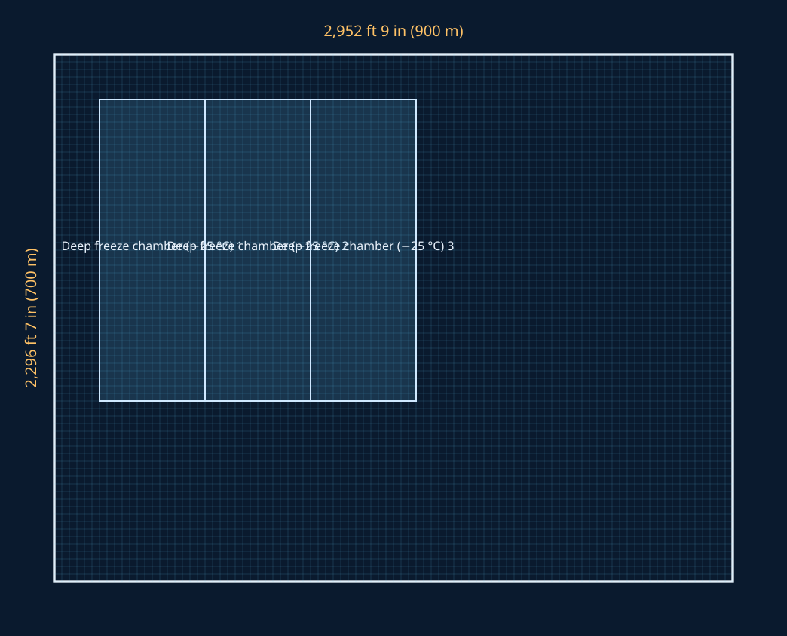

# P4-07 Cold Store: plan

Footprint 2,952 ft 9 in (900 m) × 2,296 ft 7 in (700 m) · structural grid 32 ft 10 in (10 m)

## Levels

| Level | Floor above deck | Height | Floor area |
|---|---|---|---|
| Level 1 · Ground floor | 0 ft (0 mm) | 19 ft 8 in (6,000 mm) | 4,190,821 sq ft (389,340 m²) |
| Level 2 · Upper | 19 ft 8 in (6,000 mm) | 19 ft 8 in (6,000 mm) | 3,653,487 sq ft (339,420 m²) |
| Level 3 · Chamber top | 39 ft 4 in (12 m) | 19 ft 8 in (6,000 mm) | 1,808,337 sq ft (168,000 m²) |

## Elements

| ID | Designation | Type | Name | Level(s) | Size / length | Area | Status |
|---|---|---|---|---|---|---|---|
| E001 | D5F3P4B6A3L1R1, D5F3P4B6A3L2R1, D5F3P4B6A3L3R1 | room | Deep freeze chamber (−25 °C) 1 | L1, L2, L3 | 459 ft 4 in (140 m) × 1,312 ft 4 in (400 m) | 602,779 sq ft (56,000 m²) | proposed |
| E002 | D5F3P4B6A3L1R2, D5F3P4B6A3L2R2, D5F3P4B6A3L3R2 | room | Deep freeze chamber (−25 °C) 2 | L1, L2, L3 | 459 ft 4 in (140 m) × 1,312 ft 4 in (400 m) | 602,779 sq ft (56,000 m²) | proposed |
| E003 | D5F3P4B6A3L1R3, D5F3P4B6A3L2R3, D5F3P4B6A3L3R3 | room | Deep freeze chamber (−25 °C) 3 | L1, L2, L3 | 459 ft 4 in (140 m) × 1,312 ft 4 in (400 m) | 602,779 sq ft (56,000 m²) | proposed |
| E004 | D5F3P4B6A3L1R4, D5F3P4B6A3L2R4 | room | Chill room (+2 °C) | L1, L2 | 1,115 ft 6 in (340 m) × 328 ft 1 in (100 m) | 365,973 sq ft (34,000 m²) | proposed |
| E005 | D5F3P4B6A3L1R5, D5F3P4B6A3L2R5 | room | Fresh produce room | L1, L2 | 1,115 ft 6 in (340 m) × 328 ft 1 in (100 m) | 365,973 sq ft (34,000 m²) | proposed |
| E006 | D5F3P4B6A3L1R6, D5F3P4B6A3L2R6 | room | Medical cold vault | L1, L2 | 1,115 ft 6 in (340 m) × 328 ft 1 in (100 m) | 365,973 sq ft (34,000 m²) | proposed |
| E007 | D5F3P4B6A3L1R7, D5F3P4B6A3L2R7 | room | Ripening rooms | L1, L2 | 1,115 ft 6 in (340 m) × 328 ft 1 in (100 m) | 365,973 sq ft (34,000 m²) | proposed |
| E008 | D5F3P4B6A3L1R8 | zone | Chilled dock aisle | L1 | 2,559 ft 1 in (780 m) × 19 ft 8 in (6,000 mm) | 50,375 sq ft (4,680 m²) | proposed |
| E009 | D5F3P4B6A3L1R9 | room | Chilled dock | L1 | 639 ft 9 in (195 m) × 105 ft (32 m) | 67,167 sq ft (6,240 m²) | proposed |
| E010 | D5F3P4B6A3L1R10 | room | Chilled dock | L1 | 639 ft 9 in (195 m) × 105 ft (32 m) | 67,167 sq ft (6,240 m²) | proposed |
| E011 | D5F3P4B6A3L1R11 | room | Chilled dock | L1 | 639 ft 9 in (195 m) × 105 ft (32 m) | 67,167 sq ft (6,240 m²) | proposed |
| E012 | D5F3P4B6A3L1R12 | room | Chilled dock | L1 | 639 ft 9 in (195 m) × 105 ft (32 m) | 67,167 sq ft (6,240 m²) | proposed |
| E013 | D5F3P4B6A3L1R13 | room | Chilled dock | L1 | 307 ft 9 in (94 m) × 105 ft (32 m) | 32,309 sq ft (3,002 m²) | proposed |
| E014 | D5F3P4B6A3L1R14 | room | Chilled dock | L1 | 307 ft 5 in (94 m) × 105 ft (32 m) | 32,275 sq ft (2,998 m²) | proposed |
| E015 | D5F3P4B6A3L1R15 | room | Chilled dock | L1 | 307 ft 5 in (94 m) × 105 ft (32 m) | 32,275 sq ft (2,998 m²) | proposed |
| E016 | D5F3P4B6A3L1R16 | room | Chilled dock | L1 | 307 ft 9 in (94 m) × 105 ft (32 m) | 32,309 sq ft (3,002 m²) | proposed |
| E017 | D5F3P4B6A3L1R17 | room | Quality inspection | L1 | 153 ft 10 in (47 m) × 105 ft (32 m) | 16,154 sq ft (1,501 m²) | proposed |
| E018 | D5F3P4B6A3L1R18 | room | Staff room | L1 | 1,174 ft 10 in (358 m) × 105 ft (32 m) | 123,346 sq ft (11,459 m²) | proposed |
| E019 | D5F3P4B6A3L1R19, D5F3P4B6A3L2R8 | core | Stairs and lifts | L1, L2 | 32 ft 10 in (10 m) × 75 ft 6 in (23 m) | 2,476 sq ft (230 m²) | proposed |
| E020 | D5F3P4B6A3L1R20, D5F3P4B6A3L2R9 | core | Stairs and lifts | L1, L2 | 32 ft 10 in (10 m) × 75 ft 6 in (23 m) | 2,476 sq ft (230 m²) | proposed |
| E021 | D5F3P4B6A3L1R21 | zone | Corridor | L1 | 2,559 ft 1 in (780 m) × 13 ft 1 in (4,000 mm) | 33,583 sq ft (3,120 m²) | proposed |
| E022 | D5F3P4B6A3L1R22 | room | Compressor hall | L1 | 2,493 ft 5 in (760 m) × 75 ft 6 in (23 m) | 188,153 sq ft (17,480 m²) | proposed |
| E023 | D5F3P4B6A3L1R23 | room | Switch room | L1 | 285 ft 5 in (87 m) × 75 ft 6 in (23 m) | 21,539 sq ft (2,001 m²) | proposed |
| E024 | D5F3P4B6A3L1R24 | room | Plant control | L1 | 2,273 ft 7 in (693 m) × 75 ft 6 in (23 m) | 171,566 sq ft (15,939 m²) | proposed |
| E025 | D5F3P4B6A3L2R10 | zone | Corridor | L2 | 2,559 ft 1 in (780 m) × 13 ft 1 in (4,000 mm) | 33,583 sq ft (3,120 m²) | proposed |
| E026 | D5F3P4B6A3L2R11 | room | Offices | L2 | 2,493 ft 5 in (760 m) × 75 ft 6 in (23 m) | 188,153 sq ft (17,480 m²) | proposed |
| E027 | D5F3P4B6A3L2R12 | room | Stores | L2 | 2,559 ft 1 in (780 m) × 75 ft 6 in (23 m) | 193,105 sq ft (17,940 m²) | proposed |
| E028 | D5F3P4B6A3L1R25 | zone | Truck yard | L1 | 2,559 ft 1 in (780 m) × 213 ft 3 in (65 m) | 545,730 sq ft (50,700 m²) | proposed |

## Drawings

### Level 1 · Ground floor

### Level 2 · Upper

### Level 3 · Chamber top

