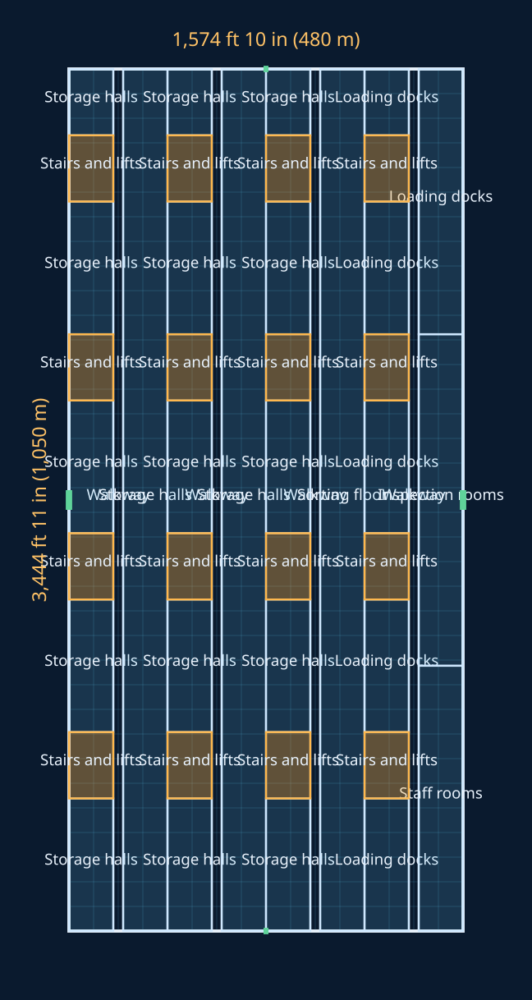
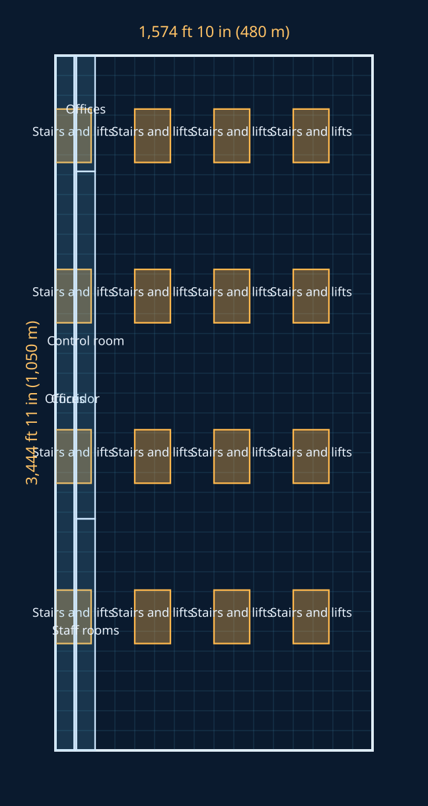

# P4-09 Waste Transfer & Recycling: plan

Footprint 1,574 ft 10 in (480 m) × 3,444 ft 11 in (1,050 m) · structural grid 32 ft 10 in (10 m)

## Levels

| Level | Floor above deck | Height | Floor area |
|---|---|---|---|
| Level 1 · Ground floor | 0 ft (0 mm) | 23 ft (7,000 mm) | 2,922,617 sq ft (271,520 m²) |
| Level 2 · Upper | 23 ft (7,000 mm) | 23 ft (7,000 mm) | 2,352,991 sq ft (218,600 m²) |

## Elements

| ID | Designation | Type | Name | Level(s) | Size / length | Area | Status |
|---|---|---|---|---|---|---|---|
| E001 | D5F3P4B2A1L1R1, D5F3P4B2A1L2R1 | room | Tipping hall | L1, L2 | 1,181 ft 1 in (360 m) × 656 ft 2 in (200 m) | 775,002 sq ft (72,000 m²) | proposed |
| E002 | D5F3P4B2A1L1R2, D5F3P4B2A1L2R2 | room | Sorting line | L1, L2 | 295 ft 3 in (90 m) × 1,115 ft 6 in (340 m) | 329,376 sq ft (30,600 m²) | proposed |
| E003 | D5F3P4B2A1L1R3, D5F3P4B2A1L2R3 | room | Metals and glass | L1, L2 | 295 ft 3 in (90 m) × 1,115 ft 6 in (340 m) | 329,376 sq ft (30,600 m²) | proposed |
| E004 | D5F3P4B2A1L1R4, D5F3P4B2A1L2R4 | room | Plastics | L1, L2 | 295 ft 3 in (90 m) × 1,115 ft 6 in (340 m) | 329,376 sq ft (30,600 m²) | proposed |
| E005 | D5F3P4B2A1L1R5, D5F3P4B2A1L2R5 | room | Paper and card | L1, L2 | 295 ft 3 in (90 m) × 1,115 ft 6 in (340 m) | 329,376 sq ft (30,600 m²) | proposed |
| E006 | D5F3P4B2A1L1R6, D5F3P4B2A1L2R6 | room | Organics digester 1 | L1, L2 | 360 ft 11 in (110 m) × 360 ft 11 in (110 m) | 130,243 sq ft (12,100 m²) | proposed |
| E007 | D5F3P4B2A1L1R7, D5F3P4B2A1L2R7 | room | Organics digester 2 | L1, L2 | 360 ft 11 in (110 m) × 360 ft 11 in (110 m) | 130,243 sq ft (12,100 m²) | proposed |
| E008 | D5F3P4B2A1L1R8 | room | Bale store | L1 | 1,181 ft 1 in (360 m) × 360 ft 11 in (110 m) | 426,251 sq ft (39,600 m²) | proposed |
| E009 | D5F3P4B2A1L1R9 | zone | Corridor | L1 | 1,181 ft 1 in (360 m) × 9 ft 10 in (3,000 mm) | 11,625 sq ft (1,080 m²) | proposed |
| E010 | D5F3P4B2A1L1R10 | room | Weighbridge office | L1 | 506 ft 3 in (154 m) × 60 ft 8 in (18 m) | 30,726 sq ft (2,855 m²) | proposed |
| E011 | D5F3P4B2A1L1R11 | room | Control room | L1 | 674 ft 10 in (206 m) × 60 ft 8 in (18 m) | 40,962 sq ft (3,805 m²) | proposed |
| E012 | D5F3P4B2A1L1R12 | room | Lab | L1 | 106 ft 4 in (32 m) × 60 ft 8 in (18 m) | 6,452 sq ft (599 m²) | proposed |
| E013 | D5F3P4B2A1L1R13 | room | Staff room | L1 | 1,074 ft 10 in (328 m) × 60 ft 8 in (18 m) | 65,236 sq ft (6,061 m²) | proposed |
| E014 | D5F3P4B2A1L1R14 | zone | Truck lanes | L1 | 196 ft 10 in (60 m) × 3,149 ft 7 in (960 m) | 620,001 sq ft (57,600 m²) | proposed |

## Drawings

### Level 1 · Ground floor

### Level 2 · Upper

