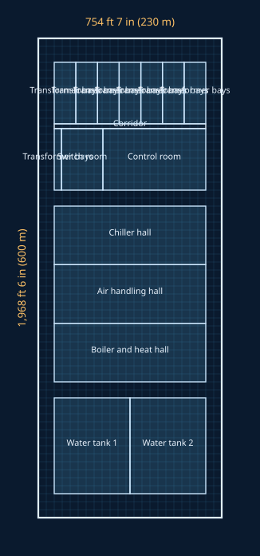
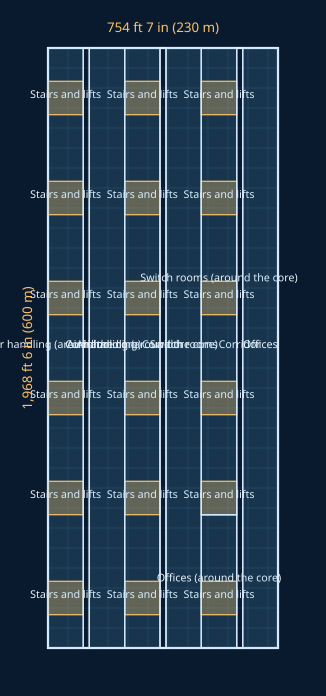

# P4-10 Freight Utility Plant: plan

Footprint 754 ft 7 in (230 m) × 1,968 ft 6 in (600 m) · structural grid 32 ft 10 in (10 m)

## Levels

| Level | Floor above deck | Height | Floor area |
|---|---|---|---|
| Level 1 · Ground floor | 0 ft (0 mm) | 26 ft 3 in (8,000 mm) | 1,010,301 sq ft (93,860 m²) |
| Level 2 · Upper plant | 26 ft 3 in (8,000 mm) | 19 ft 8 in (6,000 mm) | 695,349 sq ft (64,600 m²) |

## Elements

| ID | Designation | Type | Name | Level(s) | Size / length | Area | Status |
|---|---|---|---|---|---|---|---|
| E001 | D5F3P4B3A1L1R1 | zone | Corridor | L1 | 623 ft 4 in (190 m) × 19 ft 8 in (6,000 mm) | 12,271 sq ft (1,140 m²) | proposed |
| E002 | D5F3P4B3A1L1R2 | room | Transformer bays | L1 | 88 ft 11 in (27 m) × 252 ft 7 in (77 m) | 22,461 sq ft (2,087 m²) | proposed |
| E003 | D5F3P4B3A1L1R3 | room | Transformer bays | L1 | 89 ft 3 in (27 m) × 252 ft 7 in (77 m) | 22,544 sq ft (2,094 m²) | proposed |
| E004 | D5F3P4B3A1L1R4 | room | Transformer bays | L1 | 88 ft 11 in (27 m) × 252 ft 7 in (77 m) | 22,461 sq ft (2,087 m²) | proposed |
| E005 | D5F3P4B3A1L1R5 | room | Transformer bays | L1 | 89 ft 3 in (27 m) × 252 ft 7 in (77 m) | 22,544 sq ft (2,094 m²) | proposed |
| E006 | D5F3P4B3A1L1R6 | room | Transformer bays | L1 | 88 ft 11 in (27 m) × 252 ft 7 in (77 m) | 22,461 sq ft (2,087 m²) | proposed |
| E007 | D5F3P4B3A1L1R7 | room | Transformer bays | L1 | 89 ft 3 in (27 m) × 252 ft 7 in (77 m) | 22,544 sq ft (2,094 m²) | proposed |
| E008 | D5F3P4B3A1L1R8 | room | Transformer bays | L1 | 88 ft 11 in (27 m) × 252 ft 7 in (77 m) | 22,461 sq ft (2,087 m²) | proposed |
| E009 | D5F3P4B3A1L1R9 | room | Transformer bays | L1 | 29 ft 10 in (9,100 mm) × 252 ft 7 in (77 m) | 7,542 sq ft (701 m²) | proposed |
| E010 | D5F3P4B3A1L1R10 | room | Switch room | L1 | 170 ft 3 in (52 m) × 252 ft 7 in (77 m) | 43,016 sq ft (3,996 m²) | proposed |
| E011 | D5F3P4B3A1L1R11 | room | Control room | L1 | 423 ft 3 in (129 m) × 252 ft 7 in (77 m) | 106,918 sq ft (9,933 m²) | proposed |
| E012 | D5F3P4B3A1L1R12, D5F3P4B3A1L2R1 | room | Chiller hall | L1, L2 | 623 ft 4 in (190 m) × 240 ft 6 in (73 m) | 149,909 sq ft (13,927 m²) | proposed |
| E013 | D5F3P4B3A1L1R13, D5F3P4B3A1L2R2 | room | Air handling hall | L1, L2 | 623 ft 4 in (190 m) × 240 ft 10 in (73 m) | 150,114 sq ft (13,946 m²) | proposed |
| E014 | D5F3P4B3A1L1R14, D5F3P4B3A1L2R3 | room | Boiler and heat hall | L1, L2 | 623 ft 4 in (190 m) × 240 ft 6 in (73 m) | 149,909 sq ft (13,927 m²) | proposed |
| E015 | D5F3P4B3A1L1R15, D5F3P4B3A1L2R4 | room | Water tank 1 | L1, L2 | 311 ft 8 in (95 m) × 393 ft 8 in (120 m) | 122,709 sq ft (11,400 m²) | proposed |
| E016 | D5F3P4B3A1L1R16, D5F3P4B3A1L2R5 | room | Water tank 2 | L1, L2 | 311 ft 8 in (95 m) × 393 ft 8 in (120 m) | 122,709 sq ft (11,400 m²) | proposed |

## Drawings

### Level 1 · Ground floor

### Level 2 · Upper plant

